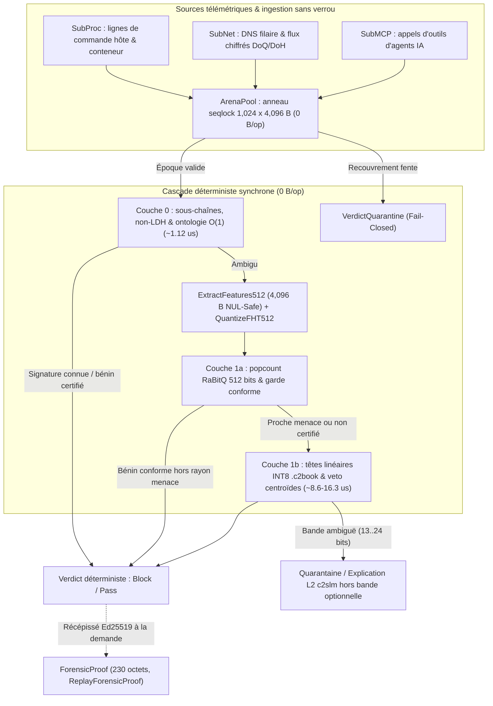
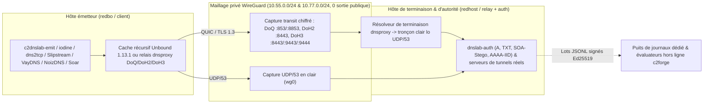

# c2blue55 : moteur de détection de menaces à double couche natif sur CPU pour le tournoi d'IA Wittgenstein

*Architecture autonome à sobriété de ressources pour la cyberdéfense locale et la supervision d'agents IA*

     

**Navigation :** [English Edition](c2blue55_wittgenstein_article.md) · [Édition Word (.docx)](c2blue55_wittgenstein_article.fr.docx) · [Présentation du dépôt](../README.fr.md) · [Géométrie & formules des centroïdes](centroid_geometry_and_formulas.fr.md) · [Micro-optimisation & sécurité](why_micro_optimization_is_a_security_choice.fr.md) · [Banc comparatif 7 piles DNS](dns_detection_solutions_benchmark.fr.md)

| Paramètre d'ingénierie | Spécification vérifiée |
| :--- | :--- |
| **Candidature & Licence** | Wittgenstein AI Tournament (Hackers-Arise / Master OTW) · Licence MIT · [github.com/hazyhaar/c2blue55](https://github.com/hazyhaar/c2blue55) |
| **Version & Date** | `v8.2` — `2026-11-01` (Fenêtre intégrale de 4,096 B, banc de parité à 7 détecteurs, campagne exotique QUIC/DNS & durcissement filaire/hôte `RAT-01..04`) |
| **Implémentation** | Go 1.27 pur (`GOAMD64=v3` / `GOEXPERIMENT=simd`, noyaux AVX2 transpilés mécaniquement depuis le C99 via `sgoiter`, Go scalaire portable pour ARM64/x86_64, `0 % CGo`, `0 % GPU`) |
| **Architecture de décision** | Cascade déterministe souveraine `L0 -> L1a -> L1b` en `0 B/op` sur disquettes `.c2book` (`C2FLOP1`) scellées HMAC-SHA256 + `PureGoEncoderArbitrator` (`0 B/op`) ; explication d'incident SOC hors bande optionnelle par `c2slm` (`Qwen2.5-0.5B-Instruct` GGUF) en couche 2 |
| **Périmètre empirique** | Corpus du tournoi (`5,236` échantillons hôte/DNS) + campagnes de laboratoire fermé WireGuard (cache négatif `SOA`, `ICMP Echo` / `ptunnel-ng`, `AAAA` IID, tunnels réels `iodine` & `dns2tcp` sur `Unbound`/`DoQ`/`DoH3`, `25` PCAP `L1` + `61` PCAP `L1-bis` sur `Slipstream`, `NoizDNS`, `VayDNS`, `Soar`) |

<strong>Historique complet des révisions (v1 à v8.2)</strong>

- **v8.2 (2026-11-01, §15.6) :** Strates scellées `RAT-01..04` — grammaire de charge `Answer` sur `NXDOMAIN` signé (`P14`), détection `EDNS0` privée côté requête (`P9`), renouvellement `RDATA` inter-réponses (`P15`), élagage des étiquettes de service RFC 2782/8552 à tiret bas (`0/50` FP sur `SRV`), escalade *fail-closed* des trames DNS malformées, agrégation d'hôte multi-résolveurs (`AgregateurHoteChiffre`, `Slipstream` `TP = 3/3`) et cinétique d'hôte Linux à 12 quotients (`part_resolveur_permille`).
- **v8.1 (2026-11-01, §6.2 & §15.5) :** Audit adversarial intégral des 21 paquets Go ; fenêtre `ExtractFeatures512` de `4,096` octets sûre aux octets NUL et refonte des disquettes `.c2book` ; élimination des preuves synthétiques circulaires ; gardes *fail-closed* de supervision et de décodage.
- **v8.0 (2026-10-31, §§13–15) :** Tunnels réels `iodine` Base128 et `dns2tcp` à travers `Unbound`, `DoQ` et `DoH3` ; corpus externe `netrack/learn` ; banc de parité à sept détecteurs (`L1`, 25 PCAP) ; fermeture filaire non-LDH (`-tolerant`) ; cinétique de transit chiffré sans clé (`V2.1`) ; campagne exotique hors-échantillon (`L1-bis`, 61 PCAP : `Slipstream`, `NoizDNS`, `VayDNS`, `Soar`).
- **v2–v5 (2026-10-27 au 2026-10-29, §§9–12) :** Banc de laboratoire fermé WireGuard sur OVHcloud (`dnslab-auth`, `c2dnslab-emit`), ablation négative du projecteur appris 512 bits (`K-0..K-2`), modulation `SOA` en réponse négative récursive (`N-01..N-05`), asymétrie `ICMP Echo` & `ptunnel-ng` (`I-01..I-04`), et modulation d'identifiant d'interface `AAAA` (`A-01..A-04`).

---

## Sommaire

- [1. Contexte et objectifs architecturaux](#1-contexte-et-objectifs-architecturaux)
- [2. Chemin critique sans allocation et architecture en mémoire](#2-chemin-critique-sans-allocation-et-architecture-en-mémoire)
  - [2.1 Zéro allocation sur le tas (`0 B/op`)](#21-zéro-allocation-sur-le-tas-0-bop)
  - [2.2 Arène annulaire atomique Seqlock de 4 Mo](#22-arène-annulaire-atomique-seqlock-de-4-mo)
  - [2.3 Décision de quarantaine par repli sûr (*fail-closed*)](#23-décision-de-quarantaine-par-repli-sûr-fail-closed)
  - [2.4 Bases de connaissances projetées en mémoire et scellement cryptographique](#24-bases-de-connaissances-projetées-en-mémoire-et-scellement-cryptographique)
- [3. La cascade de détection de menaces à double couche](#3-la-cascade-de-détection-de-menaces-à-double-couche)
  - [3.1 Couche 0 : sous-chaînes déterministes et réflexe ontologique](#31-couche-0--sous-chaînes-déterministes-et-réflexe-ontologique)
  - [3.2 Couche 1a : projection vectorielle conforme RaBitQ 512D](#32-couche-1a--projection-vectorielle-conforme-rabitq-512d)
  - [3.3 Couche 1b : têtes linéaires quantifiées INT8 et droit de veto des centroïdes](#33-couche-1b--têtes-linéaires-quantifiées-int8-et-droit-de-veto-des-centroïdes)
- [4. Contrôle de dérive de la référence : garde modulaire pour la recertification des centroïdes](#4-contrôle-de-dérive-de-la-référence--garde-modulaire-pour-la-recertification-des-centroïdes)
- [5. Causalité vérifiable : attestation forensique autonome et rejeu déterministe](#5-causalité-vérifiable--attestation-forensique-autonome-et-rejeu-déterministe)
  - [5.1 Attestation forensique autonome (`ForensicProof`)](#51-attestation-forensique-autonome-forensicproof)
  - [5.2 Attestation par clé racine Ed25519](#52-attestation-par-clé-racine-ed25519)
  - [5.3 Vérification déterministe du verdict (`ReplayForensicProof`)](#53-vérification-déterministe-du-verdict-replayforensicproof)
- [6. Évaluation empirique, réserves statistiques et compromis opérationnels](#6-évaluation-empirique-réserves-statistiques-et-compromis-opérationnels)
  - [6.1 Réserve statistique sur les tailles d'échantillons et l'étalonnage *a posteriori*](#61-réserve-statistique-sur-les-tailles-déchantillons-et-létalonnage-a-posteriori)
  - [6.2 Synthèse de l'évaluation empirique (fenêtre complète de charge utile de 4,096 octets sûre aux octets NUL)](#62-synthèse-de-lévaluation-empirique-fenêtre-complète-de-charge-utile-de-4096-octets-sûre-aux-octets-nul)
  - [6.3 Résultats détaillés par vecteur de menace](#63-résultats-détaillés-par-vecteur-de-menace)
- [7. Périmètre de protection et frontières des sous-systèmes](#7-périmètre-de-protection-et-frontières-des-sous-systèmes)
  - [7.1 SubProc (exécution sur l'hôte et en conteneur)](#71-subproc-exécution-sur-lhôte-et-en-conteneur)
  - [7.2 SubNet (frontière réseau et tunnels DNS)](#72-subnet-frontière-réseau-et-tunnels-dns)
  - [7.3 SubMCP (supervision d'agents IA et garde d'outils)](#73-submcp-supervision-dagents-ia-et-garde-doutils)
- [8. Conclusion et distribution open-source](#8-conclusion-et-distribution-open-source)
- [9. Addendum v2 (2026-10-27) : banc de laboratoire fermé sur l'infrastructure propre du projet](#9-addendum-v2-2026-10-27--banc-de-laboratoire-fermé-sur-linfrastructure-propre-du-projet)
  - [9.1 Composants (intégralement en Go pur, zéro CGo)](#91-composants-intégralement-en-go-pur-zéro-cgo)
  - [9.2 Campagnes capturées](#92-campagnes-capturées)
  - [9.3 Mesures sur le trafic propre du laboratoire](#93-mesures-sur-le-trafic-propre-du-laboratoire)
  - [9.4 Deux évasions refermées en échantillon sur les captures du laboratoire](#94-deux-évasions-refermées-en-échantillon-sur-les-captures-du-laboratoire)
  - [9.5 Modèle de base open-source (règle du tournoi ; déclaration et non mesure de banc)](#95-modèle-de-base-open-source-règle-du-tournoi--déclaration-et-non-mesure-de-banc)
  - [9.6 Projecteur appris sur 512 bits (strates K-0 à K-2) : construit, mesuré, non câblé (registres du harnais)](#96-projecteur-appris-sur-512-bits-strates-k-0-à-k-2--construit-mesuré-non-câblé-registres-du-harnais)
  - [9.7 Incidents et limites consignés](#97-incidents-et-limites-consignés)
- [10. Addendum v3 (2026-10-29) : modulation SOA dans les réponses négatives, mesurée à travers un résolveur récursif](#10-addendum-v3-2026-10-29--modulation-soa-dans-les-réponses-négatives-mesurée-à-travers-un-résolveur-récursif)
  - [10.1 Banc d'essai](#101-banc-dessai)
  - [10.2 Exécutions capturées](#102-exécutions-capturées)
  - [10.3 Évaluation du détecteur](#103-évaluation-du-détecteur)
  - [10.4 Ce que cette campagne établit et ce qu'elle n'établit pas](#104-ce-que-cette-campagne-établit-et-ce-quelle-nétablit-pas)
- [11. Addendum v5 (2026-10-29) : asymétrie de charge utile ICMP Echo, première mesure réseau hors DNS](#11-addendum-v5-2026-10-29--asymétrie-de-charge-utile-icmp-echo-première-mesure-réseau-hors-dns)
- [12. Addendum v2 (2026-10-29) : modulation de l'identifiant d'interface dans les réponses AAAA, mesurée à travers un résolveur récursif](#12-addendum-v2-2026-10-29--modulation-de-lidentifiant-dinterface-dans-les-réponses-aaaa-mesurée-à-travers-un-résolveur-récursif)
- [13. Addendum v1 (2026-10-31) : vrais tunnels DNS à travers un résolveur récursif et corpus externe de tunnels réels](#13-addendum-v1-2026-10-31--vrais-tunnels-dns-à-travers-un-résolveur-récursif-et-corpus-externe-de-tunnels-réels)
  - [13.1 Infrastructure propre du laboratoire : iodine et dns2tcp à travers Unbound](#131-infrastructure-propre-du-laboratoire--iodine-et-dns2tcp-à-travers-unbound)
  - [13.2 Corpus externe : netrack/learn (Apache-2.0)](#132-corpus-externe--netracklearn-apache-20)
- [14. Addendum v1 (2026-10-31) : les mêmes tunnels sur DNS-over-QUIC et DNS-over-HTTPS/3](#14-addendum-v1-2026-10-31--les-mêmes-tunnels-sur-dns-over-quic-et-dns-over-https3)
  - [14.1 Question posée](#141-question-posée)
  - [14.2 Dispositif expérimental](#142-dispositif-expérimental)
  - [14.3 H1 : traversée](#143-h1--traversée)
  - [14.4 H2 et H3 : trois points d'observation sur les mêmes sessions](#144-h2-et-h3--trois-points-dobservation-sur-les-mêmes-sessions)
  - [14.5 Ce que cette expérience établit](#145-ce-que-cette-expérience-établit)
  - [14.6 Sources consultées](#146-sources-consultées)
- [15. Addendum v1 (2026-10-31) : banc de parité à sept détecteurs, fermeture filaire non-LDH, cinétique de transit chiffré sans clé et expériences exotiques QUIC/DNS hors-échantillon](#15-addendum-v1-2026-10-31--banc-de-parité-à-sept-détecteurs-fermeture-filaire-non-ldh-cinétique-de-transit-chiffré-sans-clé-et-expériences-exotiques-quicdns-hors-échantillon)
  - [15.1 Fermeture de l'angle mort non-LDH du §13 (`lab-eval -tolerant` et `NonLDHBurstGuard`)](#151-fermeture-de-langle-mort-non-ldh-du-13-lab-eval--tolerant-et-nonldhburstguard)
  - [15.2 Banc de parité à sept détecteurs (`L1`, 25 captures) et défauts amont des piles tierces](#152-banc-de-parité-à-sept-détecteurs-l1-25-captures-et-défauts-amont-des-piles-tierces)
  - [15.3 Cinétique de transit chiffré sans clé (`V2` vers `V2.1`) et campagne exotique hors-échantillon (`L1-bis`)](#153-cinétique-de-transit-chiffré-sans-clé-v2-vers-v21-et-campagne-exotique-hors-échantillon-l1-bis)
  - [15.4 Ce que cette campagne n'établit pas (limites architecturales mesurées)](#154-ce-que-cette-campagne-nétablit-pas-limites-architecturales-mesurées)
  - [15.5 Remédiation d'intégrité et de sécurité post-audit (v8.1, 2026-11-01)](#155-remédiation-dintégrité-et-de-sécurité-post-audit-v81-2026-11-01)
  - [15.6 Durcissement des quotients cinétiques et de la grammaire filaire (v8.2, 2026-11-01)](#156-durcissement-des-quotients-cinétiques-et-de-la-grammaire-filaire-v82-2026-11-01)

---

## 1. Contexte et objectifs architecturaux

En cybersécurité défensive, confier l'inspection en ligne de la télémétrie à des modèles de langage hébergés dans le nuage introduit de lourdes contraintes opérationnelles. Les appels d'inférence externes imposent des latences réseau aller-retour de l'ordre de plusieurs centaines de millisecondes par requête, exigent la transmission de la télémétrie interne des systèmes vers une infrastructure tierce et introduisent une variabilité probabiliste sur des tâches d'analyse syntaxique répétitives.

Le **Wittgenstein AI Tournament**, organisé par Hackers-Arise et Master OTW, met l'accent sur une démarche d'ingénierie différente :
- Les mécanismes d'inspection défensive doivent s'exécuter **localement** ;
- Ils doivent fonctionner de manière **déterministe** avec une consommation de ressources strictement bornée ;
- Les décisions doivent demeurer **vérifiables** et reproductibles au bit près.

Les moteurs d'inspection doivent opérer directement sur le matériel de l'hôte sous le contrôle administratif du défenseur, en traitant les événements de sécurité sans exfiltrer la télémétrie. `c2blue55` a été conçu pour explorer ces contraintes de basse latence et de déterminisme sur des architectures purement CPU.

---

## 2. Chemin critique sans allocation et architecture en mémoire

Pour défendre des frontières réseau à haut débit, des chaînes d'exécution d'hôtes et des interfaces d'outils au protocole Model Context Protocol (`MCP`), un moteur de détection ne peut tolérer ni pauses du ramasse-miettes (*garbage collector*, `GC`) à l'exécution ni expansion non bornée de son empreinte mémoire. `c2blue55` applique une discipline stricte d'allocation à l'initialisation (`ARCHTIME`, préallocation intégrale des structures de données au démarrage avant tout traitement d'événements), éliminant toute allocation sur le tas (*heap*) sur l'ensemble de son chemin critique.

### 2.1 Zéro allocation sur le tas (`0 B/op`)

Le décodage des événements, l'extraction des jetons lexicaux, le routage ontologique et la projection vectorielle s'exécutent intégralement dans des piles et des structures en anneau préallouées, garantissant des latences déterministes à l'échelle de la microseconde sans gigue induite par le ramasse-miettes.

### 2.2 Arène annulaire atomique Seqlock de 4 Mo

L'arène ingère des charges utiles de longueur variable dans un espace mémoire contigu composé de 1,024 fentes dédiées de 4 Ko (`ArenaPool`). La coordination entre fils d'exécution repose sur des verrous séquentiels atomiques à double époque (`seqlock` — compteurs de séquence pairs au repos et impairs durant une écriture) munis de barrières mémoire `uint32`/`uint64` :
1. **Les lecteurs** inspectent concurremment les charges utiles sans verrou mutex grâce à une vérification d'époque avant et après lecture.
2. **Les écrivains** acquièrent la propriété d'une fente par comparaison et échange atomique (`CAS`, *Compare-And-Swap*) sur le compteur de séquence, écrivent les mots de charge utile sur 64 bits, calculent les sommes de contrôle matérielles CRC32-C de Castagnoli, puis publient la charge avec une barrière de séquence incrémentée (`StorePayload`).

### 2.3 Décision de quarantaine par repli sûr (*fail-closed*)

Si un flux d'événements à très haute vélocité provoque le recouvrement circulaire d'une fente de l'arène avant l'achèvement d'une évaluation en cours, la discordance d'époque est détectée immédiatement. Le moteur refuse d'évaluer une mémoire potentiellement altérée et bascule en repli sûr (*fail-closed*) en attribuant une décision de mise en quarantaine (`VerdictQuarantine`).

> [!NOTE]
> **Frontière opérationnelle :** L'application effective de la mesure d'atténuation elle-même (telle que la terminaison d'un processus, le refus d'exécution `fanotify` ou le rejet / trou noir d'un paquet réseau) relève de l'orchestration de l'hôte ou de l'intégration au démon système hors de la bibliothèque d'évaluation.

### 2.4 Bases de connaissances projetées en mémoire et scellement cryptographique

Les modèles de menaces précompilés et les plongements (*embeddings*) des centroïdes de référence sont assemblés sous forme de disquettes vectorielles portables (`.c2book` / format binaire `C2FLOP1`). Ces disquettes sont projetées directement dans la mémoire virtuelle du processus (`mmap`) :
- **Bases de connaissances scellées :** Lorsqu'une base de connaissances porte le drapeau de scellement (`FloppyFlagSealed`), le chargeur `LoadFloppyMmap` exige strictement une clé d'authentification HMAC-SHA256 couvrant l'en-tête de 32 octets et le corps binaire, renvoyant `ErrFloppyUnsealed` si la clé est absente ou `nil`, et `ErrFloppySeal` en cas de discordance de signature. Le chargement d'une disquette non scellée avec une clé HMAC est pareillement rejeté.
- **Disquettes non scellées en phase de test :** À l'inverse, le chargement d'une disquette non scellée sans clé est accepté avec la seule vérification d'intégrité CRC32C de Castagnoli, sans authentification cryptographique (dans l'état courant du dépôt, `LoadFloppyMmap` est invoqué par `c2forge lab-eval` / `dns-delta` et par les suites de tests, tandis que les démons autonomes `c2agent` et `c2blue-mcp-guard` s'appuient sur des livres de codes distincts et sur des oracles serveur).
- **Clés d'environnement et repli de démonstration :** Afin d'assurer la reproductibilité immédiate des suites d'évaluation du tournoi, la fonction `WittgensteinFloppyKey` journalise un avertissement de sécurité et se replie par défaut sur des clés publiques de démonstration lorsque les variables d'environnement (`C2BLUE_HMAC_KEY_*`) ne sont pas définies.
- **Mode production :** En déploiement de production, l'activation de `C2BLUE_REQUIRE_SECURE_KEYS=1` (ou `C2BLUE_PRODUCTION=1`) impose la fourniture stricte de clés secrètes à deux niveaux :
  1. `WittgensteinFloppyKey` refuse tout repli vers les clés publiques de démonstration (renvoyant `nil`) ;
  2. Le décodeur binaire (`decodeFloppy`) rejette catégoriquement toute disquette dépourvue de scellement (`FloppyFlagSealed` non positionné) avec l'erreur `ErrFloppyUnsealed`.

Ce double verrou referme la brèche par laquelle la simple remise à zéro du bit de scellement dans l'en-tête (lequel n'est pas couvert par la somme de contrôle CRC32C du corps) aurait permis de charger sans authentification une disquette altérée lorsqu'une clé `nil` est fournie.

---

## 3. La cascade de détection de menaces à double couche

Plutôt que de soumettre chaque événement système ordinaire à une inférence neuronale profonde, `c2blue55` organise l'analyse selon une cascade hiérarchique asymétrique. Les premiers étages résolvent les cas évidents en une microseconde environ (`0.97` à `1.12 µs` pour la couche 0), réservant la projection vectorielle et l'évaluation linéaire quantifiée aux cas limites ambigus.

> [!IMPORTANT]
> **Cascade bibliothèque contre démons autonomes :** La cascade synchrone `L0 -> L1a -> L1b` (`CascadeEngine`), le montage des disquettes `.c2book` projetées en mémoire et l'arbitrage de provenance constituent le noyau déterministe évalué par `wittgenstein_bench_test.go` et `c2forge`. Les démons autonomes (`cmd/c2agent`, `cmd/c2blue-mcp-guard`) associent des livres de codes fixes et un arbitrage de zone grise sans allocation (`PureGoEncoderArbitrator`, `0 B/op`) sur le chemin critique à une explication d'incident hors bande optionnelle par `c2slm` (`Qwen2.5-0.5B-Instruct` GGUF) en couche 2.

### 3.1 Couche 0 : sous-chaînes déterministes et réflexe ontologique

*Latence mesurée : 1.12 µs/op (~895,000 ops/s par cœur, 0 B/op)*

L'immense majorité du trafic d'événements est dépourvue d'ambiguïté. Plutôt que de parcourir des automates d'états complexes, la couche 0 exécute :
- Une recherche de sous-chaînes insensible à la casse (`containsSubsliceFold`) sur des tables fixes de mots-clés ;
- Des réflexes structurels sans allocation : `netcatWithExec` pour détecter la liaison d'arguments d'invocation d'un interpréteur de commandes à `netcat`, et `dnsHasEncodingChars` pour balayer les caractères d'encodage Base64 hors syntaxe standard de noms d'hôtes `LDH` (*Letter-Digit-Hyphen*, lettres ASCII, chiffres et tirets : détection de `+`, `/`, `=`) à n'importe quelle position des étiquettes brutes du nom DNS interrogé (`QNAME`) ;
- Des invariants d'état ontologiques en temps constant `O(1)` (`EvaluateOntology`).

Lors des mesures sur matériel physique réalisées sur processeur Intel Core i9-14900K (Linux 6.14, Go 1.27, `GOAMD64=v3`), la couche 0 s'exécute en **1.12 µs/op**. Les *reverse shells* connus et les primitives bénignes certifiées sont tranchés dès cet étage, interrompant le pipeline avant toute projection vectorielle.

### 3.2 Couche 1a : projection vectorielle conforme RaBitQ 512D

Les événements ambigus sont projetés dans un espace vectoriel de dimension 512 au moyen de transformations orthogonales aléatoires structurées (`RaBitQ 512D`), puis quantifiés en représentations binaires compactes de 512 bits.

Le calcul des distances de Hamming par instructions matérielles natives de comptage de bits (`popcount`) évalue la proximité géométrique vis-à-vis des distributions de prototypes. Point déterminant de sûreté : la couche 1a est subordonnée aux frontières de menaces et ne peut jamais confirmer le caractère bénin d'un événement si celui-ci se situe à l'intérieur du rayon de blocage d'un centroïde de menace établi.

### 3.3 Couche 1b : têtes linéaires quantifiées INT8 et droit de veto des centroïdes

*Latence mesurée : 8.63 µs – 16.32 µs pour la cascade complète (0 B/op)*

Les anomalies sémantiques subtiles qui franchissent la couche 1a sont évaluées par des têtes linéaires quantifiées en entiers signés de 8 bits (`INT8`), dotées d'une autorité complète de veto par centroïdes sur les disquettes `.c2book` projetées en mémoire. Tous les événements atteignant L1b sans avoir été bloqués par proximité directe d'un centroïde hostile sont tranchés par produit scalaire `INT8`.

Pour les domaines apex (domaines enregistrables de second niveau sans sous-domaine profond) spécifiquement, le calcul `INT8` précoce est évalué paresseusement uniquement lorsqu'un domaine apex tombe dans le rayon de blocage d'un centroïde, afin de vérifier si une exception de conformité bénigne s'applique avant d'exercer le veto.

**Profil de performance de la cascade complète :**
- **Commandes bénignes :** 8.63 µs/op (~115,800 ops/s par cœur)
- **Requêtes DNS :** 11.68 µs/op (~85,600 ops/s par cœur)
- **Charge utile étendue en arène (L1b) :** 16.32 µs/op (~61,300 ops/s par cœur)

Des vérifications indépendantes sur d'autres plateformes matérielles observent des latences environ 1.5x à 2x supérieures (~1.7 à 2.7 µs pour la couche 0, et 15 à 20 µs pour la cascade complète), demeurant pleinement à l'intérieur du budget opérationnel de 10 à 25 µs.

---

## 4. Contrôle de dérive de la référence : garde modulaire pour la recertification des centroïdes

Les systèmes défensifs autonomes qui s'adaptent en temps réel s'exposent à un risque sévère d'empoisonnement adversarial, par lequel un attaquant déplace graduellement la référence nominale des centroïdes du modèle jusqu'à faire classer des attaques graves comme du trafic normal. `c2blue55` intègre une garde statistique modulaire contre la dérive (`CusumDriftGuard` dans `internal/engine/drift_guard.go`) afin de préserver la stabilité des bases de référence.

> [!NOTE]
> **Frontière architecturale :** Conformément aux principes `ARCHTIME` et zéro allocation, la cascade d'inférence à l'exécution opère exclusivement sur des disquettes de centroïdes immuables projetées en mémoire et ne modifie jamais les centroïdes en ligne pendant l'inspection des paquets. `CusumDriftGuard` n'est pas câblé sur le chemin d'évaluation à débit filaire ; il constitue un composant de supervision autonome destiné aux chaînes d'apprentissage hors ligne et à la recertification périodique des références.

La garde assure deux niveaux de supervision :
1. **Porte de finitude vectorielle et surveillance de la distance de pas scalaire :** Avant tout calcul de distance, `EvaluateSample` rejette strictement tout vecteur contenant une valeur flottante invalide `NaN` ou infinie `±Inf` (`ErrDriftGuardNaN`), de sorte que les comparaisons non ordonnées IEEE-754 ne puissent jamais contourner les seuils ni écraser la référence installée. Lorsque les mises à jour candidates de centroïdes sont finies, la garde calcule la distance euclidienne de pas entre vecteurs candidats successifs : $d = ||\mu_t - \mu_{t-1}||_2$. Elle impose un seuil maximal par pas (`MaxRadius`) ainsi qu'un plafond de budget de déplacement cumulé (`MaxDriftBudget`).
2. **Accumulation scalaire CUSUM :** Un détecteur à somme cumulée (*Cumulative Sum*, `CUSUM`) suit les écarts de distance de pas : $S_t^+ = \max(0, S_{t-1}^+ + (d - \text{slack}))$. Toute poussée soutenue de déplacement excédant les limites de seuil déclenche une alerte. Les mises à jour candidates sont acceptées ou rejetées pas à pas plutôt que de provoquer un verrouillage permanent du moteur, offrant aux opérateurs un contrôle de supervision lors de la génération de nouvelles révisions de disquettes.

---

## 5. Causalité vérifiable : attestation forensique autonome et rejeu déterministe

Une vulnérabilité critique des systèmes d'IA opaques modernes réside dans l'incapacité d'expliquer ou de vérifier pourquoi une alerte s'est déclenchée. Les analystes de centre d'opérations de sécurité (`SOC`) et les équipes de réponse à incident ont besoin de faits forensiques reproductibles plutôt que de scores de confiance opaques.

### 5.1 Attestation forensique autonome (`ForensicProof`)

Pour l'investigation d'incidents et la conformité probatoire, `c2blue55` expose une interface d'attestation autonome (`SignForensicProof`). Lorsqu'elle est invoquée à la demande par un opérateur, une sonde ou un superviseur d'orchestration, elle produit un récépissé binaire canonique indépendant et auto-porteur de 230 octets.

Ce récépissé lie cryptographiquement :
- L'horodatage de l'événement à la nanoseconde ;
- L'identifiant du sous-système ;
- La structure brute d'événement de 128 octets ;
- L'empreinte SHA-256 de la charge utile ;
- La somme de contrôle CRC32 de la disquette active ;
- La justification détaillée de la décision en cascade.

Les récépissés forensiques sont générés à la demande et ne s'exécutent pas en ligne sur chaque événement inspecté, préservant le budget d'inférence à la microseconde (dans l'état courant du dépôt, cette interface est exposée au niveau de la bibliothèque mais n'est invoquée par aucune boucle active des démons autonomes).

### 5.2 Attestation par clé racine Ed25519

Chaque récépissé est signé numériquement au moyen d'une clé racine cryptographique Ed25519 non nulle, établissant une non-répudiation cryptographique individuelle pour la réponse à incident sans la latence ni la lourdeur d'état d'un registre distribué interdépendant de type chaîne de blocs.

### 5.3 Vérification déterministe du verdict (`ReplayForensicProof`)

Parce que l'agencement mémoire, le balayage de jetons sans allocation et les projections vectorielles sont strictement déterministes et indépendants de l'état dynamique du tas, le rejeu d'un incident scellé via `ReplayForensicProof` vérifie la reproductibilité bit à bit de la décision d'atténuation.

Le harnais de rejeu réévalue la charge utile scellée et son contexte contre la base de connaissances active et confirme la concordance exacte sur les quatre champs du verdict :
1. Action de remédiation ;
2. Étage de décision ;
3. Distance de Hamming ;
4. Score de confiance.

La vérification à long terme suppose la conservation de l'image exacte de la disquette `.c2book` (identifiée par le champ `FloppyCRC32` du récépissé) ainsi que de la version correspondante du binaire du moteur.

---

## 6. Évaluation empirique, réserves statistiques et compromis opérationnels

`c2blue55` a été évalué sur des corpus de bancs empiriques combinant des charges d'attaque de *reverse shells* dédupliquées, un jeu compilé de requêtes DNS de commande et contrôle (`C2`), des lignes de commande d'administration extraites de la documentation technique et des variantes mutées synthétiquement. Une évaluation d'ingénierie réaliste exige d'examiner non seulement les taux de détection maximaux, mais aussi la friction opérationnelle, l'impact des faux positifs et la charge de triage.

### 6.1 Réserve statistique sur les tailles d'échantillons et l'étalonnage *a posteriori*

Les jeux évalués de 41 et 42 échantillons représentent des effectifs restreints. Sur de petits échantillons, les intervalles de confiance sont larges : un taux de faux positifs observé de 0.00% sur 42 échantillons correspond à une borne supérieure de confiance de Wilson à 95 % égale à 8.38%. En outre, les journaux historiques bruts d'apprentissage n'étant pas distribués publiquement dans le dépôt open-source, un auditeur tiers ne peut pas vérifier indépendamment la disjonction absolue entre exemples d'apprentissage et jeux d'évaluation.

Point méthodologique essentiel : plusieurs raffinements structurels ciblés — précisément la règle de corroboration des domaines apex, la levée de quarantaine sous terminal interactif `TTY` et la segmentation des permutations d'options `netcat` en couche L0 — ont été implémentés après l'analyse d'échecs empiriques observés sur ces jeux d'évaluation mêmes (les 8 domaines constitués de mots du dictionnaire concaténés, les 9 mises en quarantaine initiales de commandes d'administration sans terminal observées sous l'ancien prototype tronqué à un préfixe de 96 octets, et les 6 variantes de drapeaux `netcat`).

Par conséquent, ces jeux d'évaluation ont fonctionné comme une **partition d'étalonnage et de développement**. Les métriques obtenues de 100.00% d'interception (blocage + quarantaine) et de 0.00% de faux positifs bloquants mesurent l'adéquation empirique sur ces cas limites connus plutôt qu'une généralisation hors-distribution prouvée. Une validation rigoureuse de la capacité réelle de généralisation requiert l'évaluation sur des corpus de production entièrement non vus.

### 6.2 Synthèse de l'évaluation empirique (fenêtre complète de charge utile de 4,096 octets sûre aux octets NUL)

Toutes les métriques ci-dessous sont mesurées avec l'extracteur post-remédiation `ExtractFeatures512` sur fenêtre intégrale de 4,096 octets insensible aux octets nuls (`NUL-safe`) et avec les disquettes `.c2book` reforgées, rapportées avec les comptages exacts d'échantillons et les intervalles de confiance de Wilson à 95 % :

| Partition d'évaluation | Taille d'échantillon (N) | Blocage franc [95% CI] | Quarantaine [95% CI] | Autorisé / Passé [95% CI] | Étage principal de résolution |
| :--- | :---: | :---: | :---: | :---: | :--- |
| **Charges de Reverse Shell** | 41 | **80.49%** (33/41) [65.99%, 89.77%] | **19.51%** (8/41) [10.23%, 34.01%] | **0.00%** (0/41) [0.00%, 8.57%] | L0 Reflex (20) / L1b Block (13) + Quarantine (8) |
| **Mutations paramétriques de Shell** | 111 | **80.18%** (89/111) [71.81%, 86.53%] | **19.82%** (22/111) [13.47%, 28.19%] | **0.00%** (0/111) [0.00%, 3.35%] | L0 Reflex (48) / L1b Block (41) + Quarantine (22) |
| **Requêtes de tunnel DNS C2** | 4,000 | **99.35%** (3,974/4,000) [99.05%, 99.56%] | **0.65%** (26/4,000) [0.44%, 0.95%] | **0.00%** (0/4,000) [0.00%, 0.10%] | L0 Reflex (2,957) / L1b Block (1,017) + Quarantine (26) |
| **Référence de domaines bénins** | 1,000 | **0.00%** (0/1,000) [0.00%, 0.38%] | **0.00%** (0/1,000) [0.00%, 0.38%] | **100.00%** (1,000/1,000) [99.62%, 100.00%] | L1a Conformal (856) / L1b Apex (144) |
| **Commandes d'admin (brutes sans TTY)** | 42 | **0.00%** (0/42) [0.00%, 8.38%] | **69.05%** (29/42) [53.97%, 80.93%] | **30.95%** (13/42) [19.07%, 46.03%] | Bande de quarantaine ambiguë (L1b) |
| **Commandes d'admin (TTY interactif)** | 42 | **0.00%** (0/42) [0.00%, 8.38%] | **0.00%** (0/42) [0.00%, 8.38%] | **100.00%** (42/42) [91.62%, 100.00%] | Provenance `OntoVerdictAllow` (15 L0 / 24 L1a / 3 L1b) |

---

### 6.3 Résultats détaillés par vecteur de menace

#### Commande et contrôle (C2) par DNS et angle mort sur les algorithmes de génération de domaines (DGA)
Évalué sur 4,000 requêtes de tunnels DNS C2 compilées dans `validate.csv` : **100.00% d'interception** (`3,974/4,000` blocages francs = `99.35%`, `26/4,000` mises en quarantaine = `0.65%`) et **0.00% de passage** (`0/4,000`). La couche 0 a arrêté 2,957 requêtes par l'effet cumulé du mot-clé de domaine de tunnel hostile connu (`hidemyself.org`, couvrant 2,000 requêtes) et du réflexe de caractères hors syntaxe d'hôte non-LDH (`dnsHasEncodingChars`, détectant `+`, `/` ou `=` à toute position du `QNAME`, couvrant 957 requêtes `example.org`). La couche 1b a intercepté la totalité des 1,043 requêtes restantes ciblant des domaines de tunnel partagés (`43/43` requêtes `example.org` restantes bloquées ; `974/1,000` requêtes `tuns.org` bloquées et `26/1,000` mises en quarantaine).

L'incorporation d'une discrimination structurelle sans allocation des domaines apex (`isApexDomain`) a éliminé les 8 faux positifs bloquants précédemment observés sur des domaines constitués de plusieurs mots du dictionnaire concaténés (par exemple `sickbeard.com`). Pour les domaines enregistrables de second niveau dépourvus de sous-domaines profonds, la proximité d'un centroïde bloque par défaut **sauf si** la tête de décision linéaire `INT8` certifie explicitement que le domaine est bénin et conforme aux prototypes de sa classe (`predClass == 0 && conforms`).

> [!WARNING]
> **Limite architecturale face aux DGA :** Parce que la règle d'exception apex suppose que les canaux cachés nécessitent des étiquettes de sous-domaines profondes pour encoder les charges exfiltrées, elle affaiblit mécaniquement le blocage direct par centroïdes face aux algorithmes de génération de domaines (*Domain Generation Algorithms*, `DGA`), lesquels enregistrent directement des domaines apex jetables. Les domaines `DGA` dépourvus de sous-domaines profonds reposent donc entièrement sur la classification par hyperplan `INT8` (`floppy_dns_dga.c2book`) ou sur un classifieur `DGA` spécialisé en amont.

#### Commandes d'administration : sensibilité brute contre provenance interactive
Évalué sur 42 lignes de commande bénignes d'administration système extraites de la documentation (`coreutils`, `systemd`, `docker`, `kubectl`, `apt` ; représentant des commandes isolées d'une ligne plutôt qu'une télémétrie vivante de flotte). Dans une configuration brute sans terminal (*headless*) et sans métadonnées de provenance de l'hôte sur la fenêtre complète de 4,096 octets, le moteur obtient 30.95% d'autorisation immédiate (13/42) et 69.05% de mise en quarantaine de sûreté (29/42) en raison du recouvrement lexical avec les motifs de reconnaissance `LOLBAS` (*Living Off The Land Binaries and Scripts*, binaires système légitimes détournés par un attaquant), avec 0.00% de faux positifs bloquants.

Sur le jeu d'apprentissage bénin de 103 échantillons évalué sans contexte de provenance, le moteur nu oriente 69 commandes vers la quarantaine (66.99%) et déclenche 1 faux positif bloquant franc (0.97%) sur une commande d'administration valide (`Get-Counter '\Processor(_Total)\% Processor Time' -SampleInterval 2 -MaxSamples 5`). Ce constat confirme que l'absence de faux positifs bloquants n'est pas une propriété intrinsèque du classifieur textuel brut pris isolément, mais dépend strictement du contexte d'exécution sur l'hôte.

#### Friction opérationnelle, compromis d'évasion sous TTY et portée élargie de la cible sous-système
Lorsque la provenance du processus est établie (`DeriveCascadeContext`), l'évaluation ontologique ne délivre un verdict d'autorisation (`OntoVerdictAllow`) que si trois conditions strictes sont réunies cumulativement :
1. **Session interactive :** Présence vérifiée d'un terminal `TTY`, identifiant d'utilisateur de connexion (`login UID`) défini et absence d'élévation de privilèges `setuid` (`EUID == UID`) ;
2. **Classification de la cible :** Exécution d'un binaire cible classé comme `TgtBinSystem` ;
3. **Absence d'indicateurs hostiles :** Aucune usurpation de fil noyau `kworker`, aucune exécution anonyme en mémoire via `memfd_create`, aucun binaire supprimé sur le disque et aucune projection mémoire simultanément inscriptible et exécutable (`W+X`).

Lorsque ces conditions sont réunies, `OntoVerdictAllow` désactive inconditionnellement la bande de quarantaine ambiguë (distances de Hamming de 13 à 24 bits). Les 42 commandes passent alors immédiatement (100.00% d'autorisation, 0.00% de quarantaine) sans dégrader le blocage strict par centroïdes contre les attaques connues.

> [!WARNING]
> **Compromis opérationnel et portée du sous-système :** Dans l'implémentation actuelle, `deriveCascadeOntoKey` associe inconditionnellement tout événement issu du sous-système processus (`Subsystem == SubProc`) à la classe `TgtBinSystem` sans inspecter le chemin du système de fichiers ; seuls les répertoires temporaires (`/tmp/`, `/var/tmp/`, `/dev/shm/`) sont écartés indirectement par `CtxTmpResidence`. Les binaires situés dans `/home/...`, `/opt/` ou `/usr/local/` héritent ainsi de `TgtBinSystem` lors des sessions `TTY` interactives, ouvrant une **fenêtre d'évasion élargie** : un adversaire opérant depuis un interpréteur interactif authentifié sans indicateurs mémoire hostiles échappe à la bande de quarantaine `13..24` bits, ne laissant subsister que le rayon strict de blocage par centroïdes ($\le 12$) ou une classification hostile explicite (`predClass == 1`) de la tête `INT8`. De surcroît, le harnais de banc applique une provenance générique `/usr/bin/bash` à l'ensemble du corpus d'administration (y compris aux commandes PowerShell), simplification qu'un déploiement de production doit remplacer par une provenance noyau native `auditd` ou `ETW`.

---

## 7. Périmètre de protection et frontières des sous-systèmes

`c2blue55` couvre trois vecteurs opérationnels distincts. Pour évaluer leur portée exacte, il convient de distinguer nettement le moteur de cascade synchrone mesuré dans la suite de bancs et les services d'arrière-plan asynchrones des démons autonomes :

### 7.1 SubProc (exécution sur l'hôte et en conteneur)
Inspecte les invocations de lignes de commande, la structure des arguments, les drapeaux d'élévation de privilèges et le détournement d'utilitaires système (`LOLBAS`) sur hôtes Linux et Unix. Le schéma de provenance actuel évalue les lignes de commande et les drapeaux d'exécution sans suivre la hiérarchie complète de l'arbre de processus ni l'ascendance des identifiants de processus parents (`PPID`).

### 7.2 SubNet (frontière réseau et tunnels DNS)
Inspecte les noms de requêtes DNS bruts, la distribution des caractères hors syntaxe d'hôtes non-LDH, l'entropie lexicale et la structure des domaines au sein de la cascade synchrone. Le suivi asynchrone de la périodicité temporelle des balises C2 (*beaconing*) est pris en charge par le pipeline télémétrique du démon (`temporal_tracker.go` dans `pipeline.go`) plutôt que par le moteur de cascade en ligne.

### 7.3 SubMCP (supervision d'agents IA et garde d'outils)
Définit une frontière d'inspection architecturale pour les appels d'outils au protocole Model Context Protocol (`MCP`), conçue pour intercepter les tentatives d'injection de prompt, la traversée non autorisée de répertoires et les séquences de commandes destructrices avant leur exécution par un agent (`cmd/c2blue-mcp-guard`). Ce sous-système constitue une interface architecturale et n'est pas évalué par les lignes du banc empirique présentées à la section 6.

---

## 8. Conclusion et distribution open-source

`c2blue55` démontre qu'une ingénierie système rigoureuse — associant balayage lexical sans allocation, quantification vectorielle rapide et arbitrage déterministe par centroïdes — fournit des garanties d'exécution bornées sur le chemin critique d'inspection télémétrique sans dépendre d'exécutifs distants dans le nuage ni d'allocations dynamiques sur le tas. Fonctionnant localement en Go pur sur matériel CPU standard (avec accélération vectorielle AVX2 évaluée sur architecture x86_64), le moteur offre une approche accessible, vérifiable et à basse latence pour l'inspection des menaces sur l'hôte et sur le réseau.

L'intégralité du code source, les outils de compilation des disquettes projetées en mémoire (`c2forge`), la documentation bilingue et les suites de tests reproductibles sont disponibles publiquement sous licence MIT à l'adresse [https://github.com/hazyhaar/c2blue55](https://github.com/hazyhaar/c2blue55).

---

## 9. Addendum v2 (2026-10-27) : banc de laboratoire fermé sur l'infrastructure propre du projet

Les sections 1 à 8 évaluent le moteur sur des corpus tiers et sur le poste de travail de développement. Entre le 2026-10-26 et le 2026-10-27, un banc de laboratoire fermé a été construit afin de mesurer le détecteur DNS sur un trafic **émis de bout en bout par le laboratoire** : deux serveurs privés virtuels (`VPS`) loués auprès d'OVHcloud (`redhost`, le serveur faisant autorité du laboratoire, et `redbo`, l'émetteur), un troisième hôte du maillage dédié exclusivement à la réception des journaux signés (le puits de journaux, *log sink*), ainsi que l'hôte de développement exécutant l'évaluation, le tout relié par un maillage privé WireGuard (`10.55.0.0/24`, complété à la section 15 par un maillage isolé à trois nœuds `10.77.0.0/24` sans sortie vers l'extérieur), sans aucune cible tierce, sans balayage réseau, sans charge utile contenant de données réelles (uniquement des noms rejoués et une poignée de main d'outil) et sous un plafond strict de 50 requêtes par seconde par exécution.

Provenance des nombres :
- **§9.2** provient des captures `tcpdump` et des manifestes d'exécution ;
- **§9.3 et §9.4** proviennent des deux sous-commandes `c2forge` avec leurs codes de sortie (tous les documents `spec/*` cités dans les sections 9 à 15 — tels que `spec/06-motifs-prouves.md`, `spec/07-homologation-laboratoire.json` et `spec/09..11` — ainsi que `desks/executions.json` et les journaux d'audit inter-modèles résident dans le dépôt privé d'enveloppe du projet et ne sont pas distribués dans le dépôt public GitHub, tandis que l'ensemble des captures PCAP, manifestes et rapports JSON d'évaluation sous `testdata/{n04,i03,a03,a04}-20261029/` et `wittgenstein/` sont livrés dans le dépôt public) ;
- **Les comptages par nom distinct du §9.3** proviennent d'une évaluation ponctuelle de chaque question capturée contre les mêmes disquettes, exécutée le 2026-10-27 et conservée dans les archives du harnais.

Vocabulaire employé ci-dessous :
- **Disquette (*floppy*) :** un fichier `.c2book` scellé de centroïdes (section 2) ;
- **Vue (*view*) :** une question DNS décodée ;
- **Strates :** les étapes de travail numérotées du harnais (`S-03` à `S-07` pour le banc, `K-0` à `K-2` pour le projecteur appris), chacune admise par des tests gelés écrits avant le code, par le détecteur de courses de données (`-race`) passé sur l'ensemble de la suite et par un audit croisé multi-modèles ;
- **Tête DGA :** la seconde disquette, `floppy_dns_dga.c2book`, classifieur de domaines apex de la section 6 ;
- **Cold-Family Split :** tient une famille entière d'un corpus à l'écart de l'apprentissage et évalue sur celle-ci ;
- **SLM :** le petit modèle de langage déclaré au §9.5.

### 9.1 Composants (intégralement en Go pur, zéro CGo)

| Composant | Hôte | Rôle | Admission (registres du harnais) |
| :--- | :--- | :--- | :--- |
| `dnslab-auth` (`cmd/dnslab-auth`, `internal/dnslab`) | redhost `10.55.0.1:53` | Serveur de laboratoire faisant uniquement autorité : réponses fixes A/TXT dans la zone, `REFUSED` hors zone et pour AXFR/IXFR, `NOTIMP` pour ANY, `FORMERR` sur questions malformées, jamais plus de 512 octets, sans enregistrement OPT ; limitation de débit par seau à jetons par adresse source ; journal JSONL typé écrit **avant** toute réponse ; lots signés Ed25519 expédiés au puits de journaux | 10 tests gelés, audit inter-modèles (4 majeurs corrigés), oracle terrain depuis redbo |
| `c2dnslab-emit` (`cmd/c2dnslab-emit`) | redbo (socket de contrôle sur boucle locale) | Une seule campagne à la fois ; rejeu de noms sous la zone du laboratoire à cadence bornée (sans rattrapage après un envoi ralenti), ou lancement d'un outil public sous échéance stricte avec terminaison du groupe de processus ; manifeste d'exécution atomique, puis étiquette signée envoyée au puits de journaux | 9 tests gelés, audit (2 majeurs corrigés) |
| Ingestion PCAP (`dns_pcap.go`, `dnslab_ingest.go`) | hôte de développement | Lecteur pcap en Go pur (capture Linux *cooked* v1/v2, Ethernet, IP brut ; IPv4/IPv6), chaque enregistrement compté dans exactement une catégorie, fichier tronqué refusé, chaque question décodée par le parseur sans allocation existant | 11 tests gelés, audit accepté |
| Homologation de laboratoire (`dnslab_eval.go`, `c2forge lab-eval`) | hôte de développement | Chaque famille hostile du laboratoire est tenue à l'écart tour à tour ; les autres familles hostiles du laboratoire rejoignent l'apprentissage par découverte de centroïdes ; la capture bénigne du laboratoire est uniquement notée, jamais apprise (`evaluateLabFamily` transmet les vues des autres familles à la découverte et les vues bénignes au seul évaluateur) | 4 tests gelés, audit (1 majeur corrigé) |
| Recompilation différentielle et preuve (`internal/engine/dns_delta.go`, `c2forge dns-delta`) | hôte de développement | Recompile la disquette N → N+1 à partir des vues ayant échappé à une exécution ; triplet de preuve = évasion comptée sur N, `FN = 0` sur N+1, faux positifs bénins non accrus | 5 tests gelés, audit (3 majeurs corrigés) |

L'ensemble de la suite (ces composants ainsi que les strates K) a passé `go test -race` lors de la fusion finale : 374 réussites, 0 échec.

### 9.2 Campagnes capturées

*Capture `tcpdump` horaire sur `wg0` de `redhost`, découpée par exécution ; comptages issus des captures et des manifestes.*

| Exécution (ordre chronologique) | Famille | Questions | Noms distincts | Provenance |
| :--- | :--- | ---: | ---: | :--- |
| `local-dns-20261027T113715Z` | bénin (domaines propres) | 69 | 11 | vraies requêtes `dig` émises depuis l'hôte de développement : 20 requêtes ont une morphologie de tunnel par construction (18 pour six noms `probe-*` dotés d'une étiquette aléatoire base32, 2 pour un nom comportant une étiquette de 53 caractères), 25 ciblent `hazyhaar.fr` / `www.hazyhaar.fr`, 24 ciblent `pound2pound.fr` / `lab.pound2pound.fr` ; toutes étiquetées bénignes car émises volontairement par l'opérateur du banc. **Sept de ces onze noms sont également rejoués comme hostiles dans `replay-20261027T150838Z`** (voir §9.3) |
| `replay-tuns-20261027T150656Z` | `redhost-replay` | 132 (partiel : incident de capture, §9.7) | 132 | vrais sous-domaines de tunnel `tuns.org` extraits du corpus de la section 6 (étiquettes conservées, suffixe remplacé par `t.lab.pound2pound.fr`) ; **les 132 noms figurent aussi dans l'exécution complète ci-dessous**, ils sont donc comptés deux fois dans les totaux par question |
| `replay-20261027T150838Z` | `redhost-replay` | 598 | 8 | rejeu de 8 noms de laboratoire (les six noms `probe-*`, le nom de 53 caractères et `canary.lab.pound2pound.fr`) à 10 q/s pendant 60 s ; manifeste `Sent=598 Dropped=0 Errors=0` : 2 des 600 créneaux n'ont pas été émis, cause non mesurée |
| `replay-tuns-20261027T150942Z` | `redhost-replay` | 598 | 598 | même liste `tuns.org`, exécution complète ; manifeste `Sent=598 Dropped=0 Errors=0` |
| `iodine-20261027T151046Z` | `redhost-iodine` | 5 | 5 | client `iodine` 0.7.0-10 (paquet Debian sur redbo), poignée de main de version uniquement : le manifeste d'exécution consigne l'arrêt du client après « Got empty reply » lors de sa vérification de version face au serveur de laboratoire non coopératif |
| `dns2tcp-*` | `redhost-dns2tcp` | 0 | 0 | le client `dns2tcp` 0.5.2-3 n'émet rien tant qu'un client TCP local ne s'y connecte pas ; famille écartée avant l'échéance |

Les totaux par question sont par conséquent dominés par la répétition : les 1,328 questions hostiles de la famille `redhost-replay` portent sur 606 noms distincts (598 étiquettes `tuns.org` et 8 noms de laboratoire), et 598 de ces questions répètent 8 noms environ 75 fois chacun.

### 9.3 Mesures sur le trafic propre du laboratoire

*Évaluation par `c2forge lab-eval` (code de sortie `0`) ; famille tenue à l'écart, bénin de laboratoire jamais appris.*

`TP`, `FN` : questions hostiles bloquées / passées ; `FP`, `TN` : questions bénignes bloquées / passées ; `AUC` : aire sous la courbe ROC du score de la tête tunnel sur les questions hostiles et bénignes (la colonne `FP` cumule les deux têtes, tandis que l'`AUC` porte sur la seule tête tunnel). Le champ `Questions` du rapport brut compte les questions hostiles ; les 69 questions bénignes sont identiques sur les deux lignes.

Par question, tel que rapporté :

| Famille tenue à l'écart | Exécutions | Hostiles | TP | FN | Bénignes | FP | TN | AUC | Blocages L0 |
| :--- | ---: | ---: | ---: | ---: | ---: | ---: | ---: | ---: | ---: |
| `redhost-replay` | 3 | 1,328 | 1,254 | 74 | 69 | 45 | 24 | 0.7945 | 0 |
| `redhost-iodine` | 1 | 5 | 0 | 5 | 69 | 45 | 24 | non calculée (moins de 50 questions hostiles ; le rapport enregistre la sentinelle 0 avec `InsuffisantPourAUC = true`) | 0 |

*(Note de mise à jour v8 : le tableau ci-dessus conserve l'instantané de référence v2 du 2026-10-27 ; après le correctif v8 de découpage filaire de domaine apex dans `splitWireQName`, les 25 faux positifs DGA sur `hazyhaar.fr` / `www.hazyhaar.fr` sont éliminés, de sorte que l'exécution de `c2forge lab-eval` avec le binaire v8 produit `FP = 20, TN = 49, AUC = 0.7749` sur `redhost-replay` et `FP = 20, TN = 49` sur `redhost-iodine`.)*

Par nom distinct, famille `redhost-replay` tenue à l'écart (évaluation ponctuelle de chaque question capturée contre les mêmes disquettes, deux têtes combinées) :

| Ensemble | Noms distincts | Bloqués | Passés |
| :--- | ---: | ---: | ---: |
| hostile, `redhost-replay` (598 étiquettes `tuns.org` + 8 noms de laboratoire) | 606 | 605 | 1 (`canary.lab.pound2pound.fr`) |
| bénin, les 11 noms complets | 11 | 9 | 2 (`pound2pound.fr`, `lab.pound2pound.fr`) |
| bénin, les 4 noms non rejoués comme hostiles | 4 | 2 (`hazyhaar.fr`, `www.hazyhaar.fr`, par la tête DGA) | 2 |

Lecture de ces nombres :

- **Conflit d'étiquetage.** Les 20 requêtes bénignes à morphologie de tunnel (7 noms) portent exactement sur 7 des 8 noms hostiles de laboratoire de `replay-20261027T150838Z`. Elles sont bloquées dans les deux exécutions : comptées en `FP` dans l'exécution bénigne et en `TP` dans l'exécution de rejeu. Restreint aux 49 requêtes bénignes dont les noms ne sont pas rejoués comme hostiles, le volet bénin s'établit à `FP` 25, `TN` 24.
- **Les 25 requêtes vers `hazyhaar.fr` et `www.hazyhaar.fr` sont bloquées par la tête DGA, 25 fois sur 25.** Il s'agit d'un authentique faux positif sur un domaine apex enregistré par le projet, et du principal constat du banc sur le versant bénin. Le taux brut de faux positifs bénins rapporté atteint 45 / 69 = 65.2 % (25 / 49 = 51.0 % après retrait des noms en conflit) ; le jeu bénin de ce banc n'est **pas** une référence représentative de production, et la base de 1,000 domaines bénins de la section 6 demeure la référence pour le taux de faux positifs.
- **Exactitude globale inférieure à la classe majoritaire.** Au point de fonctionnement rapporté, `(TP + TN) / total = (1,254 + 24) / 1,397 = 0.9148`, valeur inférieure au taux de la classe majoritaire `1,328 / 1,397 = 0.9506` consigné dans le rapport brut : la cascade commet 119 erreurs là où un classifieur constant « tout bloquer » n'en commettrait que 69. La grandeur significative du côté hostile est le décompte par nom distinct (605 / 606), et non l'exactitude globale par paquet répété.
- **Les 74 non-détections (`FN`)** correspondent aux 74 requêtes visant `canary.lab.pound2pound.fr`, un nom court à une seule étiquette ; les sept autres noms de laboratoire et la totalité des 598 étiquettes `tuns.org` rejouées sont bloqués par la disquette forgée en tenant toute la famille `redhost-replay` à l'écart (noms de laboratoire comme étiquettes `tuns.org` sont absents de son apprentissage).
- Aucun nom du laboratoire ne déclenche de mot-clé ni de réflexe de couche 0 (`L0 blocks = 0` sur les deux lignes) ; chaque blocage provient des étages à centroïdes. Dans le rapport brut, `L1bBlocks` additionne les blocages hostiles et bénins (1,299 = 1,254 + 45) et `L1aPasses` compte les questions autorisées dès l'étage L1a (11, toutes bénignes) ; aucun des deux champs ne forme une partition complète des questions.

### 9.4 Deux évasions refermées en échantillon sur les captures du laboratoire

*Évaluation par `c2forge dns-delta` ; codes de sortie dans le tableau, commandes et empreintes complètes dans `spec/06-motifs-prouves.md`.*

| Motif | Exécution | Base N (centroïdes) | FN sur N | N+1 (ajoutés) | FN sur N+1 | FP bénins N → N+1 | Code de sortie | Verdict |
| :--- | :--- | ---: | ---: | ---: | :--- | :--- | ---: | :--- |
| poignée de main de version `iodine` (requête NULL, étiquette encodée) | `iodine-20261027T151046Z` | 1,211 | 5 / 5 | +4 | 0 / 5 | 20 → 20 | 0 | refermé en échantillon |
| `canary.lab.pound2pound.fr`, nom court à une étiquette | `replay-20261027T150838Z` | 1,208 | 74 / 598 | +1 | 0 / 598 | 20 → 20 | 0 | refermé en échantillon |
| vraies étiquettes `tuns.org` rejouées sous la zone du laboratoire | `replay-tuns-20261027T150942Z` | 1,208 | 0 / 598 | — | — | — | 3 | déjà couvert |

- **Prédicat de preuve (`Proven`) :** exige une évasion mesurée sur `N`, `FN = 0` sur `N+1` et aucune hausse des faux positifs bénins ; une exécution sans évasion initiale est signalée comme « déjà couverte » (code de sortie `3`), jamais comme une preuve nouvelle.
- **Distinction en échantillon contre hors-échantillon :** `N+1` étant recompilée à partir des vues ayant échappé lors d'une exécution puis remesurée sur cette même exécution, **les deux lignes refermées constituent des corrections en échantillon (*in-sample*), et non une preuve de généralisation** (aucune seconde capture `iodine` n'existait à cette date pour éprouver les nouveaux centroïdes hors échantillon, et la ligne `canary` referme un nom forgé pour le banc). Le véritable résultat hors-échantillon de ce banc réside dans la troisième ligne : les `598` étiquettes `tuns.org`, jamais apprises, bloquées d'emblée par la disquette de base.
- **Périmètre des têtes & scellement :** le nombre de faux positifs bénins de ces preuves (`20`) diffère des `45` du §9.3 parce que `dns-delta` évalue uniquement la tête tunnel (`20` requêtes à morphologie de tunnel contre `25` blocages `hazyhaar.fr` relevant de la tête DGA). Les deux recompilations ont été scellées avec la clé HMAC publique de démonstration (`WittgensteinFloppyKey`), refusée en mode production selon la section 2.4 ; l'outil imprime explicitement cet avertissement.

### 9.5 Modèle de base open-source (règle du tournoi ; déclaration et non mesure de banc)

`c2blue55` déclare **Qwen2.5-0.5B-Instruct** (Apache-2.0, GGUF Q4_K_M) comme modèle de base open-source. Il est exécuté par le moteur d'inférence en Go pur propre au dépôt, `c2slm` (zéro CGo, fichiers GGUF projetés en mémoire, noyaux entiers AVX2 transpilés mécaniquement depuis le C99), en tant qu'arbitre SLM optionnel de couche 2 dans `cmd/c2agent` (`slm_arbitrator.go`), chargé de produire des explications d'incidents lisibles pour les analystes SOC sur les événements déjà tranchés par la cascade déterministe. Le veto déterministe demeure souverain : le modèle de langage ne décide jamais d'un blocage, tandis que `PureGoEncoderArbitrator` assure l'arbitrage synchrone de zone grise en `0 B/op`.

Les extracteurs de caractéristiques à 512 dimensions et les disquettes `.c2book` (têtes de décision `INT8` apprises sur données réelles par `buildEmpiricalDecisionHead`) sont des modèles linéaires compilés en Go, et non des réseaux de neurones profonds. Une table de poids écrite à la main qui résidait auparavant dans `encoder_arbitrator.go` n'est pas présentée comme un modèle appris.

### 9.6 Projecteur appris sur 512 bits (strates K-0 à K-2) : construit, mesuré, non câblé (registres du harnais)

À titre d'expérience visant à remplacer la projection aléatoire fixe (`QuantizeFHT512`) par une projection apprise :
- **Noyaux C99 transpilés :** sept noyaux `float32` ont été écrits en C99 et transpilés vers Go par `sgoiter` (le transpileur C99-vers-Go du projet) avec parité exacte au bit près contre `gcc -O2 -ffp-contract=off` (27 tests gelés, vérifications de gradients par différences finies, rejeu exact au bit près ; la strate `K-2` a fait l'objet d'un audit croisé inter-modèles, d'un refus initial puis d'une correction).
- **Architecture & entraînement Cold-Family Split :** un modèle convolutif compact (plongement d'octets, convolution 1-D, *max pooling* par étiquette puis sur l'ensemble des étiquettes, deux couches denses, `512` sorties `tanh` binarisées par leur signe) a été entraîné par AdamW sur les corpus réels selon la même séparation *Cold-Family Split*.
- **Résultat négatif mesuré :** après 3 époques sur `512` exemples, la perte de séparation descend de `1.02` à `0.88` et l'`AUC` de lecture sur les familles tenues à l'écart atteint **0.76** (`n = 256`), contre `0.9932` (`tuns.org` tenue à l'écart, `N = 18,504`) et `0.9449` sur 19 familles DGA (`N = 3,000`) pour la projection fixe. Ces évaluations différant par leur taille et leurs ensembles tenus à l'écart, l'écart est indicatif et ne constitue pas une ablation stricte toutes choses égales par ailleurs ; le projecteur appris est consigné comme **résultat négatif à ce stade** et n'est pas câblé dans la cascade (`K-3` en suspens).

### 9.7 Incidents et limites consignés

- Un redémarrage de capture accompagné d'un changement de schéma de nommage de fichiers a écrasé une heure de captures (consigné au registre du harnais) ; les campagnes ont été rejouées et la première exécution `tuns.org` est conservée comme partielle au §9.2, où ses 132 noms dupliquent l'exécution complète.
- La tête DGA bloque `hazyhaar.fr` et `www.hazyhaar.fr` à chaque requête (25/25) dans le binaire v2. Rien dans la section 9 ne corrige ce comportement ; il est rapporté tel que mesuré à cette date (puis résolu ultérieurement dans le découpeur filaire v8 `splitWireQName` ; voir la note de mise à jour du §9.3).
- Sept noms bénins du banc sont également rejoués comme hostiles ; les métriques bénignes par question du §9.3 héritent de ce conflit et sont présentées avec et sans ces noms.
- `iodine` et `dns2tcp` ne maintiennent aucun trafic soutenu face à un serveur faisant autorité non coopératif ; le laboratoire mesure donc ici une forme de poignée de main et des rejeux d'étiquettes réelles de tunnels sous la zone du laboratoire, et non des tunnels vivants. L'exécution d'une terminaison de tunnel coopérative sur les hôtes du banc est délibérément hors périmètre avant l'échéance initiale du tournoi. Une capture `iodine` de 5 questions n'établit aucune généralisation à un autre client ou une autre version, et les deux lignes « refermées » du §9.4 le sont en échantillon.
- Le projecteur appris est rapporté comme négatif sur une comparaison indicative. Le jeu bénin du banc correspond au trafic propre du laboratoire (69 requêtes, 11 noms), et non à du trafic DNS de production. Aucune campagne de variation d'alphabet, de longueur ou de cadence n'a été jouée (`GenerateVariationNames` est livré et testé, mais non utilisé ici).
- Les §9.3 et §9.4 sont reproductibles depuis le dépôt au moyen des deux sous-commandes `c2forge` sur les captures situées sous `wittgenstein/redhost_lab/` ; le §9.2 est reproductible à partir des captures et manifestes du même répertoire.

## 10. Addendum v3 (2026-10-29) : modulation SOA dans les réponses négatives, mesurée à travers un résolveur récursif

Les sections 1 à 9 évaluent des *questions* DNS (noms, types, cadence) ainsi que, pour les motifs côté réponse du catalogue du moteur, la section `Answer` (Réponse). Aucun des motifs existants du moteur n'inspectait jusqu'ici la section `Authority` (Autorité) d'une réponse négative. Cet addendum ajoute un détecteur dédié à cette section et le mesure sur le banc fermé en intercalant un résolveur récursif entre l'émetteur et le serveur faisant autorité, de sorte que le signal mesuré a effectivement traversé le cache d'un résolveur. La question de savoir si des outils extérieurs à ce dépôt (Zeek, RITA, Suricata, Elastic) détecteraient ce même motif **n'a pas été testée** ici ; l'affirmation formulée dans cette section porte uniquement sur ce moteur.

Fondement protocolaire énoncé strictement : la RFC 2308 §3 impose à un serveur faisant autorité d'inclure l'enregistrement `SOA` (*Start of Authority*) de la zone dans la section `Authority` de ses réponses négatives `NXDOMAIN` (domaine inexistant) et `NODATA` (nom existant sans enregistrement du type demandé) ; les §5 et §6 prévoient qu'un résolveur cache répondant à une question négative depuis son cache transmette le `SOA` mis en cache avec une durée de vie (`TTL`) décrémentée, la durée de rétention négative étant plafonnée par `min(SOA TTL, SOA Minimum)`. Rien dans la RFC ne garantit que tout résolveur renvoie le `SOA` sur chaque réponse négative ; ce qui est mesuré ci-dessous concerne un résolveur précis, Unbound 1.13.1, dans une configuration donnée (§10.1), observé du côté faisant autorité et, pour quelques vérifications manuelles, du côté client. La charge utile `RDATA` d'un enregistrement `SOA` transporte deux noms de domaine (`MNAME`, serveur maître, et `RNAME`, boîte aux lettres du responsable) ainsi que cinq entiers de 32 bits (`Serial`, `Refresh`, `Retry`, `Expire`, `Minimum`).

**Spécification du détecteur (`internal/engine/soa_negative.go`, strate `N-03`, tests gelés commis à `dac3512` avant tout code et avant la conception de la campagne du §10.2) :**
- **Filtre d'admission :** ne retient les réponses filaires que si `QR = 1`, `ANCOUNT = 0`, `RCODE ∈ {0, 3}` (`NOERROR` ou `NXDOMAIN`) et `NSCOUNT ≥ 1` (ciblant `NXDOMAIN` et `NODATA` ; toute réponse portant des enregistrements dans `Answer` est ignorée).
- **Clé et empreinte :** clé initiale `N-03` = hachage FNV-1a 64 bits de `(IP client, parent)` (nom de la question privé de sa première étiquette, en minuscules). Empreinte = hachage FNV-1a 64 bits de `MNAME`, `RNAME` (décompressés avec chaînes de pointeurs DNS bornées à `8` sauts, en minuscules) et `Serial` (`Refresh`, `Retry`, `Expire` et `Minimum` exclus).
- **État borné sans allocation :** `1,024` fentes à adressage direct (`8` empreintes horodatées par fente, expiration à `600 s`, `testing.AllocsPerRun = 0` dans `TestSOANegativeTracker_ZeroAlloc`), levant `REASON_P20_SOA_NEG_DOWNLINK` dès `>= 3` empreintes distinctes actives (constantes `3` et `600 s` fixées manuellement sans analyse de sensibilité).
- **Durcissement post-revue (`N-03b`, commit `48d394b`) :** déplace la clé vers `(IP client, nom propriétaire du SOA)` dans le bailliage (*in-bailiwick*, `>= 2` étiquettes) au sein d'une table associative `256 × 4` afin d'écarter le contournement à deux étiquettes et le regroupement sous un même `TLD`, tout en reproduisant exactement les mêmes comptages sur toutes les captures du §10.3 (`200 / 200 / 198 / 1` sur les exécutions A et B, `100 / 100 / 0 / 0` sur l'exécution bénigne).

### 10.1 Banc d'essai

| Composant | Hôte | Rôle | Admission |
| :--- | :--- | :--- | :--- |
| `dnslab-auth -negative none\|soa\|soa-stego` (`internal/dnslab`, `cmd/dnslab-auth`, strate N-01) | redhost `10.55.0.1:53` | les questions dans la zone dont la première étiquette commence par `nx-` reçoivent `NXDOMAIN` avec un `SOA` dans `Authority` ; mode `soa` : `SOA` constant (`ns1.<zone>`, `hostmaster.<zone>`, numéro de série 2026102901, Refresh 3600, Retry 900, Expire 604800, Minimum 300, TTL 300) ; mode `soa-stego` : `MNAME` = `m<16 hex>`, `RNAME` = `r<16 hex>` et `Serial` dérivés par FNV-1a d'une graine serveur et du nom de la question, `Minimum` = `TTL` = 1 ; autres champs identiques | 4 tests gelés ; suites `internal/dnslab` et `cmd/dnslab-auth` sous détecteur de courses ; déployé via la porte de construction (`77ebc4c`) |
| Unbound 1.13.1 (strate N-02, configuration dans `spec/09-campagne-soa-negative-20261029.md`) | redbo `10.55.0.2:5335` | zone de transfert `lab.pound2pound.fr` → redhost, cache actif, `local-zone "." refuse` (aucune requête ne sort du maillage : `example.com` → `REFUSED`) ; `qname-minimisation: yes` est activé mais **non exercé**, car une zone `forward` transmet le nom complet à redhost | une requête `dig` à travers lui répond sans le drapeau d'autorité `AA` |
| `c2dnslab-emit` (strates N-04, N-04b) | redbo, même hôte qu'Unbound | rejoue 100 noms `nx-<16 hex de FNV-1a(seed, i)>.<zone>` en questions `TXT`, bit de récursion demandée `RD` activé, 5 par seconde pendant 40 s (200 questions), vers Unbound | 6 tests gelés ; déployé à `ec77785` |
| `c2forge soa-eval` (`soa_negative_eval.go`, `cmd/c2forge/soa_eval.go`, strates N-05a, N-05b) | hôte de développement | soumet chaque réponse d'une capture au détecteur avec `client` = IP de destination ; affiche le total de réponses, les réponses négatives avec `SOA`, les déclenchements, les clés en alarme, le rang et l'horodatage du premier déclenchement ; écrit un rapport JSON contenant le SHA-256 de la capture | 6 tests gelés ; paquet racine et `cmd/c2forge` sous détecteur de courses |

L'émetteur et le résolveur tournent sur le même hôte ; le « troisième composant » est un processus distinct, non une troisième machine. Chaque strate de travail a été écrite contre des tests commis avant le code, implémentée par un modèle exécutant (un modèle Qwen hébergé localement pour N-04 et N-04b, Gemini 4 pour N-01, N-03, N-05a, GPT-6 pour N-05b), réexécutée par l'architecte avec les suites de paquets sous détecteur de courses, puis fusionnée. `go test -race ./...` a réussi sur l'ensemble du dépôt au commit `157f0dd` (15 paquets) ; N-04b et N-05b ont été fusionnées après cette porte, chacune validée par la suite de son paquet sous détecteur de courses. Les identifiants de commits cités dans les sections 10 à 15 désignent l'historique des strates de développement consolidé dans les commits de version publiés.

### 10.2 Exécutions capturées

*Une capture `tcpdump` sur `wg0` de `redhost` (fichier `dnslab-20261029T14Z.pcap`, nommé d'après l'heure de début de sa rotation), découpée par exécution sur les fenêtres des manifestes de l'émetteur élargies de `1 s` avant et `1.5 s` après afin d'absorber le décalage d'horloge infra-seconde entre les deux hôtes ; horodatages de capture en heure locale (`UTC+1`).*

| Exécution | Mode serveur (graine serveur) | Graine de noms | Questions émises | Questions atteignant redhost | Noms distincts | SOA distincts (MNAME, RNAME, Serial) | SOA Minimum |
| :--- | :--- | :--- | ---: | ---: | ---: | ---: | ---: |
| `n04-runA-stego-v2` | `soa-stego` (0x5EEDA) | 0x2026A | 200 | 200 | 100 | 100 | 1 |
| `n04-runB-stego-v2` | `soa-stego` (0x5EEDB) | 0x2026B | 200 | 200 | 100 | 100 | 1 |
| `n04-benin-soa-v2` | `soa` (constant) | 0x2026C | 200 | 100 | 100 | 1 | 300 |

Les comptages proviennent des captures (`tcpdump -vv`) : les trois ensembles de noms n'ont aucun nom en commun, et les 100 noms de chaque exécution hostile correspondent exactement aux 100 noms produits par le générateur pour sa graine. Ces noms sont formés du préfixe `nx-` suivi de 16 caractères hexadécimaux : ils ont été choisis pour garantir la disjonction entre exécutions, et non pour la furtivité. L'ingestion de ces deux mêmes captures par la cascade côté questions du moteur (`RunAgentCLI --pcap`) laisse passer la totalité des 400 paquets de l'exécution A et des 200 paquets de l'exécution bénigne (`escalated: 0`) : sur ce banc, le détecteur `SOA` est le seul organe du moteur qui sépare les deux exécutions. En mode `soa-stego`, `Minimum = 1 s`, de sorte qu'Unbound relaie le second passage sur les noms et que `redhost` reçoit 200 questions portant 100 `SOA` distincts (chaque nom reçoit deux fois le même `SOA`) ; en mode `soa`, la réponse négative reste en cache pendant 300 s et le second passage n'atteint jamais `redhost`. Les deux dénominateurs (200 et 100) découlent donc de la valeur de `Minimum` choisie par chaque mode serveur, et non du détecteur : un émetteur qui maintiendrait `Minimum` à 300 s ne serait vu qu'une fois par nom à ce point de capture. Vu du côté client d'Unbound (`dig` sur `redbo`, mode `soa-stego`), le `SOA` arrive identique octet pour octet à celui émis par `redhost`, avec `TTL 1`, différent pour deux noms distincts et identique lorsqu'un même nom est répété. Cadence mesurée de l'exécution A : 200 questions en 40.0 s, soit 5.00 par seconde.

### 10.3 Évaluation du détecteur

*Évaluation par `c2forge soa-eval` sur les captures par exécution publiées dans `testdata/n04-20261029/` (commit `872cf47`) ; rapports JSON avec empreintes SHA-256 joints.*

| Capture | Réponses | Négatives avec SOA | Alarme levée | Réponses après l'alarme | Clés en alarme |
| :--- | ---: | ---: | :--- | ---: | ---: |
| `n04-runA-stego-v2` | 200 | 200 | à la 3e réponse (6e paquet) | 198 | 1 |
| `n04-runB-stego-v2` (noms et graines disjoints) | 200 | 200 | à la 3e réponse (6e paquet) | 198 | 1 |
| `n04-benin-soa-v2` | 100 | 100 | jamais | 0 | 0 |
| heure complète (trois exécutions et cinq vérifications manuelles) | 505 | 500 | au 16e paquet | 498 | 1 |

Lecture de ces nombres :

- La colonne « Réponses après l'alarme » correspond au compteur `fires` de l'outil : dès qu'une clé détient trois empreintes distinctes, chaque réponse ultérieure associée à cette clé est signalée ; 198 représente donc une unique alarme maintenue pendant 198 réponses, et non 198 détections indépendantes. Le résultat par exécution est binaire : l'alarme est levée sur les deux exécutions hostiles dès la troisième réponse négative, et jamais sur l'exécution bénigne. Comme chaque nom d'une exécution modulée produit un nouveau `SOA`, tout seuil `N` se déclencherait à la `N`-ième réponse ; la valeur 3 est atteinte par construction, non par étalonnage statistique. La campagne ayant duré 142 s, l'expiration à 600 s n'a jamais été exercée sur le banc (elle ne l'est que dans le test unitaire gelé).
- L'exécution bénigne ne peut pas lever l'alarme par construction : un `SOA` constant produit une seule empreinte. Elle vérifie simplement que la règle ne se déclenche pas sur la répétition, rien de plus ; une zone légitime dont le `SOA` changerait réellement (numéro de série incrémenté deux fois en dix minutes pour un même client) serait signalée, et aucun cas de ce type n'a été joué.
- Une capture bénigne externe, ajoutée après les revues (`Normal3.pcapng` du dépôt public `cyberjonlab/DNS_exfil`, licence CC BY-NC-4.0, référencée par son empreinte SHA-256 dans `spec/09-campagne-soa-negative-20261029.md` §7 et non recopiée dans le dépôt) : 277 réponses réelles entre un client et un résolveur sur 83 s, dont 65 `NXDOMAIN` contenant un `SOA` en section `Authority` ; la règle ne signale rien (`soa-eval` : 277 réponses, 65 négatives avec `SOA`, 0 signalement), et le chemin à 17 motifs n'escalade rien. Il s'agit de la seule pièce bénigne de cet addendum non produite par le laboratoire ; elle reste de petite taille et ne couvre pas le cas d'un `SOA` évoluant légitimement.
- L'exécution B ne partage ni nom ni graine avec l'exécution A, mais elle partage le générateur, le serveur, le résolveur et la règle ; elle montre que la règle tient sur une seconde réalisation disjointe de la même construction, non qu'elle généralise au-delà.
- Heure complète : 498 = 198 (exécution A) + 200 (exécution B, dont les deux premières réponses déclenchent aussi parce que la clé est encore en alarme depuis l'exécution A) + 100 (réponses bénignes jouées moins de dix minutes après les exécutions hostiles) ; le premier déclenchement de l'heure complète est exactement la même réponse que celle de l'exécution A (même horodatage dans les deux rapports JSON), au rang 16 parce que cinq échanges manuels précèdent les campagnes dans l'heure. La clé étant `(client, parent)` et le client vu à ce point de capture étant l'adresse du résolveur, une alarme levée par n'importe quel poste derrière Unbound reste active pour tous les postes derrière lui pendant dix minutes. Les 505 réponses réunissent les 500 `NXDOMAIN` des campagnes et 5 réponses `A` issues de vérifications manuelles à travers Unbound ; le journal du serveur compte 501 `nxdomain` car un test manuel a été émis depuis `redhost` lui-même sans traverser `wg0`. Une capture prise du côté client du résolveur différerait sur deux détails : les réponses servies depuis le cache portent un `TTL` décrémenté et n'ont pas le drapeau `AA` ; l'empreinte du détecteur (noms et numéro de série) ne dépend ni de l'un ni de l'autre.
- La première campagne de la journée avait émis 600 questions sans que `redhost` n'en reçoive aucune. Cause mesurée sur `redbo` : l'outil de rejeu construisait des questions avec `RD = 0` (choix délibéré pour une cible purement faisant autorité au §9), or Unbound répond `REFUSED` à toute question dépourvue du bit `RD` (`dig +norecurse` → `status: REFUSED, flags: qr ra` ; `tcpdump` sur `redbo` montre la question de 56 octets et une réponse de 56 octets sur la boucle locale, rien sur `wg0`). Ce point a été corrigé dans la strate N-04b ; les exécutions rapportées ci-dessus constituent la seconde campagne.

### 10.4 Ce que cette campagne établit et ce qu'elle n'établit pas

- Établi : les champs `SOA` d'une réponse négative traversent sans altération un résolveur récursif, y compris avec un `Minimum` de 1 seconde ; un décompte par `(client, parent)` des empreintes `SOA` distinctes sépare les deux exécutions modulées de l'exécution constante dès la troisième réponse, sur des captures prises du côté faisant autorité, de manière reproductible depuis le dépôt.
- Non établi : que ce mécanisme forme un *canal descendant* opérationnel complet. La campagne module le `SOA` par un hachage du nom de la question ; aucun message n'a été encodé, reçu ni décodé, et aucun débit utile n'a été mesuré. Le titre emploie le terme « modulation », et non « canal », pour cette raison précise. L'émetteur, les modes serveur, le témoin bénin et la règle ont tous été conçus au sein du même projet en deux jours ; le gel préalable de la règle et de ses constantes dans un test commis avant l'exécution de la campagne constitue la seule garantie d'antériorité offerte par cet addendum.
- Non établi : le comportement sur du trafic négatif de production (zones de `CDN`, zones signées `DNSSEC` à incrémentation fréquente de numéro de série, zones à horizon partagé *split-horizon*), sur les réponses `NODATA` (couvertes uniquement par test unitaire ; la campagne ne joue que `NXDOMAIN`), sur des chaînes `CNAME` aboutissant à une réponse négative, avec plusieurs clients derrière le résolveur (partageant une même clé), sous collision de fentes (une seule clé exercée), ou face à une modulation qui maintiendrait `MNAME`, `RNAME` et `Serial` constants pour faire varier les quatre autres entiers.
- Non comparé : Zeek, RITA, Suricata et Elastic n'ont pas été exécutés sur ces captures. L'analyseur DNS de Zeek expose bien les enregistrements `SOA` des réponses aux scripts (via son événement `dns_SOA_reply`), de sorte que la section `Authority` ne lui est pas invisible ; la présence éventuelle d'un script standard comptant les `SOA` distincts par client et par zone n'a pas été vérifiée.
- Le catalogue de motifs DNS commis le 2026-10-28 (17 familles, preuves en mémoire sur trafic généré) ne fait pas partie du corps de cet article ; son seul point de contact avec ce banc réside dans la vérification croisée du §12, où il est rejoué sur les captures réelles des §10 et §12 sans provoquer d'escalade.

## 11. Addendum v5 (2026-10-29) : asymétrie de charge utile ICMP Echo, première mesure réseau hors DNS

La sonde de paquets du moteur capturait déjà les messages ICMP Echo (types 8 demande et 0 réponse) aux côtés d'UDP/53, mais aucune règle ne les évaluait. Cet addendum introduit la plus petite règle ICMP mesurable sur le banc et l'éprouve face à un répondeur de laboratoire qui viole délibérément l'invariant protocolaire, face à l'utilitaire réel `ping`, puis face à un outil de tunnel public.

**Règle (`internal/engine/icmp_echo.go`, strate `I-02`, commit `f0a7c50`, tests commis au préalable à `5c073fd`) :**
- **Invariant RFC 792 :** *« les données reçues dans le message d'écho doivent être retournées à l'identique dans le message de réponse d'écho »*.
- **État sans allocation (`0 B/op`) :** pour chaque demande `Echo Request`, le suivi enregistre l'empreinte FNV-1a de la charge utile ICMP sous `(source, destination, ID, séquence)` dans une table associative fixe `1,024 × 4` (`testing.AllocsPerRun = 0` dans `TestICMPEchoParityTracker_ZeroAlloc`).
- **Déclenchement & portée :** chaque `Echo Reply` est recherchée sous la clé permutée `(destination, source, ID, séquence)` ; toute discordance d'empreinte dans une fenêtre de `60 s` lève `REASON_IC01_ICMP_ECHO_ASYMMETRY`. Les réponses sans demande enregistrée sont ignorées, une seconde réponse identique n'est pas signalée, et chaque réponse modifiée produit une alarme unitaire (fenêtre de `60 s` et dimensions fixées manuellement sans étalonnage empirique).

**Répondeur et émetteur de laboratoire (`internal/icmplab`, `cmd/c2icmplab-respond`, `cmd/c2icmplab-emit`, strates `I-01`/`I-01b`, commits `46cf907`/`9fab503` ; évaluateur `c2forge icmp-eval`, strate `I-03`, commit `532653d`) :**
- **Répondeur XOR contrôlé :** répond sur `redhost` aux demandes `Echo Request` préfixées par `c2il` issues du seul réseau du laboratoire par un chiffrement `XOR` avec un flot FNV-1a à clé (préfixe de 4 octets conservé, transformation involutive), tandis que l'émetteur sur `redbo` envoie `N` demandes bornées en débit.
- **Signature filaire à double réponse :** le répondeur ne supprimant pas la réponse native du noyau Linux, chaque demande `c2il` reçoit deux réponses : une première identique du noyau (`~50 µs`), puis une seconde transformée du répondeur (`~120 µs`). Cette première étape synthétique (`I-03`) est suivie immédiatement ci-dessous par la mesure de bout en bout de l'outil public `ptunnel-ng` 1.42.

**Mesures** (une capture `tcpdump -i wg0 icmp` sur `redhost`, découpée par identifiant ICMP ; `c2forge icmp-eval`, strate I-03 ; captures, tranches, journal du répondeur, manifeste et empreintes SHA-256 dans `testdata/i03-20261029/` et `spec/10-campagne-icmp-echo-20261029.md`) :

| Tranche de la capture | Paquets | Demandes Echo | Réponses Echo | Réponses signalées | Premier signalement |
| :--- | ---: | ---: | ---: | ---: | :--- |
| vrai `ping` depuis redbo (ID 14 et 15 : 20 puis 10 demandes, espacées de 0.2 s, 19.7 s au total) | 60 | 30 | 30, charge identique | 0 | aucun |
| exécution répondeur A (ID 0x101, graine 0x2026A, 20 demandes en 3.9 s) | 60 | 20 | 40 (20 noyau, 20 transformées) | 20 | 3e paquet de la tranche (première réponse transformée) |
| exécution répondeur B (ID 0x202, graine 0x2026B, 20 demandes en 3.9 s) | 60 | 20 | 40 | 20 | 3e paquet de la tranche |
| capture complète | 180 | 70 | 110 | 40 | 43e paquet |

Les 40 réponses signalées sont exactement les 40 réponses transformées ; les 70 réponses identiques (30 de `ping`, 40 du noyau) ne déclenchent aucun signalement : 0 signalement sur 30 échanges `ping` ne borne pas utilement le taux de faux positifs en production, mais atteste uniquement que la règle ne se déclenche pas sur la répétition d'une charge identique. La règle doit observer les deux sens du flux : un point de capture qui manquerait la demande ne signalerait rien sur sa réponse. Le décompte interne de l'émetteur concorde exactement (`sent=20 replies=40 transformed=20` par exécution) et le journal du répondeur contient 40 lignes dont les horodatages s'intercalent entre la demande et la réponse transformée de leur couple `(ID, séquence)` dans la capture, 40 fois sur 40. Les 70 demandes forment 70 clés distinctes (chaque numéro de séquence engendre sa propre clé) ; la table a donc été exercée avec 70 clés sans provoquer de collision.

**Ce que cette première mesure n'établit pas.** Le répondeur et la règle ayant été écrits le même jour dans le même projet, cette étape montre qu'une réponse transformée émise sur `wg0` de `redhost` est bien reçue par l'émetteur (son propre décompte : `transformed=20` par exécution) et signalée par la règle, tandis que des charges identiques répétées (`ping`) ne le sont pas ; prise isolément, elle ne dit encore rien des tunnels réels. Un véritable tunnel ICMP peut conserver des réponses symétriques et transporter ses données dans les seules demandes, ou émettre sa voie descendante dans des réponses ne correspondant à aucune demande ; la règle de parité pure ne verrait ni l'un ni l'autre. Ce point a donc été mesuré immédiatement après sur un outil public ci-dessous. Par ailleurs, une discordance de charge utile n'est pas nécessairement hostile en soi : un équipement intermédiaire (*middlebox*) réécrivant ou tronquant les données Echo serait également signalé, et aucun équipement de ce type ne figurait sur le chemin. Aucun autre émetteur ICMP bénin (`traceroute`, découverte réseau, `ping` Windows, pings fragmentés) n'a été capturé. La règle est évaluée hors ligne sur captures par `c2forge icmp-eval` et n'est pas câblée dans la sonde temps réel. Le rang du premier signalement désigne une position dans la capture, non une latence temporelle.

**Un outil public, mesuré à la suite** (`ptunnel-ng` 1.42 issu de la distribution des hôtes ; mandataire sur `redhost`, client sur `redbo`, une requête HTTP transportée de bout en bout ; capture, journaux et manifeste dans `testdata/i03-20261029/`, analyse dans `spec/10-campagne-icmp-echo-20261029.md` §7) : 48 paquets, 22 demandes `Echo Request`, 26 réponses `Echo Reply`. Sur ces 26 réponses, 20 sont les réponses identiques du noyau aux demandes du tunnel, 3 portent une charge utile différente de leur demande (les réponses du mandataire `ptunnel-ng`, numéros de séquence 1 et 8), et 3 ne répondent à aucune demande enregistrée (voie descendante du mandataire, charges de 228 octets). La règle de parité signale les 3 réponses modifiées et, par construction, ignore les 3 réponses non sollicitées ainsi que les 3 demandes montantes de 114 octets : employée seule sur cet outil, elle détecte exactement la moitié des réponses du mandataire.

**Règle complémentaire, écrite après cette mesure** (`internal/engine/icmp_echo.go`, strate I-04, commit `5bbe4c1`, tests commis avant le code à `f927249` ; même procédure d'exécutant que ci-dessus) : toute réponse `Echo Reply` dont la clé `(source, destination, ID, séquence)` ne correspond à aucune demande enregistrée, mais dont l'identifiant de session `(destination, source, ID)` a émis au moins une demande `Echo Request` au cours des 60 dernières secondes, lève le motif `REASON_IC02_ICMP_ECHO_UNSOLICITED`. Une réponse issue d'un identifiant n'ayant jamais été vu émettre de demande reste ignorée (afin qu'une capture démarrée en milieu de session ne déclenche pas à faux). Une seconde table fixe (256 seaux × 4 voies) indexée par `(source, destination, ID)` conserve l'horodatage de la dernière demande ; toujours zéro allocation par paquet. Rejouée sur les cinq captures de `spec/10-campagne-icmp-echo-20261029.md` §8 : la session `ptunnel-ng` produit désormais 6 signalements (3 asymétriques, 3 non sollicités), soit la totalité des 6 réponses du mandataire, avec un premier signalement inchangé au 5e paquet ; la tranche `ping` bénigne (30 demandes, 30 réponses appariées) et les deux exécutions synthétiques du laboratoire produisent 0 signalement non sollicité. Les 3 demandes montantes demeurent invisibles, les deux règles ne jugeant que les réponses. Non mesuré : une demande perdue en amont du point de capture puis suivie de sa réponse légitime serait signalée comme non sollicitée sur du trafic bénin ; le cas de deux processus `ping` d'un même hôte partageant un identifiant n'est pas mesuré non plus ; la fenêtre de 60 s reste fixée manuellement.

## 12. Addendum v2 (2026-10-29) : modulation de l'identifiant d'interface dans les réponses AAAA, mesurée à travers un résolveur récursif

Le même banc qu'au §10 est utilisé pour examiner un champ de réponse supplémentaire : les 64 bits de poids faible d'un enregistrement IPv6 `AAAA` (RFC 3596), que la RFC 4291 §2.5.1 nomme l'identifiant d'interface (*Interface Identifier*, `IID`) pour les adresses relevant d'un préfixe `/64`. Un serveur faisant autorité pour une zone peut placer seize octets quelconques dans un enregistrement `AAAA` ; l'enregistrement demeure syntaxiquement valide, cette instance d'Unbound n'en met rien en cache lorsque le `TTL` vaut 0 (configuration détaillée ci-dessous), et aucun organe des sections 4 à 10 du présent article ne lisait ce champ. Comme au §10, aucun message n'a été encodé, reçu ni décodé, et aucun débit utile n'a été mesuré : le titre parle donc de « modulation » et non de « canal ». La constante de code se nomme `REASON_P21_AAAA_IID_DOWNLINK` en référence à ce que ce champ permettrait de transporter, non à ce qui a effectivement été transporté lors de l'essai.

**Règle (`internal/engine/aaaa_iid.go`, strate `A-02`, commit `fc89c84`, tests commis au préalable à `02388d3`, `0 B/op` vérifiée par `TestAAAAIIDTracker_ZeroAlloc`) :**
- **Indexation & filtre d'octet nul :** pour toute réponse `NOERROR`, chaque enregistrement `AAAA` de la section `Answer` est indexé sous `(client, préfixe /64)` en comptabilisant **uniquement les identifiants d'interface de 64 bits dépourvus d'octet nul (`0x00`)** au sein d'un anneau fixe de `16` identifiants horodatés par clé (table `256 × 4`, fenêtre glissante de `600 s`, seuil de `8` identifiants distincts actifs -> `REASON_P21_AAAA_IID_DOWNLINK`).
- **Réserve d'étalonnage :** la condition d'absence d'octet nul ne découle pas de la RFC 4291 mais d'un choix d'ingénierie arrêté sur la capture de poste de travail ci-dessous (qui figure également dans le tableau comme ligne d'étalonnage et non comme jeu de validation indépendant) ; tout seuil compris entre `1` et `194` déclenche sur les exécutions hostiles de `200` identifiants, tandis que la capture bénigne plafonne à `2`.

**Serveur de laboratoire et campagne (`dnslab-auth -aaaa none|static|iid-stego`, strate `A-01`, commit `9a61da7` ; question `QTYPE=28`, strate `A-04`, commit `4582081` ; évaluateur `c2forge aaaa-eval`, strate `A-03`, commit `c232d42` ; `go test -race ./...` vert sur les 16 paquets à `a5f918c`) :**
- **Mode `iid-stego` :** répond aux questions `AAAA` de la zone sous le préfixe documentaire `2001:db8:55::/64` avec un identifiant de 64 bits dérivé par FNV-1a de `(graine, compteur de réponses, nom)` (`TTL = 0`), vérifié à travers Unbound (`4` adresses distinctes pour `4` questions sur un même nom).
- **Exécutions capturées :** deux exécutions hostiles (`0xAAAA1`, `0xAAAA2`, `100` noms `nx-` chacune, `200` questions `AAAA` à `5/s` via Unbound 1.13.1 configuré avec `cache-min-ttl 0`, `serve-expired no`, `prefetch no`) et deux exécutions bénignes statiques (`2001:db8:55::1` puis `2001:db8:55::1234:5678:9abc:def1` sans octet nul, cette dernière vérifiée `200/200` côté client sur `redbo`).

**Capture bénigne d'étalonnage sur poste de travail (`testdata/a03-20261029/`) :** `200` domaines sélectionnés (grands sites web, `CDN`, universités, administrations), interrogés chacun une fois en `AAAA` avec `dig` (`5/s` pendant `54 s` de `192.168.2.50` vers `192.168.2.1:53`) avec le trafic ambiant du poste : `237` questions (`214` `AAAA` dont `14` ambiantes sur `12` noms tels que `github.com` et `mail.google.com` ; `10` `A` ; `13` `HTTPS`), `237` réponses, dont `137` portant `367` enregistrements `AAAA` sur `166` préfixes `/64`. Le préfixe `2606:4700::/64` porte `27` identifiants distincts (contenant tous au moins un octet nul), tandis qu'aucun préfixe ne dépasse `2` identifiants sans octet nul (`15` enregistrements au total). Sans le filtre d'octet nul, la règle déclenche `31` faux signalements au seuil `8` (dès la 11e réponse) et `6` au seuil `16`.

**Mesures** (`spec/11-campagne-aaaa-iid-20261029.md` ; captures, manifestes, journal, rapports et empreintes SHA-256 dans `testdata/a04-20261029/`) :

| Capture | Réponses | Enregistrements AAAA | Enregistrements sans octet nul | Signalements | Premier signalement |
| :--- | ---: | ---: | ---: | ---: | :--- |
| exécution A (graine 0xAAAA1) | 200 | 200 | 194 | 187 | 8e réponse (16e paquet de la tranche) |
| exécution B (graine 0xAAAA2) | 200 | 200 | 192 | 185 | 9e réponse |
| exécution bénigne, `2001:db8:55::1` | 200 | 200 | 0 | 0 | aucun |
| exécution bénigne, identifiant constant sans octet nul | 200 | 200 | 200 (1 distinct) | 0 | aucun |
| heure complète sur redhost | 805 | 805 | 591 | 383 | 8e réponse = 4e réponse de l'exécution A |
| capture poste de travail ci-dessus | 237 | 367 | 15 (≤ 2 distincts par préfixe) | 0 | aucun |

Sur chaque exécution hostile, le nombre de signalements est égal au nombre d'enregistrements sans octet nul diminué de sept (`194 − 7`, `192 − 7`) : sept correspond au seuil moins un, et non à la taille de l'anneau, et chaque enregistrement qualifié ultérieur déclenche un signalement, de sorte que 187 représente une unique alarme maintenue sur 187 réponses et non 187 détections indépendantes. Les 6 et 8 enregistrements exclus des exécutions hostiles contiennent fortuitement un octet nul (environ 3 % par réponse si les huit octets étaient tirés uniformément, hypothèse non vérifiée formellement sur FNV-1a) ; les 200 enregistrements de la première exécution bénigne répètent une même adresse comportant sept octets nuls. L'heure complète se décompose en `4` (sonde initiale) `+ 200 + 200 + 200 + 1` (seconde sonde) `+ 200` réponses, soit `4 + 194 + 192 + 1 + 200` enregistrements sans octet nul, et `(4 + 194 − 7) + 192 + 0 + 0` signalements : son premier déclenchement survient à la 4e réponse de l'exécution A car la sonde initiale avait déjà inséré quatre identifiants dans l'anneau ; l'exécution B déclenche dès sa première réponse, 10.19 s après la dernière réponse de l'exécution A ; la seconde sonde, émise 677 s après la dernière réponse de l'exécution B, ne signale rien, ce qui exerce une fois l'expiration à 600 s ; l'identifiant constant sans octet nul ne compte que pour une seule entrée distincte. Vérifications croisées, toutes rejouées : la règle `SOA` du §10 ne signale rien sur les exécutions A, B et bénigne ; la présente règle `AAAA` ne signale rien sur les trois captures `SOA` du §10 (dépourvues d'enregistrement `AAAA`) ; le chemin à 17 motifs du moteur (`c2agent ingest`) n'escalade rien sur les exécutions A, B et bénigne. Aucun des trois suivis à état des sections 10 à 12 n'est câblé dans le démon temps réel `cmd/c2agent` ; ils résident uniquement dans `internal/engine`, dans `BenchObserver` (`bench_observer.go`) et dans les évaluateurs hors ligne de `c2forge`.

**Ce que cette campagne n'établit pas.** La capture du poste de travail constitue simultanément le jeu d'étalonnage et la seule pièce bénigne substantielle ; il s'agit de 54 s de résolutions provoquées depuis un unique poste client, et non d'un trafic d'entreprise ni d'un parc d'hôtes dotés d'identifiants d'interface aléatoires ou opaques (adresses temporaires de confidentialité RFC 4941, identifiants stables par préfixe RFC 7217, machines virtuelles en nuage) au sein d'un même `/64` : huit hôtes de ce type résolus en moins de dix minutes par un même client, si chaque réponse portait un identifiant sans octet nul, déclencheraient un faux positif (cas non mesuré). Au point de capture retenu ici, le client vu par la sonde est le résolveur récursif, de sorte que les réponses destinées à l'ensemble des clients *stubs* situés derrière lui s'additionnent vis-à-vis du seuil alors même qu'aucun poste isolé ne l'atteindrait (non mesuré également). L'évasion face à cette règle isolée est triviale : imposer un seul octet nul par identifiant (sept octets de charge utile au lieu de huit) aveugle la règle ; répartir la rotation sur plusieurs préfixes `/64` dilue la clé ; et un émetteur qui se limiterait à sept identifiants distincts par `(client, préfixe)` par tranche de 600 s, soit environ 56 octets toutes les dix minutes par préfixe, ne serait jamais signalé. L'anneau de 16 entrées, la table `256 × 4` et leur comportement d'éviction ou de collision ne sont pas sollicités par ces captures (une seule clé en alarme) ; la fenêtre temporelle n'est exercée qu'une seule fois, par l'écart de 677 s. L'émetteur, le serveur et la règle ont été écrits au sein du même projet le même jour ; aucun outil public de tunnel `AAAA` n'a été rejoué ni recherché lors de cette passe, et rien ici ne prouve qu'un adversaire réel exploite ce champ précis. L'unique capture réelle externe disponible (`cyberjonlab/DNS_exfil`, `Normal3.pcapng`, §10) ne contenant aucun enregistrement `AAAA`, elle n'apporte aucun enseignement ici. Non comparé dans cette section : Zeek, RITA, Suricata et Elastic n'ont pas été lancés sur ces traces ; compter des identifiants distincts par `(client, préfixe)` sur un journal de réponses est une agrégation que chacun d'eux pourrait héberger, et cette comparaison n'a pas été effectuée.
## 13. Addendum v1 (2026-10-31) : vrais tunnels DNS à travers un résolveur récursif et corpus externe de tunnels réels

Les sections 9 à 12 mesuraient des modulations produites par le serveur faisant autorité du laboratoire. Elles ne comportaient aucun tunnel DNS soutenu piloté de bout en bout par un outil public : l'exécution `iodine` du 27 octobre (section 9) se limitait à une poignée de main de version avortée de cinq requêtes `NULL`. La présente section comble cette lacune au moyen de deux sources indépendantes de trafic réel de tunnels, toutes deux reproductibles depuis le dépôt.

### 13.1 Infrastructure propre du laboratoire : iodine et dns2tcp à travers Unbound

Dispositif (entièrement contenu sur le maillage privé WireGuard des sections 9 à 12) : démons serveurs `iodined` 0.7.0 (zone `t.lab.pound2pound.fr`, interface tunnel `10.99.0.0/24`) et `dns2tcpd` 0.5.2 (zone `t2.lab.pound2pound.fr`, ressource `http:127.0.0.1:8080`) déployés sur `redhost`, liés à une adresse dédiée `10.55.0.10:53` afin de laisser `dnslab-auth` intact sur `10.55.0.1:53` ; clients `iodine -r` et `dns2tcpc -r http` sur `redbo`, dirigés vers le résolveur récursif local Unbound 1.13.1 (zones de transfert vers `10.55.0.10`). Point de capture : interface `wg0` sur `redhost`, capture continue `tcpdump 'udp port 53 or tcp port 53'` (service `dnslab-capture`), découpée par fenêtre UTC. Charge utile : un transfert HTTP de 300,000 octets aléatoires par exécution (empreinte SHA-256 `f1330dab…`), vérifié identique octet pour octet à la réception. Aucun paquet n'a été forgé synthétiquement.

| Exécution (UTC, 2026-10-31) | Outil | Transfert | Paquets (tronçon résolveur → serveur de tunnel) | Type de requête |
|---|---|---|---|---|
| 15:23:23–15:23:34 | iodine, codec montant Base128, fragment descendant 1102 | 300,000 B en 0.795 s | 1,264 | `NULL` |
| 15:25:18–15:25:21 | dns2tcp | 300,000 B en 0.445 s | 2,323 | `TXT` |

Évaluation par le détecteur (`c2forge lab-eval`, disquettes entraînées sur le corpus CSV `netrack`, famille tenue à l'écart `tuns.org` ; la zone du laboratoire n'a jamais été vue à l'apprentissage) :

| Famille | Questions jugées | TP (blocage L0/L1b) | Hostiles en quarantaine | FN | AUC |
|---|---|---|---|---|---|
| dns2tcp (vivant) | 1,162 | 819 | 343 | 0 | 0.71 |
| iodine (vivant) | 411 sur 657 | 290 | 103 | 18 | 0.70 |
| référence bénigne `local-dns` (27 oct.) | 69 | FP 20 | — | TN 49 | — |

Deux limites factuelles ressortent de la mesure. Premièrement, 246 des 657 questions `iodine` n'ont jamais atteint le détecteur : le lecteur PCAP rejette les étiquettes sortant du jeu de caractères de noms d'hôtes (`RejectedInvalidLabel`), or le codec montant Base128 de `iodine` émet précisément de telles étiquettes. Une étiquette hors jeu d'hôte standard constitue en soi un fort indicateur de tunnel ; convertir ce rejet en verdict de détection est un correctif planifié, non appliqué ici. Deuxièmement, la référence bénigne reste modeste (69 questions) et le taux de faux positifs sur celle-ci est de 29 %.

### 13.2 Corpus externe : netrack/learn (Apache-2.0)

Le dépôt `netrack/learn` (licence Apache 2.0) publie cinq captures réelles enregistrées en 2018 dans un laboratoire Docker par ses auteurs : `iodine` (12,415 paquets), `dns2tcp` (9,070), `dnscapy` (14,423), `tuns` (125,434) ainsi qu'une capture bénigne (17,279). Elles sont incluses sous `wittgenstein/netrack_lab/` avec leur fichier de licence et évaluées par le même outil. Les disquettes étant entraînées sur les fichiers CSV `netrack` eux-mêmes dérivés de ces captures, seule la famille `tuns.org` constitue ici un véritable test hors-échantillon ; les trois autres lignes hostiles sont en échantillon et ne figurent que par exhaustivité documentaire, non comme preuve de généralisation.

| Famille | Statut d'apprentissage | Questions jugées | TP | FN | AUC |
|---|---|---|---|---|---|
| tuns | tenue à l'écart | 63,108 | 63,108 | 0 | 1.00 |
| dns2tcp | en échantillon | 4,537 | 4,537 | 0 | 1.00 |
| dnscapy | en échantillon | 13,760 | 13,759 | 0 | 1.00 |
| iodine | en échantillon | 72 sur 6,119 | 6 | 47 | 0.35 |
| plain (bénin) | — | 8,654 | FP 2,385 | TN 6,014 | — |

La ligne `iodine` reproduit exactement l'angle mort Base128 : 6,047 des 6,119 questions sont rejetées avant jugement. La ligne bénigne constitue le chiffre le plus sévère de cet article : 27.6 % de faux positifs sur du trafic bénin réel de 2018 issu d'un autre réseau. Ces deux lignes sont intégrées telles quelles aux limites mesurées de la méthode.

## 14. Addendum v1 (2026-10-31) : les mêmes tunnels sur DNS-over-QUIC et DNS-over-HTTPS/3

### 14.1 Question posée

Lorsqu'un poste terminal achemine ses requêtes DNS vers un résolveur chiffré (DNS over QUIC, RFC 9250, UDP 853 ; DNS over HTTPS porté par HTTP/3, UDP 443), un canal de commande DNS change-t-il de nature ? Trois hypothèses mesurables sont mises à l'épreuve : (H1) les outils publics de tunnel traversent sans modification un résolveur `DoQ` ou `DoH3` par l'intermédiaire d'un relais local (*stub*) ; (H2) en transit chiffré, ni ce détecteur ni une sonde réseau de référence ne voient le contenu DNS ; (H3) sur le résolveur de terminaison, le détecteur non modifié retrouve intégralement le motif.

### 14.2 Dispositif expérimental

Mêmes deux hôtes qu'au §13.1. Sur `redhost`, `dnsproxy` (AdGuard, compilé depuis ses sources) joue le rôle de résolveur de terminaison : `DoQ` sur `10.55.0.1:853` et `DoH3` sur `10.55.0.1:8443`, relayant en clair vers le serveur de tunnel `10.55.0.10:53` sur le même hôte ; une seconde instance (`DoQ` 8853, `DoH3` 8444) relaie vers `dnslab-auth` pour le trafic bénin. Certificat auto-signé (`CN=doq.lab.pound2pound.fr`). Sur `redbo`, un relais local `dnsproxy` sur `127.0.0.1:53` achemine les requêtes vers `quic://` ou `h3://` ; les clients de tunnel pointent sur `127.0.0.1` et demeurent strictement inchangés par ailleurs. Trois prises de capture simultanées sur `redhost` : `wg0` sur les ports `853/8443/8853/8444` (transit chiffré), `lo` avec le filtre `udp port 53 and host 10.55.0.10` (tronçon terminal déchiffré en clair), ainsi que la capture continue `wg0` UDP/53. Tout l'état temporaire ajouté (adresse secondaire, règles de pare-feu, zones Unbound, routes WireGuard, unités `systemd` transitoires) a été intégralement retiré à l'issue de la campagne.

### 14.3 H1 : traversée

| Exécution (UTC) | Outil | Transport vers le résolveur | Transfert |
|---|---|---|---|
| 15:34:57 | iodine | DoQ 853 | 300,000 B en 0.387 s (fragment descendant 1522) |
| 15:35:24 | dns2tcp | DoQ 853 | 300,000 B en 1.045 s |
| 15:36:54 | iodine | DoH3 8443 | 300,000 B en 0.490 s |
| 15:37:47 | dns2tcp | DoH3 8443 | 300,000 B en 1.226 s ; un premier essai avec le délai de réponse client par défaut de 3 s a échoué, le passage à 10 s a abouti |
| 15:38:46 / 15:39:32 | bénin, 200 questions AAAA à 5/s | DoQ 8853 / DoH3 8444 | 200/200 réponses chacune |

L'hypothèse H1 est vérifiée : les deux outils traversent les deux transports chiffrés sans la moindre modification de leur code.

### 14.4 H2 et H3 : trois points d'observation sur les mêmes sessions

| Point d'observation | Détecteur (`IngestRedhostLabRun` → `lab-eval`) | Suricata 8.0.8, règles ET Open du jour |
|---|---|---|
| Transit, DoQ et DoH3 (`wg0`, 6 tranches, 1,257 à 4,657 paquets chacune) | 0 question lue ; chaque enregistrement compté en `OtherPackets` | 0 événement `dns`, 0 alerte de contenu, 0 événement `quic` ; les flux se terminent en `app_proto = failed` |
| Tronçon terminal en clair, iodine DoQ / DoH3 (`lo`) | 109 / 118 jugées : TP 66 / 24, en quarantaine 31 / 68, FN 12 / 26, AUC 0.70 | `ET MALWARE Suspicious Long NULL DNS Request - Possible DNS Tunneling` ×204, `ET HUNTING Suspicious NULL DNS Request` ×314 / ×322 |
| Tronçon terminal en clair, dns2tcp DoQ / DoH3 (`lo`) | 1,153 jugées chacune : TP 401 / 1,036, en quarantaine 692 / 117, FN 60 / 0, AUC 0.71 | `ET MALWARE Suspected DNS2TCP Auth` ×1, `Connect` ×1 (identique au clair) |
| Clair UDP/53 (13.1, pour référence) | voir 13.1 | iodine : mêmes deux signatures ×245 / ×657 ; dns2tcp : mêmes deux signatures |

H2 est vérifiée sur les deux observateurs. Côté détecteur, cet aveuglement découle par construction du lecteur UDP/53. Côté Suricata, le constat va plus loin qu'attendu : la sonde n'a même pas classifié les flux QUIC v1 émis par `quic-go` (pourtant amorcés par un premier datagramme `Initial` standard de 1,280 octets, en-tête long `0xc4`, version `0x00000001`, identifiant de connexion destination `DCID` de 10 octets), ne produisant ainsi ni indication de nom de serveur `SNI` ni empreinte TLS/QUIC ; la cause n'a pas été établie ici et est rapportée comme une observation ouverte. H3 est vérifiée : sur le résolveur de terminaison, le détecteur comme la sonde réseau retrouvent ce qu'ils observaient en clair, avec les mêmes signatures et des volumes du même ordre de grandeur. L'écart entre les deux exécutions terminales `dns2tcp` (`TP` 401 contre 1,036) provient de l'état d'alarme par `(client, parent)` conservé d'une exécution à la suivante, propriété connue de la méthode (section 10).

### 14.5 Ce que cette expérience établit

Ce qui n'est pas nouveau : le fait que des tunnels DNS puissent emprunter `DoH` est documenté dans la littérature (`dnstt`, `godoh`, `DoHC2` ; Cobalt Strike 4.11 intègre des balises `DoH`), et le masquage du contenu en transit est la définition même du chiffrement de transport. Ce qu'apporte cette mesure dans le corpus étudié (section 14.6) : l'observation d'une même session de tunnel réel en trois points simultanés avec des outils exclusivement publics, quantifiant exactement ce qui subsiste lorsqu'on déplace le capteur. Enseignement opérationnel : un détecteur DNS C2 conserve sa pleine efficacité sur le résolveur de terminaison ou sur l'hôte terminal, mais la perd intégralement sur le câble qui les relie ; une sonde réseau configurée pour UDP/53 la perd tout autant et peut même échouer à étiqueter le flux comme QUIC. Étape suivante, non réalisée dans cette section : détecter le tunnel en transit sans déchiffrement, à partir de la géométrie des tailles de datagrammes et de la cinétique des temps inter-arrivées, rejoignant les travaux cinétiques des sections 9 à 12.

### 14.6 Sources consultées

RFC 9250, RFC 8484, RFC 9114 ; annonces de service `DoQ` et `DoH3` de Quad9 et AdGuard DNS ; notes de version d'Unbound 1.22.0 et `dnsdist` 1.9.0 (support `DoQ` côté serveur) ; documentation AdGuard `dnsproxy` (`quic://`, `h3://`) ; `dnstt`, `godoh`, SpiderLabs `DoHC2`, note de version Cobalt Strike 4.11, Merlin v0.6.0 (transport HTTP/3) ; documentation des événements QUIC de Suricata 8. Les captures brutes, manifestes, rapports d'évaluation et synthèses Suricata figurent sous `wittgenstein/redhost_lab/tunnels-20261031/` et `wittgenstein/redhost_lab/quic-20261031/`.

---

## 15. Addendum v1 (2026-10-31) : banc de parité à sept détecteurs, fermeture filaire non-LDH, cinétique de transit chiffré sans clé et expériences exotiques QUIC/DNS hors-échantillon

Les sections 13 et 14 laissaient trois questions techniques ouvertes : (1) le filtrage strict de syntaxe de noms d'hôtes écartait les étiquettes binaires Base128 de `iodine` avant leur évaluation par la cascade (§13.1, §13.2) ; (2) Suricata 8.0.8 échouait à classifier les flux `DoQ`/`DoH3` émis par `quic-go` (`app_proto = failed`, §14.4) ; et (3) ni `c2blue55` ni les sondes réseau classiques n'avaient été comparés côte à côte sur le transit DNS chiffré ou face à des tunnels récents conçus pour contourner l'inspection protocolaire (§14.5). La présente section rend compte de deux campagnes en maillage fermé enregistrées le 31 octobre 2026 sur un laboratoire privé WireGuard à trois nœuds (`10.77.0.0/24` : `client`, `relay`, `auth` ; zéro résolveur public ni sortie DNS/DoQ/DoH vers l'extérieur, interdiction opposée par une garde sortante `iptables` et vérifiée à zéro paquet émis vers les destinations gardées) :

- **Banc `L1` (`wittgenstein/redhost_lab/banc-comparatif-2026-11/`, 25 PCAPs vérifiés) :** 6 captures `UDP/53` en clair (`dnstt`, `iodine` Base128, `dns2tcp`, `c2dnslab`, une balise lente de 20 minutes `periodic-slow-20m`, et `benign-dns` comprenant 270 requêtes récursives) et 19 captures chiffrées réparties sur `DoQ` (RFC 9250), `DoH2` (RFC 8484 sur TLS/TCP) et `DoH3` (RFC 8484 sur HTTP/3/QUIC), réunissant 13 tunnels hostiles et 6 références bénignes (DNS récursif, navigation web HTTP/3 multi-ressources et téléchargements volumineux HTTP/3).
- **Banc `L1-bis` (`wittgenstein/redhost_lab/banc-exotiques-quic-2026-11/`, 61 PCAPs vérifiés) :** 40 captures hostiles (`Slipstream` v0.1.1 QUIC-dans-DNS incluant le routage multi-chemins à double résolveur et la double encapsulation QUIC ; `NoizDNS` à étiquettes fixes de 63 caractères contre étiquettes variables de `15..40` caractères et requêtes de couverture ; `VayDNS` sur enregistrements `TXT`, `CAA`, `SRV`, `MX` et `NS` avec sockets sources aléatoires contre socket partagé ; `Soar` à sondages retenus et réponses `NXDOMAIN` authentifiées), 2 captures bénignes (`benign-rrtypes-clear` comptant 200 échanges `NS/MX/SRV/CAA`, et `doh3-shared-web-only` sur `:9444`), et 19 captures témoins non-C2 (`control` : option privée `EDNS(0)` `65001` contre options standards `ECS/Cookie/Padding`, grandes réponses de `3,200 B` avec troncature `TC=1` et repli `TCP/53`, coalescence de cache froid/chaud, et réécriture d'identifiant de transaction `TxID` selon la RFC 8484).

Chaque mesure d'exactitude et de `ROC AUC` ci-dessous est systématiquement accompagnée des comptages bruts de confusion (`TP`, `FP`, `TN`, `FN`) et du taux de la classe majoritaire (`maj`). Dès que l'effectif d'un pli descend sous 20 conversations par classe, l'indicateur `insufficient_for_auc = true` est explicitement signalé.

### 15.1 Fermeture de l'angle mort non-LDH du §13 (`lab-eval -tolerant` et `NonLDHBurstGuard`)

La RFC 1035 §3.1 et la RFC 2181 §11 autorisent tout octet arbitraire sur 8 bits (`0x00..0xff`) à l'intérieur des étiquettes DNS au format filaire, tandis que la syntaxe `LDH` (lettres, chiffres, tirets) de la RFC 1035 §2.3.1 et de la RFC 1123 restreint uniquement les noms d'hôtes applicatifs et non le protocole filaire DNS lui-même. L'ajout d'un lecteur filaire propre aux octets binaires (`-tolerant`, qui échappe de manière déterministe les octets non imprimables pour la projection vectorielle tout en comptant à débit filaire les octets hors `LDH`), couplé à une garde de rafale sans allocation en couche `L0` (`NonLDHBurstGuard`), referme le mode de défaillance du §13 sans réentraîner aucune disquette :

| Corpus & exécution `iodine` | Mode | Questions jugées | `TP` (blocages `L0`) | Hostiles en quarantaine | `FN` | `FP / total` bénins (`TN`, `Q`) | `maj` | `ROC AUC` |
|---|---|---:|---:|---:|---:|---:|---:|---:|
| `L1` `iodine-clear.pcap` (591 q., Base128) | strict (comportement §13) | 378 / 591 | 246 (0) | 132 | 0 *(+213 non jugées)* | 0 / 270 (270, 0) | 0.5833 | 1.0000 |
| `L1` `iodine-clear.pcap` (591 q., Base128) | **`-tolerant` (`V1`)** | **591 / 591** | **458 (212)** | **133** | **0** | **0 / 270 (270, 0)** | 0.6864 | **1.0000** |
| `netrack_lab` `iodine` (§13.2, 6,119 q.) | strict (§13.2) | 72 / 6,119 | 6 (0) | 19 | 47 *(+6,047 non jugées)* | 2,385 / 8,654 (6,014, 255) | 0.9917 | 0.3500 |
| `netrack_lab` `iodine` (§13.2, 6,119 q.) | **`-tolerant` (`V1`)** | **6,119 / 6,119** | **6,053 (6,045)** | **19** | **47** | **2,385 / 8,654 (6,014, 255)** | 0.5858 | **0.9922** |

Portée méthodologique : `NonLDHBurstGuard` ayant été introduit spécifiquement après le constat du rejet filaire Base128 au §13, cette fermeture est **en échantillon (*in-sample*)** vis-à-vis de `iodine` en mode Base128 (et un client `iodine` contraint au mode Base32 purement `LDH` contourne `NonLDHBurstGuard`, retombant alors sur l'évaluation vectorielle `L1b`) ; sur la capture bénigne `plain` de `netrack_lab`, le taux préexistant de `2,385 / 8,654` (`27.6%`) faux positifs relevé au §13.2 demeure strictement inchangé (`0` faux positif supplémentaire). Sur l'ensemble des cinq captures hostiles en clair de `L1` (`dnstt` `399/399` TP, `iodine` `458 TP + 133 Q`, `dns2tcp` `606 TP + 546 Q / 1,153` avec `1` FN, `c2dnslab` `594/594` TP, `periodic-slow-20m` `26/26` TP), `c2forge lab-eval -tolerant` juge l'intégralité des `2,763` questions hostiles (`2,083` TP, `679` mises en quarantaine, `1` FN) avec `0 / 270` faux positif sur `benign-dns-clear` (`ROC AUC = 1.0000` sur les quatre familles comptant $\ge 50$ questions).

### 15.2 Banc de parité à sept détecteurs (`L1`, 25 captures) et défauts amont des piles tierces

Le diagnostic de cause racine du constat `app_proto = failed` du §14.4 a mis en évidence deux défauts amont dans `Suricata 8.0.8` : (a) son analyseur QUIC n'enregistre par défaut que les ports UDP `[443, 80]`, omettant le port standard IANA `UDP/853` réservé à `DoQ` (RFC 9250), et (b) lorsqu'un serveur `DoQ` `quic-go` émet un paquet `Retry` de validation d'adresse, Suricata conserve les secrets cryptographiques `Initial` antérieurs au `Retry` au lieu de les redériver à partir du nouvel identifiant de connexion source `SCID` du paquet `Retry` conformément à la RFC 9001 §5.2, ce qui déclenche à tort des alertes `SID 2231000` (`SURICATA QUIC failed decrypt`) et supprime le calcul de l'empreinte serveur `quic.ja3s`. La déclaration explicite des ports dans `detection-ports.dp` rétablit `app_proto = quic` sur l'ensemble des captures QUIC, permettant une comparaison rigoureuse à périmètre identique entre sept piles externes (`Suricata 8.0.8 + ET Open`, `Zeek 9.0.1` natif, `Zeek + zkg hhzzk/dns-tunnels`, `ActiveCM RITA v5.1.2`, `FoxIO JA4+` / `TShark 4.4.19`, `CIC DoHlyzer` et `Stratosphere Slips v1.1.24`) :

1. **Parité `UDP/53` en clair (`L1` : 5 tunnels contre 1 bénin, `maj = 0.8333` ; `L1-bis` : 30 tunnels en clair/terminaux contre 1 bénin + 14 `control`, `maj = 0.6667`, ou sur les 61 captures complètes : 40 `tunnel` contre 21 non-tunnels, `maj = 0.6557`) :**
   - **`Suricata 8.0.8 + ET Open` (53,323 règles actives) :** Sur `L1`, détecte `2/5` tunnels en clair (`TP=2, FP=0, TN=1, FN=3, maj=0.8333, ROC AUC=0.7000` : `iodine` `NULL` ×803, poignée de main `dns2tcp` ×2 ; `0` alerte sur `dnstt`, `c2dnslab` et `periodic-slow`). Sur `L1-bis`, émet **`0` alerte ET Open sur la totalité des `61/61` captures (`TP=0, FP=0, TN=21, FN=40, maj=0.6557, ROC AUC=0.5000` ; `TN=15, FN=30` sur les 45 captures hors QUIC)** — manquant 100 % de `Slipstream`, `NoizDNS`, `VayDNS` et `Soar` même en `UDP/53` non chiffré.
   - **`Zeek 9.0.1` natif et paquet `zkg hhzzk/dns-tunnels` :** Zeek natif n'émet `0` notice C2 (`TP=0, FP=0, AUC=0.5000`) et laisse vides (`-`) les colonnes `answers` et `TTLs` de `dns.log` sur **100 % des réponses `CAA` RFC 8659 (`QTYPE=257`)**, car `Zeek_DNS.events.bif.zeek:453` génère bien l'événement interne `dns_CAA_reply` mais `base/protocols/dns/main.zeek` ne définit aucun gestionnaire `event dns_CAA_reply`. L'ajout du greffon `hhzzk/dns-tunnels` signale les 5 tunnels en clair de `L1` (`TP=5, FP=1, TN=0, FN=0, maj=0.8333`, mais déclenche 2 faux positifs `RequestCountOverload` sur `benign-dns-clear` et comporte un bogue de division entière `num_count*10 / query_len > 0.2` dans `main.zeek:69`) ; sur l'ensemble des 61 captures de `L1-bis` classées par nombre de notices, `hhzzk` obtient **`TP=24, FP=8, TN=13, FN=16, maj=0.6557, ROC AUC=0.6381`** (`536/840` paires ; `TP=24, FP=8, TN=7, FN=6` sur les 45 captures hors QUIC, déclenchant des faux positifs sur `benign-rrtypes-clear` et sur `7/14` captures `control` hors QUIC tout en manquant 6 captures locales hors port 53 et la totalité des 10 captures de tunnels QUIC).
   - **`ActiveCM RITA v5.1.2` (`ClickHouse 24.1.6`) :** Obtient `TP=5, FP=0, TN=1, FN=0, maj=0.8333, ROC AUC=1.0000` sur `L1` en clair, bien qu'il élimine silencieusement **100 % des requêtes Base128 non ASCII échappées en `\x..`** (`213/591` sur `iodine` de `L1`, `6,064/6,137` lignes totales de `dns.log` — les `6,119` requêtes de tunnel `*.pirate.sea` plus 18 requêtes du système d'exploitation hôte — sur `iodine` de `netrack`), parce que la fonction ClickHouse `cutToFirstSignificantSubdomain(query)` renvoie une chaîne vide `''` dès que `query` contient une barre oblique inverse. Sur un banc `L1-bis` de 21 captures couvrant les quatre outils exotiques (19 tunnels contre 2 bénins, classés par le score continu `threat_mixtape`), RITA chute à **`TP=6, FP=1, TN=1, FN=13, maj=0.9048, ROC AUC=0.4737`** (`18/38` paires) : des réponses descendantes `TXT`/`CAA` de `900 B` transfèrent `32 KiB` en `< 100` sous-domaines uniques (`score = 0.000` sur `VayDNS TXT/CAA` et sur `4/4` exécutions `NoizDNS`), tandis que `benign-rrtypes-clear` (`100` sous-domaines) déclenche un faux positif à `0.200`.
   - **`Stratosphere Slips v1.1.24` :** Sur `L1` en clair, `Slips` manque `dnstt` (`0` alerte) et `iodine` (`0` alerte — `flow_alerts/dns.py` calcule l'entropie de Shannon uniquement sur les réponses `TXT` `flow.answers`, jamais sur le `QNAME` montant ni sur `NULL` ou `CNAME`), tout en émettant `90` fausses alertes `INVALID_DNS_RESOLUTION` sur `benign-dns-clear` (`TP=3, FP=1, TN=0, FN=2, maj=0.8333, ROC AUC=0.4000` une fois classé par volume d'alertes).
2. **Parité en transit chiffré (`L1`, 13 tunnels contre 6 bénins, `maj = 0.6842`) :**
   - `Suricata + ET Open`, `Zeek + hhzzk` et les modules de contenu/apprentissage de `Slips` obtiennent **`TP=0, FP=0, TN=6, FN=13` (`ROC AUC = 0.5000`)** sur le transit chiffré. `RITA v5.1.2` n'attrape que `1/13` (`TP=1, FP=0, TN=6, FN=12, ROC AUC=0.5385` : uniquement `periodic-slow-20m-doq`, où `dnsproxy` referme les sessions QUIC inactives toutes les 40 à 60 s, créant 25 connexions courtes $\ge 20$ ; les 12 tunnels persistants ne produisent que 1 à 2 lignes dans `conn.log` et reçoivent un score de `0.000`).
   - **`CIC DoHlyzer` (corrigé pour éviter un arrêt brutal sur `PacketDirection.FORWARD` dans `packet_flow_key.py:33` et adapté au port `TCP/8443`) :** Code en dur l'analyse IPv4 sur TCP (`TLSApplicationData`), ne fournit aucun classifieur pré-entraîné distinguant un tunnel `DoH` d'un trafic `DoH` bénin, ignore 100 % des flux UDP/QUIC (`14/19` captures) et étiquette les 5 captures TCP `DoH2` (`4` tunnels + `1` `benign-dns-doh2`) comme `DoH=True` ; le classement par nombre de séquences d'agrégats (*clumps*) extraites donne **`TP=4, FP=1, TN=5, FN=9, maj=0.6842, ROC AUC=0.5769`** (`45/78` paires).
   - **`JA4+` (`TShark 4.4.19`, `Suricata 8.0.8`, `FoxIO ja4.py`) :** Le script de référence `FoxIO python/ja4.py` produit `[]` sur 100 % des captures QUIC (`layer_update` affecte `x['hl'] = 'quic'` juste avant de tester `if x['hl'] == 'tls':`). Avec le décodage natif de `TShark 4.4.19`, seul le binaire autonome `dnstt-doh2` (empreinte `uTLS` `t13i1311h2_f57a46bbacb6_a089bac06eae`) se distingue (`TP=1, FP=0, TN=6, FN=12, maj=0.6842, ROC AUC=0.5385`) ; les 12 tunnels acheminés à travers un relais standard `dnsproxy` partagent des empreintes `JA4` identiques au bit près avec le trafic bénin `DoQ` (`q13i0314dq_55b375c5d22e_7dad20094f23`) et `DoH3` (`q13i0314h3_55b375c5d22e_7dad20094f23`).

### 15.3 Cinétique de transit chiffré sans clé (`V2` vers `V2.1`) et campagne exotique hors-échantillon (`L1-bis`)

Afin d'inspecter sur le câble le transit chiffré `DoQ`/`DoH2`/`DoH3` sans clés TLS et en `0 allocs/op` lors de l'ingestion des paquets, `c2forge encrypted-eval` extrait un vecteur cinétique à 9 composantes `KineticVector` — rapport d'asymétrie descendante en base 2 (`AsymetrieDescendanteLog2`), proportion de datagrammes descendants proches de la taille maximale d'unité de transmission `MTU` (`FractionQuasiMTUDescendante`), nombre d'inversions de sens montant/descendant par Kio porteur (`TournantsParKioPorteur`), fraction de paquets montants de taille intermédiaire typique d'une charge encodée (`FractionMontanteIntermediaire`), débit montant porteur en base 2 (`DebitMontantPorteurLog2`), volume bidirectionnel couplé persistant (`PersistanceBidirectionnelle`), régularité temporelle entre rafales (`RegulariteInterRafales`), régularité de taille des charges montantes (`RegulariteChargeMontante`) et isochronie montante (`IsochronieMontante`), parmi lesquelles `DebitMontantPorteurLog2` et `IsochronieMontante` sont conservées à titre de coordonnées diagnostiques tandis que `ScoreEncryptedWire` pondère les sept autres — accompagné d'un estimateur descriptif à quatre régimes `EstimateEncryptedRegime` (`R0a` DNS récursif court, `R0b` navigation ou téléchargement massif HTTP/3 asymétrique, `R1a` tunnel bidirectionnel soutenu exigeant `PersistanceBidirectionnelle >= 4.30` et `AsymetrieDescendanteLog2 <= 3.50`, `R1b` balise périodique lente).

**Ablation en échantillon sur `L1` (`V2` `aeb6917` contre `V2.1` `5027b50`) :** Lors de son premier passage sur traces filaires réelles sur les 19 captures chiffrées de `L1`, la version initiale `V2` (étalonnée uniquement sur des traces WAN synthétiques de `40–200 s`) n'a jugé que `9/19` captures (`TP=0, FP=0, TN=5, FN=4`, taux de vrais positifs `0%`) tout en écartant `10/19` captures (`9` tunnels + `1` bénin sur `:8853/:9443`) comme hors périmètre, en raison de trois défauts mécaniques : (1) l'absence des ports du maillage `8853/9443/9444` et du type de liaison `DLT_NULL`, (2) des coefficients de variation de Welford valant `+Inf` sur les conversations comptant $< 3$ rafales, ce qui faisait échouer la sérialisation JSON `-pcap`, et (3) un plancher temporel de `5 s` qui comprimait les transferts LAN rapides de `1.2 s` (`307 KiB`) à `PersistanceBidirectionnelle = 1.0`, combiné à un `max(tunnel, beacon)` inconditionnel où une branche balise inactive à `0.0` masquait les marges négatives de tunnel. La correction de ces trois défauts dans `V2.1` (`5027b50` — volume bidirectionnel net couplé compté en pages de `4 KiB` au-dessus d'un plancher de trame porteuse de `56 B`, gardes de flottants finis, et conditionnement de `brancheBalise` à une régularité active de rafales) produit `19/19` affectations exactes de régime sur `L1` (`[[4,0,0,0],[0,2,0,0],[0,0,12,0],[0,0,0,1]]`) ainsi que `TP=13, FP=0, TN=6, FN=0` sur les 8 familles de `L1` (`maj=0.6667..0.8571`, `insufficient_for_auc=true`). Les seuils de `V2.1` ayant été arrêtés après examen de `L1` et `CalibrateEncryptedWire` ajustant ses médianes et écarts absolus médians (`MAD`) sur les seuls flux bénins, **`L1` mesure une qualification en échantillon ; seul le banc `L1-bis` (auquel le code n'a jamais été confronté avant le gel du commit `5027b50`) mesure la généralisation hors-échantillon.**

L'évaluation du binaire `c2blue55` gelé (`lab-eval -tolerant` sur le DNS en clair ou terminal face aux 470 requêtes bénignes combinées = 270 de `L1` + 200 de `benign-rrtypes-clear` ; `encrypted-eval` `V2.1` sur le transit chiffré) sur les 61 captures jamais vues de **`L1-bis`** établit cinq résultats :

| Famille claire/terminale `L1-bis` (`lab-eval -tolerant`) | Questions hostiles | `TP` | Hostiles `Q` | `FN` | `FP` bénins (`SRV`) | `TN` bénins | `Q` bénins (`NS/MX/CAA`) | `maj` | `ROC AUC` |
|---|---:|---:|---:|---:|---:|---:|---:|---:|---:|
| `Slipstream` (4 exécutions natives `UDP/53` ; `+300/300` TP sur ports locaux) | 419 | 419 | 0 | 0 | 50 | 270 | 150 | 0.5287 | **1.0000** |
| `NoizDNS` (5 exécutions incl. étiquettes variables `15..40` car. & couverture) | 462 | 461 | 0 | 1 | 50 | 270 | 150 | 0.5043 | **0.9983** |
| `VayDNS` (12 exécutions sur `TXT, CAA, SRV, MX, NS`, port aléatoire/partagé) | 2,947 | 2,819 | 74 | 54 | 50 | 270 | 150 | 0.8625 | **0.9835** |
| `Soar` (3 exécutions natives `UDP/53` ; `+40/40` TP sur port local) | 253 | 253 | 0 | 0 | 50 | 270 | 150 | 0.6501 | **1.0000** |

1. **`Slipstream` (`QUIC-in-DNS`), répartition multi-chemins et double encapsulation QUIC :** Après correction d'une structure de pile non initialisée (`st_address_t addr` dans `slipstream_client_cli.cpp:60`) qui désactivait silencieusement les chemins secondaires `--resolver` dans `slipstream` amont v0.1.1, une session de `32 KiB` se répartit effectivement entre deux résolveurs indépendants (`290` requêtes sur `:53` + `331` sur `:5354` en clair ; `251` + `286` sur double `DoQ` ; les 4 tronçons natifs `UDP/53` totalisent `419` questions et les tronçons locaux hors port 53 en totalisent `300`). Le décodage passif sans clé des `QNAME` Base32 et des réponses `TXT` extrait des identifiants de connexion (`Connection ID`) QUIC internes de 8 octets strictement identiques sur les deux résolveurs et sur les deux connexions `DoQ` externes (**`Jaccard = 1.0000`**, invariant maintenu sous 5 % de perte de paquets `netem`).
2. **Longueurs d'étiquettes variables (`15..40` caractères) et trafic de couverture de `NoizDNS` :** Sans aucun réentraînement, `L1b` bloque `461 / 462` requêtes (`FN = 1` sur une requête légitime de couverture de type `A` ; `ROC AUC = 0.9983` face aux 470 requêtes bénignes combinées, `0.9910` sur `var1540` seul face aux 270 requêtes bénignes de `L1`), réfutant toute dépendance à des étiquettes fixes de 63 caractères (sous réserve du facteur de confusion lié à la zone non inscrite en liste blanche `.lab.pound2pound.fr`, quantifié au §15.4 #1).
3. **`VayDNS` (`TXT`, `CAA`, `SRV`, `MX`, `NS`), indépendance au port source et bogues de relais dans `miekg/dns` :** Parce que `EvaluateDNSMessageWithReason` omet par construction le port client dans sa signature d'évaluation, les scores vérifiés sur le câble demeurent identiques entre 90 sockets éphémères et 1 unique socket partagé (`2,819 TP + 74 Q / 2,947`). L'épreuve à travers les relais `DoQ`/`DoH3` a mis au jour deux bogues dans la bibliothèque `miekg/dns` `v1.1.73` utilisée par `AdGuardTeam/dnsproxy` : les routines `unpackStringOctet`/`packOctetString` corrompent tout octet brut `0x5c` (`\`) présent dans `CAA.Value` (brisant le chiffrement authentifié Noise AEAD dans `dnsproxy`, tandis qu'`Unbound` et les relais RFC 8484 bruts préservent la trame intacte), et `(*TXT).len()` additionne les longueurs de chaînes échappées en `\DDD` ($\sim 4\times$ la taille filaire réelle), provoquant une fausse troncature `TC = 1` sur des réponses `TXT` binaires de `900 B` sous `EDNS0 = 1232`.
4. **Sondages retenus / réponses `NXDOMAIN` signées de `Soar`, option `EDNS(0) OPT 65001` et témoins de cache/`TxID` :** Les captures filaires mesurent une rétention serveur des sondages de `146.8–317.2 ms`, `31` réponses `NXDOMAIN` authentifiées (`RCODE=3`, `ANCOUNT=1`) portant des données (`0` entrée dans `weird.log` de Zeek, `253/253` `TP` en `L1b`), le retrait systématique de l'option privée `OPT 65001` par `Unbound` (`0/25`) contre sa transmission transparente par `dnsproxy` (`25/25` sur `DoQ`/`DoH3`), une absorption à 98 % par le cache chaud (`1/50` transmis en amont), et la réécriture `TxID = 0x0000` sur `DoH3` conformément à la RFC 8484 §4.1 (`SHOULD use a DNS ID of 0`).
5. **Transit chiffré hors-échantillon sur `L1-bis` (16 captures : 10 `tunnel`, 1 `benign`, 5 témoins non-C2 `control`) — sorties par régime descriptif et par score étalonné :**
   - **Résistance aux faux positifs sur rafales non-C2 :** Alors qu'une référence par régression logistique L2 à 5 caractéristiques (`E3-v2`) déclenche **`5/5` faux positifs sur les cinq captures `control` chiffrées (`5/6` sur l'ensemble des six captures non hostiles, `FPR = 83.3%`, $p = 0.641..0.990$)**, `V2.1` enregistre **`0 / 6` faux positif (`TN = 6, FP = 0, FPR = 0.0000`)** aussi bien sur `EstimateEncryptedRegime` (`doh3-shared-web-only` classée en `R0b` avec `pers = 3.49` ; les cinq captures `control` classées en `R0a` avec `pers = 2.83..3.58`) que sur le seuil `ScoreEncryptedWire >= SeuilDecision` (`0 / 12` faux positifs sur l'ensemble bénin+témoin des 35 captures / 37 conversations du corpus joint `L1 + L1-bis`).
   - **Validation croisée étalonnée par conversation en tenant une famille à l'écart (`LOFO`, `EvaluateEncryptedWireSamples`, 35 captures jointes = 37 conversations, `insufficient_for_auc = true`) :** Noter que `EvaluateEncryptedWireSamples` note chaque famille bénigne sous un étalonnage excluant cette famille bénigne (*leave-one-benign-family-out*), tandis que la famille hostile tenue à l'écart est évaluée contre l'étalonnage complet des flux bénins (`SeuilDecision = 2.0`). Sur les trois familles inédites de `L1-bis` confrontées aux 12 conversations bénignes et témoins, `vaydns` obtient `TP=5, FP=0, TN=12, FN=2` (`maj=0.6316`, `accuracy=0.8947`, `ROC AUC=0.8452` — les 2 faux négatifs par conversation étant `doh3-shared-conn-vaydns-transit` et la conversation web légitime `:9444` présente au sein de la capture à deux conversations `doh3-split-origins`), `slipstream` obtient `TP=0, FP=0, TN=12, FN=4` (`maj=0.7500`, `ROC AUC=0.8958`, car ses transferts mono-chemin de `32 KiB` à `pers = 4.32..4.47` franchissent de `0.02..0.17` le plancher de régime `R1a` fixé à `4.30`, mais restent sous la marge `SeuilDecision = 2.0` étalonnée face à des transferts de `300 KB`), et `noizdns` obtient `TP=0, FP=0, TN=12, FN=1` (`maj=0.9231`, `ROC AUC=0.8333`).
   - **Règle descriptive par capture sur le régime estimé (`any(RegimeEstime ∈ {R1a, R1b})` : `TP = 7, FP = 0, TN = 6, FN = 3`, `maj = 0.6250`, `accuracy = 0.8125` ; `TP=7, FP=0, TN=1, FN=3, maj=0.9091` hors témoins `control`) :** `EstimateEncryptedRegime` classe en `R1a` les quatre tunnels `VayDNS` `CAA`/`SRV` sur `DoQ`/`DoH3` (`pers = 5.02..6.19`), les deux tunnels `Slipstream` mono-résolveur sur `DoQ`/`DoH3` (`pers = 4.32, 4.47`), ainsi que la conversation de tunnel `:9443` dans `doh3-split-origins` (`R1a`, `pers = 6.23` contre `R0a`, `3.57` sur `:9444`). À l'inverse, les **trois captures manquées** isolent trois limites physiques d'une cinétique sans clé restreinte à une conversation isolée :
     1. *Dilution multi-chemins (`slipstream-2doq-multipath-transit`) :* Répartir `32 KiB` entre deux résolveurs `DoQ` abaisse la persistance par conversation de `4.32` (`R1a`) à `4.08` et `3.51` (`R0a`, sous le seuil de `4.30` sur chacun des deux tronçons).
     2. *Échange court à haute densité (`noizdns-var1540-doq-transit`) :* Transférer `32 KiB` en seulement `75` requêtes compactes accompagnées de réponses de `900 B` produit `pers = 4.12` (`R0a`, soit `0.18` sous le plancher `4.30` de `R1a`).
     3. *Co-multiplexage de couverture HTTP/3 dans la même connexion (`doh3-shared-conn-vaydns-transit` sur `:9444`) :* Multiplexer `VayDNS` à l'intérieur de **la même connexion QUIC** que `3.15 MB` de téléchargements légitimes de ressources web HTTP/3 produit une empreinte `JA4` identique au bit près à celle de `doh3-shared-web-only` (`q13d0313h3_55b375c5d22e_4156cdf64688`) et porte l'asymétrie descendante à `AsymetrieDescendanteLog2 = 6.45` (au-delà du plafond `3.50` du régime `R1a` comme du seuil d'asymétrie de sondage `3.00` de `ScoreEncryptedWire`), maquillant la connexion combinée en téléchargement massif HTTP/3 (`R0b`). Dès que le tunnel et le trafic web empruntent deux connexions QUIC distinctes (`doh3-split-origins`), le tunnel est immédiatement démasqué (`R1a`).

### 15.4 Ce que cette campagne n'établit pas (limites architecturales mesurées)

Huit limites concrètes de `c2blue55` ont été mises en évidence au cours de la campagne `L1-bis` et de l'audit adversarial du code, et ont été laissées intactes dans le binaire évalué (`5027b50`) afin d'interdire tout réajustement sur le banc de test :

1. **Faux positifs sur requêtes `SRV` bénignes hors liste blanche (`benign-rrtypes-clear.pcap`) :** Sur 200 requêtes bénignes sous `.lab.pound2pound.fr` (domaine absent de la liste d'autorisation Tranco de `L1a`), `150` requêtes `NS`, `MX` et `CAA` sont orientées en `Quarantine` (`0` blocage), tandis que **`50 / 50` requêtes `SRV` (`_sip._tls.service-N...`, `QTYPE=33`) déclenchent des faux positifs francs en `L1b`** (`score = 0.683..0.750`), entraînant un faux positif à l'échelle de la capture sur `benign-rrtypes-clear` doublé d'un facteur de confusion non isolé lié à la nouveauté de la zone `.lab.pound2pound.fr`.
2. **Court-circuit `SRV` côté requête et règle `EDNS0` restreinte à `QR=1` dans `ObserveAndClassify18` :** La sonde structurelle secondaire renvoie inconditionnellement `"BENIGN"` lorsque `QR=0 && QTYPE=33` (s'en remettant à `L1b` sur les requêtes et à la règle `P7` de détection de réponses DNS volumineuses sur les grandes réponses `SRV`) et n'évalue la règle `P9` (`HasPrivateEDNS0Option`, détection d'options `EDNS0` privées `65001..65534`) que sur les réponses `QR=1` (limite vérifiée sur les trames de sonde `OPT 65001` de la suite `control` lorsque les réponses du serveur omettent l'option).
3. **Filtre PCAP DNS hors ligne restreint à `UDP/53` :** Les lecteurs PCAP DNS hors ligne ignorent les ports UDP non standards (`5300`, `5354`, `15353`) ainsi que le repli `TCP/53` après troncature `TC=1`.
4. **Plafond d'inspection `RDATA` (`MaxDNSRDataBytes = 384` dans le commit évalué `5027b50` ; relevé à `1536` avec rejet explicite `ErrRDataTooLong` / `ErrTooManyRRs` lors de la remédiation post-banc) :** Suffisant dans `5027b50` pour déclencher la règle de volume `P7` (`> 180 B`), mais tronquant l'inspection structurelle du champ `RDATA` au-delà de l'octet 384 sur les réponses de `900–3,200 B` avant la mise à jour *fail-closed* à `1536 B`.
5. **Absence de règle dédiée aux réponses `RCODE=3 (NXDOMAIN)` portant `ANCOUNT > 0` :** `soa-eval` inspecte les champs `SOA` de la section `Authority` et n'émet `0` alerte sur les réponses `NXDOMAIN` signées de `Soar` dont la charge utile est logée dans un enregistrement `TXT` de la section `Answer`.
6. **Absence d'agrégation cinétique multi-résolveurs à l'échelle de l'hôte :** `V2.1` indexe les conversations par quadruplet `(clientIP, serverIP, serverPort, transport)` sans agréger les tronçons simultanés `DoQ`/`DoH3` émis par un même client vers plusieurs résolveurs (`slipstream-2doq-multipath`), et ne peut pas démultiplexer des flux web de couverture HTTP/3 de flux `/dns-query` partageant une unique connexion QUIC sans visibilité sur l'hôte ou le mandataire.
7. **Table fixe de `4,096` conversations, priorité sans état au port de service et sensibilité au déchargement matériel (`NIC offload`) :** `EncryptedWireEvaluator` utilise une table bornée sans éviction de `4,096` fentes (renvoyant `ErrEncryptedWireTableFull` sur des captures de plusieurs jours si elle n'est pas périodiquement vidée), détermine le sens `Montant` en comparant `DestPort` aux ports de service classifiés avant `SourcePort`, et suppose des captures enregistrées avec la super-segmentation UDP `GSO`/`GRO` désactivée afin que les tailles de datagrammes filaires reflètent les véritables paquets QUIC.
8. **Taille d'échantillon des conversations en transit chiffré :** Les sessions `DoQ`/`DoH3` persistantes se condensent en 1 à 2 conversations par capture (`35` captures chiffrées $\to 37$ conversations), maintenant les effectifs par pli sous 20 conversations (`insufficient_for_auc = true`) et appelant des traces d'entreprise plurijournalières pour resserrer les intervalles de confiance sur le taux de faux positifs par conversation.

### 15.5 Remédiation d'intégrité et de sécurité post-audit (v8.1, 2026-11-01)

À l'issue des campagnes de laboratoire v8, un audit adversarial indépendant du code a passé en revue l'intégralité des 430 fichiers suivis hors `vendor` et des 21 paquets Go du dépôt. Chaque défaut confirmé a été corrigé et scellé par des tests négatifs permanents avant publication :

1. **Élimination des preuves de bancs synthétiques circulaires ou figées en dur :** Le banc synthétique IRL (`irl_bench_thesaurus.go`) projetait auparavant des vecteurs de caractéristiques à partir des étiquettes de vérité terrain (`ex.Family`) au lieu des octets filaires bruts à l'aveugle, et des suites synthétiques auxiliaires (`irl_bench_8motifs.go`, `irl_bench_17motifs.go`, `dns_ablation_18x18.go`, preuves de motifs à 6 pièces, `cmd/c2agent/record_cli.go`) renseignaient des champs `OOSProof` ou de référence-$N$ non mesurés. Noter qu'aucun des bancs de laboratoire sur captures réelles présentés aux sections 9 à 15 (`c2forge lab-eval`, `soa-eval`, `icmp-eval`, `aaaa-eval`, `encrypted-eval`) n'utilisait ces harnais synthétiques. Tous les évaluateurs synthétiques extraient désormais les caractéristiques à l'aveugle depuis les paquets filaires bruts, exécutent l'authentique détecteur historique de référence-$N$ lors des ablations, imposent `Recall >= 0.90` conjointement à `BenignRunBFP == 0` dans `ProvePatternOutOfSample`, et bloquent `c2agent record --export-blueteam` tant qu'un rapport `--oos-proof` vérifié n'est pas fourni.
2. **Extraction intégrale sur 4,096 octets insensible aux octets NUL (`ExtractFeatures512`) :** Les versions antérieures plafonnaient l'extraction de n-grammes à 96 octets et s'arrêtaient au premier octet nul `0x00` alors même qu'`ArenaPool` fournit des pages de 4,096 octets. La suppression de ces deux troncatures et la refonte des trois disquettes canoniques `.c2book` préservent `0.00%` de passage hostile sur les charges `LOLBAS` (`0/41`), les mutations paramétriques (`0/111`) et le DNS C2 (`0/4,000`), ainsi que `0.00%` de faux positifs bloquants sur les domaines bénins (`0/1,000`) et les commandes d'administration (`0/42`), tout en déplaçant les charges longues tangentes dans la bande de sûreté `Quarantine` (`8/41` LOLBAS, `22/111` mutations, `26/4,000` DNS `tuns.org`, `29/42` commandes d'administration brutes sans terminal ; `0/42` sous provenance `TTY` authentifiée).
3. **Gardes de supervision et de silo à repli sûr (*fail-closed*) :** `ValidateAgainstHoldoutSet` rejette tout jeu de retenue `nil` ou vide (`ErrHoldoutUnvalidated`) et oppose `maxAllowedRegression` aux collisions de Hamming mesurées ; `CusumDriftGuard` rejette les vecteurs contenant `NaN`/`±Inf` (`ErrDriftGuardNaN`) ; `BuildBaselineFromSilo` renvoie `ErrOracleCorrupt` lorsque toutes les tranches `.c2oracle` sont corrompues ; `ProfilWelford` applique un quorum sur les rapports temporels sensibles à la charge CPU afin d'éviter de fausses régressions `AMORCAGE_PROFIL` sous charge.
4. **Durcissement des parseurs, des sondes, de l'agent SOC et des interfaces CLI :** `ParseDNSMessage` relève `MaxDNSRDataBytes` à `1536` et échoue en mode sûr (`ErrRDataTooLong`, `ErrTooManyRRs`) ; `ReadPCAPDNSMessages` rejette les longueurs UDP `< 8` ; `dnslab.BuildResponse` borne les apex `SOA` de 253 octets sans paniquer ; `dnslab.EncodeJournalLine` émet des échappements conformes à la RFC 8259 `\u00XX` ; `icmplab.TransformPayload` renvoie le nombre exact d'octets écrits ; `probes/ring.go` conserve les réponses DNS `srcPort == 53` ; `probes/policy.go` impose des frontières exactes de segments de chemin `/` ; `socagent.ComposeV7` encode l'intégralité des 16 bits de séquence et `RemediationFor` exige au moins un fait attesté ; `cmd/c2dnslab-emit` impose une authentification Bearer en temps constant et un lissage `maxQPS` ; `cmd/c2scanner` rejette les fichiers `> 16 MiB` ; et `cmd/c2forge` interrompt immédiatement l'exécution sur tout fichier de corpus illisible.

### 15.6 Durcissement des quotients cinétiques et de la grammaire filaire (v8.2, 2026-11-01)

Des strates scellées ultérieures (`RAT-01` à `RAT-04`, commit `94135a3`) ont résolu les lacunes structurelles filaires, multi-résolveurs et cinétiques d'hôte identifiées au §15.4 #1, #2, #5 et #6 tout en conservant `0 B/op` (`0 allocs/op`) sur le chemin critique :

1. **Grammaire porteuse `NXDOMAIN` signée (`P14`), détection `EDNS0` côté requête (`P9`), renouvellement `RDATA` (`P15`) et élagage des préfixes soulignés RFC (`StripLeadingRFCUnderscoreLabels`) :** `ObserveAndClassify18` détecte désormais toute trame `RCODE=3 (NXDOMAIN)` transportant une charge utile en section `Answer` autre que `CNAME`/`DNAME`/`RRSIG` (règle `P14`, `REASON_P14_NXDOMAIN_ANSWER_PAYLOAD`, `TP = 40/40, FP = 0/200` sur `soar-signed-nxdomain-cache-auth.pcap`, reflétée par le compteur `NegativeAnswerPayloadPackets` dans `soa-eval`), évalue `HasPrivateEDNS0Option` dès les requêtes `QR = 0` (`25/25` sur `OPT 65001`), suit le renouvellement systématique des champs `RDATA` d'une réponse à l'autre (règle `P15`, `SuiveurRenouvellementRData`, `REASON_P15_RDATA_RENEWAL`, `TP = 99/99` sur `vaydns-caa-unbound-clear.pcap` avec `0/200` FP), et élague en tête de nom les étiquettes de service à tiret bas définies par les RFC 2782 et 8552 (y compris `_gc`, `_msdcs` et `_sites` d'Active Directory), ramenant les faux positifs d'`EvaluateDNSView` sur les requêtes `SRV` de `benign-rrtypes-clear.pcap` de `50/50` à `0/50` tout en conservant `TP = 349/366` sur `vaydns-srv-clear.pcap`.
2. **Escalade *fail-closed* des trames DNS malformées (`RAT-02a`) et agrégation d'hôte multi-résolveurs (`encrypted-eval -hote -doh-ports 8443,9443,9444`, `RAT-02b`) :** `EvaluateDNSMessageWithReason` escalade explicitement les trames malformées ou surdimensionnées (`REASON_MALFORMED_OR_OVERSIZE_DNS`) au lieu d'omettre leur classification, et l'agrégation à l'échelle de l'hôte à travers des résolveurs `DoQ`/`DoH2`/`DoH3` sollicités simultanément (`AgregateurHoteChiffre`, avec regroupement par préfixe `/64` en IPv6) fait remonter `slipstream-2doq-multipath-transit.pcap` (`PersistanceBidirectionnelleHote = 4.7705`, `SynchroniePermille = 833`) dans le régime `R1a` (`REASON_HOST_MULTIPATH_TUNNEL`), portant `slipstream` à `TP = 3/3, FP = 0/11` (`ROC AUC = 1.0000`) et `vaydns` à `TP = 6/6, FP = 0/11` (`ROC AUC = 1.0000`) sur le corpus `joint35`. Le co-multiplexage HTTP/3 + DoH3 au sein d'une unique connexion QUIC (`doh3-shared-conn-vaydns-transit.pcap`) demeure borné par l'observabilité filaire sans clé et délègue la décision à la cinétique sur l'hôte.
3. **Cinétique d'hôte à 12 quotients (`part_resolveur_permille`, `RAT-03`) et parité monographique (`RAT-04`) :** `internal/cinetique` ajoute le quotient `part_resolveur_permille` (mesurant en millièmes la part du trafic réseau d'un processus confinée vers les résolveurs DNS configurés), étend le cache des quadruplets DNS récents à `1,024` entrées, corrige l'attribution de `ConnexionSansDNS`, et `monograph_truthfulness_test.go` scelle `docs/why_micro_optimization_is_a_security_choice.{md,docx}` vis-à-vis de l'arène de 4,096 octets, des bancs `i9-14900K` `GOEXPERIMENT=simd` contre scalaire et des frontières hors-échantillon `v8.2`.

> [!TIP]
> **Reproductibilité & publications compagnes :** Chaque capture PCAP, manifeste et rapport JSON des sections 9 à 15 peut être réévalué localement sans accès réseau ni modèle externe au moyen de `c2forge` (`lab-eval -tolerant`, `dns-delta`, `soa-eval`, `icmp-eval`, `aaaa-eval`, `encrypted-eval -hote`). Pour le banc comparatif sous charge soutenue de 60 secondes (`3 011 298` paquets sur 7 piles), consulter [`dns_detection_solutions_benchmark.fr.md`](dns_detection_solutions_benchmark.fr.md) ; pour l'analyse d'ingénierie système justifiant le chemin critique en `0 B/op`, consulter [`why_micro_optimization_is_a_security_choice.fr.md`](why_micro_optimization_is_a_security_choice.fr.md).

---

**Navigation :** [Haut de page](#c2blue55--moteur-de-détection-de-menaces-à-double-couche-natif-sur-cpu-pour-le-tournoi-dia-wittgenstein) · [English Edition](c2blue55_wittgenstein_article.md) · [Édition Word (.docx)](c2blue55_wittgenstein_article.fr.docx) · [Présentation du dépôt](../README.fr.md) · [Micro-optimisation & sécurité](why_micro_optimization_is_a_security_choice.fr.md) · [Banc comparatif 7 piles DNS](dns_detection_solutions_benchmark.fr.md)
