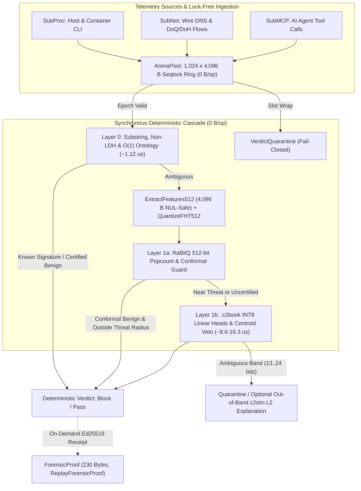
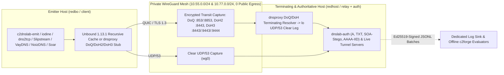

# c2blue55: A CPU-Native Dual-Layer Threat Detection Engine for the Wittgenstein AI Tournament

*Autonomous, Resource-Sobriety Architecture for Local Cyber Defense and AI Agent Oversight*

     

**Navigation:** [Version française](c2blue55_wittgenstein_article.fr.md) · [Word Edition (.docx)](c2blue55_wittgenstein_article.docx) · [Repository Overview](../README.md) · [Centroid Geometry & Formulas](centroid_geometry_and_formulas.md) · [Micro-Optimization & Security](why_micro_optimization_is_a_security_choice.md) · [7-Stack DNS Benchmark](dns_detection_solutions_benchmark.md)

| Engineering Parameter | Verified Specification |
| :--- | :--- |
| **Entry & License** | Wittgenstein AI Tournament (Hackers-Arise / Master OTW) · MIT License · [github.com/hazyhaar/c2blue55](https://github.com/hazyhaar/c2blue55) |
| **Version & Date** | `v8.2` — `2026-11-01` (Full 4,096 B Payload Window, Seven-Detector Parity Bench, Exotic QUIC/DNS Campaign & `RAT-01..04` Wire/Host Hardening) |
| **Implementation** | Pure Go 1.27 (`GOAMD64=v3` / `GOEXPERIMENT=simd` AVX2 kernels transpiled mechanically from C99 via `sgoiter`, portable scalar Go for ARM64/x86_64, `0% CGo`, `0% GPU`) |
| **Decision Architecture** | Sovereign `0 B/op` deterministic `L0 -> L1a -> L1b` cascade over HMAC-SHA256-sealed `.c2book` (`C2FLOP1`) floppies + `PureGoEncoderArbitrator` (`0 B/op`); optional out-of-band `c2slm` (`Qwen2.5-0.5B-Instruct` GGUF) for L2 human-readable SOC incident narratives |
| **Empirical Scope** | Tournament corpora (`5,236` host/DNS samples) + closed WireGuard laboratory campaigns (`SOA` negative cache, `ICMP Echo` / `ptunnel-ng`, `AAAA` IID, live `iodine` & `dns2tcp` over `Unbound`/`DoQ`/`DoH3`, `25` `L1` + `61` `L1-bis` captures across `Slipstream`, `NoizDNS`, `VayDNS`, `Soar`) |

<strong>Complete Revision History (v1 to v8.2)</strong>

- **v8.2 (2026-11-01, §15.6):** Sealed `RAT-01..04` hardening — signed-`NXDOMAIN` answer grammar (`P14`), query-side private `EDNS0` (`P9`), cross-response `RDATA` renewal (`P15`), RFC 2782/8552 underscore service-label stripping (`0/50` `SRV` FPs), fail-closed malformed DNS escalation, cross-resolver host aggregation (`AgregateurHoteChiffre`, `Slipstream` `TP = 3/3`), and 12-ratio Linux host kinetics (`part_resolveur_permille`).
- **v8.1 (2026-11-01, §6.2 & §15.5):** Full adversarial code audit across all 21 Go packages; `4,096`-byte NUL-safe `ExtractFeatures512` window and reforged `.c2book` floppies; elimination of circular synthetic bench proofs; fail-closed supervisory and parser guards.
- **v8.0 (2026-10-31, §§13–15):** Live `iodine` Base128 and `dns2tcp` tunnels over `Unbound`, `DoQ`, and `DoH3`; `netrack/learn` external corpus; seven-detector parity bench (`L1`, 25 PCAPs); `-tolerant` non-LDH wire closure; keyless encrypted-transit kinetics (`V2.1`); out-of-sample exotic campaign (`L1-bis`, 61 PCAPs: `Slipstream`, `NoizDNS`, `VayDNS`, `Soar`).
- **v2–v5 (2026-10-27 to 2026-10-29, §§9–12):** Closed OVHcloud WireGuard laboratory bench (`dnslab-auth`, `c2dnslab-emit`), learned 512-bit projector negative ablation (`K-0..K-2`), recursive `SOA` authority modulation (`N-01..N-05`), `ICMP Echo` asymmetry & `ptunnel-ng` (`I-01..I-04`), and `AAAA` interface-identifier modulation (`A-01..A-04`).

---

## Table of Contents

- [1. Context and Architectural Objectives](#1-context-and-architectural-objectives)
- [2. Zero-Allocation Hot Path and In-Memory Architecture](#2-zero-allocation-hot-path-and-in-memory-architecture)
  - [2.1 Zero Heap Allocation (`0 B/op`)](#21-zero-heap-allocation-0-bop)
  - [2.2 4MB Atomic Seqlock Ring Arena](#22-4mb-atomic-seqlock-ring-arena)
  - [2.3 Fail-Closed Quarantine Decision](#23-fail-closed-quarantine-decision)
  - [2.4 Memory-Mapped Knowledge Bases & Cryptographic Sealing](#24-memory-mapped-knowledge-bases--cryptographic-sealing)
- [3. The Dual-Layer Threat Detection Cascade](#3-the-dual-layer-threat-detection-cascade)
  - [3.1 Layer 0: Deterministic Substring & Ontological Reflex](#31-layer-0-deterministic-substring--ontological-reflex)
  - [3.2 Layer 1a: Conformal RaBitQ 512D Vector Projection](#32-layer-1a-conformal-rabitq-512d-vector-projection)
  - [3.3 Layer 1b: Quantized INT8 Heads & Centroid Veto](#33-layer-1b-quantized-int8-heads--centroid-veto)
- [4. Baseline Drift Control: A Modular Guard for Centroid Recertification](#4-baseline-drift-control-a-modular-guard-for-centroid-recertification)
- [5. Verifiable Causality: Stand-Alone Forensic Attestation and Deterministic Replay](#5-verifiable-causality-stand-alone-forensic-attestation-and-deterministic-replay)
  - [5.1 Stand-Alone Forensic Attestation (`ForensicProof`)](#51-stand-alone-forensic-attestation-forensicproof)
  - [5.2 Ed25519 Root Key Attestation](#52-ed25519-root-key-attestation)
  - [5.3 Deterministic Verdict Verification (`ReplayForensicProof`)](#53-deterministic-verdict-verification-replayforensicproof)
- [6. Empirical Evaluation, Statistical Caveats, and Operational Trade-Offs](#6-empirical-evaluation-statistical-caveats-and-operational-trade-offs)
  - [6.1 Statistical Caveat on Sample Sizes & A Posteriori Calibration](#61-statistical-caveat-on-sample-sizes--a-posteriori-calibration)
  - [6.2 Empirical Evaluation Summary (Full 4,096-Byte NUL-Safe Payload Window)](#62-empirical-evaluation-summary-full-4096-byte-nul-safe-payload-window)
  - [6.3 Detailed Findings by Threat Vector](#63-detailed-findings-by-threat-vector)
- [7. Scope of Protection and Subsystem Boundaries](#7-scope-of-protection-and-subsystem-boundaries)
  - [7.1 SubProc (Host & Container Execution)](#71-subproc-host--container-execution)
  - [7.2 SubNet (Network Boundary & DNS Tunneling)](#72-subnet-network-boundary--dns-tunneling)
  - [7.3 SubMCP (AI Agent Oversight & Tool Guard)](#73-submcp-ai-agent-oversight--tool-guard)
- [8. Conclusion and Open-Source Distribution](#8-conclusion-and-open-source-distribution)
- [9. Addendum v2 (2026-10-27): Closed Laboratory Bench on Dedicated Infrastructure](#9-addendum-v2-2026-10-27-closed-laboratory-bench-on-dedicated-infrastructure)
  - [9.1 Pieces (all pure Go, no CGO)](#91-pieces-all-pure-go-no-cgo)
  - [9.2 Runs Captured](#92-runs-captured)
  - [9.3 Measured on Laboratory Traffic](#93-measured-on-laboratory-traffic)
  - [9.4 Two Evasions Closed In-Sample on Laboratory Captures](#94-two-evasions-closed-in-sample-on-laboratory-captures)
  - [9.5 Open-source base model (tournament rule; declaration, not a bench measurement)](#95-open-source-base-model-tournament-rule-declaration-not-a-bench-measurement)
  - [9.6 Learned 512-bit projector (strates K-0 to K-2): built, measured, not wired (harness records)](#96-learned-512-bit-projector-strates-k-0-to-k-2-built-measured-not-wired-harness-records)
  - [9.7 Incidents and limits, as recorded](#97-incidents-and-limits-as-recorded)
- [10. Addendum v3 (2026-10-29): SOA Modulation in Negative Answers, Measured Through a Recursive Resolver](#10-addendum-v3-2026-10-29-soa-modulation-in-negative-answers-measured-through-a-recursive-resolver)
  - [10.1 Bench](#101-bench)
  - [10.2 Captured Runs](#102-captured-runs)
  - [10.3 Detector Evaluation](#103-detector-evaluation)
  - [10.4 What this does and does not establish](#104-what-this-does-and-does-not-establish)
- [11. Addendum v5 (2026-10-29): ICMP Echo Payload Asymmetry, a First Network Measurement Outside DNS](#11-addendum-v5-2026-10-29-icmp-echo-payload-asymmetry-a-first-network-measurement-outside-dns)
- [12. Addendum v2 (2026-10-29): Interface-Identifier Modulation in AAAA Answers, Measured Through a Recursive Resolver](#12-addendum-v2-2026-10-29-interface-identifier-modulation-in-aaaa-answers-measured-through-a-recursive-resolver)
- [13. Addendum v1 (2026-10-31): Real DNS Tunnels Through a Recursive Resolver, and an External Real-Tunnel Corpus](#13-addendum-v1-2026-10-31-real-dns-tunnels-through-a-recursive-resolver-and-an-external-real-tunnel-corpus)
  - [13.1 Own infrastructure: iodine and dns2tcp through Unbound](#131-own-infrastructure-iodine-and-dns2tcp-through-unbound)
  - [13.2 External corpus: netrack/learn (Apache-2.0)](#132-external-corpus-netracklearn-apache-20)
- [14. Addendum v1 (2026-10-31): The Same Tunnels Over DNS-over-QUIC and DNS-over-HTTPS/3](#14-addendum-v1-2026-10-31-the-same-tunnels-over-dns-over-quic-and-dns-over-https3)
  - [14.1 Question](#141-question)
  - [14.2 Setup](#142-setup)
  - [14.3 H1: traversal](#143-h1-traversal)
  - [14.4 H2 and H3: three observation points on the same sessions](#144-h2-and-h3-three-observation-points-on-the-same-sessions)
  - [14.5 What this establishes](#145-what-this-establishes)
  - [14.6 Sources consulted](#146-sources-consulted)
- [15. Addendum v1 (2026-10-31): Seven-Detector Parity Bench, Non-LDH Wire Closure, Keyless Encrypted-Transit Kinetics, and Out-of-Sample Exotic QUIC/DNS Experiments](#15-addendum-v1-2026-10-31-seven-detector-parity-bench-non-ldh-wire-closure-keyless-encrypted-transit-kinetics-and-out-of-sample-exotic-quicdns-experiments)
  - [15.1 Closing the §13 Non-LDH Blind Spot (`lab-eval -tolerant` and `NonLDHBurstGuard`)](#151-closing-the-13-non-ldh-blind-spot-lab-eval--tolerant-and-nonldhburstguard)
  - [15.2 Seven-Detector Parity Bench (`L1`, 25 Captures) and Upstream Stack Defects](#152-seven-detector-parity-bench-l1-25-captures-and-upstream-stack-defects)
  - [15.3 Keyless Encrypted-Transit Kinetics (`V2` to `V2.1`) and Out-of-Sample Exotic Campaign (`L1-bis`)](#153-keyless-encrypted-transit-kinetics-v2-to-v21-and-out-of-sample-exotic-campaign-l1-bis)
  - [15.4 What This Does Not Establish (Measured Architectural Limitations)](#154-what-this-does-not-establish-measured-architectural-limitations)
  - [15.5 Post-Audit Integrity & Security Remediation (v8.1, 2026-11-01)](#155-post-audit-integrity--security-remediation-v81-2026-11-01)
  - [15.6 Post-Mythos Ratio & Wire Grammar Hardening (v8.2, 2026-11-01)](#156-post-mythos-ratio--wire-grammar-hardening-v82-2026-11-01)

---

## 1. Context and Architectural Objectives

In defensive cybersecurity, relying on cloud-hosted language models for inline telemetry inspection introduces significant operational constraints. External inference calls impose round-trip network latencies on the order of hundreds of milliseconds per request, mandate the transmission of internal system telemetry to third-party infrastructure, and introduce probabilistic variability on repetitive parsing tasks.

The **Wittgenstein AI Tournament**, organized by Hackers-Arise and Master OTW, emphasizes an alternative engineering approach:
- Defensive inspection mechanisms should run **locally**;
- They must execute **deterministically** with strictly bounded resource consumption;
- Decisions must remain **verifiable** and reproducible down to the bit.

Inspection engines must operate directly on host hardware under the defender's administrative control, processing security events without exfiltrating telemetry. `c2blue55` was developed to explore these low-latency, deterministic constraints on pure CPU architectures.

---

## 2. Zero-Allocation Hot Path and In-Memory Architecture

When defending high-throughput network boundaries, host execution pipelines, and Model Context Protocol (MCP) toolchain interfaces, detection engines cannot tolerate runtime garbage collection pauses or unbounded memory footprint expansion. `c2blue55` enforces strict `ARCHTIME` discipline, pre-allocating state and eliminating heap allocations across its entire critical path.

### 2.1 Zero Heap Allocation (`0 B/op`)

Event parsing, token extraction, ontological routing, and vector projection execute entirely within pre-allocated stacks and ring structures, guaranteeing deterministic microsecond latencies without GC jitter.

### 2.2 4MB Atomic Seqlock Ring Arena

Ingests variable-length payloads into an arena composed of 1,024 dedicated 4KB slots (`ArenaPool`). Thread coordination relies on double-epoch atomic sequence locks (`seqlock`) with `uint32`/`uint64` barriers:
1. **Readers** inspect payloads concurrently without mutex locks via pre- and post-epoch verification.
2. **Writers** acquire slot ownership via sequence `CAS`, write 64-bit payload words, compute Castagnoli CRC32-C checksums, and publish the payload with an incremented sequence barrier (`StorePayload`).

### 2.3 Fail-Closed Quarantine Decision

If high-velocity event streams cause an arena slot to wrap before an ongoing evaluation completes, the epoch discrepancy is detected immediately. The engine refuses to evaluate corrupt memory and fails closed, assigning a `VerdictQuarantine` decision.

> [!NOTE]
> **Operational Boundary:** Mitigation enforcement itself (such as terminating a process, denying `fanotify` execution, or dropping/sinkholing a packet) is left to host orchestration or daemon integration outside the core evaluation library.

### 2.4 Memory-Mapped Knowledge Bases & Cryptographic Sealing

Pre-compiled threat models and baseline centroid embeddings are packaged into portable vector floppy books (`.c2book` / `C2FLOP1`). These books are memory-mapped directly into process virtual memory:
- **Sealed Knowledge Bases:** When a knowledge base carries the seal flag (`FloppyFlagSealed`), `LoadFloppyMmap` strictly requires an HMAC-SHA256 key covering the 32-byte header and body, returning `ErrFloppyUnsealed` if the key is missing or `nil`, and `ErrFloppySeal` on signature mismatch. Loading an unsealed disk with an HMAC key is likewise rejected.
- **Unsealed Disks in Testing:** Conversely, loading an unsealed disk without a key is accepted with Castagnoli CRC32C verification only, without cryptographic authentication (in the current repository, `LoadFloppyMmap` is invoked by `c2forge lab-eval` / `dns-delta` and the test suites, whereas the standalone daemons `c2agent` and `c2blue-mcp-guard` rely on separate codebooks and server oracles).
- **Environment Keys & Demonstration Fallback:** To ensure out-of-the-box reproducibility of tournament evaluation suites, `WittgensteinFloppyKey` logs a security warning and defaults to public demonstration keys when environment variables (`C2BLUE_HMAC_KEY_*`) are unset.
- **Production Mode:** In production deployments, setting `C2BLUE_REQUIRE_SECURE_KEYS=1` (or `C2BLUE_PRODUCTION=1`) enforces strict key provision at two levels:
  1. `WittgensteinFloppyKey` refuses fallback to public demonstration keys (returning `nil`);
  2. The binary loader (`decodeFloppy`) categorically rejects any unsealed disk (`FloppyFlagSealed` unset) with `ErrFloppyUnsealed`.

This closes the loophole where simply clearing the header's seal flag (which is not covered by the body's CRC32C checksum) would allow an unsealed disk to load without authentication when a `nil` key is supplied.

---

## 3. The Dual-Layer Threat Detection Cascade

Rather than subjecting every mundane system event to deep neural inference, `c2blue55` organizes analysis into an asymmetric, hierarchical cascade. Early stages resolve clear-cut events at microsecond latency (approximately `0.97` to `1.12 µs` for Layer 0), reserving vector projection and quantized linear scoring for ambiguous edge cases.

> [!IMPORTANT]
> **Library Cascade vs. Standalone Daemons:** The synchronous `L0 -> L1a -> L1b` cascade (`CascadeEngine`), memory-mapped `.c2book` floppy mounting, and provenance arbitration form the deterministic library core evaluated by `wittgenstein_bench_test.go` and `c2forge`. Standalone daemons (`cmd/c2agent`, `cmd/c2blue-mcp-guard`) pair fixed codebooks and zero-allocation gray-zone arbitration (`PureGoEncoderArbitrator`, `0 B/op`) on the hot path with optional out-of-band `c2slm` (`Qwen2.5-0.5B-Instruct` GGUF) incident explanations on Layer 2.

### 3.1 Layer 0: Deterministic Substring & Ontological Reflex

*Measured Latency: 1.12 µs/op (~895,000 ops/s per core, 0 B/op)*

The overwhelming majority of event traffic is unambiguous. Rather than complex state automata, Layer 0 performs:
- Case-folded substring matching (`containsSubsliceFold`) over fixed keyword tables;
- Zero-allocation structural reflexes: `netcatWithExec` for shell invocation argument binding, and `dnsHasEncodingChars` for scanning non-LDH Base64 characters (`+`, `/`, `=`) at any position within raw QNAME labels;
- O(1) ontological state invariants (`EvaluateOntology`).

In physical hardware benchmarks on an Intel Core i9-14900K (Linux 6.14, Go 1.27, `GOAMD64=v3`), Layer 0 executes in **1.12 µs/op**. Known reverse shells and certified benign primitives are resolved here, halting the pipeline before vector projection begins.

### 3.2 Layer 1a: Conformal RaBitQ 512D Vector Projection

Ambiguous events are projected into a 512-dimensional vector space using structured randomized orthogonal transforms (`RaBitQ 512D`) and quantized into 512-bit binary representations.

Computing Hamming distances via native popcount intrinsics resolves geometric proximity against prototype distributions. Crucially, Layer 1a is subordinated to threat boundaries: it cannot confirm benignity if the event resides within the blocking radius of an established threat centroid.

### 3.3 Layer 1b: Quantized INT8 Heads & Centroid Veto

*Measured Latency: 8.63 µs – 16.32 µs complete cascade (0 B/op)*

Subtle semantic anomalies that survive Layer 1a are evaluated by quantized linear heads operating with full centroid veto authority over memory-mapped `.c2book` floppies. All events reaching L1b without being blocked by centroid proximity are evaluated by the INT8 dot-product.

For apex domains specifically, early INT8 computation is evaluated lazily only when an apex domain falls within the centroid block radius, verifying whether an exception applies before enforcing the veto.

**Complete Cascade Performance Profile:**
- **Benign Commands:** 8.63 µs/op (~115,800 ops/s per core)
- **DNS Queries:** 11.68 µs/op (~85,600 ops/s per core)
- **Extended Arena Payload (L1b):** 16.32 µs/op (~61,300 ops/s per core)

Independent verifications on alternative hardware platforms observe latencies approximately 1.5x to 2x higher (~1.7 to 2.7 µs for Layer 0, and 15 to 20 µs for the complete cascade), remaining within the 10 to 25 µs operational budget.

---

## 4. Baseline Drift Control: A Modular Guard for Centroid Recertification

Autonomous defensive systems that adapt in real time face severe risks of adversarial poisoning, where attackers slowly shift the model's nominal centroid baseline until severe threats are misclassified as normal traffic. `c2blue55` includes a modular statistical drift guard (`CusumDriftGuard` in `internal/engine/drift_guard.go`) to preserve baseline stability.

> [!NOTE]
> **Architectural Boundary:** In strict adherence to `ARCHTIME` and zero-allocation principles, the runtime inference cascade operates exclusively over immutable, memory-mapped centroid floppies and never mutates centroids inline during packet inspection. `CusumDriftGuard` is intentionally decoupled from the line-rate evaluation path and serves as a standalone supervisory gate for offline training pipelines and periodic baseline recertification.

The guard provides two supervision layers:
1. **Finite-Vector Gate & Scalar Step Distance Monitoring:** Before computing distances, `EvaluateSample` strictly rejects any vector containing `NaN` or `±Inf` (`ErrDriftGuardNaN`) so IEEE-754 unordered comparisons can never bypass thresholds or overwrite the installed reference. When candidate centroid updates are finite, the guard computes the Euclidean step distance between successive candidate vectors: $d = ||\mu_t - \mu_{t-1}||_2$. It enforces a maximum step threshold (`MaxRadius`) and a cumulative displacement budget ceiling (`MaxDriftBudget`).
2. **Scalar CUSUM Accumulation:** A cumulative sum detector tracks step distance deltas: $S_t^+ = \max(0, S_{t-1}^+ + (d - \text{slack}))$. Any sustained displacement burst exceeding threshold limits triggers an alert. Candidate updates are accepted or rejected on a per-step basis rather than triggering a permanent engine lock, providing supervisory control for operators generating new floppy releases.

---

## 5. Verifiable Causality: Stand-Alone Forensic Attestation and Deterministic Replay

A critical vulnerability of modern black-box AI is the inability to explain or verify why an alert was triggered. Security Operations Center (SOC) analysts and incident response teams require reproducible forensic facts rather than opaque confidence scores.

### 5.1 Stand-Alone Forensic Attestation (`ForensicProof`)

For incident investigation and evidentiary compliance, `c2blue55` provides a standalone attestation API (`SignForensicProof`). When invoked on demand by an operator, probe, or orchestration supervisor, it generates an independent, self-contained 230-byte canonical binary receipt.

The receipt cryptographically binds:
- The nanosecond event timestamp;
- The subsystem identifier;
- The 128-byte raw event structure;
- The SHA-256 hash of the payload;
- The active floppy CRC32 checksum;
- The cascading decision rationale.

Forensic receipts are generated on demand and do not run inline on every evaluated event, preserving the microsecond inference budget (in the current repository, this API is exposed at the library layer but not invoked by any active loop in the standalone daemons).

### 5.2 Ed25519 Root Key Attestation

Each receipt is digitally signed using a non-nil Ed25519 cryptographic root key, establishing individual cryptographic non-repudiation for incident response without the latency and state overhead of an interdependent blockchain ledger.

### 5.3 Deterministic Verdict Verification (`ReplayForensicProof`)

Because memory layouts, zero-allocation token scanning, and vector projections are strictly deterministic and independent of runtime heap state, replaying a sealed incident via `ReplayForensicProof` verifies the bit-for-bit reproducibility of the mitigation decision.

The replay harness re-evaluates the sealed payload and context against the active knowledge base and confirms exact concordance across all four verdict fields:
1. Remediation action;
2. Decision stage;
3. Hamming distance;
4. Confidence score.

A prerequisite for long-term verification is preserving the exact `.c2book` floppy image (verified by the `FloppyCRC32` in the receipt) and the corresponding engine binary version.

---

## 6. Empirical Evaluation, Statistical Caveats, and Operational Trade-Offs

`c2blue55` was evaluated across empirical benchmark corpora combining deduplicated reverse shell attack payloads, a compiled DNS C2 query dataset, curated administrative command lines drawn from documentation, and synthetically mutated variants. A realistic engineering appraisal requires examining not only peak detection rates, but also operational friction, false-positive impacts, and triage overhead.

### 6.1 Statistical Caveat on Sample Sizes & A Posteriori Calibration

Evaluated sets of 41 and 42 samples represent constrained sample sizes. For small samples, confidence intervals are broad: an observed 0.00% false-positive rate on 42 samples corresponds to an upper 95% Wilson confidence bound of 8.38%. Furthermore, because raw historical training logs are not distributed publicly with the open-source repository, third-party auditors cannot independently verify the absolute disjunction between training samples and evaluation sets.

Critically, from an experimental methodology perspective, several targeted structural refinements—specifically the apex domain corroboration rule, the TTY interactive quarantine bypass, and the L0 netcat permutation segmentation—were implemented after analyzing empirical failures observed on these evaluation datasets (the 8 concatenated dictionary domains, the initial 9 headless admin quarantines observed under the earlier 96-byte prefix prototype, and the 6 netcat flag variations).

Consequently, these evaluation sets functioned as a **calibration and development partition**. The resulting 100.00% interception (block + quarantine) and 0.00% false-positive block metrics measure empirical fit on these known edge cases rather than provable out-of-distribution generalization. A rigorous validation of true generalizability will require evaluation against completely unobserved production corpora.

### 6.2 Empirical Evaluation Summary (Full 4,096-Byte NUL-Safe Payload Window)

All metrics below are measured with the post-remediation 4,096-byte NUL-safe `ExtractFeatures512` extractor and the reforged `.c2book` floppies, reported with exact sample counts and 95% Wilson score confidence intervals:

| Evaluation Partition | Sample Size (N) | Hard Block [95% CI] | Quarantine [95% CI] | Allow / Pass [95% CI] | Primary Resolution Stage |
| :--- | :---: | :---: | :---: | :---: | :--- |
| **Reverse Shell Payloads** | 41 | **80.49%** (33/41) [65.99%, 89.77%] | **19.51%** (8/41) [10.23%, 34.01%] | **0.00%** (0/41) [0.00%, 8.57%] | L0 Reflex (20) / L1b Block (13) + Quarantine (8) |
| **Parametric Shell Mutations** | 111 | **80.18%** (89/111) [71.81%, 86.53%] | **19.82%** (22/111) [13.47%, 28.19%] | **0.00%** (0/111) [0.00%, 3.35%] | L0 Reflex (48) / L1b Block (41) + Quarantine (22) |
| **DNS C2 Tunnel Queries** | 4,000 | **99.35%** (3,974/4,000) [99.05%, 99.56%] | **0.65%** (26/4,000) [0.44%, 0.95%] | **0.00%** (0/4,000) [0.00%, 0.10%] | L0 Reflex (2,957) / L1b Block (1,017) + Quarantine (26) |
| **Benign Domain Baseline** | 1,000 | **0.00%** (0/1,000) [0.00%, 0.38%] | **0.00%** (0/1,000) [0.00%, 0.38%] | **100.00%** (1,000/1,000) [99.62%, 100.00%] | L1a Conformal (856) / L1b Apex (144) |
| **Admin Commands (Raw Headless)** | 42 | **0.00%** (0/42) [0.00%, 8.38%] | **69.05%** (29/42) [53.97%, 80.93%] | **30.95%** (13/42) [19.07%, 46.03%] | Ambiguous Quarantine Band (L1b) |
| **Admin Commands (Interactive TTY)** | 42 | **0.00%** (0/42) [0.00%, 8.38%] | **0.00%** (0/42) [0.00%, 8.38%] | **100.00%** (42/42) [91.62%, 100.00%] | `OntoVerdictAllow` Provenance (15 L0 / 24 L1a / 3 L1b) |

---

### 6.3 Detailed Findings by Threat Vector

#### DNS Command & Control (C2) & the DGA Blind Spot
Tested across 4,000 DNS C2 tunnel queries compiled in `validate.csv`: **100.00% interception** (`3,974/4,000` hard block = `99.35%`, `26/4,000` quarantine = `0.65%`) and **0.00% pass rate** (`0/4,000`). Layer 0 caught 2,957 queries through the cumulative effect of the known hostile tunnel domain keyword (`hidemyself.org`, covering 2,000 queries) and the non-LDH character reflex (`dnsHasEncodingChars`, matching `+`, `/`, or `=` at any position within the QNAME, covering 957 `example.org` queries). Layer 1b intercepted all 1,043 remaining queries targeting shared tunnel domains (`43/43` remaining `example.org` blocked; `974/1,000` `tuns.org` blocked and `26/1,000` quarantined).

Incorporating zero-allocation apex domain structural discrimination (`isApexDomain`) eliminated all 8 previously observed false-positive blocks on multi-word concatenated dictionary domains (e.g. `sickbeard.com`). For second-level registrable domains without deep subdomains, centroid proximity blocks by default **unless** the INT8 decision head explicitly certifies that the domain is benign and conforming to class prototypes (`predClass == 0 && conforms`).

> [!WARNING]
> **Architectural Limitation on DGA:** Because the apex rule assumes that covert channels require deep subdomain labels to encode exfiltrated payloads, it weakens direct centroid-based blocking against Domain Generation Algorithms (`DGA`), which register disposable apex domains directly. `DGA` domains lacking deep subdomains rely entirely on `INT8` hyperplane classification (`floppy_dns_dga.c2book`) or a dedicated upstream `DGA` classifier.

#### Administrative Commands: Sensitivity vs. Interactive Provenance
Tested against 42 benign system administration command lines drawn from documentation (coreutils, systemd, docker, kubectl, apt; representing single-line commands rather than live fleet telemetry). In a raw headless baseline without host provenance metadata over the full 4,096-byte payload window, the engine achieves 30.95% immediate pass (13/42) and 69.05% fail-safe quarantine (29/42) due to token overlap with LOLBAS discovery patterns (0.00% false positive block).

On the 103-sample benign training set evaluated without provenance context, the unaugmented engine routes 69 commands to quarantine (66.99%) and triggers 1 hard false-positive block (0.97%) on a valid administrative command (`Get-Counter '\Processor(_Total)\% Processor Time' -SampleInterval 2 -MaxSamples 5`). This confirms that zero false-positive blocking is not an inherent property of the raw text classifier alone, but strictly contingent upon host execution context.

#### Operational Friction, TTY Evasion Trade-Off & Broad Subsystem Target Scope
When process provenance is established (`DeriveCascadeContext`), ontological evaluation yields an allow verdict (`OntoVerdictAllow`) only when strict conditions are met cumulatively:
1. **Interactive Session:** Verified TTY presence, login UID, and lack of setuid elevation (`EUID == UID`);
2. **Target Classification:** Execution of a target classified as `TgtBinSystem`;
3. **Absence of Hostile Indicators:** No `kworker` spoofing, no anonymous `memfd_create` execution, no deleted binary on disk, and no writable-executable (`W+X`) memory mappings.

When satisfied, `OntoVerdictAllow` unconditionally disables the ambiguous quarantine band (13 to 24 bits Hamming distance). All 42 commands pass immediately (100.00% pass, 0.00% quarantine) without degrading strict centroid blocking against attacks.

> [!WARNING]
> **Operational Trade-Off & Subsystem Scope:** In the current implementation, `deriveCascadeOntoKey` maps any event from the process subsystem (`Subsystem == SubProc`) to `TgtBinSystem` without inspecting filesystem paths; only temporary execution directories (`/tmp/`, `/var/tmp/`, `/dev/shm/`) are screened out indirectly via `CtxTmpResidence`. Binaries located in `/home/...`, `/opt/`, or `/usr/local/` therefore inherit `TgtBinSystem` under interactive `TTY` sessions, creating an **expanded evasion window**: an adversary operating inside an authenticated interactive shell without hostile memory flags bypasses the `13..24`-bit quarantine band, leaving detection to the strict centroid block radius ($\le 12$) or an explicit hostile `INT8` classification (`predClass == 1`). In addition, the benchmark harness applies a generic `/usr/bin/bash` provenance across the administrative corpus (including PowerShell strings), which production deployments must replace with native kernel `auditd` or `ETW` provenance.

---

## 7. Scope of Protection and Subsystem Boundaries

`c2blue55` addresses three distinct operational vectors. In evaluating their scope, a clear distinction must be made between the synchronous cascade engine evaluated in the benchmark suite and the asynchronous background services of the standalone daemons:

### 7.1 SubProc (Host & Container Execution)
Inspects command-line invocations, argument structures, privilege escalation flags, and LOLBAS utility abuse on Linux and Unix hosts. The current provenance schema evaluates command lines and execution flags without tracking full process tree hierarchies or parent process ID (PPID) ancestry.

### 7.2 SubNet (Network Boundary & DNS Tunneling)
Inspects raw DNS query names, non-LDH character distributions, lexical entropy, and domain structures within the synchronous cascade. Asynchronous tracking of periodic C2 beaconing timing intervals is handled by the daemon telemetry pipeline (`temporal_tracker.go` in `pipeline.go`) rather than the inline cascade engine.

### 7.3 SubMCP (AI Agent Oversight & Tool Guard)
Defines an architectural inspection boundary for Model Context Protocol (MCP) tool invocations, designed to intercept prompt injection attempts, unauthorized file traversal, and destructive command sequences prior to agent execution (`cmd/c2blue-mcp-guard`). This subsystem represents an architectural interface and is not evaluated by the empirical benchmark rows reported in Section 6.

---

## 8. Conclusion and Open-Source Distribution

`c2blue55` demonstrates that principled systems engineering—combining zero-allocation token scanning, fast vector quantization, and deterministic centroid arbitration—delivers bounded execution guarantees on the critical telemetry inspection path without reliance on cloud runtimes or dynamic heap allocations. Running locally in pure Go on standard CPU hardware (with AVX2 acceleration evaluated on x86_64), it provides an accessible, verifiable, and low-latency approach to host and network threat inspection.

The complete source code, memory-mapped floppy builders (`c2forge`), bilingual documentation, and reproducible test suites are publicly available under the MIT license at [https://github.com/hazyhaar/c2blue55](https://github.com/hazyhaar/c2blue55).

---

## 9. Addendum v2 (2026-10-27): Closed Laboratory Bench on Dedicated Infrastructure

Sections 1 to 8 evaluate the engine on third-party corpora and on the author's workstation. Between 2026-10-26 and 2026-10-27, a closed laboratory was built to measure the DNS detector on traffic **emitted end-to-end by the laboratory**: two dedicated virtual private servers (`VPS`) rented from OVHcloud (`redhost`, the laboratory authoritative server, and `redbo`, the emitter), a third mesh host that only receives the signed journals (the "log sink"), and the development host that runs the evaluation, all over a private WireGuard mesh (`10.55.0.0/24`, extended with a three-node `10.77.0.0/24` egress-blocked mesh in Section 15), with no third-party target, no scanning, no payload carrying real data (replayed names and one tool handshake only) and a hard cap of 50 queries per second per run.

Provenance of the numbers:
- **§9.2** comes from the `tcpdump` captures and the run manifests;
- **§9.3 and §9.4** come from the two `c2forge` subcommands with their exit codes (all `spec/*` documents cited in Sections 9 to 15—such as `spec/06-motifs-prouves.md`, `spec/07-homologation-laboratoire.json`, and `spec/09..11`—together with `desks/executions.json` and cross-model audit logs live in the private project-envelope repository and are not distributed in the public GitHub repository, whereas all PCAP captures, manifests, and JSON evaluation reports under `testdata/{n04,i03,a03,a04}-20261029/` and `wittgenstein/` are shipped in the public repository);
- **Per-name counts in §9.3** come from a one-off evaluation of every captured question against the same floppies, run on 2026-10-27 and kept with the harness records.

Vocabulary used below:
- **Floppy:** a sealed `.c2book` file of centroids (Section 2);
- **View:** one parsed DNS question;
- **Strates:** the numbered work stages of the harness (`S-03` to `S-07` for the bench, `K-0` to `K-2` for the learned projector), each accepted by frozen tests written before the code, by the race detector run over the whole suite, and by a cross-model audit;
- **DGA head:** the second floppy, `floppy_dns_dga.c2book`, the apex-domain classifier of Section 6;
- **Cold-Family Split:** holds one whole family of a corpus out of training and evaluates on it;
- **SLM:** the small language model declared in §9.5.

### 9.1 Pieces (all pure Go, no CGO)

| Piece | Host | Role | Acceptance (harness records) |
| :--- | :--- | :--- | :--- |
| `dnslab-auth` (`cmd/dnslab-auth`, `internal/dnslab`) | redhost `10.55.0.1:53` | Authoritative-only laboratory server: fixed A/TXT answers in zone, `REFUSED` out of zone and for AXFR/IXFR, `NOTIMP` for ANY, `FORMERR` on malformed questions, never more than 512 bytes, no OPT; per-source token-bucket rate limit; typed JSONL journal written **before** any answer; Ed25519-signed batches shipped to the log sink | 10 frozen tests, cross-model audit (4 majors fixed), field oracle from redbo |
| `c2dnslab-emit` (`cmd/c2dnslab-emit`) | redbo (control socket on loopback) | One campaign at a time; replay of names under the laboratory zone at a bounded rate (no catch-up after a stalled send), or launch of a public tool under a deadline with process-group termination; atomic run manifest, then signed label to the log sink | 9 frozen tests, audit (2 majors fixed) |
| PCAP ingestion (`dns_pcap.go`, `dnslab_ingest.go`) | development host | Pure-Go pcap reader (Linux cooked capture v1/v2, Ethernet, raw IP; IPv4/IPv6), every record counted in exactly one category, truncated file refused, each question parsed by the existing zero-allocation decoder | 11 frozen tests, audit accepted |
| Laboratory homologation (`dnslab_eval.go`, `c2forge lab-eval`) | development host | Each hostile laboratory family held out in turn; the other hostile laboratory families join training through centroid discovery; the laboratory benign capture is only scored, never learned (`evaluateLabFamily` passes the other families' views to discovery and the benign views to the scorer only) | 4 frozen tests, audit (1 major fixed) |
| Differential recompile and proof (`internal/engine/dns_delta.go`, `c2forge dns-delta`) | development host | Recompile floppy N → N+1 from the views a run evaded; proof triplet = evasion counted on N, `FN = 0` on N+1, benign FP not increased | 5 frozen tests, audit (3 majors fixed) |

The whole suite (these pieces and the K strates) passed `go test -race` at the final merge: 374 passes, 0 failure.

### 9.2 Runs Captured

*Hourly `tcpdump` on `wg0` of `redhost`, sliced per run; counts from captures and manifests.*

| Run (chronological) | Family | Questions | Distinct names | Provenance |
| :--- | :--- | ---: | ---: | :--- |
| `local-dns-20261027T113715Z` | benign (own domains) | 69 | 11 | real `dig` queries from the development host: 20 queries are tunnel-shaped by construction (18 for six `probe-*` names with a random base32 label, 2 for a name with a 53-character label), 25 go to `hazyhaar.fr` / `www.hazyhaar.fr`, 24 to `pound2pound.fr` / `lab.pound2pound.fr`; all labelled benign because they were intentionally issued by the bench operator. **Seven of these eleven names are also replayed as hostile in `replay-20261027T150838Z`** (see §9.3) |
| `replay-tuns-20261027T150656Z` | `redhost-replay` | 132 (partial: capture incident, §9.7) | 132 | real `tuns.org` tunnel subdomains taken from the section 6 corpus (labels kept, suffix changed to `t.lab.pound2pound.fr`); **all 132 names are also in the complete run below**, so they are counted twice in the per-question totals |
| `replay-20261027T150838Z` | `redhost-replay` | 598 | 8 | replay of 8 laboratory names (the six `probe-*` names, the 53-character name and `canary.lab.pound2pound.fr`) at 10 q/s for 60 s; manifest `Sent=598 Dropped=0 Errors=0`: 2 of the 600 slots were not sent, cause not measured |
| `replay-tuns-20261027T150942Z` | `redhost-replay` | 598 | 598 | same `tuns.org` list, complete; manifest `Sent=598 Dropped=0 Errors=0` |
| `iodine-20261027T151046Z` | `redhost-iodine` | 5 | 5 | `iodine` 0.7.0-10 (Debian package on redbo) client, version handshake only: the run manifest records the client exiting after "Got empty reply" to its version check against the non-cooperating laboratory server |
| `dns2tcp-*` | `redhost-dns2tcp` | 0 | 0 | `dns2tcp` 0.5.2-3 client emits nothing without a local TCP client connecting to it; family dropped before the deadline |

The per-question totals are therefore dominated by repetition: 1,328 hostile questions of the `redhost-replay` family carry 606 distinct names (598 `tuns.org` labels and 8 laboratory names), and 598 of those questions are 8 names repeated about 75 times each.

### 9.3 Measured on Laboratory Traffic

*Evaluated via `c2forge lab-eval` (exit code `0`); family held out, laboratory benign never learned.*

TP, FN: hostile questions blocked / passed; FP, TN: benign questions blocked / passed; AUC: area under the ROC curve of the tunnel-head score over hostile and benign questions (the FP column counts both heads, the AUC only the tunnel head). `Questions` in the raw report counts hostile questions; the 69 benign questions are the same in both rows.

Per question, as reported:

| Family held out | Runs | Hostile | TP | FN | Benign | FP | TN | AUC | L0 blocks |
| :--- | ---: | ---: | ---: | ---: | ---: | ---: | ---: | ---: | ---: |
| `redhost-replay` | 3 | 1,328 | 1,254 | 74 | 69 | 45 | 24 | 0.7945 | 0 |
| `redhost-iodine` | 1 | 5 | 0 | 5 | 69 | 45 | 24 | not computed (fewer than 50 hostile questions; the report stores the sentinel 0 with `InsuffisantPourAUC = true`) | 0 |

*(v8 update note: the table above preserves the 2026-10-27 v2 baseline snapshot; after the v8 wire apex-splitting fix in `splitWireQName`, the 25 `hazyhaar.fr` / `www.hazyhaar.fr` DGA false positives are eliminated, so running `c2forge lab-eval` with the v8 binary yields `FP = 20, TN = 49, AUC = 0.7749` on `redhost-replay` and `FP = 20, TN = 49` on `redhost-iodine`.)*

Per distinct name, `redhost-replay` held out (one-off evaluation of every captured question against the same floppies, both heads):

| Set | Distinct names | Blocked | Passed |
| :--- | ---: | ---: | ---: |
| hostile, `redhost-replay` (598 `tuns.org` labels + 8 laboratory names) | 606 | 605 | 1 (`canary.lab.pound2pound.fr`) |
| benign, all 11 names | 11 | 9 | 2 (`pound2pound.fr`, `lab.pound2pound.fr`) |
| benign, the 4 names not also replayed as hostile | 4 | 2 (`hazyhaar.fr`, `www.hazyhaar.fr`, by the DGA head) | 2 |

Reading these numbers:

- **Labelling conflict.** The 20 tunnel-shaped benign queries (7 names) are the same names as 7 of the 8 hostile laboratory names of `replay-20261027T150838Z`. They are blocked in both runs: counted as FP in the benign run and as TP in the replay run. Restricted to the 49 benign queries whose names are not replayed as hostile, the benign side reads FP 25, TN 24.
- **The 25 queries to `hazyhaar.fr` and `www.hazyhaar.fr` are blocked by the DGA head, 25 out of 25.** This is a genuine false positive on a registered apex domain owned by the project and the main finding of the bench on the benign side. The benign false-positive rate as reported is 45 / 69 = 65.2 % (25 / 49 = 51.0 % after removing the conflicting names); this bench's benign set is **not** a production baseline, and the 1,000-domain benign baseline of section 6 remains the reference for false positives.
- **Accuracy below the majority class.** At the reported operating point, (TP + TN) / total = (1,254 + 24) / 1,397 = 0.9148, below the majority-class rate 1,328 / 1,397 = 0.9506 stored in the raw report: the cascade makes 119 errors where a constant "block everything" classifier would make 69. The number that carries the hostile side is the per-name count (605 / 606), not the accuracy.
- **The 74 misses** are the 74 queries for `canary.lab.pound2pound.fr`, a one-label short name; the seven other laboratory names and all 598 replayed `tuns.org` labels are blocked by the floppy forged with the whole `redhost-replay` family held out (laboratory names and `tuns.org` labels alike are outside its training).
- No laboratory name hits a Layer 0 keyword or reflex (`L0 blocks = 0` in both rows); every block comes from the centroid stages. In the raw report, `L1bBlocks` counts hostile and benign blocks together (1,299 = 1,254 + 45) and `L1aPasses` counts the questions passed at stage L1a (11, all benign); neither is a partition of the questions.

### 9.4 Two Evasions Closed In-Sample on Laboratory Captures

*Evaluated via `c2forge dns-delta`; exit codes in the table, commands and full hashes in `spec/06-motifs-prouves.md`.*

| Pattern | Run | Base N (centroids) | FN on N | N+1 (added) | FN on N+1 | Benign FP N → N+1 | Exit code | Verdict |
| :--- | :--- | ---: | ---: | ---: | ---: | :--- | ---: | :--- |
| `iodine` version handshake (NULL query, encoded label) | `iodine-20261027T151046Z` | 1,211 | 5 / 5 | +4 | 0 / 5 | 20 → 20 | 0 | closed in-sample |
| `canary.lab.pound2pound.fr`, one-label short name | `replay-20261027T150838Z` | 1,208 | 74 / 598 | +1 | 0 / 598 | 20 → 20 | 0 | closed in-sample |
| real `tuns.org` labels replayed under the laboratory zone | `replay-tuns-20261027T150942Z` | 1,208 | 0 / 598 | — | — | — | 3 | already covered |

- **Proof predicate (`Proven`):** Requires an evasion counted on `N`, `FN = 0` on `N+1`, and zero increase in benign false positives; a run with no initial evasion is reported as "already covered" (exit code `3`), never as a new proof.
- **In-sample vs. out-of-sample distinction:** Because `N+1` is recompiled from the evaded views of a run and re-measured on that same run, **the two closed rows are in-sample corrections, not generalization proofs** (no second `iodine` capture existed at that stage to test the new centroids out of sample, and the `canary` row closes a synthetic name forged for the bench). The genuine out-of-sample result of this bench is the third row: all `598` unseen `tuns.org` labels blocked directly by the base floppy.
- **Head scoping & sealing:** The benign FP count of the proofs (`20`) differs from the `45` in §9.3 because `dns-delta` evaluates the tunnel head alone (`20` tunnel-shaped queries vs `25` `hazyhaar.fr` blocks on the DGA head). Both recompilations were sealed with the public demonstration HMAC key (`WittgensteinFloppyKey`), which Section 2.4 refuses in production mode; the tool prints that warning explicitly.

### 9.5 Open-source base model (tournament rule; declaration, not a bench measurement)

`c2blue55` declares **Qwen2.5-0.5B-Instruct** (Apache-2.0, GGUF Q4_K_M) as its open-source base model. It is executed by the repository's pure-Go inference engine `c2slm` (zero CGO, GGUF memory-mapped, AVX2 integer kernels transpiled mechanically from C99) as the optional Layer 2 SLM arbiter of `cmd/c2agent` (`slm_arbitrator.go`), which generates human-readable SOC incident narratives for events already decided by the deterministic cascade. The deterministic veto stays sovereign: the language model never decides a block, while `PureGoEncoderArbitrator` handles synchronous gray-zone arbitration at `0 B/op`.

The 512-dimensional feature extractors and the `.c2book` floppies (INT8 decision heads learned on real data by `buildEmpiricalDecisionHead`) are linear models compiled into Go, not deep neural networks. A hand-written weight table that used to sit in `encoder_arbitrator.go` is not presented as a learned model.

### 9.6 Learned 512-bit projector (strates K-0 to K-2): built, measured, not wired (harness records)

As an experiment in replacing the fixed random projection (`QuantizeFHT512`) with a learned one:
- **Transpiled C99 kernels:** Seven `float32` kernels were written in C99 and transpiled to Go by `sgoiter` (the project's C99-to-Go transpiler) with bit-exact parity against `gcc -O2 -ffp-contract=off` (27 frozen tests, finite-difference gradient checks, bit-exact replay; the `K-2` stage was audited cross-model, refused once, and fixed).
- **Architecture & Cold-Family Split training:** A compact convolutional model (byte embedding, 1-D convolution, max pooling per label and across labels, two dense layers, `512` `tanh` outputs binarized by sign) was trained with AdamW on the real corpora under the same Cold-Family Split.
- **Measured negative result:** After 3 epochs on `512` examples, separation loss drops from `1.02` to `0.88` and readout `AUC` on held-out families reaches **0.76** (`n = 256`), compared with `0.9932` (`tuns.org` held out, `N = 18,504`) and `0.9449` over 19 DGA families (`N = 3,000`) for the fixed projection. Because those evaluations differ in sample size and held-out partitions, the gap is indicative rather than a like-for-like ablation; the learned projector is recorded as **negative at this stage** and is not wired into the cascade (`K-3` pending).

### 9.7 Incidents and limits, as recorded

- A capture restart with a changed file-name scheme overwrote one hour of captures (harness record); the campaigns were replayed and the first `tuns.org` run is kept as partial in §9.2, where its 132 names duplicate the complete run.
- The DGA head blocks `hazyhaar.fr` and `www.hazyhaar.fr` on every query (25/25) in the v2 binary. Nothing in Section 9 corrects it; it is reported as measured at the time (and subsequently resolved in the v8 `splitWireQName` wire parser; see the §9.3 update note).
- Seven benign names of the bench are also replayed as hostile; the per-question benign metrics of §9.3 inherit that conflict and are given with and without those names.
- `iodine` and `dns2tcp` do not sustain traffic against a non-cooperating authoritative server; Section 9 therefore measures a handshake shape and replays of real tunnel labels under the laboratory zone rather than live tunnels (subsequently closed with cooperating endpoints in Section 13). Running a cooperating tunnel endpoint on the bench hosts was out of scope for the initial v2 campaign; one `iodine` capture of 5 questions does not establish generalization to another client or version, and the two "closed" rows of §9.4 are in-sample.
- The learned projector is reported as negative on an indicative comparison. The bench's benign set consists of bench-originated queries (69 queries, 11 names), not production DNS. No alphabet, length or cadence variation campaign was run (`GenerateVariationNames` is shipped and tested, unused).
- §9.3 and §9.4 are reproducible from the repository with the two `c2forge` subcommands on the captures under `wittgenstein/redhost_lab/`; §9.2 is reproducible from the captures and manifests in the same directory.

## 10. Addendum v3 (2026-10-29): SOA Modulation in Negative Answers, Measured Through a Recursive Resolver

Sections 1 to 9 score DNS *questions* (names, types, cadence) and, for the response-side patterns of the engine's catalogue, the Answer section. None of the engine's own patterns reads the Authority section of a negative answer. This addendum adds one detector that does, and measures it on the closed bench with a recursive resolver between the emitter and the authoritative server, so that what is measured has crossed a resolver's cache. Whether tools outside this repository (Zeek, RITA, Suricata, Elastic) would see the same pattern was **not tested** in this section; the only claim made here is about this engine.

**Protocol basis (RFC 2308):** RFC 2308 §3 requires an authoritative server to put the zone's `SOA` record in the `Authority` section of its `NXDOMAIN` and `NODATA` answers; §5 and §6 specify that a caching resolver answering a negative question from cache includes the cached `SOA` with a decremented `TTL`, bounded by `min(SOA TTL, SOA Minimum)`. Nothing in the RFC guarantees that every resolver returns the `SOA` on every negative answer; what is measured below is one resolver, Unbound 1.13.1, in one configuration (§10.1), observed at the authoritative side and spot-checked at the client side. The `SOA` `RDATA` carries two domain names (`MNAME`, `RNAME`) and five 32-bit fields.

**Detector specification (`internal/engine/soa_negative.go`, strate `N-03`, frozen tests committed at `dac3512` prior to code and campaign design):**
- **Admission filter:** Considers wire answers only when `QR = 1`, `ANCOUNT = 0`, `RCODE ∈ {0, 3}`, and `NSCOUNT ≥ 1` (`NXDOMAIN` and `NODATA`; answers carrying `Answer` records are ignored).
- **Key & fingerprint:** Initial `N-03` key = FNV-1a 64 of `(client IP, parent)` (question name minus first label, lower-cased). Fingerprint = FNV-1a 64 of `MNAME`, `RNAME` (decompressed with pointer chains bounded to `8` hops, lower-cased) and `Serial` (`Refresh`, `Retry`, `Expire`, and `Minimum` excluded).
- **Bounded zero-allocation state:** `1,024` direct-mapped slots (`8` timestamped fingerprints per slot, `600 s` expiry, `testing.AllocsPerRun = 0` in `TestSOANegativeTracker_ZeroAlloc`), raising `REASON_P20_SOA_NEG_DOWNLINK` at `>= 3` live distinct fingerprints (hand-chosen constants `3` and `600 s`, no sensitivity sweep).
- **Post-review hardening (`N-03b`, commit `48d394b`):** Moved the key to in-bailiwick `(client IP, SOA owner name)` (`>= 2` labels) inside a `256 × 4`-way associative table to prevent two-label evasion and TLD lumping, reproducing exact counts on all §10.3 captures (`200 / 200 / 198 / 1` on runs A and B, `100 / 100 / 0 / 0` on the benign run).

### 10.1 Bench

| Piece | Host | Role | Acceptance |
| :--- | :--- | :--- | :--- |
| `dnslab-auth -negative none\|soa\|soa-stego` (`internal/dnslab`, `cmd/dnslab-auth`, strate N-01) | redhost `10.55.0.1:53` | in-zone questions whose first label starts with `nx-` get NXDOMAIN with one SOA in Authority; `soa`: constant SOA (`ns1.<zone>`, `hostmaster.<zone>`, serial 2026102901, Refresh 3600, Retry 900, Expire 604800, Minimum 300, TTL 300); `soa-stego`: MNAME = `m<16 hex>`, RNAME = `r<16 hex>` and Serial derived by FNV-1a from a server seed and the question name, Minimum = TTL = 1; other fields as above | 4 frozen tests; `internal/dnslab` and `cmd/dnslab-auth` suites under the race detector; deployed through the build gate (`77ebc4c`) |
| Unbound 1.13.1 (strate N-02, configuration in `spec/09-campagne-soa-negative-20261029.md`) | redbo `10.55.0.2:5335` | forward zone `lab.pound2pound.fr` → redhost, cache on, `local-zone "." refuse` (no query leaves the mesh: `example.com` → REFUSED); `qname-minimisation: yes` is set but **not exercised**, since a forward zone sends the full name to redhost | `dig` through it answers without the AA flag |
| `c2dnslab-emit` (strates N-04, N-04b) | redbo, same host as Unbound | replays 100 names `nx-<16 hex of FNV-1a(seed, i)>.<zone>` as TXT questions, RD set, 5 per second for 40 s (200 questions), towards Unbound | 6 frozen tests; deployed at `ec77785` |
| `c2forge soa-eval` (`soa_negative_eval.go`, `cmd/c2forge/soa_eval.go`, strates N-05a, N-05b) | development host | feeds every answer of a capture to the detector with client = destination IP; prints responses, negative answers with SOA, fires, keys in alarm, rank and timestamp of the first fire; writes a JSON report with the capture's SHA-256 | 6 frozen tests; root package and `cmd/c2forge` under the race detector |

The emitter and the resolver run on the same host; the "third component" is a process, not a third machine. Each work stage was written against tests committed before the code, implemented by a model executor (a locally hosted Qwen model for N-04 and N-04b, Gemini 4 for N-01, N-03, N-05a, GPT-6 for N-05b), re-run by the architect with the package suites under the race detector, then merged. `go test -race ./...` passed on the whole repository at commit `157f0dd` (15 packages); N-04b and N-05b were merged after that gate, each with its package suite under the race detector. Commit identifiers in Sections 10 to 15 refer to the development stage history consolidated into the published release commits.

### 10.2 Captured Runs

*One `tcpdump` on `wg0` of `redhost` (file `dnslab-20261029T14Z.pcap`, named after the hour its rotation started), sliced per run on the emitter's manifest windows widened by `1 s` before and `1.5 s` after to absorb the sub-second clock offset between the two hosts; capture timestamps are local time (`UTC+1`).*

| Run | Server mode (server seed) | Name seed | Questions sent | Questions reaching redhost | Distinct names | Distinct SOA (MNAME, RNAME, Serial) | SOA Minimum |
| :--- | :--- | :--- | ---: | ---: | ---: | ---: | ---: |
| `n04-runA-stego-v2` | `soa-stego` (0x5EEDA) | 0x2026A | 200 | 200 | 100 | 100 | 1 |
| `n04-runB-stego-v2` | `soa-stego` (0x5EEDB) | 0x2026B | 200 | 200 | 100 | 100 | 1 |
| `n04-benin-soa-v2` | `soa` (constant) | 0x2026C | 200 | 100 | 100 | 1 | 300 |

Counts are from the captures (`tcpdump -vv`): the three name sets have no name in common, and the 100 names of each hostile run are exactly the 100 produced by the generator for its seed. The names are `nx-` followed by 16 hexadecimal characters: they were chosen for disjointness between runs, not for stealth. Ingesting the same two captures with the engine's question-side cascade (`RunAgentCLI --pcap`) passes all 400 packets of run A and all 200 of the benign run (`escalated: 0`): on this bench the SOA detector is the only part of the engine that separates the two runs. In `soa-stego` mode Minimum = 1 s, so Unbound forwards the second pass over the names and redhost sees 200 questions carrying 100 distinct SOA (each name gets the same SOA twice); in `soa` mode the negative answer is cached for 300 s and the second pass never reaches redhost. The two denominators (200 and 100) therefore follow from the Minimum value each server mode chooses, not from the detector: a sender that kept Minimum at 300 s would be seen once per name at this capture point. Seen from the client side of Unbound (`dig` on redbo, mode `soa-stego`), the SOA arrives byte-identical to the one redhost emits, TTL 1, different for two different names and identical when a name is repeated. Measured cadence of run A: 200 questions in 40.0 s, 5.00 per second.

### 10.3 Detector Evaluation

*Evaluated via `c2forge soa-eval` on the per-run captures published in `testdata/n04-20261029/` (commit `872cf47`); JSON reports with SHA-256 alongside.*

| Capture | Answers | Negative with SOA | Alarm raised | Answers after the alarm | Keys in alarm |
| :--- | ---: | ---: | :--- | ---: | ---: |
| `n04-runA-stego-v2` | 200 | 200 | at the 3rd answer (6th packet) | 198 | 1 |
| `n04-runB-stego-v2` (disjoint names and seeds) | 200 | 200 | at the 3rd answer (6th packet) | 198 | 1 |
| `n04-benin-soa-v2` | 100 | 100 | never | 0 | 0 |
| whole hour (three runs and five manual checks) | 505 | 500 | at the 16th packet | 498 | 1 |

Reading these numbers:

- "Answers after the alarm" is the tool's `fires` counter: once a key holds three distinct fingerprints every later answer of that key is reported, so 198 is one alarm held for 198 answers, not 198 independent detections. The result per run is binary: the alarm is raised on both hostile runs at the third negative answer, and never on the benign run. Since every name of a modulated run yields a new SOA, any threshold N would fire at the N-th answer; the value 3 is met by construction, not calibrated. The campaign lasted 142 s, so the 600 s expiry was never exercised on the bench (it is exercised in the frozen test only).
- The benign run cannot raise the alarm by construction: a constant SOA yields one fingerprint. It measures that the rule does not fire on repetition, nothing more; a benign zone whose SOA legitimately changes (a serial bumped twice within ten minutes for the same client) would be flagged, and none was played.
- One external benign capture, added after the reviews (`Normal3.pcapng` of the public `cyberjonlab/DNS_exfil` repository, CC BY-NC-4.0, referenced by SHA-256 in `spec/09-campagne-soa-negative-20261029.md` §7, not copied into the repository): 277 real answers from one client to one resolver over 83 s, 65 of them NXDOMAIN with a SOA in the authority section; the rule reports nothing (`soa-eval`: 277 answers, 65 negative with SOA, 0 reports), and the 17-pattern path escalates nothing. It is the only benign piece of this addendum that was not produced by this team; it is small and does not cover a legitimately changing SOA.
- Run-B shares no name and no seed with Run-A, but it shares the generator, the server, the resolver and the rule; it shows that the rule holds on a second, disjoint realisation of the same construction, not that anything generalises beyond it.
- Whole hour: 498 = 198 (run A) + 200 (run B, whose first two answers also fire because the key is still in alarm from run A) + 100 (benign answers played within ten minutes of the hostile runs); the first fire of the whole hour is the same answer as run A's (same timestamp in both JSON reports), ranked 16th because five manual exchanges precede the runs in the hour. The key is (client, parent) and the client at this capture point is the resolver's address, so an alarm raised by any client behind Unbound stays raised for every client behind it for ten minutes. The 505 answers are the 500 NXDOMAIN of the runs plus 5 A answers to manual checks through Unbound; the server journal counts 501 `nxdomain` because one manual check was sent from redhost itself and never crossed `wg0`. A capture taken at the client side of the resolver would differ: cached answers carry a decremented TTL and no AA flag; the detector's fingerprint (names and serial) does not depend on either.
- The first campaign of the day sent 600 questions and redhost received none. Cause, measured on redbo: the replay tool built questions with RD = 0 (deliberate for an authoritative-only target in §9) and Unbound answers REFUSED to a question without RD (`dig +norecurse` → `status: REFUSED, flags: qr ra`; `tcpdump` on redbo shows the 56-byte question and a 56-byte reply on the loopback, nothing on `wg0`). Fixed as strate N-04b; the runs above are the second campaign.

### 10.4 What this does and does not establish

- Established: the SOA fields of a negative answer traverse one recursive resolver unchanged, including a 1-second Minimum; a per-(client, parent) count of distinct SOA fingerprints separates the two modulated runs from the constant run at the third answer, on captures taken at the authoritative side, reproducibly from the repository.
- Not established: that this is a usable *downlink channel*. The campaign modulates the SOA by a hash of the question name; no message was encoded, received or decoded, and no throughput was measured. The title says "modulation", not "channel", for that reason. The sender, the server modes, the benign witness and the rule were all designed by the same team in the same two days; the rule and its constants were frozen in a test before the campaign was run, which is the only ordering guarantee this addendum can offer.
- Not established: behaviour on production negative traffic (CDN zones, DNSSEC-signed zones with frequently bumped serials, split-horizon zones), on NODATA answers (unit-tested only; the campaign is NXDOMAIN only), on CNAME chains ending in a negative answer, with several clients behind the resolver (one key is shared), under slot collision (one key was used), or against a modulation that keeps MNAME, RNAME and Serial constant and moves the other fields.
- Not compared: Zeek, RITA, Suricata and Elastic were not run on these captures. Zeek's DNS analyzer does expose SOA records of answers to scripts (its `dns_SOA_reply` event), so the Authority section is not invisible to it; whether any shipped script counts distinct SOA per client and zone was not checked.
- The DNS motif catalogue committed on 2026-10-28 (17 families, in-memory proofs on generated traffic) is not part of this article; its only contact with the bench is the cross-check of §12, where it is replayed on the real captures of §§10 and 12 and escalates nothing.

## 11. Addendum v5 (2026-10-29): ICMP Echo Payload Asymmetry, a First Network Measurement Outside DNS

The engine's packet probe already captures ICMP Echo (types 8 and 0) alongside UDP/53, but nothing scored it. This addendum adds the smallest ICMP rule that the bench can measure and plays it against a laboratory responder that violates the rule on purpose, and against real `ping`.

**Rule (`internal/engine/icmp_echo.go`, work stage `I-02`, commit `f0a7c50`, tests committed first at `5c073fd`):**
- **RFC 792 invariant:** *"The data received in the echo message must be returned in the echo reply message."*
- **Zero-allocation state (`0 B/op`):** For each `Echo Request`, the tracker stores the FNV-1a fingerprint of the ICMP payload under `(source, destination, ID, sequence)` inside a fixed `1,024 × 4`-way associative table (`testing.AllocsPerRun = 0` in `TestICMPEchoParityTracker_ZeroAlloc`).
- **Trigger & scoping:** An `Echo Reply` is looked up under the swapped `(destination, source, ID, sequence)` key; a payload fingerprint mismatch within `60 s` raises `REASON_IC01_ICMP_ECHO_ASYMMETRY`. Replies without a stored request are ignored, duplicate identical replies are not reported, and each asymmetric reply emits one alarm (the `60 s` window and table size were chosen manually without empirical sensitivity tuning).

**Laboratory responder and emitter (`internal/icmplab`, `cmd/c2icmplab-respond`, `cmd/c2icmplab-emit`, stages `I-01`/`I-01b`, commits `46cf907`/`9fab503`; evaluator `c2forge icmp-eval`, stage `I-03`, commit `532653d`):**
- **Controlled XOR responder:** Answers laboratory-network `Echo Requests` prefixed with `c2il` using a keyed FNV-1a XOR stream (4-byte prefix preserved, involutive), while the emitter on `redbo` sends `N` rate-limited seeded requests.
- **Dual-reply wire signature:** Because the responder does not suppress the Linux kernel's native reply, each `c2il` request yields two replies: an identical kernel reply (`~50 µs`) followed by the transformed responder reply (`~120 µs`). Stage `I-03` tests this synthetic responder first, followed immediately below by end-to-end evaluation of the public tunnel `ptunnel-ng` 1.42.

**Measured** (one `tcpdump -i wg0 icmp` capture on redhost, sliced per ICMP identifier; `c2forge icmp-eval`, work stage I-03; captures, slices, responder log, manifest and SHA-256 in `testdata/i03-20261029/` and `spec/10-campagne-icmp-echo-20261029.md`):

| Slice of the capture | Packets | Echo requests | Echo replies | Reported replies | First report |
| :--- | ---: | ---: | ---: | ---: | :--- |
| real `ping` from redbo (IDs 14 and 15: 20 then 10 requests, 0.2 s apart, 19.7 s in all) | 60 | 30 | 30, identical payload | 0 | none |
| responder run A (ID 0x101, seed 0x2026A, 20 requests in 3.9 s) | 60 | 20 | 40 (20 kernel, 20 transformed) | 20 | 3rd packet of the slice (first transformed reply) |
| responder run B (ID 0x202, seed 0x2026B, 20 requests in 3.9 s) | 60 | 20 | 40 | 20 | 3rd packet of the slice |
| whole capture | 180 | 70 | 110 | 40 | 43rd packet |

The 40 reported replies are exactly the 40 transformed ones; the 70 identical replies (30 `ping`, 40 kernel) report nothing: 0 reports on 30 `ping` exchanges bounds the false-report rate at nothing useful, it only says the rule is not tripped by repetition of an identical payload. The rule needs to see both directions: a capture point that misses the request reports nothing for its reply. The emitter's own count agrees (`sent=20 replies=40 transformed=20` per run) and the responder's log holds 40 lines whose timestamps fall between the request and the transformed reply of their (ID, sequence) in the capture, 40 of 40. The 70 requests make 70 distinct keys (each sequence number is its own key); the table was therefore exercised with 70 keys and no collision was provoked.

**What this does not establish.** The responder and the rule were written by the same team in the same day: the measurement shows that a transformed reply emitted on `wg0` of redhost is received by the emitter (its own count: `transformed=20` per run) and is reported by the rule, and that repeated identical payloads (`ping`) are not reported; by itself it says nothing about real tunnels. A real ICMP tunnel may keep replies symmetric and carry its data in the requests, or send its downlink in replies that answer no request; the rule sees neither. This was then measured on one public tool, below. A payload mismatch is not by itself hostile: a middlebox that rewrites or truncates Echo data would be reported too, and none was in the path. No other benign ICMP sender (traceroute, discovery, Windows `ping`, fragmented pings) was captured. The rule is evaluated offline on captures by `c2forge icmp-eval`; it is not wired into the live probe. The rank of the first report is a position in the capture, not a latency.

**One public tool, measured after the above** (`ptunnel-ng` 1.42 from the hosts' distribution; proxy on redhost, client on redbo, one HTTP request carried end to end; capture, logs and manifest in `testdata/i03-20261029/`, analysis in `spec/10-campagne-icmp-echo-20261029.md` §7): 48 packets, 22 Echo Requests, 26 Echo Replies. Of the 26 replies, 20 are the kernel's identical answers to the tunnel's requests, 3 carry a payload that differs from their request (the proxy's answers, sequences 1 and 8), and 3 answer no request at all (the proxy's downlink, 228-byte payloads). The parity rule reports the 3 differing replies and, by construction, nothing for the 3 unsolicited ones, nor for the 3 uplink requests of 114 bytes: on this tool, alone, it sees half of the proxy's replies.

**Complement rule, written after that measurement** (`internal/engine/icmp_echo.go`, work stage I-04, commit `5bbe4c1`, tests committed before the code at `f927249`; same executant procedure as above): an Echo Reply whose key (source, destination, ID, sequence) matches no stored request, but whose identifier (destination, source, ID) sent at least one Echo Request within 60 s, raises `REASON_IC02_ICMP_ECHO_UNSOLICITED`. A reply from an identifier never seen requesting is still ignored (a capture started mid-session says nothing). A second fixed table (256 buckets × 4 ways) keyed by (source, destination, ID) holds the last request time; still no allocation per packet. Replayed on the five captures of `spec/10-campagne-icmp-echo-20261029.md` §8: the `ptunnel-ng` session now yields 6 reports (3 asymmetric, 3 unsolicited), i.e. all 6 of the proxy's replies, first report unchanged at the 5th packet; the benign `ping` slice (30 requests, 30 paired replies) and the two home-made runs yield 0 unsolicited reports. The 3 uplink requests remain unseen: both rules judge replies only. Not measured: a request lost upstream of the capture point followed by its reply would be reported as unsolicited on benign traffic; two `ping` processes of one host sharing an identifier are not measured either; the 60 s window is still chosen by hand.

## 12. Addendum v2 (2026-10-29): Interface-Identifier Modulation in AAAA Answers, Measured Through a Recursive Resolver

The same bench as §10 is used, with one more answer field: the low 64 bits of an AAAA record (RFC 3596), which RFC 4291 §2.5.1 calls the interface identifier for addresses under a /64 prefix. A server that answers for a zone can put any sixteen bytes in an AAAA record; the record stays well-formed, this Unbound caches nothing of it when the TTL is 0 (configuration below), and nothing in §§4-10 of this article reads that field. As in §10, no message was encoded, received or decoded, and no throughput was measured: the title says "modulation", not "channel". The code constant is named `REASON_P21_AAAA_IID_DOWNLINK` for what the field can carry, not for what was carried.

**Rule (`internal/engine/aaaa_iid.go`, stage `A-02`, commit `fc89c84`, tests committed first at `02388d3`, `0 B/op` verified by `TestAAAAIIDTracker_ZeroAlloc`):**
- **Indexing & zero-byte filter:** For every `NOERROR` answer, each `AAAA` record in `Answer` is indexed under `(client, /64 prefix)`, counting **only 64-bit interface identifiers containing no `0x00` byte** inside a fixed ring of `16` timestamped identifiers per key (`256 × 4`-way table, `600 s` window, threshold `8` distinct live identifiers -> `REASON_P21_AAAA_IID_DOWNLINK`).
- **Calibration caveat:** The no-zero-byte filter is an empirical engineering choice derived from the workstation capture below (which also appears in the summary table as a calibration row, not an independent holdout), rather than an RFC 4291 requirement; any threshold in `1..194` fires on the 200-identifier hostile runs, whereas the benign workstation capture peaked at `2`.

**Laboratory server and campaign (`dnslab-auth -aaaa none|static|iid-stego`, stage `A-01`, commit `9a61da7`; campaign `QTYPE=28`, stage `A-04`, commit `4582081`; evaluator `c2forge aaaa-eval`, stage `A-03`, commit `c232d42`; `go test -race ./...` green on 16 packages at `a5f918c`):**
- **`iid-stego` mode:** Answers in-zone `AAAA` queries under documentation prefix `2001:db8:55::/64` with a 64-bit IID derived by FNV-1a from `(seed, answer counter, name)` (`TTL = 0`), verified via Unbound (`4` distinct addresses for `4` queries on one name).
- **Captured runs:** Two hostile runs (`0xAAAA1`, `0xAAAA2`, `100` `nx-` names each, `200` `AAAA` queries at `5/s` through Unbound 1.13.1 with `cache-min-ttl 0`, `serve-expired no`, `prefetch no`) plus two static benign runs (`2001:db8:55::1` and zero-byte-free `2001:db8:55::1234:5678:9abc:def1`, the latter also verified `200/200` on the `redbo` stub leg).

**Calibration workstation capture (`testdata/a03-20261029/`):** `200` curated domains (large web sites, CDNs, universities, public administrations) queried once via `dig` (`AAAA`, `5/s` over `54 s` from `192.168.2.50` to `192.168.2.1:53`) alongside ambient workstation lookups: `237` questions (`214` `AAAA` incl. `14` ambient on `12` names such as `github.com` and `mail.google.com`; `10` `A`; `13` `HTTPS`), `237` answers, `137` carrying `367` `AAAA` records across `166` `/64` prefixes. Prefix `2606:4700::/64` carried `27` distinct identifiers (all containing zero bytes), while no prefix exceeded `2` zero-byte-free identifiers (`15` records total). Removing the no-zero-byte condition causes `31` false reports at threshold `8` (first at answer `11`) and `6` at threshold `16`.

**Measured** (`spec/11-campagne-aaaa-iid-20261029.md`; captures, manifests, journal, reports and SHA-256 in `testdata/a04-20261029/`):

| Capture | Answers | AAAA records | Records without zero byte | Reports | First report |
| :--- | ---: | ---: | ---: | ---: | :--- |
| run A (seed 0xAAAA1) | 200 | 200 | 194 | 187 | 8th answer (16th packet of the slice) |
| run B (seed 0xAAAA2) | 200 | 200 | 192 | 185 | 9th answer |
| benign run, `2001:db8:55::1` | 200 | 200 | 0 | 0 | none |
| benign run, constant identifier without zero byte | 200 | 200 | 200 (1 distinct) | 0 | none |
| whole hour on redhost | 805 | 805 | 591 | 383 | 8th answer = 4th answer of run A |
| workstation capture above | 237 | 367 | 15 (≤ 2 distinct per prefix) | 0 | none |

On each hostile run, reports equal records without zero byte minus seven (194 − 7, 192 − 7): seven is the threshold minus one, not the ring size, and every later such record reports, so 187 is one alarm held for 187 answers, not 187 detections. The 6 and 8 excluded records of the hostile runs carry a zero byte (about 3 % per answer if the eight bytes were uniform, an assumption not tested on FNV-1a); the 200 of the first benign run are one address with seven zero bytes. The whole hour decomposes as 4 (probe) + 200 + 200 + 200 + 1 (second probe) + 200 answers, 4 + 194 + 192 + 1 + 200 records without zero byte, and (4 + 194 − 7) + 192 + 0 + 0 reports: its first report is the 4th answer of run A, because the probe had already placed four identifiers; run B reports from its first answer, 10.19 s after the last answer of run A; the second probe, 677 s after the last answer of run B, reports nothing, which exercises the 600 s expiry once; the constant identifier counts once. Cross-checks, all replayed: the SOA rule of §10 reports nothing on runs A and B and the benign run; this rule reports nothing on the three SOA captures of §10 (no AAAA record there); the engine's 17-pattern path (`c2agent ingest`) escalates nothing on runs A and B and the benign run. None of the three trackers of §§10-12 is wired into the live `cmd/c2agent` daemon; they exist in `internal/engine`, `BenchObserver` (`bench_observer.go`), and the offline `c2forge` evaluators only.

**What this does not establish.** The workstation capture is both the calibration set and the only benign piece that weighs; it is 54 s of provoked lookups from one client, not enterprise traffic, and not a pool of hosts whose addresses have random or opaque identifiers (RFC 4941 temporary addresses, RFC 7217 stable-per-prefix identifiers, cloud virtual machines) inside one /64: eight such hosts resolved within ten minutes by one client, each answer carrying an identifier without zero byte, would be reported; not measured. At the capture point used here the client is the recursive resolver, so the answers of all stubs behind it add up to the threshold while no single stub reaches it; not measured either. Evasion is trivial: one zero byte per identifier (seven bytes of payload instead of eight) blinds the rule; rotating across several /64 prefixes dilutes the key; and a sender that keeps to seven distinct identifiers per (client, prefix) per 600 s, about 56 bytes per ten minutes per prefix, is never reported. The ring of 16, the 256 × 4 table and their eviction and collision behaviour are not constrained by these captures (one key in alarm); the window is exercised once, by the 677 s gap. Emitter, server and rule were written by the same team on the same day; no public AAAA tunnel tool was replayed, none was looked for in this round, and nothing here shows that an adversary uses this field. The one external real capture at hand (`cyberjonlab/DNS_exfil`, `Normal3.pcapng`, §10) holds no AAAA record and says nothing here. Not compared: Zeek, RITA, Suricata and Elastic were not run; counting distinct identifiers per (client, prefix) over a log of answers is an aggregation any of them could host, and that comparison was not made.
## 13. Addendum v1 (2026-10-31): Real DNS Tunnels Through a Recursive Resolver, and an External Real-Tunnel Corpus

Sections 9 to 12 measured modulations produced by the laboratory authoritative server. They did not contain a single sustained DNS tunnel driven by a public tool: the `iodine` run of 27 October (Section 9) was a failed version handshake of five `NULL` queries. This section closes that gap with two independent sources of real tunnel traffic, both reproducible from the repository.

### 13.1 Own infrastructure: iodine and dns2tcp through Unbound

Setup (all on the WireGuard mesh of Sections 9 to 12): `iodined` 0.7.0 (zone `t.lab.pound2pound.fr`, tun 10.99.0.0/24) and `dns2tcpd` 0.5.2 (zone `t2.lab.pound2pound.fr`, resource `http:127.0.0.1:8080`) on `redhost`, bound to a dedicated address 10.55.0.10:53 so that `dnslab-auth` on 10.55.0.1:53 stays untouched; clients `iodine -r` and `dns2tcpc -r http` on `redbo`, pointed at the local Unbound 1.13.1 recursive resolver (forward zones to 10.55.0.10). Capture point: `wg0` on `redhost`, continuous `tcpdump 'udp port 53 or tcp port 53'` (service `dnslab-capture`), sliced by UTC window. Payload: one HTTP transfer of 300,000 random bytes per run (SHA-256 `f1330dab…`), verified byte-identical at the receiving end. No packet was fabricated.

| Run (UTC, 2026-10-31) | Tool | Transfer | Packets (resolver → tunnel server leg) | Query type |
|---|---|---|---|---|
| 15:23:23–15:23:34 | iodine, upstream codec Base128, downstream fragment 1102 | 300,000 B in 0.795 s | 1,264 | `NULL` |
| 15:25:18–15:25:21 | dns2tcp | 300,000 B in 0.445 s | 2,323 | `TXT` |

Detector evaluation (`c2forge lab-eval`, floppies trained on the netrack CSV corpus, held-out family `tuns.org`; the laboratory zone was never seen in training):

| Family | Questions judged | TP (L0/L1b block) | Hostile quarantined | FN | AUC |
|---|---|---|---|---|---|
| dns2tcp (live) | 1,162 | 819 | 343 | 0 | 0.71 |
| iodine (live) | 411 of 657 | 290 | 103 | 18 | 0.70 |
| benign reference `local-dns` (27 Oct) | 69 | FP 20 | — | TN 49 | — |

Two limits are stated as measured. First, 246 of the 657 iodine questions never reached the detector: the PCAP reader rejects labels outside the hostname character set (`RejectedInvalidLabel`), and iodine's Base128 upstream codec produces exactly such labels. An invalid label is itself a strong tunnel indicator; turning that rejection into a verdict is a scheduled fix, not applied here. Second, the benign reference is small (69 questions) and the false-positive rate on it is 29 %.

### 13.2 External corpus: netrack/learn (Apache-2.0)

The `netrack/learn` repository (Apache License 2.0) publishes five real captures recorded in 2018 in a Docker laboratory by its authors: iodine (12,415 packets), dns2tcp (9,070), dnscapy (14,423), tuns (125,434) and a benign capture (17,279). They are included under `wittgenstein/netrack_lab/` with the license file and judged with the same tool. Because the floppies are trained on the netrack CSV files, which were derived from these very captures, only the `tuns.org` family is a genuine out-of-sample test; the other three hostile rows are in-sample and are reported for completeness, not as evidence.

| Family | Training status | Questions judged | TP | FN | AUC |
|---|---|---|---|---|---|
| tuns | held out | 63,108 | 63,108 | 0 | 1.00 |
| dns2tcp | in sample | 4,537 | 4,537 | 0 | 1.00 |
| dnscapy | in sample | 13,760 | 13,759 | 0 | 1.00 |
| iodine | in sample | 72 of 6,119 | 6 | 47 | 0.35 |
| plain (benign) | — | 8,654 | FP 2,385 | TN 6,014 | — |

The iodine row repeats the Base128 blind spot: 6,047 of 6,119 questions are rejected before judgment. The benign row is the hardest number in this paper: 27.6 % false positives on real 2018 benign traffic from a different network. Both rows go into the method's limitations as is.

## 14. Addendum v1 (2026-10-31): The Same Tunnels Over DNS-over-QUIC and DNS-over-HTTPS/3

### 14.1 Question

When an endpoint sends its DNS to an encrypted resolver (DNS over QUIC, RFC 9250, UDP 853; DNS over HTTPS carried by HTTP/3, UDP 443), does a DNS command channel change nature? Three measurable hypotheses: (H1) public tunnels traverse a DoQ or DoH3 resolver unmodified, through a local stub; (H2) in transit, neither this detector nor a reference network sensor sees DNS content; (H3) at the terminating resolver, the unmodified detector recovers the pattern.

### 14.2 Setup

Same two hosts as 13.1. On `redhost`, `dnsproxy` (AdGuard, built from source) acts as the terminating resolver: DoQ on 10.55.0.1:853 and DoH3 on 10.55.0.1:8443, forwarding in clear to the tunnel server 10.55.0.10:53 on the same host; a second instance (DoQ 8853, DoH3 8444) forwards to `dnslab-auth` for benign traffic. Self-signed certificate (`CN=doq.lab.pound2pound.fr`). On `redbo`, a `dnsproxy` stub on 127.0.0.1:53 relays to `quic://` or `h3://`; the tunnel clients are pointed at 127.0.0.1 and are otherwise unchanged. Three captures on `redhost`: `wg0` ports 853/8443/8853/8444 (encrypted transit), `lo` `udp port 53 and host 10.55.0.10` (terminal clear leg), plus the continuous `wg0` UDP/53 capture. All added state (address, firewall rules, Unbound zones, WireGuard routes, transient units) was removed afterwards.

### 14.3 H1: traversal

| Run (UTC) | Tool | Resolver transport | Transfer |
|---|---|---|---|
| 15:34:57 | iodine | DoQ 853 | 300,000 B in 0.387 s (downstream fragment 1522) |
| 15:35:24 | dns2tcp | DoQ 853 | 300,000 B in 1.045 s |
| 15:36:54 | iodine | DoH3 8443 | 300,000 B in 0.490 s |
| 15:37:47 | dns2tcp | DoH3 8443 | 300,000 B in 1.226 s; a first attempt with the client's default 3 s answer delay failed, 10 s succeeded |
| 15:38:46 / 15:39:32 | benign, 200 AAAA questions at 5/s | DoQ 8853 / DoH3 8444 | 200/200 answers each |

H1 holds: both tools, both transports, no change to the tools.

### 14.4 H2 and H3: three observation points on the same sessions

| Observation point | Detector (`IngestRedhostLabRun` → `lab-eval`) | Suricata 8.0.8, ET Open rules of the day |
|---|---|---|
| Transit, DoQ and DoH3 (`wg0`, 6 slices, 1,257 to 4,657 packets each) | 0 questions read; every record counted as `OtherPackets` | 0 `dns` events, 0 content alerts, 0 `quic` events; flows end `app_proto = failed` |
| Terminal clear leg, iodine DoQ / DoH3 (`lo`) | 109 / 118 judged: TP 66 / 24, quarantined 31 / 68, FN 12 / 26, AUC 0.70 | `ET MALWARE Suspicious Long NULL DNS Request - Possible DNS Tunneling` ×204, `ET HUNTING Suspicious NULL DNS Request` ×314 / ×322 |
| Terminal clear leg, dns2tcp DoQ / DoH3 (`lo`) | 1,153 judged each: TP 401 / 1,036, quarantined 692 / 117, FN 60 / 0, AUC 0.71 | `ET MALWARE Suspected DNS2TCP Auth` ×1, `Connect` ×1 (same as in clear) |
| Clear UDP/53 (13.1, for reference) | see 13.1 | iodine: same two signatures ×245 / ×657; dns2tcp: same two signatures |

H2 is measured on both observers. On the detector it is by construction (UDP/53 reader). On Suricata it is stronger than expected: the sensor did not even classify the QUIC v1 flows emitted by `quic-go` (first datagram is a 1,280-byte Initial, long header `0xc4`, version `0x00000001`, 10-byte DCID), so no SNI and no fingerprint were produced; the cause was not established here and is reported as an open observation. H3 holds: at the terminating resolver, detector and sensor see what they saw in clear, with the same signatures and counts of the same order. The spread between the two dns2tcp terminal runs (TP 401 vs 1,036) comes from the per-(client, parent) alarm state carried across the run and is a known property of the method (Section 10).

### 14.5 What this establishes

Not new: that DNS tunnels can ride DoH is documented (dnstt, godoh, DoHC2; Cobalt Strike 4.11 ships DoH beacons), and encryption hiding content is the definition of the transport. New in the corpus surveyed (Section 14.6): a single tunnel session measured at three observation points with public tools only, quantifying what survives moving the observation point. Operationally: a DNS C2 detector keeps its full value at the terminating resolver or on the endpoint, and loses it entirely on the wire between them; a network sensor configured for UDP/53 loses it too, and may not even label the flow as QUIC. Next step, not done here: detection in transit without decryption, from datagram size and inter-arrival kinetics, which rejoins the kinetic work of Sections 9 to 12.

### 14.6 Sources consulted

RFC 9250, RFC 8484, RFC 9114; Quad9 and AdGuard DNS announcements of DoQ and DoH3 service; Unbound 1.22.0 and dnsdist 1.9.0 release notes (server-side DoQ); AdGuard `dnsproxy` documentation (`quic://`, `h3://`); dnstt, godoh, SpiderLabs DoHC2, Cobalt Strike 4.11 release note, Merlin v0.6.0 (HTTP/3 transport); Suricata 8 QUIC event documentation. Raw captures, manifests, evaluation reports and the Suricata summary are under `wittgenstein/redhost_lab/tunnels-20261031/` and `wittgenstein/redhost_lab/quic-20261031/`.

---

## 15. Addendum v1 (2026-10-31): Seven-Detector Parity Bench, Non-LDH Wire Closure, Keyless Encrypted-Transit Kinetics, and Out-of-Sample Exotic QUIC/DNS Experiments

Sections 13 and 14 left three technical questions open: (1) strict hostname filtering dropped `iodine`'s binary Base128 labels before cascade evaluation (§13.1, §13.2); (2) Suricata 8.0.8 failed to classify `quic-go` DoQ/DoH3 flows (`app_proto = failed`, §14.4); and (3) neither `c2blue55` nor classical network sensors had been evaluated side-by-side on encrypted DNS transit or against newer protocol-evading tunnels (§14.5). This section reports two closed-mesh campaigns recorded on 31 October 2026 across a private three-node WireGuard laboratory (`10.77.0.0/24`: `client`, `relay`, `auth`; zero public resolver or outbound DNS/DoQ/DoH egress, enforced by an outbound `iptables` guard and verified at zero outbound guarded-destination packets):

- **Bench `L1` (`wittgenstein/redhost_lab/banc-comparatif-2026-11/`, 25 verified PCAPs):** 6 clear `UDP/53` captures (`dnstt`, `iodine` Base128, `dns2tcp`, `c2dnslab`, a 20-minute slow beacon `periodic-slow-20m`, and `benign-dns` with 270 recursive queries) and 19 encrypted captures across `DoQ` (RFC 9250), `DoH2` (RFC 8484 over TLS/TCP), and `DoH3` (RFC 8484 over HTTP/3/QUIC), comprising 13 hostile tunnels and 6 benign baselines (recursive DNS, multi-asset HTTP/3 navigation, and bulk HTTP/3 downloads).
- **Bench `L1-bis` (`wittgenstein/redhost_lab/banc-exotiques-quic-2026-11/`, 61 verified PCAPs):** 40 hostile captures (`Slipstream` v0.1.1 QUIC-in-DNS including dual-resolver multipath and double QUIC encapsulation; `NoizDNS` fixed 63-char vs variable `15..40`-char labels and cover queries; `VayDNS` over `TXT`, `CAA`, `SRV`, `MX`, and `NS` with randomized vs shared source sockets; `Soar` held polls and authenticated `NXDOMAIN` answers), 2 benign captures (`benign-rrtypes-clear` with 200 `NS/MX/SRV/CAA` exchanges, and `doh3-shared-web-only` on `:9444`), and 19 non-C2 `control` captures (`EDNS(0)` private option `65001` vs `ECS/Cookie/Padding`, `3,200 B` large answers with `TC=1` and `TCP/53` fallback, cold/warm cache coalescence, and RFC 8484 `TxID` rewriting).

Every accuracy and ROC AUC figure below is reported alongside raw confusion counts (`TP`, `FP`, `TN`, `FN`) and the majority-class rate (`maj`). Whenever per-fold sample counts fall below 20 conversations per class, `insufficient_for_auc = true` is explicitly flagged.

### 15.1 Closing the §13 Non-LDH Blind Spot (`lab-eval -tolerant` and `NonLDHBurstGuard`)

RFC 1035 §3.1 and RFC 2181 §11 permit arbitrary 8-bit octets (`0x00..0xff`) inside wire-format DNS labels, whereas RFC 1035 §2.3.1 / RFC 1123 LDH syntax restricts hostnames rather than the DNS wire itself. Adding a binary-clean wire reader (`-tolerant`, deterministically escaping non-printable octets for projection while counting non-LDH octets at wire speed) together with a zero-allocation `L0` burst guard (`NonLDHBurstGuard`) closes the §13 failure mode without retraining any floppy:

| Corpus & `iodine` run | Mode | Questions judged | `TP` (`L0` blocks) | Hostile quarantined | `FN` | Benign `FP / total` (`TN`, `Q`) | `maj` | `ROC AUC` |
|---|---|---:|---:|---:|---:|---:|---:|---:|
| `L1` `iodine-clear.pcap` (591 q., Base128) | strict (§13 behaviour) | 378 / 591 | 246 (0) | 132 | 0 *(+213 unjudged)* | 0 / 270 (270, 0) | 0.5833 | 1.0000 |
| `L1` `iodine-clear.pcap` (591 q., Base128) | **`-tolerant` (`V1`)** | **591 / 591** | **458 (212)** | **133** | **0** | **0 / 270 (270, 0)** | 0.6864 | **1.0000** |
| `netrack_lab` `iodine` (§13.2, 6,119 q.) | strict (§13.2) | 72 / 6,119 | 6 (0) | 19 | 47 *(+6,047 unjudged)* | 2,385 / 8,654 (6,014, 255) | 0.9917 | 0.3500 |
| `netrack_lab` `iodine` (§13.2, 6,119 q.) | **`-tolerant` (`V1`)** | **6,119 / 6,119** | **6,053 (6,045)** | **19** | **47** | **2,385 / 8,654 (6,014, 255)** | 0.5858 | **0.9922** |

Methodological scope: because `NonLDHBurstGuard` was introduced specifically after observing §13's Base128 wire drop, this closure is **in-sample** with respect to `iodine` Base128 (and an `iodine` client forced into pure LDH Base32 bypasses `NonLDHBurstGuard`, falling back to `L1b`); on `netrack_lab` `plain`, the pre-existing `2,385 / 8,654` (`27.6%`) benign false-positive rate noted in §13.2 is unchanged (`0` additional FPs). Across all five clear hostile captures of `L1` (`dnstt` `399/399` TP, `iodine` `458 TP + 133 Q`, `dns2tcp` `606 TP + 546 Q / 1,153` with `1` FN, `c2dnslab` `594/594` TP, `periodic-slow-20m` `26/26` TP), `c2forge lab-eval -tolerant` judges all `2,763` hostile questions (`2,083` TP, `679` quarantined, `1` FN) with `0 / 270` false positives on `benign-dns-clear` (`ROC AUC = 1.0000` on all four families with $\ge 50$ questions).

### 15.2 Seven-Detector Parity Bench (`L1`, 25 Captures) and Upstream Stack Defects

Root-cause diagnosis of §14.4 resolved Suricata's `app_proto = failed` observation into two upstream defects in `Suricata 8.0.8`: (a) its QUIC parser registers default UDP ports `[443, 80]` only, omitting standard IANA DoQ port `UDP/853` (RFC 9250), and (b) when a `quic-go` DoQ server emits a `Retry` packet, Suricata retains pre-`Retry` `Initial` secrets instead of re-deriving them from the new `Retry` `SCID` per RFC 9001 §5.2, triggering false `SID 2231000` (`SURICATA QUIC failed decrypt`) alerts and dropping `quic.ja3s`. Configuring explicit `detection-ports.dp` restores `app_proto = quic` across all QUIC captures, enabling an apple-to-apple comparison across seven external stacks (`Suricata 8.0.8 + ET Open`, `Zeek 9.0.1` core, `Zeek + zkg hhzzk/dns-tunnels`, `ActiveCM RITA v5.1.2`, `FoxIO JA4+` / `TShark 4.4.19`, `CIC DoHlyzer`, and `Stratosphere Slips v1.1.24`):

1. **Clear `UDP/53` parity (`L1`: 5 tunnels vs 1 benign, `maj = 0.8333`; `L1-bis`: 30 clear/terminal tunnels vs 1 benign + 14 `control`, `maj = 0.6667`, or all 61 captures: 40 `tunnel` vs 21 non-tunnel, `maj = 0.6557`):**
   - **`Suricata 8.0.8 + ET Open` (53,323 active rules):** On `L1`, catches `2/5` clear tunnels (`TP=2, FP=0, TN=1, FN=3, maj=0.8333, ROC AUC=0.7000`: `iodine` `NULL` ×803, `dns2tcp` handshake ×2; `0` alerts on `dnstt`, `c2dnslab`, `periodic-slow`). On `L1-bis`, fires **`0` ET Open alerts across all `61/61` captures (`TP=0, FP=0, TN=21, FN=40, maj=0.6557, ROC AUC=0.5000`; `TN=15, FN=30` on the 45 non-QUIC captures)**—missing 100% of `Slipstream`, `NoizDNS`, `VayDNS`, and `Soar` even in unencrypted `UDP/53`.
   - **`Zeek 9.0.1` core and `zkg hhzzk/dns-tunnels`:** Native Zeek emits `0` C2 notices (`TP=0, FP=0, AUC=0.5000`) and leaves `dns.log` `answers` and `TTLs` blank (`-`) on **100% of RFC 8659 `CAA` (`QTYPE=257`) replies** because `Zeek_DNS.events.bif.zeek:453` emits `dns_CAA_reply` while `base/protocols/dns/main.zeek` lacks an `event dns_CAA_reply` handler. Adding `hhzzk/dns-tunnels` flags all 5 `L1` clear tunnels (`TP=5, FP=1, TN=0, FN=0, maj=0.8333`, firing 2 `RequestCountOverload` FPs on `benign-dns-clear`; integer-division bug `num_count*10 / query_len > 0.2` in `main.zeek:69`); across all 61 `L1-bis` captures ranked by notice count, `hhzzk` yields **`TP=24, FP=8, TN=13, FN=16, maj=0.6557, ROC AUC=0.6381`** (`536/840` pairs; `TP=24, FP=8, TN=7, FN=6` on the 45 non-QUIC captures, firing FPs on `benign-rrtypes-clear` and `7/14` non-QUIC `control` captures while missing 6 non-port-53 local captures and all 10 QUIC tunnel captures).
   - **`ActiveCM RITA v5.1.2` (`ClickHouse 24.1.6`):** Scores `TP=5, FP=0, TN=1, FN=0, maj=0.8333, ROC AUC=1.0000` on `L1` clear, despite silently dropping **100% of non-ASCII `\x..`-escaped Base128 queries** (`213/591` on `L1` `iodine`, `6,064/6,137` total `dns.log` rows—the `6,119` `*.pirate.sea` tunnel queries plus 18 host OS queries—on `netrack` `iodine`) because ClickHouse `cutToFirstSignificantSubdomain(query)` returns `''` whenever `query` contains a backslash. On a 21-capture `L1-bis` benchmark spanning all four exotic tools (19 tunnels vs 2 benigns, ranked by continuous `threat_mixtape` score), RITA drops to **`TP=6, FP=1, TN=1, FN=13, maj=0.9048, ROC AUC=0.4737`** (`18/38` pairs): `900 B` downlink `TXT`/`CAA` payloads transfer `32 KiB` in `< 100` unique subdomains (`score = 0.000` on `VayDNS TXT/CAA` and `4/4` `NoizDNS` runs), while `benign-rrtypes-clear` (`100` subdomains) triggers a `0.200` false positive.
   - **`Stratosphere Slips v1.1.24`:** On `L1` clear, `Slips` misses `dnstt` (`0` alerts) and `iodine` (`0` alerts—`flow_alerts/dns.py` computes Shannon entropy solely on `TXT` `flow.answers`, never on upstream `QNAME`, `NULL`, or `CNAME`) while emitting `90` `INVALID_DNS_RESOLUTION` alerts on `benign-dns-clear` (`TP=3, FP=1, TN=0, FN=2, maj=0.8333, ROC AUC=0.4000` ranked by alert volume).
2. **Encrypted transit parity (`L1`, 13 tunnels vs 6 benigns, `maj = 0.6842`):**
   - `Suricata + ET Open`, `Zeek + hhzzk`, and `Slips` content/ML modules score **`TP=0, FP=0, TN=6, FN=13` (`ROC AUC = 0.5000`)** on encrypted transit. `RITA v5.1.2` catches `1/13` (`TP=1, FP=0, TN=6, FN=12, ROC AUC=0.5385`: only `periodic-slow-20m-doq`, where `dnsproxy` closes idle QUIC every 40–60 s, creating 25 short connections $\ge 20$; all 12 persistent tunnels produce 1–2 `conn.log` rows and score `0.000`).
   - **`CIC DoHlyzer` (patched for `PacketDirection.FORWARD` crash in `packet_flow_key.py:33` and adapted to `TCP/8443`):** Hardcodes IPv4 TCP (`TLSApplicationData`), ships no pre-trained tunnel vs benign-DoH classifier, ignores 100% of UDP/QUIC (`14/19` captures), and labels all 5 TCP `DoH2` captures (`4` tunnels + `1` `benign-dns-doh2`) as `DoH=True`; ranking by extracted clump-sequence count yields **`TP=4, FP=1, TN=5, FN=9, maj=0.6842, ROC AUC=0.5769`** (`45/78` pairs).
   - **`JA4+` (`TShark 4.4.19`, `Suricata 8.0.8`, `FoxIO ja4.py`):** Reference `FoxIO python/ja4.py` outputs `[]` on 100% of QUIC pcaps (`layer_update` sets `x['hl'] = 'quic'` before checking `if x['hl'] == 'tls':`). With native `TShark 4.4.19` decoding, only standalone `dnstt-doh2` (`uTLS` fingerprint `t13i1311h2_f57a46bbacb6_a089bac06eae`) differs (`TP=1, FP=0, TN=6, FN=12, maj=0.6842, ROC AUC=0.5385`); all 12 tunnels routed through a standard `dnsproxy` stub share bit-identical `JA4` fingerprints with benign `DoQ` (`q13i0314dq_55b375c5d22e_7dad20094f23`) and `DoH3` (`q13i0314h3_55b375c5d22e_7dad20094f23`) traffic.

### 15.3 Keyless Encrypted-Transit Kinetics (`V2` to `V2.1`) and Out-of-Sample Exotic Campaign (`L1-bis`)

To inspect encrypted `DoQ`/`DoH2`/`DoH3` transit on the wire without TLS keys and with `0 allocs/op` on packet ingestion, `c2forge encrypted-eval` extracts a 9-component `KineticVector` (`AsymetrieDescendanteLog2`, `FractionQuasiMTUDescendante`, `TournantsParKioPorteur`, `FractionMontanteIntermediaire`, `DebitMontantPorteurLog2`, `PersistanceBidirectionnelle`, `RegulariteInterRafales`, `RegulariteChargeMontante`, `IsochronieMontante`—of which `DebitMontantPorteurLog2` and `IsochronieMontante` are retained as diagnostic coordinates while `ScoreEncryptedWire` weights the other seven) alongside a descriptive four-regime estimator `EstimateEncryptedRegime` (`R0a` short recursive DNS, `R0b` asymmetric HTTP/3 web/bulk, `R1a` sustained bidirectional tunnel requiring `PersistanceBidirectionnelle >= 4.30` and `AsymetrieDescendanteLog2 <= 3.50`, `R1b` slow beacon).

**In-sample ablation on `L1` (`V2` `aeb6917` vs `V2.1` `5027b50`):** On its first real-wire pass over the 19 encrypted captures of `L1`, `V2` (calibrated solely on `40–200 s` synthetic WAN traces) judged only `9/19` captures (`TP=0, FP=0, TN=5, FN=4`, `0%` TPR) while dropping `10/19` captures (`9` tunnels + `1` benign on `:8853/:9443`) as out-of-scope, due to three mechanical defects: (1) missing mesh ports `8853/9443/9444` and `DLT_NULL`, (2) `+Inf` Welford CVs on conversations with $< 3$ bursts breaking `-pcap` JSON serialization, and (3) a `5 s` window floor that compressed `1.2 s` LAN transfers (`307 KiB`) into `PersistanceBidirectionnelle = 1.0`, combined with an unconditional `max(tunnel, beacon)` score where an inactive `0.0` beacon branch masked negative tunnel margins. Correcting these three defects in `V2.1` (`5027b50`—coupled net bidirectional volume in `4 KiB` pages above a `56 B` carrier floor, finite-float guards, and gating `brancheBalise` on active burst regularity) yields `19/19` exact regime assignments on `L1` (`[[4,0,0,0],[0,2,0,0],[0,0,12,0],[0,0,0,1]]`) and `TP=13, FP=0, TN=6, FN=0` across all 8 `L1` families (`maj=0.6667..0.8571`, `insufficient_for_auc=true`). Because `V2.1`'s thresholds were fixed after inspecting `L1` and `CalibrateEncryptedWire` fits medians/MADs on benign flows only, **`L1` measures in-sample qualification; only `L1-bis` (never accessed prior to freezing `5027b50`) measures out-of-sample generalization.**

Evaluating the frozen `c2blue55` binary (`lab-eval -tolerant` on clear/terminal DNS against the 470 combined benign queries = 270 `L1` + 200 `benign-rrtypes-clear`; `encrypted-eval` `V2.1` on encrypted transit) on the 61 unseen captures of **`L1-bis`** establishes five results:

| `L1-bis` clear/terminal family (`lab-eval -tolerant`) | Hostile questions | `TP` | Hostile `Q` | `FN` | Benign `FP` (`SRV`) | Benign `TN` | Benign `Q` (`NS/MX/CAA`) | `maj` | `ROC AUC` |
|---|---:|---:|---:|---:|---:|---:|---:|---:|---:|
| `Slipstream` (4 native `UDP/53` runs; `+300/300` TP on local ports) | 419 | 419 | 0 | 0 | 50 | 270 | 150 | 0.5287 | **1.0000** |
| `NoizDNS` (5 runs incl. variable `15..40`-char labels & cover) | 462 | 461 | 0 | 1 | 50 | 270 | 150 | 0.5043 | **0.9983** |
| `VayDNS` (12 runs across `TXT, CAA, SRV, MX, NS`, rand/shared port) | 2,947 | 2,819 | 74 | 54 | 50 | 270 | 150 | 0.8625 | **0.9835** |
| `Soar` (3 native `UDP/53` runs; `+40/40` TP on local port) | 253 | 253 | 0 | 0 | 50 | 270 | 150 | 0.6501 | **1.0000** |

1. **`Slipstream` (`QUIC-in-DNS`), multipath splitting, and double QUIC encapsulation:** After fixing an uninitialized stack struct (`st_address_t addr` in `slipstream_client_cli.cpp:60`) that silently disabled secondary `--resolver` paths in upstream `slipstream` v0.1.1, a `32 KiB` session splits across two independent resolvers (`290` queries on `:53` + `331` on `:5354` in clear; `251` + `286` over dual `DoQ`; the 4 native `UDP/53` legs total `419` questions and the non-53 local legs total `300`). Passive keyless decoding of Base32 `QNAME`s and `TXT` answers recovers identical 8-byte inner-QUIC Connection IDs across both resolvers and both outer `DoQ` connections (**`Jaccard = 1.0000`**, preserved under 5% `netem` packet loss).
2. **`NoizDNS` variable label lengths (`15..40` chars) and cover traffic:** Without retraining, `L1b` blocks `461 / 462` queries (`FN = 1` on a legitimate cover `A` query; `ROC AUC = 0.9983` vs 470 combined benigns, `0.9910` on `var1540` alone vs 270 `L1` benigns), refuting reliance on fixed 63-character labels (subject to the unwhitelisted `.lab.pound2pound.fr` zone confound quantified in §15.4 #1).
3. **`VayDNS` (`TXT`, `CAA`, `SRV`, `MX`, `NS`), source-port independence, and `miekg/dns` relay bugs:** Because `EvaluateDNSMessageWithReason` omits client port by API design, scores verified on the wire are identical across 90 ephemeral sockets and 1 shared socket (`2,819 TP + 74 Q / 2,947`). Exercising `DoQ`/`DoH3` relays uncovered two bugs in `miekg/dns` `v1.1.73` (`AdGuardTeam/dnsproxy`): `unpackStringOctet`/`packOctetString` corrupts any raw `0x5c` (`\`) byte inside `CAA.Value` (breaking Noise AEAD in `dnsproxy` while `Unbound` and raw RFC 8484 relays preserve the frame), and `(*TXT).len()` sums `\DDD`-escaped string lengths ($\sim 4\times$ wire bytes), causing false `TC = 1` truncation on `900 B` binary `TXT` answers under `EDNS0 = 1232`.
4. **`Soar` held polls / signed `NXDOMAIN`, `EDNS(0) OPT 65001`, and cache/`TxID` controls:** Wire captures measure `146.8–317.2 ms` poll holding, `31` authenticated `NXDOMAIN` (`RCODE=3`, `ANCOUNT=1`) answers (`0` Zeek `weird.log`, `253/253` `L1b` TP), stripping of `OPT 65001` by `Unbound` (`0/25`) vs transparent forwarding by `dnsproxy` (`25/25` over `DoQ`/`DoH3`), 98% warm-cache absorption (`1/50` upstream), and `TxID = 0x0000` rewriting over `DoH3` per RFC 8484 §4.1 (`SHOULD use a DNS ID of 0`).
5. **Out-of-sample encrypted transit on `L1-bis` (16 captures: 10 `tunnel`, 1 `benign`, 5 non-C2 `control`) — both regime and calibrated-score outputs:**
   - **False-positive resistance on non-C2 bursts:** Whereas a 5-feature L2 logistic baseline (`E3-v2`) fires **`5/5` false positives on the five encrypted `control` captures (`5/6` across all six non-hostile captures, `FPR = 83.3%`, $p = 0.641..0.990$)**, `V2.1` records **`0 / 6` false positives (`TN = 6, FP = 0, FPR = 0.0000`)** on both `EstimateEncryptedRegime` (`doh3-shared-web-only` as `R0b`, `pers = 3.49`; all five `control` captures as `R0a`, `pers = 2.83..3.58`) and `ScoreEncryptedWire >= SeuilDecision` (`0 / 12` benign+control FPs across the 35-capture / 37-conversation `L1 + L1-bis` corpus).
   - **Calibrated conversation-level LOFO (`EvaluateEncryptedWireSamples`, 35 joint captures = 37 conversations, `insufficient_for_auc = true`):** Note that `EvaluateEncryptedWireSamples` scores each benign family under its leave-one-benign-family-out calibration while scoring the held-out hostile family against the all-benign calibration (`SeuilDecision = 2.0`). On the three unseen `L1-bis` families against all 12 benign+control conversations, `vaydns` scores `TP=5, FP=0, TN=12, FN=2` (`maj=0.6316`, `accuracy=0.8947`, `ROC AUC=0.8452`—the 2 conversation FNs being `doh3-shared-conn-vaydns-transit` and the benign `:9444` web leg inside two-conversation `doh3-split-origins`), `slipstream` scores `TP=0, FP=0, TN=12, FN=4` (`maj=0.7500`, `ROC AUC=0.8958`, because `32 KiB` single-path transfers at `pers = 4.32..4.47` clear the `4.30` `R1a` regime floor by `0.02..0.17` but sit below the `SeuilDecision = 2.0` margin calibrated alongside `300 KB` transfers), and `noizdns` scores `TP=0, FP=0, TN=12, FN=1` (`maj=0.9231`, `ROC AUC=0.8333`).
   - **Capture-level descriptive regime rule (`any(RegimeEstime ∈ {R1a, R1b})`: `TP = 7, FP = 0, TN = 6, FN = 3`, `maj = 0.6250`, `accuracy = 0.8125`; `TP=7, FP=0, TN=1, FN=3, maj=0.9091` excluding controls):** `EstimateEncryptedRegime` labels as `R1a` all four `VayDNS` `CAA`/`SRV` `DoQ`/`DoH3` tunnels (`pers = 5.02..6.19`), both single-resolver `Slipstream` `DoQ`/`DoH3` tunnels (`pers = 4.32, 4.47`), and the `:9443` tunnel conversation in `doh3-split-origins` (`R1a`, `pers = 6.23` vs `R0a`, `3.57` on `:9444`). Conversely, the **three missed captures** isolate three physical limits of single-conversation keyless kinetics:
     1. *Multipath dilution (`slipstream-2doq-multipath-transit`):* Splitting `32 KiB` across two DoQ resolvers lowers per-conversation persistence from `4.32` (`R1a`) to `4.08` and `3.51` (`R0a`, below `4.30` on both legs).
     2. *High-density short exchange (`noizdns-var1540-doq-transit`):* Completing `32 KiB` in `75` compact queries with `900 B` answers yields `pers = 4.12` (`R0a`, `0.18` below the `4.30` `R1a` floor).
     3. *Same-connection HTTP/3 cover multiplexing (`doh3-shared-conn-vaydns-transit` on `:9444`):* Co-multiplexing `VayDNS` inside the **exact same QUIC connection** as `3.15 MB` of legitimate HTTP/3 asset downloads yields a `JA4` fingerprint bit-identical to `doh3-shared-web-only` (`q13d0313h3_55b375c5d22e_4156cdf64688`) and raises downlink asymmetry to `AsymetrieDescendanteLog2 = 6.45` (exceeding both the `3.50` `R1a` regime cap and the `3.00` `ScoreEncryptedWire` polling-asymmetry threshold), masking the combined connection as bulk HTTP/3 (`R0b`). Separating tunnel and web traffic onto two distinct QUIC connections (`doh3-split-origins`) immediately unmasks the tunnel (`R1a`).

### 15.4 What This Does Not Establish (Measured Architectural Limitations)

Eight concrete limitations of `c2blue55` were exposed during `L1-bis` and adversarial code review, and remain unpatched in the evaluated binary (`5027b50`) so as not to tune on the test bench:

1. **False positives on unwhitelisted benign `SRV` queries (`benign-rrtypes-clear.pcap`):** On 200 benign queries under `.lab.pound2pound.fr` (absent from the `L1a` Tranco allowlist), `150` `NS`, `MX`, and `CAA` queries route to `Quarantine` (`0` blocks), whereas **`50 / 50` `SRV` queries (`_sip._tls.service-N...`, `QTYPE=33`) trigger hard `L1b` false positives** (`score = 0.683..0.750`), producing a capture-level false positive on `benign-rrtypes-clear` alongside an unisolated zone-novelty confound on `.lab.pound2pound.fr`.
2. **Query-only `SRV` short-circuit and `QR=1`-gated `EDNS0` rule in `ObserveAndClassify18`:** The secondary structural probe returns `"BENIGN"` unconditionally on `QR=0 && QTYPE=33` (relying on `L1b` on queries and `P7` on large `SRV` responses) and evaluates `P9` (`HasPrivateEDNS0Option` `65001..65534`) only when `QR=1` (verified on the `OPT 65001` probe frames of the `control` suite when server replies omit the option).
3. **Offline PCAP DNS filter restricted to `UDP/53`:** Offline DNS PCAP readers ignore non-standard UDP ports (`5300`, `5354`, `15353`) and `TCP/53` fallback after `TC=1` truncation.
4. **RDATA inspection cap (`MaxDNSRDataBytes = 384` in evaluated commit `5027b50`; raised to `1536` with explicit `ErrRDataTooLong` / `ErrTooManyRRs` rejection in post-benchmark remediation):** Sufficient in `5027b50` to trigger `P7` (`> 180 B`), but truncated structural RDATA inspection past byte 384 on `900–3,200 B` answers prior to the `1536 B` fail-closed parser update.
5. **No dedicated rule for `RCODE=3 (NXDOMAIN)` carrying `ANCOUNT > 0`:** `soa-eval` inspects `Authority` `SOA` fields and emits `0` alerts on `Soar`'s signed `NXDOMAIN` responses whose payload resides in an `Answer` `TXT` record.
6. **No cross-resolver host-level kinetic aggregation:** `V2.1` keys conversations per `(clientIP, serverIP, serverPort, transport)` without aggregating simultaneous DoQ/DoH3 legs from the same client across multiple resolvers (`slipstream-2doq-multipath`), and cannot demultiplex HTTP/3 cover streams from `/dns-query` streams inside a single shared QUIC connection without endpoint or proxy visibility.
7. **Fixed `4,096`-slot conversation table, stateless service-port priority, and NIC offload sensitivity:** `EncryptedWireEvaluator` uses a bounded non-evicting `4,096`-slot table (returning `ErrEncryptedWireTableFull` on multi-day captures unless periodically finalized), assigns `Montant` by checking `DestPort` against classified service ports before `SourcePort`, and assumes captures are recorded with UDP GSO/GRO super-segmentation disabled so wire datagram sizes reflect actual QUIC packets.
8. **Conversation sample size in encrypted transit:** Persistent `DoQ`/`DoH3` sessions collapse into 1–2 conversations per capture (`35` encrypted captures $\to 37$ conversations), keeping per-fold conversation counts below 20 (`insufficient_for_auc = true`) and requiring larger multi-day enterprise traces for tight confidence intervals on conversation-level FPR.

### 15.5 Post-Audit Integrity & Security Remediation (v8.1, 2026-11-01)

Following the v8 laboratory campaigns, an independent adversarial code audit reviewed all 430 non-vendored tracked files and 21 Go packages of the repository. Every confirmed defect was remediated and sealed with permanent negative tests before publication:

1. **Elimination of circular or hardcoded synthetic bench proofs:** The synthetic IRL bench (`irl_bench_thesaurus.go`) previously projected feature vectors from ground-truth family labels (`ex.Family`) rather than blind wire bytes, and auxiliary synthetic suites (`irl_bench_8motifs.go`, `irl_bench_17motifs.go`, `dns_ablation_18x18.go`, 6-piece motif proofs, `cmd/c2agent/record_cli.go`) assigned unmeasured `OOSProof` or baseline-$N$ fields. Note that none of the real-capture laboratory benchmarks reported in Sections 9 to 15 (`c2forge lab-eval`, `soa-eval`, `icmp-eval`, `aaaa-eval`, `encrypted-eval`) used those synthetic harnesses. All synthetic evaluators now extract features blindly from raw wire packets, execute the genuine historical baseline-$N$ detector during ablation, enforce `Recall >= 0.90` alongside `BenignRunBFP == 0` in `ProvePatternOutOfSample`, and block `c2agent record --export-blueteam` unless a verified `--oos-proof` report is supplied.
2. **Full 4,096-byte NUL-safe feature extraction (`ExtractFeatures512`):** Earlier versions capped n-gram extraction at 96 bytes and stopped at the first `0x00` byte despite `ArenaPool` supplying 4,096-byte pages. Removing both truncations and reforging the three canonical `.c2book` floppies preserves `0.00%` hostile pass across LOLBAS (`0/41`), parametric mutations (`0/111`), and DNS C2 (`0/4,000`) as well as `0.00%` false-positive blocks on benign domains (`0/1,000`) and administrative commands (`0/42`), while shifting long borderline payloads into the fail-safe `Quarantine` band (`8/41` LOLBAS, `22/111` mutations, `26/4,000` DNS `tuns.org`, `29/42` raw headless admin commands; `0/42` under authenticated TTY provenance).
3. **Supervisory & silo fail-closed guards:** `ValidateAgainstHoldoutSet` rejects `nil` or empty holdout sets (`ErrHoldoutUnvalidated`) and enforces `maxAllowedRegression` against measured Hamming collisions; `CusumDriftGuard` rejects `NaN`/`±Inf` vectors (`ErrDriftGuardNaN`); `BuildBaselineFromSilo` returns `ErrOracleCorrupt` when all `.c2oracle` slices are corrupt; `ProfilWelford` applies a quorum over CPU-sensitive timing ratios to prevent spurious `AMORCAGE_PROFIL` regressions under load.
4. **Parser, probe, SOC & CLI hardening:** `ParseDNSMessage` raises `MaxDNSRDataBytes` to `1536` and fails closed (`ErrRDataTooLong`, `ErrTooManyRRs`); `ReadPCAPDNSMessages` rejects UDP lengths `< 8`; `dnslab.BuildResponse` bounds 253-byte SOA apexes without panicking; `dnslab.EncodeJournalLine` emits RFC 8259 `\u00XX` escapes; `icmplab.TransformPayload` returns exact written lengths; `probes/ring.go` retains `srcPort == 53` DNS replies; `probes/policy.go` enforces `/` path-segment boundaries; `socagent.ComposeV7` encodes all 16 sequence bits and `RemediationFor` requires at least one attested fact; `cmd/c2dnslab-emit` enforces constant-time Bearer authentication and `maxQPS` pacing; `cmd/c2scanner` rejects files `> 16 MiB`; and `cmd/c2forge` aborts on unreadable corpus files.

### 15.6 Post-Mythos Ratio & Wire Grammar Hardening (v8.2, 2026-11-01)

Subsequent sealed strates (`RAT-01` through `RAT-04`, commit `94135a3`) resolved the structural wire, cross-resolver, and host-kinetic gaps identified in §15.4 #1, #2, #5, and #6 while preserving `0 B/op` (`0 allocs/op`) on the hot path:

1. **Signed-`NXDOMAIN` carrier grammar (`P14`), query-side `EDNS0` (`P9`), `RDATA` renewal (`P15`), and RFC underscore stripping (`StripLeadingRFCUnderscoreLabels`):** `ObserveAndClassify18` detects `RCODE=3 (NXDOMAIN)` carrying non-`CNAME`/`DNAME`/`RRSIG` `Answer` payloads (`REASON_P14_NXDOMAIN_ANSWER_PAYLOAD`, `TP = 40/40, FP = 0/200` on `soar-signed-nxdomain-cache-auth.pcap`, mirrored by `NegativeAnswerPayloadPackets` in `soa-eval`), evaluates `HasPrivateEDNS0Option` on `QR = 0` queries (`25/25` on `OPT 65001`), tracks cross-response `RDATA` renewal (`SuiveurRenouvellementRData`, `REASON_P15_RDATA_RENEWAL`, `TP = 99/99` on `vaydns-caa-unbound-clear.pcap` with `0/200` FP), and strips leading RFC 2782/8552 service labels (including Active Directory `_gc`, `_msdcs`, `_sites`), reducing `EvaluateDNSView` false positives on `benign-rrtypes-clear.pcap` `SRV` queries from `50/50` to `0/50` while retaining `TP = 349/366` on `vaydns-srv-clear.pcap`.
2. **Fail-closed malformed DNS escalation (`RAT-02a`) and cross-resolver host aggregation (`encrypted-eval -hote -doh-ports 8443,9443,9444`, `RAT-02b`):** `EvaluateDNSMessageWithReason` escalates malformed or oversize frames (`REASON_MALFORMED_OR_OVERSIZE_DNS`) instead of skipping classification, and host-level aggregation across concurrent `DoQ`/`DoH2`/`DoH3` resolvers (`AgregateurHoteChiffre`, `/64` prefix grouping for IPv6) lifts `slipstream-2doq-multipath-transit.pcap` (`PersistanceBidirectionnelleHote = 4.7705`, `SynchroniePermille = 833`) into `R1a` (`REASON_HOST_MULTIPATH_TUNNEL`), yielding `slipstream` `TP = 3/3, FP = 0/11` (`ROC AUC = 1.0000`) and `vaydns` `TP = 6/6, FP = 0/11` (`ROC AUC = 1.0000`) on `joint35`. Same-connection HTTP/3 + DoH3 co-multiplexing (`doh3-shared-conn-vaydns-transit.pcap`) remains bounded by keyless wire observability and delegates to host kinetics.
3. **12-ratio host kinetics (`part_resolveur_permille`, `RAT-03`) and monograph parity (`RAT-04`):** `internal/cinetique` adds resolver-confinement tracking, expands the recent DNS tuple cache to `1,024` entries, fixes `ConnexionSansDNS` attribution, and `monograph_truthfulness_test.go` seals `docs/why_micro_optimization_is_a_security_choice.{md,docx}` against the 4,096-byte arena, `GOEXPERIMENT=simd` vs scalar `i9-14900K` benchmarks, and `v8.2` OOS boundaries.

> [!TIP]
> **Reproducibility & Companion Publications:** Every laboratory PCAP, manifest, and JSON report referenced in Sections 9 to 15 can be re-evaluated locally without network access or external models via `c2forge` (`lab-eval -tolerant`, `dns-delta`, `soa-eval`, `icmp-eval`, `aaaa-eval`, `encrypted-eval -hote`). For the 60-second sustained-load comparison (`3,011,298` packets across 7 stacks), see [`dns_detection_solutions_benchmark.md`](dns_detection_solutions_benchmark.md); for the systems-engineering rationale behind the `0 B/op` hot path, see [`why_micro_optimization_is_a_security_choice.md`](why_micro_optimization_is_a_security_choice.md).

---

**Navigation:** [Back to Top](#c2blue55-a-cpu-native-dual-layer-threat-detection-engine-for-the-wittgenstein-ai-tournament) · [Version française](c2blue55_wittgenstein_article.fr.md) · [Word Edition (.docx)](c2blue55_wittgenstein_article.docx) · [Repository Overview](../README.md) · [Micro-Optimization & Security](why_micro_optimization_is_a_security_choice.md) · [7-Stack DNS Benchmark](dns_detection_solutions_benchmark.md)
