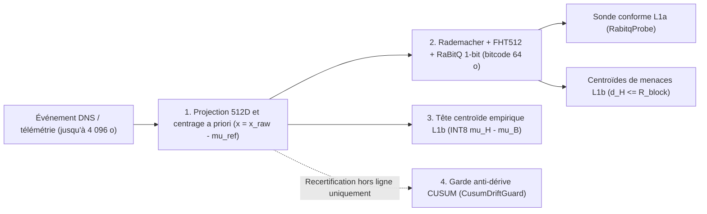

# Géométrie des centroïdes et formulations mathématiques exactes dans `c2blue55` (`v8.2`)

*Centrage a priori 512D, quantification 1-bit RaBitQ par rotation orthonormale de Rademacher-Hadamard, calibration conforme du rayon de veto, têtes centroïdes linéaires INT8 et garde anti-dérive CUSUM hors ligne*

    

**Navigation :** [English](centroid_geometry_and_formulas.md) · **Version française** · [PDF (FR)](centroid_geometry_and_formulas.fr.pdf) · [PDF (EN)](centroid_geometry_and_formulas.pdf) · [Présentation du dépôt](../README.fr.md) · [Micro-optimisation et sécurité](why_micro_optimization_is_a_security_choice.fr.md) · [Comparatif DNS 7 piles](dns_detection_solutions_benchmark.fr.md) · [Monographie Wittgenstein](c2blue55_wittgenstein_article.fr.md)

| Paramètre d'ingénierie | Spécification vérifiée |
| :--- | :--- |
| **Module et version** | `github.com/hazyhaar/c2blue55` (`v8.2`) · Licence MIT |
| **Dimension et bitcode** | `EmbeddingDim = 512` (espace d'entrée `float32`) $\rightarrow$ `8 × uint64` (`64` octets = `512` bits de signe par `CodebookEntry` de `72` octets) |
| **Complexité sur le chemin critique** | Transformation de Walsh-Hadamard rapide en place en $O(D \log_2 D)$ (`4 608` additions/soustractions papillon) + `8` instructions matérielles `POPCNT` déroulées par centroïde stocké (`0 B/op`, `0 allocs/op`) |
| **Latence de cascade (`i9-14900K`)** | Réflexe `L0` : `0.97 µs/op` (`GOEXPERIMENT=simd`) / plafond scalaire `1.12 µs/op` ; cascade complète `L0 -> L1a -> L1b` : `6.68–11.94 µs/op` (`SIMD`) / plafond scalaire `8.63–16.32 µs/op` |
| **Fichiers sources principaux** | `internal/engine/feature_extractor.go`, `internal/engine/rabitq512.go`, `internal/goclassifier/rabitq_probe.go`, `internal/engine/floppy_engine.go`, `internal/engine/inference_cascade.go`, `cmd/c2forge/floppy_builder.go`, `internal/engine/drift_guard.go` |

---

## Sommaire

- [Vue d'ensemble et substitution à l'inférence profonde](#vue-densemble-et-substitution-à-linférence-profonde)
- [1. Projection 512D et centroïde de référence a priori](#1-projection-512d-et-centroïde-de-référence-a-priori)
- [2. Centroïdes binaires de menaces RaBitQ FHT512 et rayon de veto](#2-centroïdes-binaires-de-menaces-rabitq-fht512-et-rayon-de-veto)
  - [2.1 Rotation orthonormale de Rademacher-Hadamard (`ProjectRabitq`)](#21-rotation-orthonormale-de-rademacher-hadamard-projectrabitq)
  - [2.2 Centrage de moyenne et encodage de signe 1-bit (`QuantizeRabitq`)](#22-centrage-de-moyenne-et-encodage-de-signe-1-bit-quantizerabitq)
  - [2.3 Distance de Hamming déroulée, arbitrage L1a/L1b et rayon calibré](#23-distance-de-hamming-déroulée-arbitrage-l1al1b-et-rayon-calibré)
- [3. Centroïdes empiriques de classes et tête linéaire quantifiée INT8](#3-centroïdes-empiriques-de-classes-et-tête-linéaire-quantifiée-int8)
- [4. Recertification hors ligne et garde anti-empoisonnement CUSUM](#4-recertification-hors-ligne-et-garde-anti-empoisonnement-cusum)

---

## Vue d'ensemble et substitution à l'inférence profonde

Sur un socket DNS à haut débit ou un anneau de télémétrie système, exécuter un réseau de neurones profond sur chaque paquet dépasse les budgets de latence à l'échelle de la microseconde et provoque des pauses imprévisibles du ramasse-miettes par allocations sur le tas. `c2blue55` remplace cette inférence lourde par une **cascade déterministe sans allocation** (`0 B/op`, binaire autonome `c2agent` dépouillé des symboles de `7.58 MiB`) adossée à des disquettes vectorielles projetées en lecture seule par `mmap` (`.c2book`, format `C2FLOP1`).

Chaque observation (jusqu'à `4 096` octets) est convertie en un vecteur de `512` flottants, centrée autour d'un point neutre analytique, tournée isométriquement par une transformation de Walsh-Hadamard rapide (`FHT512`), puis compressée en `512` bits de signe (`64` octets). Comparer un événement entrant à un catalogue de menaces se ramène alors à `8` instructions matérielles `XOR` + `POPCNT` sur registres de `64` bits.

À travers la base de code de `c2blue55`, le terme **centroïde** désigne quatre objets mathématiques distincts et chaînés :

| Objet mathématique | Représentation en mémoire | Rôle fonctionnel dans le moteur | Implémentation de référence |
| :--- | :--- | :--- | :--- |
| **1. Centroïde de référence a priori $\mu_{\text{ref}}$** | Tableau analytique fixe `[512]float32` | Soustrait l'espérance d'octets uniformes avant quantification ($x = x_{\text{raw}} - \mu_{\text{ref}}$) | `internal/engine/feature_extractor.go` |
| **2. Centroïdes de menaces RaBitQ** | `[8]uint64` (`512` bits) dans `CodebookEntry` (`72` octets) | Veto géométrique `L1b` par rayon de Hamming $d_H(q, c) \le R_{\text{block}}$ (et centroïde de dispersion par blocs en `L1a`) | `internal/engine/rabitq512.go`, `internal/engine/floppy_engine.go`, `internal/goclassifier/rabitq_probe.go` |
| **3. Centroïdes empiriques de classes $\mu_B, \mu_H$** | Moyennes arithmétiques `[512]float32` quantifiées en `[512]int8` | Hyperplan séparateur linéaire ($W \propto \mu_H - \mu_B$) évalué en `L1b` (`PredictINT8`) | `cmd/c2forge/floppy_builder.go` (`computeEmpiricalHead`) |
| **4. Centroïde de base suivi $\mu_t$** | Suite `[512]float32` hors ligne | Rejette l'empoisonnement graduel par pas euclidien, budget cumulé et détecteur `CUSUM` de Page | `internal/engine/drift_guard.go` (`CusumDriftGuard`) |

---

## 1. Projection 512D et centroïde de référence a priori

Lors de l'évaluation d'un événement `Probe_event_t` sur les trois disquettes générales de tournoi (`floppy_lolbas.c2book`, `floppy_dns_c2.c2book`, `floppy_agent_mcp.c2book`), `FeatureExtractor` résout l'intégralité de la charge utile jusqu'à $\text{PageSize} = 4\,096$ octets sans s'interrompre sur les octets `NUL` internes, et peuple un vecteur brut $x_{\text{raw}} \in \mathbb{R}^{512}$ découpé en sept régions contiguës :

$$\dim(x_{\text{raw}}) = \underbrace{256}_{\text{unigrammes d'octets}} + \underbrace{128}_{\text{bigrammes hachés}} + \underbrace{64}_{\text{trigrammes hachés}} + \underbrace{16}_{\text{entropies locales}} + \underbrace{12}_{\text{classes ASCII}} + \underbrace{8}_{\text{en-tête}} + \underbrace{28}_{\text{agrégats statistiques}} = 512$$

Afin d'empêcher les décalages d'échelle continus de dominer la quantification par signe, `FeatureExtractor.center` soustrait un **centroïde de référence a priori** $\mu_{\text{ref}} \in \mathbb{R}^{512}$ calculé à l'initialisation (`buildReferenceCentroid`), défini analytiquement comme l'espérance d'une loi d'octets uniforme sur $\{0, \dots, 255\}$ :

$$x = x_{\text{raw}} - \mu_{\text{ref}}$$

Chaque coordonnée de $\mu_{\text{ref}}$ est indépendante de tout corpus :

$$\mu_{\text{ref}}[i] = \begin{cases} \dfrac{1}{256} & \text{si } i \in [0, 255] \quad \text{(fréquences d'unigrammes d'octets uniformes)} \\[6pt] \dfrac{1}{128} & \text{si } i \in [256, 383] \quad \text{(seaux de bigrammes par décalage et XOR)} \\[6pt] \dfrac{1}{64} & \text{si } i \in [384, 447] \quad \text{(seaux de trigrammes à hachage multiplicatif)} \\[6pt] 1.0 & \text{si } i \in [448, 463] \quad \text{(16 fenêtres glissantes d'entropie de Shannon normalisées par 8 bits)} \\[6pt] \dfrac{|C_{i - 464}|}{256} & \text{si } i \in [464, 475] \quad \text{(cardinaux des 12 classes de caractères chevauchantes)} \\[6pt] 0 & \text{si } i \in [476, 511] \quad \text{(8 champs d'en-tête normalisés et 28 agrégats statistiques)} \end{cases}$$

où les 12 cardinaux $|C_k|$ valent `10` (voyelles ASCII), `42` (consonnes ASCII), `26` (majuscules), `26` (minuscules), `10` (chiffres décimaux), `12` (lettres hexadécimales `a-f`/`A-F`), `32` (ponctuation ASCII), `2` (espace et tabulation horizontale), `33` (octets de contrôle ASCII `< 0x20` ou `0x7F`), `128` (octets hauts $\ge \mathtt{0x80}$), `95` (ASCII imprimables `0x20..0x7E`) et `62` (ASCII alphanumériques).

> [!NOTE]
> Les disquettes DNS spécialisées à séparation par familles disjointes (`floppy_dns_tunnel.c2book` et `floppy_dns_dga.c2book` dans `internal/engine/dns_agent.go`) remplacent `FeatureExtractor` par des extracteurs aveugles au domaine parent (`ExtractDNSTunnel512` et `ExtractDNSDGA512` dans `internal/engine/dns_extractor.go`) qui centrent directement les descripteurs structurels DNS dans $[-1, 1]^{512}$ avant d'alimenter exactement les mêmes étapes `QuantizeFHT512` et `.c2book` décrites ci-dessous.

---

## 2. Centroïdes binaires de menaces RaBitQ FHT512 et rayon de veto

Dans une disquette `.c2book`, chaque vecteur d'attaque réel issu de la partition d'apprentissage (ainsi que tout motif hors-distribution inédit isolé par `DiscoverRedhostPatterns`) est compilé dans une entrée `CodebookEntry` de `72` octets réunissant un bitcode `[8]uint64` de `64` octets, `ThreatID` (`uint32`), `Subsystem` (`uint16`) et `Severity` (`uint16`).

### 2.1 Rotation orthonormale de Rademacher-Hadamard (`ProjectRabitq`)

Une quantification binaire directe le long des axes canoniques écraserait un signal éparse concentré sur quelques coordonnées (tel qu'un pic isolé d'unigramme). `QuantizeFHT512` (`internal/engine/rabitq512.go`) applique donc une rotation orthonormale structurée sans jamais allouer ni multiplier de matrice dense $512 \times 512$ (`ProjectRabitq` dans `internal/goclassifier/rabitq_probe.go`) :

$$p = \frac{1}{\sqrt{512}} \, H_{512} \, (s \odot x)$$

- $s \in \{-1, +1\}^{512}$ est un vecteur déterministe de signes de Rademacher engendré une seule fois par `SplitMix64` à partir de la graine fixe $\mathtt{RabitqSeed} = \mathtt{0x9E3779B97F4A7C15}$, et $s \odot x$ désigne le produit terme à terme ($s_i x_i$).
- $H_{512}$ est la transformation de Walsh-Hadamard rapide en place (`FHT512`), exécutée en $512 \log_2(512) = 4\,608$ additions et soustractions papillon, suivie d'une normalisation uniforme par $1/\sqrt{512} \approx 0.044194174$.
- Puisque $Q = \frac{1}{\sqrt{512}} H_{512} \operatorname{diag}(s)$ vérifie $Q^\top Q = I_{512}$, l'application constitue une **isométrie euclidienne exacte** ($\|p\|_2 = \|x\|_2$ et $\langle p, p' \rangle = \langle x, x' \rangle$) tout en répartissant uniformément la variance sur les `512` coordonnées.

### 2.2 Centrage de moyenne et encodage de signe 1-bit (`QuantizeRabitq`)

Le vecteur tourné $p \in \mathbb{R}^{512}$ est centré par la moyenne arithmétique de ses propres coordonnées avant quantification sur 1 bit :

$$\bar{p} = \frac{1}{512} \sum_{j=0}^{511} p_j, \qquad u_j = p_j - \bar{p}, \qquad c_j = \mathbf{1}_{\{u_j \ge 0\}} = \begin{cases} 1 & \text{si } p_j - \bar{p} \ge 0 \\ 0 & \text{si } p_j - \bar{p} < 0 \end{cases}$$

Les `512` bits de signe $c_j$ sont empaquetés en boutisme petit-boutiste dans `8` mots `uint64` selon $\mathtt{Bits}[\lfloor j / 64 \rfloor] \mathrel{|}= 1 \ll (j \bmod 64)$. Lorsqu'une estimation continue de distance euclidienne est requise (`RabitqCode`), les normes $L_1 = \sum_{j=0}^{511} |u_j|$ et $L_2 = \|u\|_2$ du vecteur centré sont conservées, reliant la distance de Hamming $d_H(q, c)$ à la distance euclidienne carrée par l'estimateur cosinus angulaire (`AsymmetricDistanceCodes`) :

$$\cos\hat{\theta}(q, c) = 1 - \frac{2 \, d_H(q, c)}{512}, \qquad \hat{d}_2^2(q, c) = \|u_q\|_2^2 + \|u_c\|_2^2 - 2 \, \|u_q\|_2 \, \|u_c\|_2 \, \cos\hat{\theta}(q, c)$$

*(Un estimateur asymétrique 1-bit $\times$ 5-bit par plans de bits transposés sans table de correspondance est également implémenté dans `BitProductScalar` : $\hat{d}_{\text{asym}}^2 = \|q\|_2^2 + \|u_c\|_2^2 - 2 \|u_c\|_2^2 \langle s_c, q \rangle / \|u_c\|_1$, où $s_c \in \{-1, +1\}^{512}$.)*

### 2.3 Distance de Hamming déroulée, arbitrage L1a/L1b et rayon calibré

À l'exécution (`FloppyDisk.SearchCentroid`), le bitcode entrant $q$ est comparé à chaque centroïde de menace stocké $c \in \mathcal{C}$ au moyen de `8` instructions matérielles `POPCNT` (`bits.OnesCount64`) avec arrêt anticipé par mot dès que le seuil `maxHamming` est franchi (`codebookHammingBounded`) :

$$d_H(q, c) = \sum_{w=0}^{7} \operatorname{popcount}(q_w \oplus c_w) \in \{0, \dots, 512\}, \qquad d_H^*(q) = \min_{c \in \mathcal{C}} d_H(q, c)$$

La monotonie défensive entre les étages `L1a` et `L1b` (`CascadeEngine.evaluateResolved` dans `internal/engine/inference_cascade.go`) impose trois règles géométriques :

1. **Subordination de la sonde conforme `L1a` :** en couche `L1a`, `RabitqProbe` mesure les distances de Hamming normalisées moyennes $D_1, D_2$ vis-à-vis d'au plus `32` prototypes bénins et `32` prototypes hostiles (`maxFloppyPrototypes = 32`) et évalue la dispersion $\text{Spread}_k$ de chaque classe par rapport à un centroïde majoritaire par mot de `64` bits (`classSpread` : le mot $w$ vaut `^uint64(0)` si et seulement si $2 \sum_{i=1}^n \operatorname{popcount}(\text{proto}_i[w]) \ge 64 n$, et `0` sinon). Même lorsque `L1a` conclut `ProbeConfirm` pour la classe bénigne ($D_1 \le \text{Spread}_1 + 0.02$ et $D_2 - D_1 > 0.02$), toute libération bénigne anticipée est **interdite** dès que $d_H^*(q) \le \max(R_{\text{block}}, 24)$ hors contexte bénin certifié par l'ontologie (`ontoVerdict != OntoVerdictAllow`).
2. **Veto direct par centroïde de menace en `L1b` :** si $d_H^*(q) \le R_{\text{block}}$, le moteur prononce immédiatement `VerdictBlock` avec une confiance en virgule fixe $Q_8 = 2(128 - d_H^*(q))$, à l'exception des domaines DNS apex enregistrables dépourvus de sous-domaine (`isApexDomain`), pour lesquels `PredictINT8` est évalué paresseusement afin qu'un domaine certifié bénin conforme (`predClass == 0 && conforms`) lève les fausses collisions lexicales.
3. **Quarantaine de bande grise suspecte :** si $R_{\text{block}} < d_H^*(q) \le 24$ (sans certification bénigne apex ni autorisation ontologique), l'événement est escaladé au minimum en `VerdictQuarantine`.

Lors de la compilation de la disquette (`CalibrateBlockRadius` dans `internal/engine/floppy_engine.go`), le rayon de veto $R_{\text{block}}$ est calibré exclusivement sur la partition bénigne d'apprentissage $B_{\text{train}}$ de sorte que le taux empirique de faux blocages n'excède jamais $\alpha_{\max} = 1\%$ (`benignBlockRateMax = 0.01`, majoré par `FloppyDefaultBlockRadius = 12` et minoré par `1`, la valeur `0` codant un rayon non déclaré dans l'en-tête) :

$$R_{\text{block}} = \max \left( \{1\} \cup \left\{ r \in \{0, \dots, 12\} \;\middle|\; \frac{1}{|B_{\text{train}}|} \sum_{x \in B_{\text{train}}} \mathbf{1}_{\{d_H^*(q(x)) \le r\}} \le 0.01 \right\} \right)$$

---

## 3. Centroïdes empiriques de classes et tête linéaire quantifiée INT8

Les événements qui atteignent `L1b` sans déclencher de veto direct par centroïde de menace sont évalués par une tête linéaire signée quantifiée sur 8 bits (`DecisionClass`). Dans `cmd/c2forge/floppy_builder.go` (`computeEmpiricalHead`), les deux vecteurs de poids sont construits directement comme **discriminant linéaire de Fisher isotrope par centroïdes les plus proches** à partir des plongements d'apprentissage réels centrés $B$ (bénins, classe `0`) et $H$ (hostiles, classe `1`) :

$$\mu_B = \frac{1}{|B|} \sum_{x \in B} x \in \mathbb{R}^{512}, \qquad \mu_H = \frac{1}{|H|} \sum_{x \in H} x \in \mathbb{R}^{512}$$

Les poids `INT8` $W_0, W_1 \in [-127, 127]^{512}$ (avec $\text{Bias}_0 = \text{Bias}_1 = 0$) quantifient la différence des centroïdes empiriques :

$$W_0[d] = \operatorname{clamp}_{[-127,\,127]}\!\Big(\operatorname{trunc}\big(127 \cdot (\mu_B[d] - \mu_H[d])\big)\Big), \qquad W_1[d] = \operatorname{clamp}_{[-127,\,127]}\!\Big(\operatorname{trunc}\big(127 \cdot (\mu_H[d] - \mu_B[d])\big)\Big)$$

À l'exécution (`FloppyDisk.PredictINT8`), après rejet immédiat de toute entrée comportant une coordonnée IEEE-754 `NaN` ou `±Inf`, chaque caractéristique est quantifiée en $q_d = \operatorname{clamp}_{[-127,\,127]}(\operatorname{trunc}(127 \cdot x_d))$, et le produit scalaire entier saturé ainsi que son score normalisé sont calculés sans aucune allocation sur le tas :

$$S_c(x) = \text{Bias}_c + \sum_{d=0}^{511} q_d \, W_c[d], \qquad \tilde{S}_c(x) = \frac{S_c(x)}{127 \times 512} = \frac{S_c(x)}{65\,024}, \qquad c^* = \arg\max_{c \in \{0, 1\}} S_c(x)$$

La prédiction $c^*$ est certifiée **conforme** si et seulement si $\tilde{S}_{c^*}(x) \ge \hat{q}_{c^*}$ (`QHat`), où `computeEmpiricalHead` fixe $\hat{q}_c = 0.4 \times \overline{\tilde{S}}_c$ lorsque le score normalisé moyen d'apprentissage $\overline{\tilde{S}}_c$ de la classe dépasse $0.02$ (et $0.05$ sinon). En `L1b`, $c^* = 1$ avec conformité produit `VerdictBlock`, tandis que $c^* = 1$ sans conformité produit `VerdictQuarantine`.

---

## 4. Recertification hors ligne et garde anti-empoisonnement CUSUM

En production, les disquettes `.c2book` sont des projections mémoire immuables `PROT_READ` authentifiées au chargement par `HMAC-SHA256` (couvrant les `32` premiers octets d'en-tête — dont `FamilyID` et `BlockRadius` — ainsi que l'intégralité du corps binaire) et par `CRC32C` de Castagnoli, puis permutées atomiquement en $O(1)$ via `FloppySlot`. Le trafic réseau en direct **ne modifie jamais les centroïdes en place**.

Lorsqu'une recertification périodique hors ligne évalue une suite de centroïdes de référence candidats $\mu_0, \mu_1, \dots, \mu_t \in \mathbb{R}^{512}$, un adversaire pourrait tenter une *attaque d'empoisonnement graduel* visant à dériver lentement la base vers du trafic hostile. `CusumDriftGuard.CheckUpdate` (`internal/engine/drift_guard.go`) soumet chaque transition $\mu_{t-1} \rightarrow \mu_t$ à quatre conditions cumulatives (configuration par défaut `DefaultDriftGuardConfig`) :

1. **Garde de finitude IEEE-754 :** rejet immédiat s'il existe $d \in \{0, \dots, 511\}$ tel que $\mu_t[d] \in \{\text{NaN}, \pm\infty\}$, empêchant toute comparaison flottante non ordonnée de contourner les seuils.
2. **Borne de déplacement euclidien instantané ($r_{\max} = 15.0$) :**
   $$\Delta_t = \|\mu_t - \mu_{t-1}\|_2 = \sqrt{\sum_{d=0}^{511} \big(\mu_t[d] - \mu_{t-1}[d]\big)^2} \le r_{\max}$$
3. **Budget total de dérive cumulée ($B = 50.0$) :**
   $$D_t = \sum_{\tau=1}^{t} \Delta_\tau \le B$$
4. **Détecteur séquentiel unilatéral `CUSUM` de Page** (tolérance $k = 0.1$, seuil d'alarme $h = 5.0$, état initial $S_0^+ = 0$) :
   $$S_t^+ = \max\!\big(0,\; S_{t-1}^+ + (\Delta_t - k)\big) \le h$$

Si l'une de ces inégalités échoue, le candidat $\mu_t$ est rejeté, le compteur `alertCount` est incrémenté et le centroïde de référence actif demeure figé sur $\mu_{t-1}$.
