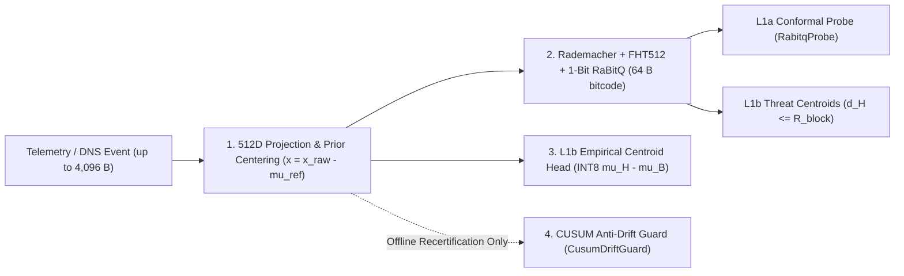

# Centroid Geometry and Exact Mathematical Formulations in `c2blue55` (`v8.2`)

*512D Prior Centering, Orthonormal Rademacher-Hadamard 1-Bit RaBitQ Quantization, Conformal Radius Calibration, INT8 Nearest-Centroid Heads, and Offline CUSUM Drift Guards*

    

**Navigation:** **English** · [Version française](centroid_geometry_and_formulas.fr.md) · [PDF Edition (EN)](centroid_geometry_and_formulas.pdf) · [PDF (FR)](centroid_geometry_and_formulas.fr.pdf) · [Repository Overview](../README.md) · [Micro-Optimization & Security](why_micro_optimization_is_a_security_choice.md) · [7-Stack DNS Benchmark](dns_detection_solutions_benchmark.md) · [Wittgenstein Monograph](c2blue55_wittgenstein_article.md)

| Engineering Parameter | Verified Specification |
| :--- | :--- |
| **Module & Release** | `github.com/hazyhaar/c2blue55` (`v8.2`) · MIT License |
| **Vector & Bitcode Width** | `EmbeddingDim = 512` (`float32` input space) $\rightarrow$ `8 × uint64` (`64` bytes = `512` sign bits per `CodebookEntry` of `72` bytes) |
| **Hot-Path Complexity** | $O(D \log_2 D)$ in-place Fast Walsh-Hadamard Transform (`4,608` butterfly add/sub operations) + `8` unrolled hardware `POPCNT` instructions per stored centroid (`0 B/op`, `0 allocs/op`) |
| **Cascade Latency (`i9-14900K`)** | `L0` reflex: `0.97 µs/op` (`GOEXPERIMENT=simd`) / `1.12 µs/op` scalar ceiling; full `L0 -> L1a -> L1b` cascade: `6.68–11.94 µs/op` (`SIMD`) / `8.63–16.32 µs/op` scalar ceiling |
| **Primary Source Files** | `internal/engine/feature_extractor.go`, `internal/engine/rabitq512.go`, `internal/goclassifier/rabitq_probe.go`, `internal/engine/floppy_engine.go`, `internal/engine/inference_cascade.go`, `cmd/c2forge/floppy_builder.go`, `internal/engine/drift_guard.go` |

---

## Table of Contents

- [Overview: Why Binary and INT8 Centroids Replace Deep Runtime Inference](#overview-why-binary-and-int8-centroids-replace-deep-runtime-inference)
- [1. 512D Feature Projection and Prior Reference Centroid](#1-512d-feature-projection-and-prior-reference-centroid)
- [2. 1-Bit RaBitQ FHT512 Threat Centroids and Veto Radius](#2-1-bit-rabitq-fht512-threat-centroids-and-veto-radius)
  - [2.1 Orthonormal Rademacher-Hadamard Rotation (`ProjectRabitq`)](#21-orthonormal-rademacher-hadamard-rotation-projectrabitq)
  - [2.2 Coordinate-Mean Centering and 1-Bit Sign Encoding (`QuantizeRabitq`)](#22-coordinate-mean-centering-and-1-bit-sign-encoding-quantizerabitq)
  - [2.3 Unrolled Hamming Distance, L1a/L1b Arbitration, and Calibrated Radius](#23-unrolled-hamming-distance-l1al1b-arbitration-and-calibrated-radius)
- [3. Empirical Class Centroids and Quantized INT8 Linear Head](#3-empirical-class-centroids-and-quantized-int8-linear-head)
- [4. Offline Recertification and Anti-Poisoning CUSUM Drift Guard](#4-offline-recertification-and-anti-poisoning-cusum-drift-guard)

---

## Overview: Why Binary and INT8 Centroids Replace Deep Runtime Inference

On high-throughput DNS sockets or host telemetry rings, running a deep neural network on every packet exceeds microsecond latency budgets and triggers unpredictable garbage-collector pauses through heap allocations. `c2blue55` replaces heavy runtime inference with a **zero-allocation deterministic cascade** (`0 B/op`, standalone stripped `c2agent` binary of `7.58 MiB`) backed by read-only `mmap`-projected vector floppies (`.c2book`, format `C2FLOP1`).

Every observation (up to `4,096` bytes) is mapped into a `512`-dimensional floating-point vector, centered against an analytical neutral point, rotated isometrically by a Fast Walsh-Hadamard Transform (`FHT512`), and compressed to `512` sign bits (`64` bytes). Comparing a live event against a threat catalog reduces to `8` hardware `XOR` + `POPCNT` instructions on `64`-bit registers.

Across the `c2blue55` codebase, the term **centroid** refers to four distinct, chained mathematical objects:

| Mathematical Object | In-Memory Representation | Functional Role in the Engine | Reference Implementation |
| :--- | :--- | :--- | :--- |
| **1. Prior Reference Centroid $\mu_{\text{ref}}$** | Fixed analytical `[512]float32` array | Subtracts uniform-byte expectation prior to quantization ($x = x_{\text{raw}} - \mu_{\text{ref}}$) | `internal/engine/feature_extractor.go` |
| **2. RaBitQ Threat Centroids** | `[8]uint64` (`512` bits) inside `72`-byte `CodebookEntry` | `L1b` geometric threat veto via Hamming radius $d_H(q, c) \le R_{\text{block}}$ (plus blockwise dispersion centroid in `L1a`) | `internal/engine/rabitq512.go`, `internal/engine/floppy_engine.go`, `internal/goclassifier/rabitq_probe.go` |
| **3. Empirical Class Centroids $\mu_B, \mu_H$** | Arithmetic `[512]float32` means quantized to `[512]int8` | Linear separating hyperplane ($W \propto \mu_H - \mu_B$) evaluated in `L1b` (`PredictINT8`) | `cmd/c2forge/floppy_builder.go` (`computeEmpiricalHead`) |
| **4. Tracked Baseline Centroid $\mu_t$** | Offline `[512]float32` sequence | Rejects gradual adversarial poisoning via Euclidean step, cumulative budget, and Page's `CUSUM` | `internal/engine/drift_guard.go` (`CusumDriftGuard`) |

---

## 1. 512D Feature Projection and Prior Reference Centroid

When evaluating an event `Probe_event_t` on the three general tournament floppies (`floppy_lolbas.c2book`, `floppy_dns_c2.c2book`, `floppy_agent_mcp.c2book`), `FeatureExtractor` resolves the full payload up to $\text{PageSize} = 4,096$ bytes without stopping on interior `NUL` bytes, and populates a raw vector $x_{\text{raw}} \in \mathbb{R}^{512}$ partitioned into seven contiguous regions:

$$\dim(x_{\text{raw}}) = \underbrace{256}_{\text{byte unigrams}} + \underbrace{128}_{\text{hashed bigrams}} + \underbrace{64}_{\text{hashed trigrams}} + \underbrace{16}_{\text{local entropies}} + \underbrace{12}_{\text{ASCII classes}} + \underbrace{8}_{\text{event header}} + \underbrace{28}_{\text{statistical aggregates}} = 512$$

To prevent static baseline offsets from dominating sign quantization, `FeatureExtractor.center` subtracts a compile-time **prior reference centroid** $\mu_{\text{ref}} \in \mathbb{R}^{512}$ (`buildReferenceCentroid`), defined analytically as the expected value of a uniform byte distribution over $\{0, \dots, 255\}$:

$$x = x_{\text{raw}} - \mu_{\text{ref}}$$

Each coordinate of $\mu_{\text{ref}}$ is data-independent:

$$\mu_{\text{ref}}[i] = \begin{cases} \dfrac{1}{256} & \text{if } i \in [0, 255] \quad \text{(uniform byte unigram frequencies)} \\[6pt] \dfrac{1}{128} & \text{if } i \in [256, 383] \quad \text{(2-byte shift-XOR bigram buckets)} \\[6pt] \dfrac{1}{64} & \text{if } i \in [384, 447] \quad \text{(3-byte multiplicative hash buckets)} \\[6pt] 1.0 & \text{if } i \in [448, 463] \quad \text{(16 sliding Shannon entropy windows normalized by 8 bits)} \\[6pt] \dfrac{|C_{i - 464}|}{256} & \text{if } i \in [464, 475] \quad \text{(cardinalities of the 12 overlapping character classes)} \\[6pt] 0 & \text{if } i \in [476, 511] \quad \text{(8 normalized header fields and 28 statistical aggregates)} \end{cases}$$

where the 12 class cardinalities $|C_k|$ are `10` (ASCII vowels), `42` (ASCII consonants), `26` (uppercase), `26` (lowercase), `10` (decimal digits), `12` (hexadecimal letters `a-f`/`A-F`), `32` (ASCII punctuation), `2` (space and horizontal tab), `33` (ASCII control bytes `< 0x20` or `0x7F`), `128` (high bytes $\ge \mathtt{0x80}$), `95` (printable ASCII `0x20..0x7E`), and `62` (alphanumeric ASCII).

> [!NOTE]
> Specialized Cold-Family Split DNS floppies (`floppy_dns_tunnel.c2book` and `floppy_dns_dga.c2book` in `internal/engine/dns_agent.go`) replace `FeatureExtractor` with parent-blind domain extractors (`ExtractDNSTunnel512` and `ExtractDNSDGA512` in `internal/engine/dns_extractor.go`) that directly center structural DNS features into $[-1, 1]^{512}$ before feeding the exact same `QuantizeFHT512` and `.c2book` stages below.

---

## 2. 1-Bit RaBitQ FHT512 Threat Centroids and Veto Radius

Inside a `.c2book` floppy, every real attack vector from the training partition (as well as any uncovered out-of-distribution motif isolated by `DiscoverRedhostPatterns`) is compiled into a `72`-byte `CodebookEntry` consisting of a `64`-byte `[8]uint64` bitcode, `ThreatID` (`uint32`), `Subsystem` (`uint16`), and `Severity` (`uint16`).

### 2.1 Orthonormal Rademacher-Hadamard Rotation (`ProjectRabitq`)

Direct 1-bit sign quantization along canonical feature axes collapses sparse signals concentrated on a handful of coordinates (such as a single unigram spike). `QuantizeFHT512` (`internal/engine/rabitq512.go`) therefore applies a structured orthonormal rotation without allocating or multiplying by a dense $512 \times 512$ matrix (`ProjectRabitq` in `internal/goclassifier/rabitq_probe.go`):

$$p = \frac{1}{\sqrt{512}} \, H_{512} \, (s \odot x)$$

- $s \in \{-1, +1\}^{512}$ is a deterministic Rademacher sign vector generated once via `SplitMix64` from the fixed seed $\mathtt{RabitqSeed} = \mathtt{0x9E3779B97F4A7C15}$, and $s \odot x$ denotes element-wise multiplication ($s_i x_i$).
- $H_{512}$ is the in-place Fast Walsh-Hadamard Transform (`FHT512`), computed in $512 \log_2(512) = 4,608$ butterfly additions and subtractions, followed by uniform scaling by $1/\sqrt{512} \approx 0.044194174$.
- Because $Q = \frac{1}{\sqrt{512}} H_{512} \operatorname{diag}(s)$ satisfies $Q^\top Q = I_{512}$, the mapping is an **exact Euclidean isometry** ($\|p\|_2 = \|x\|_2$ and $\langle p, p' \rangle = \langle x, x' \rangle$) while spreading coordinate variance evenly across all `512` dimensions.

### 2.2 Coordinate-Mean Centering and 1-Bit Sign Encoding (`QuantizeRabitq`)

The rotated vector $p \in \mathbb{R}^{512}$ is centered by its own coordinate arithmetic mean prior to 1-bit quantization:

$$\bar{p} = \frac{1}{512} \sum_{j=0}^{511} p_j, \qquad u_j = p_j - \bar{p}, \qquad c_j = \mathbf{1}_{\{u_j \ge 0\}} = \begin{cases} 1 & \text{if } p_j - \bar{p} \ge 0 \\ 0 & \text{if } p_j - \bar{p} < 0 \end{cases}$$

The `512` sign bits $c_j$ are packed little-endian into `8` `uint64` words via $\mathtt{Bits}[\lfloor j / 64 \rfloor] \mathrel{|}= 1 \ll (j \bmod 64)$. When continuous Euclidean distance estimation is needed (`RabitqCode`), the $L_1 = \sum_{j=0}^{511} |u_j|$ and $L_2 = \|u\|_2$ norms of the centered vector are retained, linking the Hamming distance $d_H(q, c)$ to the squared Euclidean distance through the angular cosine estimator (`AsymmetricDistanceCodes`):

$$\cos\hat{\theta}(q, c) = 1 - \frac{2 \, d_H(q, c)}{512}, \qquad \hat{d}_2^2(q, c) = \|u_q\|_2^2 + \|u_c\|_2^2 - 2 \, \|u_q\|_2 \, \|u_c\|_2 \, \cos\hat{\theta}(q, c)$$

*(An asymmetric 1-bit $\times$ 5-bit transposed bit-plane estimator without lookup tables is also implemented in `BitProductScalar`: $\hat{d}_{\text{asym}}^2 = \|q\|_2^2 + \|u_c\|_2^2 - 2 \|u_c\|_2^2 \langle s_c, q \rangle / \|u_c\|_1$, where $s_c \in \{-1, +1\}^{512}$.)*

### 2.3 Unrolled Hamming Distance, L1a/L1b Arbitration, and Calibrated Radius

At runtime (`FloppyDisk.SearchCentroid`), a live query bitcode $q$ is compared against each stored threat centroid $c \in \mathcal{C}$ using `8` hardware `POPCNT` instructions (`bits.OnesCount64`) with early word-level termination as soon as `maxHamming` is exceeded (`codebookHammingBounded`):

$$d_H(q, c) = \sum_{w=0}^{7} \operatorname{popcount}(q_w \oplus c_w) \in \{0, \dots, 512\}, \qquad d_H^*(q) = \min_{c \in \mathcal{C}} d_H(q, c)$$

Defensive monotonicity across stages `L1a` and `L1b` (`CascadeEngine.evaluateResolved` in `internal/engine/inference_cascade.go`) enforces three geometric rules:

1. **Subordination of the `L1a` Conformal Probe:** In `L1a`, `RabitqProbe` measures mean normalized Hamming distances $D_1, D_2$ to up to `32` benign and `32` hostile prototypes (`maxFloppyPrototypes = 32`) and computes each class's dispersion $\text{Spread}_k$ relative to a 64-bit word-level majority centroid (`classSpread`: word $w$ is set to `^uint64(0)` iff $2 \sum_{i=1}^n \operatorname{popcount}(\text{proto}_i[w]) \ge 64 n$, else `0`). Even when `L1a` returns `ProbeConfirm` for the benign class ($D_1 \le \text{Spread}_1 + 0.02$ and $D_2 - D_1 > 0.02$), early benign release is **forbidden** whenever $d_H^*(q) \le \max(R_{\text{block}}, 24)$ outside ontologically certified benign contexts (`ontoVerdict != OntoVerdictAllow`).
2. **Direct `L1b` Threat Centroid Veto:** If $d_H^*(q) \le R_{\text{block}}$, the engine immediately issues `VerdictBlock` with fixed-point confidence $Q_8 = 2(128 - d_H^*(q))$, except on registrable apex DNS names lacking subdomains (`isApexDomain`), where `PredictINT8` is evaluated lazily to allow a conformally certified benign domain (`predClass == 0 && conforms`) to override false lexical collisions.
3. **Suspicious Gray-Band Quarantine:** If $R_{\text{block}} < d_H^*(q) \le 24$ (and neither apex-certified benign nor ontologically allowed), the event is escalated at minimum to `VerdictQuarantine`.

During floppy compilation (`CalibrateBlockRadius` in `internal/engine/floppy_engine.go`), the veto radius $R_{\text{block}}$ is calibrated exclusively on the benign training partition $B_{\text{train}}$ so that the empirical false-block rate never exceeds $\alpha_{\max} = 1\%$ (`benignBlockRateMax = 0.01`, bounded above by `FloppyDefaultBlockRadius = 12` and floored at `1`, since `0` encodes an undeclared header radius):

$$R_{\text{block}} = \max \left( \{1\} \cup \left\{ r \in \{0, \dots, 12\} \;\middle|\; \frac{1}{|B_{\text{train}}|} \sum_{x \in B_{\text{train}}} \mathbf{1}_{\{d_H^*(q(x)) \le r\}} \le 0.01 \right\} \right)$$

---

## 3. Empirical Class Centroids and Quantized INT8 Linear Head

Events reaching `L1b` without triggering a direct threat centroid veto are scored by a quantized 8-bit signed linear head (`DecisionClass`). In `cmd/c2forge/floppy_builder.go` (`computeEmpiricalHead`), the two class weight vectors are derived directly as a **Nearest-Centroid / isotropic Fisher linear discriminant** from the real centered training embeddings $B$ (benign, class `0`) and $H$ (hostile, class `1`):

$$\mu_B = \frac{1}{|B|} \sum_{x \in B} x \in \mathbb{R}^{512}, \qquad \mu_H = \frac{1}{|H|} \sum_{x \in H} x \in \mathbb{R}^{512}$$

The `INT8` weights $W_0, W_1 \in [-127, 127]^{512}$ (with $\text{Bias}_0 = \text{Bias}_1 = 0$) quantize the empirical centroid difference:

$$W_0[d] = \operatorname{clamp}_{[-127,\,127]}\!\Big(\operatorname{trunc}\big(127 \cdot (\mu_B[d] - \mu_H[d])\big)\Big), \qquad W_1[d] = \operatorname{clamp}_{[-127,\,127]}\!\Big(\operatorname{trunc}\big(127 \cdot (\mu_H[d] - \mu_B[d])\big)\Big)$$

At runtime (`FloppyDisk.PredictINT8`), after rejecting any input containing IEEE-754 `NaN` or `±Inf` coordinates, each feature is quantized to $q_d = \operatorname{clamp}_{[-127,\,127]}(\operatorname{trunc}(127 \cdot x_d))$, and the saturated integer dot product and normalized score are computed with zero heap allocations:

$$S_c(x) = \text{Bias}_c + \sum_{d=0}^{511} q_d \, W_c[d], \qquad \tilde{S}_c(x) = \frac{S_c(x)}{127 \times 512} = \frac{S_c(x)}{65,024}, \qquad c^* = \arg\max_{c \in \{0, 1\}} S_c(x)$$

Prediction $c^*$ is certified **conformal** iff $\tilde{S}_{c^*}(x) \ge \hat{q}_{c^*}$ (`QHat`), where `computeEmpiricalHead` sets $\hat{q}_c = 0.4 \times \overline{\tilde{S}}_c$ whenever the class's mean normalized training score $\overline{\tilde{S}}_c$ exceeds $0.02$ (and $0.05$ otherwise). In `L1b`, $c^* = 1$ with conformity yields `VerdictBlock`, whereas $c^* = 1$ without conformity yields `VerdictQuarantine`.

---

## 4. Offline Recertification and Anti-Poisoning CUSUM Drift Guard

In production, `.c2book` floppies are immutable `PROT_READ` memory mappings authenticated at load time by `HMAC-SHA256` (covering the first `32` header bytes—including `FamilyID` and `BlockRadius`—plus the entire binary body) and Castagnoli `CRC32C`, swapped atomically in $O(1)$ via `FloppySlot`. Live network traffic **never mutates centroids in place**.

When periodic offline recertification computes a sequence of candidate reference centroids $\mu_0, \mu_1, \dots, \mu_t \in \mathbb{R}^{512}$, an adversary could attempt a *boiling-frog poisoning attack* by gradually shifting the baseline toward hostile traffic. `CusumDriftGuard.CheckUpdate` (`internal/engine/drift_guard.go`) gates every transition $\mu_{t-1} \rightarrow \mu_t$ behind four cumulative conditions (default configuration `DefaultDriftGuardConfig`):

1. **IEEE-754 Finiteness Gate:** Immediate rejection if $\exists d \in \{0, \dots, 511\}$ with $\mu_t[d] \in \{\text{NaN}, \pm\infty\}$, preventing unordered floating-point comparisons from bypassing threshold checks.
2. **Instantaneous Euclidean Step Bound ($r_{\max} = 15.0$):**
   $$\Delta_t = \|\mu_t - \mu_{t-1}\|_2 = \sqrt{\sum_{d=0}^{511} \big(\mu_t[d] - \mu_{t-1}[d]\big)^2} \le r_{\max}$$
3. **Total Cumulative Drift Budget ($B = 50.0$):**
   $$D_t = \sum_{\tau=1}^{t} \Delta_\tau \le B$$
4. **Page's One-Sided Sequential `CUSUM` Detector** (slack $k = 0.1$, alarm threshold $h = 5.0$, initial state $S_0^+ = 0$):
   $$S_t^+ = \max\!\big(0,\; S_{t-1}^+ + (\Delta_t - k)\big) \le h$$

If any inequality fails, candidate $\mu_t$ is rejected, `alertCount` is incremented, and the active reference centroid remains pinned to $\mu_{t-1}$.
