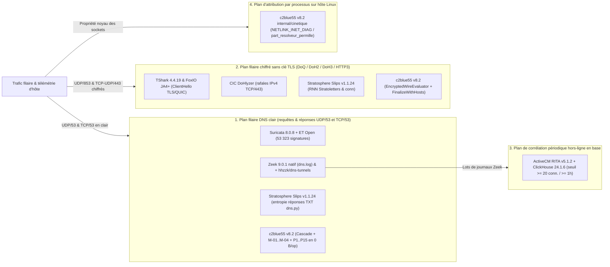

# Benchmark comparatif de 7 piles Open-Source DNS & Résolveurs Chiffrés (`v8.2`)

[](../README.fr.md) [](#11-périmètre-architectural--contrat-déquité) [](#4-banc-de-charge-soutenue-de-60-secondes-et-de-survie-opérationnelle-paliers-normal--extrême) [](#7-matrice-dédiée-des-20-reproducteurs-w-01w-20-et-bibliographie-des-24-signalements-amont-124) [](../LICENSE)

**Langue & Publications associées :** [English edition](dns_detection_solutions_benchmark.md) · **Français** · [Édition Word (.docx)](dns_detection_solutions_benchmark.fr.docx) · [README du dépôt](../README.fr.md) · [Micro-optimisation & Sécurité](why_micro_optimization_is_a_security_choice.fr.md) · [Monographie complète Wittgenstein](c2blue55_wittgenstein_article.fr.md)

| Paramètre | Valeur vérifiée sur le banc |
| :--- | :--- |
| **Date & version** | `2026-11-01 — c2blue55 v8.2` (`94135a3`) |
| **Révision** | `2026-11-06` — règles de décision des piles tierces et réglage `internal_subnets` de RITA explicités (sections 2.3 et 8.1) après un rejeu automatisé complet du lot `L1` ; aucun compte modifié |
| **Matériel, OS & chaîne Go** | `Linux 6.14.0-37-generic` (`Linux 6.14 x86_64`), `Intel(R) Core(TM) i9-14900K`, `Go 1.27` (`GOAMD64=v3`, `GOEXPERIMENT=simd`), exécution séquentielle stricte sans contention |
| **Piles évaluées (`7`)** | `Suricata 8.0.8 + Emerging Threats Open (53 323 règles)`, `Zeek 9.0.1` (natif & `+ hhzzk/dns-tunnels`), `ActiveCM RITA v5.1.2 + ClickHouse 24.1.6`, `Wireshark / TShark 4.4.19 + FoxIO JA4+`, `CIC DoHlyzer`, `Stratosphere Linux IPS (Slips) v1.1.24` et `c2blue55 v8.2` (`94135a3`) |
| **Corpus & paliers de charge** | `5` jeux DNS d'entreprise externes (`netrack/learn`), suites DNS clair `L1` classique & `L1-bis` hors-distribution (`61` PCAP), `35` PCAP chiffrés `joint35` (`19 L1` en-échantillon + `16 L1-bis` hors-échantillon), socket `UDP/53` actif `60 s` (`2k` & `45k paq/s`), rejeu PCAP multiprotocole `60 s` (`normal-60s.pcap` `147 020` paq. & `extreme-60s.pcap` `3 011 298` paq.) |
| **Discipline statistique** | Notation stricte dans le contrat (`N/A` hors contrat), comptes bruts (`TP / FP / TN / FN`), taux de la classe majoritaire, `ROC AUC`, séparation stricte en-échantillon (`L1`) contre hors-échantillon (`L1-bis`) |
| **Divulgations amont** | `24` signalements techniques `[1]..[24]` (`W-01..W-20` + `S-21..S-24`) : `20` issues GitHub publiques en ligne (`#2159..#2162` pour Slips sous charge) + `4` fiches préparées hors GitHub (Redmine, GitLab, Discourse) |

---

## Sommaire

- [Synthèse exécutive](#synthèse-exécutive)
- [1. Cadrage architectural et méthodologie anti-homme de paille](#1-cadrage-architectural-et-méthodologie-anti-homme-de-paille)
  - [1.1 Périmètre architectural : contrat d'équité](#11-périmètre-architectural--contrat-déquité)
  - [1.2 Matrice des contrats d'ingénierie des 7 piles évaluées](#12-matrice-des-contrats-dingénierie-des-7-piles-évaluées)
  - [1.3 Discipline statistique de restitution](#13-discipline-statistique-de-restitution)
- [2. Compétence DNS en clair (`L1`) contre tunnels évasifs modernes (`L1-bis` hors-distribution)](#2-compétence-dns-en-clair-l1-contre-tunnels-évasifs-modernes-l1-bis-hors-distribution)
  - [2.1 Phénomène opérationnel](#21-phénomène-opérationnel)
  - [2.2 Mécanismes d'ingénierie expliquant la divergence](#22-mécanismes-dingénierie-expliquant-la-divergence)
  - [2.3 Tableau comparatif — DNS en clair (`L1` classique contre `L1-bis` évasions modernes)](#23-tableau-comparatif--dns-en-clair-l1-classique-contre-l1-bis-évasions-modernes)
- [3. Supervision sans clé du DNS chiffré (`DoQ`, `DoH2`, `DoH3`)](#3-supervision-sans-clé-du-dns-chiffré-doq-doh2-doh3)
  - [3.1 Phénomène opérationnel](#31-phénomène-opérationnel)
  - [3.2 Mécanismes d'ingénierie sans clés de déchiffrement](#32-mécanismes-dingénierie-sans-clés-de-déchiffrement)
  - [3.3 Résultats hors-distribution sur transports chiffrés (`L1-bis` & `joint35`)](#33-résultats-hors-distribution-sur-transports-chiffrés-l1-bis--joint35)
- [4. Banc de charge soutenue de 60 secondes et de survie opérationnelle (paliers Normal & Extrême)](#4-banc-de-charge-soutenue-de-60-secondes-et-de-survie-opérationnelle-paliers-normal--extrême)
  - [4.1 Phénomène opérationnel et protocole expérimental](#41-phénomène-opérationnel-et-protocole-expérimental)
  - [4.2 Banc actif sur socket UDP Linux de 60 secondes (`c2blue55 v8.2`, `GOEXPERIMENT=simd`)](#42-banc-actif-sur-socket-udp-linux-de-60-secondes-c2blue55-v82-goexperimentsimd)
  - [4.3 Comparaison séquentielle système et ressources sur `normal-60s.pcap` et `extreme-60s.pcap`](#43-comparaison-séquentielle-système-et-ressources-sur-normal-60spcap-et-extreme-60spcap)
  - [4.4 Exactitude de détection dans le contrat sous flux multi-domaines de 60 secondes](#44-exactitude-de-détection-dans-le-contrat-sous-flux-multi-domaines-de-60-secondes)
- [5. Audit causal d'ingénierie de `Stratosphere Slips v1.1.24` sous charge (`[21]..[24]`)](#5-audit-causal-dingénierie-de-stratosphere-slips-v1124-sous-charge-2124)
  - [5.1 Phénomène opérationnel et comparaison visuelle des pipelines sous charge](#51-phénomène-opérationnel-et-comparaison-visuelle-des-pipelines-sous-charge)
  - [5.2 `S-21` (`[21]`) : amplification à 100 % sur `flows.sqlite` et écrasement de clé primaire dans `altflows`](#52-s-21-21--amplification-à-100--sur-flowssqlite-et-écrasement-de-clé-primaire-dans-altflows)
  - [5.3 `S-22` (`[22]`) : plancher `poll()` de `3,16 ms` par flux, tempête Redis loopback et `MPQueue` intra-processus](#53-s-22-22--plancher-poll-de-316-ms-par-flux-tempête-redis-loopback-et-mpqueue-intra-processus)
  - [5.4 `S-23` (`[23]`) : explosion mémoire de `+4,09 Gio` dans les files, descripteurs pré-`fork()` et `t_cell` inconditionnel](#54-s-23-23--explosion-mémoire-de-409-gio-dans-les-files-descripteurs-pré-fork-et-t_cell-inconditionnel)
  - [5.5 `S-24` (`[24]`) : famine FIFO hors ligne de `conn.log` derrière `dns.log` et autoscale / métriques inopérants](#55-s-24-24--famine-fifo-hors-ligne-de-connlog-derrière-dnslog-et-autoscale--métriques-inopérants)
- [6. Frontières d'échec falsifiables de `c2blue55 v8.2` (symétrie de divulgation)](#6-frontières-déchec-falsifiables-de-c2blue55-v82-symétrie-de-divulgation)
  - [6.1 Matrice récapitulative des modes d'échec falsifiables](#61-matrice-récapitulative-des-modes-déchec-falsifiables)
  - [6.2 Contrôles opérationnels de déploiement et parades](#62-contrôles-opérationnels-de-déploiement-et-parades)
- [7. Matrice dédiée des 20 reproducteurs (`W-01..W-20`) et bibliographie des 24 signalements amont (`[1]..[24]`)](#7-matrice-dédiée-des-20-reproducteurs-w-01w-20-et-bibliographie-des-24-signalements-amont-124)
  - [7.1 Récapitulatif des signalements par projet amont](#71-récapitulatif-des-signalements-par-projet-amont)
  - [7.2 Bibliographie des issues et traqueurs amont (`[1]..[24]`)](#72-bibliographie-des-issues-et-traqueurs-amont-124)
- [8. Commandes de reproductibilité](#8-commandes-de-reproductibilité)
  - [8.1 Règles de décision et configuration des piles tierces (`L1`, section 2.3)](#81-règles-de-décision-et-configuration-des-piles-tierces-l1-section-23)

---

## Synthèse exécutive

Les équipes de défense réseau font aujourd'hui face à deux évolutions simultanées des canaux de commande et contrôle (`C2`) et d'exfiltration par DNS :

1. **Migration protocolaire vers les transports chiffrés :** les implants encapsulent désormais leurs échanges dans DNS-over-QUIC (`DoQ`, RFC 9250 sur `UDP/853`), DNS-over-HTTP/2 (`DoH2`, RFC 8484 sur `TCP/443`) et DNS-over-HTTP/3 (`DoH3` sur QUIC), voire répartissent un même flux sur plusieurs résolveurs récursifs indépendants en parallèle (`Slipstream`, QUIC-dans-DNS multivoie).
2. **Contrebande à faible nombre de requêtes et types d'enregistrements atypiques sur DNS en clair :** même sur `UDP/53` non chiffré, les cadriciels récents (`VayDNS`, `NoizDNS`, `Soar`) transfèrent `32 Kio` de charge utile en moins de `100` requêtes en exploitant des réponses filaires `EDNS(0)` de `1 232` à `1 540` octets transportant `420` à `850` octets utiles nets par réponse, des types d'enregistrements alternatifs (`CAA`, `SRV`, `MX`, `SOA`), des encodages à entropie aplatie ou des réponses signées `NXDOMAIN` porteuses d'enregistrements `TXT` terminaux.

Comparer équitablement des piles de sécurité open-source sur ces régimes exige un **cadrage architectural strict**. Attribuer une pénalité `ROC AUC = 0,5000` sur des flux QUIC chiffrés à un analyseur protocolaire (`Zeek` natif), à un extracteur d'empreintes `ClientHello` (`JA4+`) ou à un moteur de signatures dépourvu de coupure TLS (`Suricata + ET Open`) constituerait un homme de paille méthodologique : ces outils n'ont pas pour contrat de classifier sans clés des charges applicatives chiffrées après la poignée de main. Symétriquement, exposer les forces de `c2blue55` sans documenter les scénarios précis où ses propres règles non calibrées échouent violerait l'intégrité expérimentale.

Ce benchmark applique trois règles méthodologiques strictes :

- **Notation exclusivement dans le contrat architectural :** chaque pile n'est notée (`TP, FP, TN, FN`, `Taux de classe majoritaire` et `ROC AUC`) qu'à l'intérieur de son périmètre revendiqué, et marquée **`N/A (Hors contrat)`** partout ailleurs.
- **Double lisibilité (`Phénomène -> Mécanisme d'ingénieur -> Preuve exacte`) :** chaque section expose d'abord le phénomène opérationnel concret, détaille ensuite le mécanisme système sous-jacent en langage d'ingénieur explicite sans supposer la connaissance du code interne, puis fournit les comptes bruts exacts, les empreintes SHA-256 des captures et les commandes de reproduction.
- **Contribution amont et auto-audit symétrique :**
  - **Audits de l'écosystème tiers :** chaque défaut ou angle mort identifié dans les piles tierces a été isolé dans un reproducteur minimal déterministe (`W-01..W-20` plus 4 reproducteurs de profilage sous charge) au travers de **24 signalements techniques (`[1]..[24]` : `20` issues GitHub publiées en ligne — dont les `4` rapports explicatifs Slips sous charge `#2159..#2162` — et `4` fiches préparées pour les traqueurs externes Redmine/GitLab/Discourse)**.
  - **Auto-audit falsifiable de `c2blue55 v8.2` :** la section 6 applique exactement la même rigueur à `c2blue55 v8.2`, en publiant son taux de **`27,6 %` (`2 385 / 8 654` `Block` strict)** de faux positifs sur des zones DNS d'entreprise tierces non calibrées (`netrack/learn`), ses **`215..216 / 240`** faux positifs en flux continu sur navigation multi-domaines (`REASON_P4_MULTIPARENT_SHARDING`), et son angle mort filaire **`TP = 0 / 1, FP = 0 / 1, TN = 1 / 1, FN = 1 / 1`** (`ROC AUC = 0,5000`) lorsqu'un tunnel de `32 Kio` partage la même connexion QUIC que `3,29 Mo` (`3,14 Mio`) de téléchargements HTTP/3.

---

## 1. Cadrage architectural et méthodologie anti-homme de paille

### 1.1 Périmètre architectural : contrat d'équité

Les outils open-source dits de « sécurité DNS » occupent quatre plans d'observation radicalement distincts d'une architecture défensive, et une comparaison équitable impose de positionner chaque pile dans son contrat exact :

1. **Analyseurs protocolaires et moteurs de télémétrie réseau (`Zeek 9.0.1` natif) :** décodent les trames filaires en journaux structurés (`conn.log`, `dns.log`, `quic.log`, `ssl.log`, `weird.log`). Zeek natif ne livre aucun seuil d'alerte de tunnel C2 prêt à l'emploi ; le noter comme un classifieur binaire confondrait la fidélité télémétrique avec la détection d'anomalies.
2. **Extracteurs d'empreintes de poignée de main cryptographique (`TShark 4.4.19 JA4+`, `FoxIO ja4.py`) :** condensent les paramètres du message `ClientHello` TLS 1.3 ou QUIC Initial (`version`, suites cryptographiques, extensions, `ALPN`, algorithmes de signature) en une chaîne compacte (`JA4`). Cette empreinte démasque immédiatement un binaire C2 autonome embarquant sa propre pile TLS (tel que le client `uTLS` de `dnstt-doh2`), mais dès que le trafic bénin du système et un tunnel caché transitent par le **même résolveur-relais local légitime** (`AdGuard dnsproxy`, `Unbound` ou `Chromium`), leurs empreintes `ClientHello` sont identiques par construction.
3. **Moteurs de signatures filaires et d'heuristiques en clair (`Suricata 8.0.8 + ET Open`, `Zeek + hhzzk/dns-tunnels`) :** recherchent des motifs d'octets connus (`Suricata`) ou des ratios de caractères et de volume par requête (`hhzzk`) sur `UDP/53` et `TCP/53` en clair. Sans mandataire de coupure TLS, les charges `DoQ`/`DoH` demeurent du texte chiffré opaque pour ces deux moteurs.
4. **Classifieurs comportementaux de flux, de base hors-ligne et d'attribution par processus hôte (`RITA v5.1.2`, `CIC DoHlyzer`, `Stratosphere Slips v1.1.24`, `c2blue55 v8.2`) :** agrègent la cardinalité des sous-domaines, la périodicité hors-ligne en base orientée colonnes (`RITA + ClickHouse`), le groupement de tailles de paquets, l'entropie lexicale, la cinétique bidirectionnelle sans clé (`FinalizeWithHosts`) ou l'attribution de sockets par processus sur hôte Linux (`internal/cinetique` via `NETLINK_SOCK_DIAG` / `INET_DIAG`, calculant le quotient `part_resolveur_permille`, part en millièmes des octets réseau d'un processus dirigée exclusivement vers des résolveurs DNS/DoQ/DoH) afin de séparer les tunnels cachés de l'activité normale de résolution et de navigation.



### 1.2 Matrice des contrats d'ingénierie des 7 piles évaluées

| Pile & version testée | Rôle architectural | Contrat DNS en clair (`UDP/53`, `TCP/53`) | DNS chiffré (`DoQ`, `DoH2`, `DoH3`) sans clés TLS | Contrat de tenue aux ressources sur 60 s soutenues |
| :--- | :--- | :---: | :---: | :---: |
| **`Suricata 8.0.8 + ET Open`** (`53 323` règles) | NIDS C/Rust multifil + base de signatures + décodeur d'en-têtes QUIC/TLS | **Noté** (signatures de tunnels connus + règles TLD/chasse) | **`N/A`** pour alertes C2 de charge (télémétrie & `JA4` vérifiés) | **Noté** (rejeu démon chaud `suricatasc` sans rechargement) |
| **`Zeek 9.0.1` (natif)** | Moteur C++/Spicy de télémétrie réseau et d'analyse protocolaire | **`N/A`** pour alertes C2 (évalué sur la fidélité `dns.log` / `weird.log`) | **`N/A`** pour alertes C2 (évalué sur la fidélité `quic.log` / `ssl.log`) | **Noté** (comptage paquets, débit, mémoire, E/S) |
| **`Zeek 9.0.1 + hhzzk/dns-tunnels`** | Greffon communautaire de scripts Zeek pour avis de tunnels DNS | **Noté** (`OvermuchNumber`, `RequestCountOverload`) | **`N/A`** (accroche `dns_request` sur DNS en clair uniquement) | **Noté** conjointement avec Zeek 9.0.1 |
| **`ActiveCM RITA v5.1.2 + ClickHouse 24.1.6`** | NDR comportemental par lots sur journaux Zeek (`c2_over_dns`, balises IP/SNI, connexions longues) | **Noté** (`threat_mixtape.c2_over_dns_score`) | **Noté sur captures `>= 1 h` / `>= 20` conn.** (`N/A` sur session QUIC unique `< 1 h`) | **Noté** (extraction Zeek + ingestion ClickHouse & vues matérialisées) |
| **`TShark 4.4.19` & `FoxIO ja4.py`** | Dissecteur C natif contre extracteur Python de référence `JA4` | **`N/A`** (aucun `ClientHello` TLS/QUIC sur `UDP/53`) | **`N/A`** pour C2 comportemental (évalué sur l'exactitude d'extraction `JA4`) | **Noté** (vitesse de dissection, passage à l'échelle du tube JSON `ek`) |
| **`CIC DoHlyzer`** (corrigé Scapy `[10]`) | Extracteur académique Python/Scapy de rafales TCP/443 pour DoH | **`N/A`** (filtre BPF codé en dur `tcp port 443`) | **Partiel** (`IPv4 TCP/443` seul ; aveugle à `QUIC` `[11]`, livré sans poids C2 entraînés) | **Noté** (CPU, RSS, taux de rejet du filtre de capture) |
| **`Stratosphere Slips v1.1.24`** | IDS comportemental & RNN multiprocessus Python/Zeek/Redis/SQLite | **Noté** (`flow_alerts/dns.py` entropie, DGA, règles de résolution) | **Noté** (RNN `Stratoletters`, analyseurs `conn` & ports) | **Noté** (a révélé 4 bogues majeurs d'E/S, CPU, RAM et famine FIFO `[21]..[24]`) |
| **`c2blue55 v8.2` (`94135a3`)** | Grammaire filaire Go `1.27` (`GOEXPERIMENT=simd`) en `0 B/op` + cascade binaire `.c2book` + cinétique sans clé | **Noté** (`ParseDNSMessage`, 4 détecteurs `M-01..M-04`, 15 règles d'état `P1..P15`, Hadamard `FHT512` + `RaBitQ` 1 bit `.c2book`) | **Noté** (`EncryptedWireEvaluator` + `FinalizeWithHosts -hote`) | **Noté** (socket UDP actif de `60 s` et rejeu PCAP hors ligne de `60 s`) |

### 1.3 Discipline statistique de restitution

Le taux d'exactitude globale (*accuracy*) est trompeur sur du trafic réseau déséquilibré : lorsque `240` flux sur `267` (`89,89 %`) sont bénins, un détecteur inopérant qui n'émet aucune alerte affiche `89,89 %` d'exactitude tout en manquant `100 %` des attaques. Chaque mesure de classification de ce document rapporte donc systématiquement :

- Les comptes bruts de la matrice de confusion **`TP`**, **`FP`**, **`TN`**, **`FN`** sur un dénominateur explicite (messages ou conversations) ;
- Le **taux de la classe majoritaire** ($\max(N_{\text{hostile}}, N_{\text{benign}}) / N_{\text{total}}$) servant de référence du classifieur trivial ;
- L'aire **`ROC AUC`** calculée sur les scores continus ou ordonnés produits sur trafic capturé réel.

> [!IMPORTANT]
> **Contrat méthodologique et règle anti-homme de paille :** aucune pile ne reçoit jamais une pénalité `ROC AUC = 0,5000` hors de sa couche architecturale (`N/A` est consigné partout où un outil ne revendique ni n'implémente de classification C2 sans clé). À l'intérieur du contrat revendiqué de chaque pile, aucun taux ni seuil n'est énoncé sans associer les comptes bruts `TP / FP / TN / FN` sur dénominateur explicite, le taux de la classe majoritaire et le `ROC AUC` continu sur captures filaires authentiques.

---

## 2. Compétence DNS en clair (`L1`) contre tunnels évasifs modernes (`L1-bis` hors-distribution)

### 2.1 Phénomène opérationnel

Sur le **Lot `L1`** (tunnels DNS soutenus classiques : `dnstt`, `iodine`, `dns2tcp`, encodages dictionnaire/hexadécimal `c2dnslab` et balise lente de `20` minutes `periodic-slow-20m-clear`, appariés à du trafic DNS récursif bénin), les détecteurs open-source matures obtiennent d'excellents résultats :

- `RITA v5.1.2` comme `c2blue55 v8.2` atteignent **`ROC AUC = 1,0000`** avec **`0` faux positif** ;
- `Zeek + hhzzk/dns-tunnels` détecte **`5 / 5`** familles de tunnels ;
- `Suricata + ET Open` lève **`803`** alertes sur les enregistrements `NULL` d'`iodine` et **`2`** alertes de poignée de main sur `dns2tcp` avec **`0` faux positif** sur ses règles dédiées aux tunnels (`SID 2029994/2029995/2026416/2026417`).

Confrontées au **Lot `L1-bis`** (`61` captures hors-distribution engendrées par les binaires réels de `Slipstream v0.1.1`, `VayDNS`, `NoizDNS` et `Soar`, accompagnées de trafic bénin multi-enregistrements `NS/MX/SRV/CAA` et de témoins de stress non-C2), les approches classiques décrochent fortement :

- `RITA v5.1.2` passe de `ROC AUC = 1,0000` (`5/5` TP) sur `L1` à **`ROC AUC = 0,4737`** (`TP = 6/19`, `FP = 1/2`, `FN = 13`) sur `L1-bis`.
- `Suricata 8.0.8 + ET Open` maintient **`0 / 21` faux positif** sur les SID de tunnels, mais détecte **`0 / 40`** captures de tunnels `L1-bis`, aucune signature publique n'existant jusqu'alors pour `Slipstream`, `VayDNS`, `NoizDNS` ou `Soar`.
- `Zeek + hhzzk/dns-tunnels` intercepte **`24 / 24`** tunnels sur `UDP/53` (en manquant `6` captures sur ports de laboratoire non standard), mais déclenche **`8 / 21` faux positifs** (`ROC AUC = 0,7000`) sur le trafic bénin multi-enregistrements et les rafales témoins.
- `c2blue55 v8.2` maintient **`ROC AUC = 0,9842–1,0000`** sur `L1-bis`, interceptant **`419 / 419`** requêtes `Slipstream`, **`253 / 253`** requêtes `Soar` (`40 / 40` réponses `NXDOMAIN+TXT` contre `0 / 200` bénignes, `Maj. = 0,8333`), **`461 / 462`** trames `NoizDNS`, **`99 / 99`** réponses `VayDNS` `CAA` et **`349 / 366`** requêtes `VayDNS` `SRV`, tout en conservant **`0 / 50`** faux positif (`TN = 50 / 50`, `Maj. = 0,8798`, `ROC AUC = 0,9842`) sur la découverte de services `SRV` légitime RFC 2782.

### 2.2 Mécanismes d'ingénierie expliquant la divergence

1. **Pourquoi `RITA v5.1.2` manque les tunnels `EDNS(0)` à faible nombre de requêtes et le Base128 brut (`[1, 2, 19]`) :**
   - **Seuil rigide de `100` sous-domaines (`[19]`) :** le pipeline `ScoopDNS` de RITA (`dns.go`) applique un filtre `HAVING subdomain_count >= 100` par domaine enregistrable (`eTLD+1`). Or `VayDNS` (`CAA`/`TXT` avec `EDNS0` `1 232` o) et `NoizDNS` (réponses filaires de `1 540` o) logent `420` à `850` octets utiles nets par réponse descendante : transférer `32 Kio` (`32 768` o) ne requiert plus que **`40` à `99`** sous-domaines uniques — restant totalement sous le radar (`c2_over_dns_score = 0,000`). Même si un exploitant abaisse `c2_subdomains` à `30` dans `config.hjson`, un second littéral `>= 100` codé en dur dans la sous-requête SQL `sussy_subdomains` empêche `direct_conns_modifier` de s'activer (`W-19`).
   - **Rejet par l'analyseur d'URL ClickHouse du Base128 échappé (`[1]`) :** en mode `Base128` brut, `iodine` place des octets `>= 0x80` dans les étiquettes DNS, que Zeek journalise sous forme de séquences d'échappement `\x..`. La fonction ClickHouse `cutToFirstSignificantSubdomain(zeek_dns.query)` traite le caractère `\` comme une syntaxe d'URL illégale et renvoie `''`, écartant silencieusement `213 / 591` requêtes `iodine` dans `L1` et `100 %` des flux Base128 purs (`W-01`).
   - **Suppression des captures de moins d'une heure par vue matérialisée (`[2]`) :** sur les captures de moins d'une heure contenant du DNS sans connexion longue, `min_max_dns_mv` insère `beacon = false` dans `min_max_timestamps`, ce qui conduit `rita view --stdout` à filtrer `max_ts = 1970-01-01` et à afficher `0` ligne malgré la présence de scores valides dans `threat_mixtape` (`W-02`).

2. **Pourquoi `hhzzk/dns-tunnels` déclenche des faux positifs dès `10 %` de chiffres (`[12]`) :**
   - Dans `main.zeek`, le test de proportion de chiffres s'écrit `(num_count * 10) / query_len > overmuch_number_threshold` (`0.20`), où les deux opérandes de `/` sont des entiers Zeek `count` (`uint64`). La division entière tronque l'intervalle `[10 %, 20 %)` à `1` (`3 * 10 / 29 == 1`), valeur ensuite promue en flottant `1.0 > 0.20` (et même `> 0.35` après reconfiguration !), signalant à tort des noms de CDN ordinaires comportant `10,3 %` de chiffres tout en ignorant systématiquement la toute première requête de chaque client dans la branche `else { cq_table[src_ip] = 0; }` (`W-12`).
   - De plus, son gestionnaire `dns_TXT_reply` emploie une ancienne signature à 4 arguments qui n'est jamais appelée par l'interface BIF à 5 arguments de Zeek 9.0.1.

3. **Pourquoi `Zeek 9.0.1` natif laisse les réponses `CAA` vides et `Soar` muet (`[16, 17]`) :**
   - L'analyseur DNS C++ de Zeek émet l'événement `dns_CAA_reply`, ce qui inhibe le repli générique `dns_unknown_reply`, mais `scripts/base/protocols/dns/main.zeek` ne définit aucun gestionnaire `event dns_CAA_reply`. Par conséquent, `hook DNS::do_reply` ne s'exécute jamais sur les réponses `CAA`, laissant `answers`, `TTLs` et `rtt` à `'-'` et les drapeaux `AA`/`RA` à `F` (`W-16`, `99 / 99` réponses `VayDNS` `CAA` vides).
   - Lorsque `Soar` glisse des données de tunnel dans un enregistrement `TXT` terminal attaché à une réponse `NXDOMAIN` (`RCODE=3`) sans chaîne préalable `CNAME`/`DNAME` (en violation des RFC 1034 §4.3.2 et RFC 2308 §2.1), `DNS_Interpreter` n'écrit aucune anomalie dans `weird.log`, et `ParseRR_EDNS` jette les codes d'options privées `EDNS(0)` (`65001..65534`) dans sa branche `default:` sans émettre d'événement BIF (`W-17`).

4. **Pourquoi `Stratosphere Slips v1.1.24` manque `dnstt` et `iodine` sur DNS en clair (`[8]`) :**
   - Dans `modules/flow_alerts/dns.py` (`check_dns_arpa_scan` / `detect_dga` / calcul d'entropie de Shannon), Slips calcule l'entropie DNS exclusivement sur **les réponses `TXT` (`flow.answers`)**, sans jamais inspecter les noms de requêtes (`QNAME`, où `dnstt` encode le flux montant) ni les enregistrements `NULL`/`CAA`/`SRV` (`iodine` utilise `QTYPE=10 NULL`) (`W-08`).

5. **Comment `c2blue55 v8.2` comble ces angles morts en `0 B/op` (`internal/engine`) :**
   - **Reconstitution du `RCODE` étendu sur 12 bits :** `ParseDNSMessage` décode le paquet filaire brut sans aucune allocation sur le tas et reconstitue le code `RCODE` étendu complet sur 12 bits (`Header RCODE | (EDNS0 ExtRCODE << 4)`) afin de ne jamais confondre `BADMODE = 19` (`19 & 0x0f == 3`) avec `NXDOMAIN = 3`, ni `BADVERS = 16` (`16 & 0x0f == 0`) avec `NOERROR = 0`.
   - **Règle `P14` (`REASON_P14_NXDOMAIN_ANSWER_PAYLOAD`, charge cachée dans réponse négative) :** signale immédiatement tout vrai `NXDOMAIN` (`ExtRCODE == 3`) transportant dans `Answer` un enregistrement hors `{CNAME, DNAME, RRSIG}`, interceptant **`40 / 40`** réponses `Soar` (`0 / 200` faux positif bénin).
   - **Règle `P15` (`REASON_P15_RDATA_RENEWAL`, renouvellement rapide de charges descendantes) :** suit par triplet `(Client, Apex, QType)` les jeux d'enregistrements `Answer` dans une table fixe `.bss` `256 x 4` voies LRU (`0 B/op`, anneau de `16` fentes sur `10` minutes) au moyen d'une **somme modulaire commutative sur `uint64`** des condensats canoniques `FNV-1a` + `SplitMix64` (insensible au brassage circulaire *round-robin* des enregistrements DNS). Dès que `>= 8` réponses présentent `>= 750` millièmes d'empreintes distinctes et une longueur moyenne `RDLength >= 128` o, `P15` signale le flux descendant caché sur `TXT`, `CAA`, `SRV`, `MX` et `NS` (`99 / 99` sur `vaydns-caa-unbound-clear.pcap`).
   - **Normalisation des préfixes RFC (`StripLeadingRFCUnderscoreLabels`) :** dépouille en `0 B/op` jusqu'à deux étiquettes initiales de service RFC 2782 / RFC 8552 (`_ldap`, `_tcp`, `_msdcs`, `_sip`, etc.) avant la projection structurelle `FHT512` + `RaBitQ` `.c2book` (disquette binaire de centroïdes projetée en mémoire en lecture seule), éliminant les `50 / 50` faux positifs historiques sur les requêtes Active Directory / Kerberos `SRV` (`0 / 50` FP en `v8.2`).

### 2.3 Tableau comparatif — DNS en clair (`L1` classique contre `L1-bis` évasions modernes)

| Pile | `L1` DNS clair classique (`5` PCAP tunnels + `1` bénin, Maj. `0,8333`) | `L1` ROC AUC | `L1-bis` DNS clair évasif hors-distribution (`Slipstream`, `VayDNS`, `NoizDNS`, `Soar` + bénins/témoins) | `L1-bis` ROC AUC | Enseignement d'ingénierie principal |
| :--- | :--- | :---: | :--- | :---: | :--- |
| **`RITA v5.1.2 + ClickHouse`** | `TP=5/5, FP=0/1, TN=1/1, FN=0/5` (décision `max(c2_over_dns_score, beacon_threat_score, long_conn_score) > 0` ; `periodic-slow-20m-clear` rattrapé par `beacon_score = 0,945` avec `internal_subnets = ["10.55.0.2/32"]`, section 8.1) | **`1,0000`** | `TP=6/19, FP=1/2, TN=1/2, FN=13/19` (Maj. `0,9048` sur sous-ensemble port 53) | `0,4737` | Référence sur tunnels longs (`> 100` sous-domaines, `> 1 h`) ; aveugle sous `100` sous-domaines `[19]` et sur Base128 `\x` `[1]`. |
| **`Zeek 9.0.1 + hhzzk/dns-tunnels`** | `TP=5/5, FP=1/1, TN=0/1, FN=0/5` (`2` avis bénins de volume) | `1,0000`* | `TP=24/24` (port 53), `FP=8/21, TN=13/21, FN=0/24` (Maj. `0,5333`) | `0,7000` | Détecte les QNAME Base32 courts (`NoizDNS`), mais la division entière `[12]` et le compteur global à `100` requêtes génèrent de nombreux FP. |
| **`Suricata 8.0.8 + ET Open`** | `TP=2/5, FP=0/1, TN=1/1, FN=3/5` (`803` alertes `iodine` + `2` `dns2tcp`) | `0,7000` | `TP=0/40, FP=0/21, TN=21/21, FN=40/40` (Maj. `0,6557`) | `0,5000` (0 sig.) | Zéro faux positif sur les SID de tunnels ; `4` règles candidates (`SID 9900001..9900004`) soumises en amont `[18]` (`6/6` TP, `0/5` FP). |
| **`Stratosphere Slips v1.1.24`** | `TP=3/5, FP=1/1, TN=0/1, FN=2/5` (décision sur toute ligne d'`alerts.json`, preuves comprises : `90` preuves `INVALID_DNS_RESOLUTION` sur le témoin bénin ; avec la décision agrégée propre à Slips la ligne devient `TP=1/5, FP=0/1, TN=1/1, FN=4/5`, ROC AUC `0,6000`, section 8.1) | `0,4000` | Inexploitable sur le lot de `61` PCAP (gel d'arrêt `> 10 h` en mode hors ligne `[9]`) | `N/A` (gel `[9]`) | N'inspecte que l'entropie des réponses `TXT` `[8]`, manquant `dnstt` (`QNAME`) et `iodine` (`NULL`). |
| **`c2blue55 v8.2` (`94135a3`)** | Par message : `2 083 Block + 679 Q / 2 763` (`FN=1`), `FP=0/270` (`TN=270`, Maj. `0,9110`) | **`1,0000`** | `Slipstream` `419/419` ; `Soar` `40/40` P14 (`FP=0/200, TN=200, Maj.=0,8333`) ; `NoizDNS` `461/462` ; `VayDNS CAA` `99/99` P15 ; `SRV` `349/366 TP, 0/50 FP` (`TN=50, FN=17, Maj.=0,8798`) | **`0,9842–1,0000`** | Grammaire filaire `0 B/op` (`P14/P15`) + `.c2book` `RaBitQ` ; requiert une calibration locale `dns-delta` sur zones d'entreprise tierces (section 6). |
| **`Zeek 9.0.1` (natif)** | **`N/A`** (moteur télémétrique : `100 %` `UDP/TCP 53` journalisés) | `N/A` | **`N/A`** (moteur télémétrique : réponses `CAA` vides `[16]`, `NXDOMAIN+TXT` muet `[17]`) | `N/A` | Analyseur de référence ; gestionnaire `dns_CAA_reply` de `4` lignes `[16]` et anomalie `NXDOMAIN` `[17]` transmis en amont. |

*\*Note sur l'AUC `L1` de `hhzzk` : ordonnée par le nombre d'avis par capture (`25..563` avis sur les tunnels contre `2` sur la capture bénigne).*

---

## 3. Supervision sans clé du DNS chiffré (`DoQ`, `DoH2`, `DoH3`)

### 3.1 Phénomène opérationnel

Dès que le trafic DNS est encapsulé dans `DoQ` (`UDP/853`), `DoH2` (`TCP/443,8443`) ou `DoH3` (`UDP/443,8443,9444`), l'inspection du contenu applicatif sans clés privées TLS devient mathématiquement impossible. Plus ardu encore, `Slipstream v0.1.1` (une fois corrigé son bogue C++ de structure de pile non initialisée `st_address_t addr;` `[13]`) répartit un même tunnel sur $K$ résolveurs `DoQ` indépendants simultanément, abaissant le volume et la persistance de chaque conversation individuelle sous les seuils d'alerte par flux.

### 3.2 Mécanismes d'ingénierie sans clés de déchiffrement

- **Empreinte de poignée de main (`JA4+`) :** `TShark 4.4.19` et `Suricata 8.0.8` extraient proprement l'empreinte `JA4` sur `TCP/443` et `QUIC` (à condition d'associer `UDP/853` au dissecteur `quic`, voir `[6, 7]`). Lorsque `dnstt-doh2` ouvre sa propre connexion TLS 1.3 au moyen de la bibliothèque Go `uTLS`, son empreinte `JA4` (`t13i1311h2_f57a46bbacb6_a089bac06eae`) se distingue immédiatement des résolveurs du système. En revanche, le script Python de référence `ja4.py` de FoxIO ignore **`100 %` des paquets QUIC** à cause d'une condition morte `if x['hl'] == 'tls':` placée juste après `x['quic'] = True` (`[3]`, `W-03`) et écrase `signature_algorithms` (`0x000d`) par `signature_algorithms_cert` (`0x0032`) (`[4]`, `W-04`).
- **Balisage sur table de connexions (`RITA v5.1.2`) :** le contrat architectural de RITA analyse les écarts inter-arrivées de `conn.log` sur `>= 20` connexions distinctes ou sur des durées `>= 3 600 s` (`1 h`). À l'intérieur de ce contrat — lorsqu'un implant chiffré ouvre une nouvelle session `DoQ` toutes les `45 s` (`periodic-slow-20m-doq.pcap`, `25` connexions QUIC) — RITA excelle (**`score = 0,853`**). À l'inverse, les tunnels QUIC persistants à session unique durant moins d'une heure (`dnstt`, `Slipstream`, `VayDNS`, `NoizDNS`) sortent du contrat de nombre de connexions et de durée de RITA (`N/A` ; score brut `0,000` sur `0 / 10` captures chiffrées `L1-bis`).
- **Cinétique bidirectionnelle sans clé et agrégation multivoie par hôte (`c2blue55 v8.2`) :** `EncryptedWireEvaluator` (`encrypted_wire_eval.go`) suit en `0 B/op` par conversation la distribution de tailles de paquets, les retournements inter-rafales, l'asymétrie descendante/montante (`AsymetrieDescendanteLog2`) et la persistance d'échange bidirectionnel (`PersistanceBidirectionnelleLog2`), classant chaque flux selon quatre régimes opérationnels :
  - `R0a` : résolution `DoQ`/`DoH` récursive ordinaire ;
  - `R0b` : navigation web ou téléchargement massif HTTP/3 asymétrique ;
  - `R1a` : tunnel interactif soutenu ;
  - `R1b` : balise C2 périodique chiffrée.

> [!NOTE]
> **Séparation stricte entre calibration (`L1` en-échantillon) et généralisation hors-échantillon (`L1-bis`) :** sur `L1` (`13` tunnels chiffrés + `6` captures bénignes, Maj. `0,6842`), la fenêtre initiale de 30 secondes de `V2` obtenait `0 / 13` avant recalibration de l'horizon de persistance à `5 s` (`V2.1` / `v8.2` : `13 / 13` TP, `0 / 6` FP). Parce que `L1` a guidé le choix de cet horizon de `5 s`, **`L1` est rapporté strictement comme résultat calibré en-échantillon**, et la généralisation hors-distribution véritable est mesurée sans réajustement des seuils sur **`L1-bis`** (`16` PCAP chiffrés `transit_wg0` inédits : `10` captures `Slipstream` / `VayDNS` / `NoizDNS` + `6` témoins non-C2 inédits ; `35` PCAP `transit_wg0` dans `joint35` avec `12` témoins bénins au total).

### 3.3 Résultats hors-distribution sur transports chiffrés (`L1-bis` & `joint35`)

- **Recombinaison multivoie par hôte (`FinalizeWithHosts -hote`) :** agrège les sessions `DoQ`/`DoH` simultanées par client normalisé (`IPv4 /32`, `IPv6 /64`), recombinant le partage à 2 résolveurs de `Slipstream` (scores par flux `4,08` et `3,51 < 4,30` -> persistance hôte **`4,77 >= 4,30`**, `REASON_HOST_MULTIPATH_TUNNEL`) : **`TP = 3 / 3` (`ROC AUC = 1,0000`)**.
- **`VayDNS` sur canaux `DoQ` et `DoH3` dédiés ou à origines séparées :** sur `caa-doq`, `caa-doh3`, `srv-doq`, `srv-doh3` et `doh3-split-origins` : **`TP = 5 / 5` (`ROC AUC = 1,0000`)** — ou **`TP = 5 / 6, FN = 1 / 6`** en incluant la capture de couverture sur connexion QUIC partagée ci-dessous.
- **`NoizDNS` court sur `DoQ` :** sur `noizdns-var1540-doq-transit.pcap` (`233` paquets, persistance `4,12 < 4,30`) : **`TP = 0 / 1, FN = 1 / 1`** sur `transit_wg0` (**`TP = 1 / 2, FN = 1 / 2`, `ROC AUC = 0,9615`** une fois apparié à `noizdns-var1540-doq-terminal.pcap`).
- **Témoins chiffrés non-C2 :** **`FP = 0 / 6` (`TN = 6 / 6`)** sur `L1-bis`, et **`FP = 0 / 12` (`TN = 12 / 12`)** sur `joint35`.
- **Frontière de couverture sur connexion partagée (`doh3-shared-conn-vaydns-transit.pcap`) :** **`TP = 0 / 1, FP = 0 / 1, TN = 1 / 1, FN = 1 / 1` (`Maj. = 0,5000`, `ROC AUC = 0,5000` sur la paire `:9444` ; `AUC = 0,4545` sur `N = 12`, `Maj. = 0,9167`)** lorsque l'attaquant multiplexe `32 Kio` (`21 683` o = `21,7 ko` QUIC montants nets) de tunnel `DoH3` à l'intérieur de **la même connexion QUIC exactement** que `3 291 563` o (`3,29 Mo` / `3,14 Mio` QUIC descendants ; `3,35 Mo` / `3,20 Mio` filaires) de téléchargements HTTP/3 (section 6).

---

## 4. Banc de charge soutenue de 60 secondes et de survie opérationnelle (paliers Normal & Extrême)

### 4.1 Phénomène opérationnel et protocole expérimental

Des captures unitaires de quelques centaines de paquets masquent les fuites mémoire, les pauses de ramasse-miettes, la contention de verrous et l'amplification d'écriture disque qui paralysent les sondes en production. Afin de mesurer la tenue réelle sans interférence entre processus concurrents, chaque pile a été exécutée **strictement seule l'une après l'autre** (`execution_policy: strict_sequential_single_stack_zero_contention`) sur `Intel Core i9-14900K` face à deux captures multiprotocoles dépassant `60` secondes ainsi qu'à un test actif sur socket UDP noyau de `60` secondes :

- **Palier Normal 60 s (`normal-60s.pcap`) :** durée `66,75 s`, **`147 020` paquets** (`22,15 Mo`, SHA-256 `4f540afa...`), mêlant **`317` conversations étiquetées** : `267` flux DNS en clair (`240` flux clients bénins multi-domaines réels `argencon` + `27` tunnels cachés couvrant les familles classiques et `L1-bis`, Maj. **`0,8989`**) et `50` flux chiffrés `DoQ`/`DoH2`/`DoH3`/`HTTP3` (`36` bénins + `14` hostiles, Maj. **`0,7200`**).
- **Palier Extrême 60 s (`extreme-60s.pcap`) :** durée `67,51 s`, **`3 011 298` paquets** (`325,11 Mo`, SHA-256 `1148d66e...`, **`1 442 599` transactions DNS**), mêlant **`335` conversations étiquetées** : `276` flux DNS en clair (`240` bénins + `36` hostiles, Maj. **`0,8696`**) et `59` flux chiffrés (`36` bénins + `23` hostiles, Maj. **`0,6102`**).
- **Mode démon chaud équitable pour Suricata :** comme `Suricata 8.0.8` consacre `11,84 s` au démarrage à compiler les `53 323` signatures ET Open (coût payé une seule fois en production), Suricata a été chronométré via `suricatasc` (`pcap-file` sur socket Unix) contre un démon déjà initialisé, tout en consignant séparément le démarrage à froid (`12,66 s` en Normal, `26,95 s` en Extrême).

### 4.2 Banc actif sur socket UDP Linux de 60 secondes (`c2blue55 v8.2`, `GOEXPERIMENT=simd`)

Avant le rejeu hors ligne de fichiers PCAP, `c2blue55 v8.2` a été alimenté au travers d'un vrai socket UDP Linux pendant `60,00 s` à `2 000 msg/s` (Normal) et `45 000 msg/s` (Extrême) afin de vérifier l'absence totale de perte sous ordonnancement noyau réel :

| Palier socket actif (`60,00 s`) | Messages émis / traités | Pertes noyau | Débit moyen | CPU boucle / processus (`ns/msg`) | Alloc. tas (`B/msg` · `mallocs/msg`) | Moyenne CPU (`user + sys`) | RSS crête (`Mio`) | Écriture disque (`Mio`) |
| :--- | :---: | :---: | :---: | :---: | :---: | :---: | :---: | :---: |
| **UDP actif Normal** | `120 000 / 120 000` | **`0`** | `1 999,9 msg/s` | `4 992 / 6 547 ns` | `0,0103 B` · `0,000050` | `1,31 %` (`0,79 s`) | **`7,62 Mio`** | **`0,00 Mio`** |
| **UDP actif Extrême** | `2 700 014 / 2 700 014` | **`0`** | **`44 997,0 msg/s`** | **`3 419 / 3 793 ns`** | **`0,00046 B`** · **`0,000002`** | `17,07 %` (`10,24 s`) | **`7,39 Mio`** | **`0,00 Mio`** |

À `44 997` messages/seconde soutenus pendant une minute entière (`2,70` millions de datagrammes UDP réels), `c2blue55 v8.2` mobilise `17 %` d'un seul cœur, n'effectue pratiquement aucune allocation dynamique (`2` allocations d'exécutif amorties par million de messages), écrit `0` octet sur disque et conserve une empreinte résidente plate de **`7,39 Mio`** — inférieure à la taille du cache L3 du processeur hôte.

### 4.3 Comparaison séquentielle système et ressources sur `normal-60s.pcap` et `extreme-60s.pcap`

Une pile ne suit le débit filaire en temps réel que si son **ratio temps réel** ($\text{Wall Time} / \text{Capture Duration}$) demeure **`<= 1,00x`**. Un ratio supérieur à `1,00x` implique un retard cumulatif infini ou des pertes forcées en écoute directe.

| Pile & mode d'exécution | Palier | Temps horloge (`s`) | Ratio temps réel | Débit (`paq/s`) | CPU total (`sys` CPU) | MaxRSS processus ou composite* / Crête Cgroup (`Mio`) | Écriture bloc disque / Sortie logique (`Mio`) | Paquets non traités / perdus |
| :--- | :---: | :---: | :---: | :---: | :---: | :---: | :---: | :---: |
| **`c2blue55 v8.2`** (`offline_pcap_simd`) | Normal | **`0,65 s`** | **`0,010x` (OK)** | **`226 267`** | `0,65 s` (`0,06 s`) | `191,59 / 191,59` | **`0,11 / 0,11`** | `0` |
| **`Suricata 8.0.8 + ET Open`** (`suricatasc` chaud) | Normal | `0,79 s` | `0,012x` (OK) | `186 550` | `0,92 s` (`0,15 s`) | `496,32 / 653,96` | `0,00 / 58,87` | `0` |
| **`TShark 4.4.19`** (`JA4+` C natif) | Normal | `0,85 s` | `0,013x` (OK) | `172 944` | `0,83 s` (`0,05 s`) | `98,04 / 132,75` | `0,00 / 0,01` | `0` |
| **`Zeek 9.0.1 + hhzzk`** | Normal | `1,14 s` | `0,017x` (OK) | `128 480` | `1,25 s` (`0,11 s`) | **`94,11 / 180,27`** | `11,20 / 11,17` | `0` |
| **`CIC DoHlyzer`** (corrigé `S-10`) | Normal | `2,06 s` | `0,031x`** | `1 502`** | `4,11 s` (`1,59 s`) | `125,45 / 191,63` | `0,00 / 0,01` | `143 921` (`BPF tcp/443`) |
| **`RITA v5.1.2 + ClickHouse 24.1`** | Normal | `8,66 s` | `0,130x` (OK) | `16 973` | `3,56 s` (`0,49 s`) | `614,23 / 692,18` | `25,52 / 11,18` | `0` |
| **`FoxIO ja4.py`** (tube `tshark -T ek`) | Normal | `9,63 s` | `0,144x` (OK) | `15 264` | `12,39 s` (`0,44 s`) | `109,56 / 121,47` | `0,00 / 0,02` | `0` (`0` QUIC JA4 `[3]`) |
| **`Stratosphere Slips v1.1.24`** | Normal | **`240,09 s` (TIMEOUT)** | **`3,597x` (ÉCHEC)** | `612` | **`635,22 s` (`121,25 s`)** | **`1 317,14 / 2 055,98`** | **`1 071,16` / `31,55`** | Arrêt au plafond `4x` |
| **`c2blue55 v8.2`** (`offline_pcap_simd`) | Extrême | **`13,86 s`** | **`0,205x` (OK)** | **`217 298`** | **`13,84 s` (`0,18 s`)** | **`332,73 / 332,73`** | **`0,12 / 0,12`** | `0` |
| **`Zeek 9.0.1 + hhzzk`** | Extrême | `15,08 s` | `0,223x` (OK) | `199 727` | `19,01 s` (`0,74 s`) | **`94,24 / 402,50`** | `253,79 / 253,73` | `0` |
| **`Suricata 8.0.8 + ET Open`** (`suricatasc` chaud) | Extrême | `15,33 s` | `0,227x` (OK) | `196 387` | `18,02 s` (`3,15 s`) | `487,02 / 1 932,92` | `104,65 / 1 338,17` | `0` |
| **`TShark 4.4.19`** (`JA4+` C natif) | Extrême | `15,55 s` | `0,230x` (OK) | `193 697` | `15,52 s` (`0,24 s`) | `666,73 / 708,28` | `0,00 / 0,01` | `0` |
| **`CIC DoHlyzer`** (corrigé `S-10`) | Extrême | `19,34 s` | `0,287x`** | `2 011`** | `21,20 s` (`1,65 s`) | `697,67 / 770,38` | `0,00 / 0,01` | `2 972 404` (`BPF tcp/443`) |
| **`RITA v5.1.2 + ClickHouse 24.1`** | Extrême | `27,78 s` | `0,412x` (OK) | `108 406` | `56,35 s` (`3,97 s`) | `5 134,87 / 5 824,03` | `716,68 / 253,77` | `0` |
| **`FoxIO ja4.py`** (tube `tshark -T ek`) | Extrême | **`180,01 s` (TIMEOUT)** | **`2,667x` (ÉCHEC)** | `0` (bloqué) | `230,23 s` (`6,85 s`) | `664,11 / 674,16` | `0,98 / 0,00` | `3 011 298` (blocage JSON) |
| **`Stratosphere Slips v1.1.24`** | Extrême | **`240,10 s` (TIMEOUT)** | **`3,557x` (ÉCHEC)** | `12 542`*** | **`854,93 s` (`152,67 s`)** | **`5 504,63 / 6 220,52`** | **`1 975,75` / `601,92`** | `333/335` `conn.log` affamés |

*\*Comptabilité mémoire : pour les binaires natifs mono-processus (`c2blue55`, `Zeek`, `Suricata`, `TShark`, `DoHlyzer`, `ja4.py`), la valeur de gauche est le `ru_maxrss` noyau ; pour les piles conteneurisées multiprocessus (`RITA + ClickHouse` et `Stratosphere Slips` sur 26 processus), il s'agit du pic mémoire hors cache de pages (`anon + shmem + sock + kernel_stack` issu de `memory.stat` cgroup v2), tandis que la valeur de droite (`Crête Cgroup`) donne `memory.peak` incluant le cache de fichiers du noyau.*  
*\*\*`CIC DoHlyzer` écarte `97,9 %` (Normal) et `98,7 %` (Extrême) des paquets dans `libpcap` via son filtre codé en dur `tcp port 443` ; le débit indiqué ne porte que sur les `3 099` et `38 894` trames `TCP/443` effectivement inspectées par Scapy.*  
*\*\*\*Dans `Stratosphere Slips`, le processus Zeek embarqué lit rapidement le fichier PCAP, mais le pipeline Python/Redis/SQLite de Slips dépile à `~350` lignes DNS/s et expire au bout de `240 s` (section 5).*

**Constats majeurs d'ingénierie système :**

- **Quatre moteurs natifs C/Rust/Go tiennent entre `0,20x` et `0,23x` du temps réel sous charge Extrême :** `c2blue55 v8.2` (`13,86 s`, `217 298 paq/s`), `Zeek 9.0.1` (`15,08 s`, `199 727 paq/s`), `Suricata 8.0.8` (`15,33 s`, `196 387 paq/s`) et `TShark 4.4.19` (`15,55 s`, `193 697 paq/s`) traitent chacun `3,01` millions de paquets en 14 à 15,5 secondes — conservant environ `78 %` de marge sur une fenêtre de 60 secondes. `Zeek 9.0.1` obtient la plus faible mémoire processus sous charge Extrême (`94,24 Mio` de RSS processus, `402,50 Mio` crête cgroup), tandis que **parmi les moteurs de détection**, `c2blue55 v8.2` présente la plus faible empreinte d'écriture disque (**`0,12 Mio`** contre **`253,79 Mio`** de journaux Zeek, **`716,68 Mio`** pour RITA/ClickHouse et **`1 338,17 Mio`** de sortie logique `eve.json` pour Suricata ; les extracteurs sans alerte `TShark`/`DoHlyzer` écrivent `0,00 / 0,01 Mio`).
- **`FoxIO ja4.py` face à `TShark 4.4.19` natif (`11,3x` -> expiration) :** injecter `3,01` millions de paquets sérialisés en JSON verbeux `tshark -T ek` dans `json.loads()` en Python consomme `230,23 s` de CPU et expire à `180 s` avec `0` empreinte produite, alors que le dissecteur `ja4` compilé en C de TShark traite la même capture en `15,55 s` et extrait les `60` empreintes `ClientHello`.
- **`RITA v5.1.2 + ClickHouse 24.1` encaisse le débit (`27,78 s`) au prix d'une empreinte analytique par lots (`5,69 Gio` crête cgroup) :** ClickHouse ingère `1,44` million de lignes `dns.log` et matérialise ses vues analytiques en `12,70 s` (`27,78 s` de bout en bout avec Zeek), restant nettement sous le temps réel (`0,412x`), mais mobilise `4 060 Mio` de RSS ClickHouse + `1 075 Mio` de RSS `rita` CLI (`5 134,87 Mio = 5,01 Gio` RSS composite, soit `50,7x` le RSS processus de Zeek ; `5 824,03 Mio = 5,69 Gio` crête cgroup) et `716,68 Mio` d'écritures orientées colonnes sur disque.

### 4.4 Exactitude de détection dans le contrat sous flux multi-domaines de 60 secondes

| Pile & périmètre dans le contrat | Palier | Unités (`Hostiles / Bénins`, Maj.) | `TP` | `FP` | `TN` | `FN` | Précision / Rappel | `ROC AUC` | Explication d'ingénierie |
| :--- | :---: | :---: | :---: | :---: | :---: | :---: | :---: | :---: | :--- |
| **`c2blue55 v8.2` — Chiffré (`-hote`)** | Normal | `50` (`14 / 36`, Maj. `0,7200`) | **`6`** | **`0`** | **`36`** | `8` | `1,000 / 0,429` | **`1,0000`** | Zéro FP ; le seuil prudent `4,30` classe les `14` tunnels devant les `36` flux bénins (`AUC=1,0`), laissant les courtes rafales de `32 Kio` non bloquées sans sonde hôte. |
| **`c2blue55 v8.2` — Chiffré (`-hote`)** | Extrême | `59` (`23 / 36`, Maj. `0,6102`) | **`13`** | **`0`** | **`36`** | `10` | `1,000 / 0,565` | **`1,0000`** | Séparation de rang parfaite (`0/36` FP) à `3,01 M` paquets. |
| **`c2blue55 v8.2` — DNS clair (`BenchObserver`)** | Normal | `267` (`27 / 240`, Maj. `0,8989`) | **`24`** | `215` | `25` | `3` | `0,100 / 0,889` | **`0,8947`** | Fort rappel (`AUC 0,8947`), mais **`215/240` FP** causés par `P4` `MultiParentSharding` sans décroissance sur navigation `argencon` (section 6.1). |
| **`c2blue55 v8.2` — DNS clair (`BenchObserver`)** | Extrême | `276` (`36 / 240`, Maj. `0,8696`) | **`33`** | `216` | `24` | `3` | `0,133 / 0,917` | **`0,9208`** | **`33/36` TP** (`AUC 0,9208`), mêmes **`216/240` FP** issus de `P4` (`+146` rafales `M-03` sous haut débit). |
| **`Suricata 8 + ET Open` (SID tunnels stricts)** | Normal | `267` (`27 / 240`, Maj. `0,8989`) | `3` | **`0`** | **`240`** | `24` | `1,000 / 0,111` | `0,5556` | Restreindre aux `SID 2029994/2029995/2026416/2026417` assure **`0/240` FP** et détecte `iodine` `NULL`, mais manque `L1-bis` & `dnstt`. |
| **`Suricata 8 + ET Open` (SID tunnels stricts)** | Extrême | `276` (`36 / 240`, Maj. `0,8696`) | `4` | **`0`** | **`240`** | `32` | `1,000 / 0,111` | `0,5556` | Zéro FP sur SID tunnels ; sans filtrage, les règles `ET INFO` de TLD (`.biz`, `.cc`, `.su`, `.to`) sonnent sur `218` / `225` clients bénins (`AUC 0,1368 / 0,1139`). |
| **`Zeek 9.0.1 + hhzzk/dns-tunnels`** | Normal | `267` (`27 / 240`, Maj. `0,8989`) | `18` | `141` | `99` | `9` | `0,113 / 0,667` | `0,6256` | Bogue de division entière à `10 %` de chiffres (`[12]`) + `RequestCountOverload` (`240/240` FP si l'avis par hôte est propagé). |
| **`Zeek 9.0.1 + hhzzk/dns-tunnels`** | Extrême | `276` (`36 / 240`, Maj. `0,8696`) | `33` | `225` | `15` | `3` | `0,128 / 0,917` | `0,5852` | Le fort volume déclenche des avis sur `93,8 %` des clients bénins. |
| **`RITA v5.1.2 + ClickHouse`** (DNS clair) | Normal | `267` (`27 / 240`, Maj. `0,8989`) | `6` | `225` | `15` | `21` | `0,026 / 0,222` | `0,2465` | Les plateformes partagées (`wordpress.com`, `tumblr.com`, `googlepages.com`) franchissent `>= 100` sous-domaines sur `240` clients tandis que les tunnels `< 100` req. restent à `0`. |
| **`RITA v5.1.2 + ClickHouse`** (DNS clair) | Extrême | `276` (`36 / 240`, Maj. `0,8696`) | `19` | `230` | `10` | `17` | `0,076 / 0,528` | `0,2196` | Même collision de cardinalité CDN partagés contre évasion `EDNS0` à faible nombre de sous-domaines (`[19]`). |
| **`RITA v5.1.2 + ClickHouse`** (Chiffré) | Normal / Ext. | `50` / `59` (Maj. `0,720` / `0,610`) | `N/A` (`0`) | `N/A` (`0`) | `N/A` (`36`) | `N/A` (`14/23`) | `N/A` | **`N/A`** | Hors contrat `< 1 h` / `< 20` conn. (`66,7–67,5 s` en session QUIC unique ; score brut `0,000`). |
| **`Stratosphere Slips v1.1.24`** (Tous flux) | Normal | `317` (`41 / 276`, Maj. `0,8707`) | `13` | `30` | `246` | `28` | `0,302 / 0,317` | `0,6042` | Expiré à `240 s` ; les détections chiffrées proviennent d'alertes indifférenciées `UNKNOWN_PORT` (`30/36` FP bénins). |
| **`Stratosphere Slips v1.1.24`** (Tous flux) | Extrême | `335` (`59 / 276`, Maj. `0,8239`) | `4` | `0` | `276` | `55` | `1,000 / 0,068` | `0,5339` | Le nombre d'alertes **s'effondre** de `195` à `56` (`3` hors-INFO) car `333/335` flux `conn.log` sont affamés derrière `1,44 M` lignes `dns.log` (`[24]`). |

---

## 5. Audit causal d'ingénierie de `Stratosphere Slips v1.1.24` sous charge (`[21]..[24]`)

### 5.1 Phénomène opérationnel et comparaison visuelle des pipelines sous charge

Au cours de la campagne de charge soutenue de 60 secondes, `Stratosphere Linux IPS (Slips) v1.1.24` (image Docker officielle `stratosphereips/slips:latest`, commit `b5061a961b8348353070e168e8ea3c9101961f4b`, `redis-py 5.2.1`, SQLite, Zeek `9.0.1`) a manifesté quatre défaillances système aiguës réparties sur ses 26 processus de conteneur :

1. **Amplification massive des écritures disque :** écriture de **`1 071,16 Mio` (`1,05 Gio`)** d'E/S bloc sur un PCAP de `22,15 Mo` (`31,55 Mio` de sortie logique Slips, `46,50 Mio` de journaux Zeek embarqués ; soit `34,0x` la sortie Slips et `48,4x` la taille du PCAP) et **`1 975,75 Mio` (`1,93 Gio`)** sur un PCAP de `325,11 Mo` (`601,92 Mio` de sortie logique Slips, `597,17 Mio` de journaux Zeek), accompagnée de **`121,25 s`** et **`152,67 s` de temps CPU noyau `sys`**.
2. **Goulet d'étranglement sévère du débit :** traitement limité à **`~350` à `612` messages/s** tout en consommant **`635,22 s`** et **`854,93 s`** de CPU cumulé entre processus ouvriers, atteignant le délai d'expiration de `240 s` sur les deux paliers de `60 s`.
3. **Croissance mémoire de plusieurs giga-octets dans le conteneur :** gonflement de **`1 317,14 Mio` (`1,29 Gio`)** de mémoire hors cache de pages (`anon + shmem + sock + kernel_stack` ; `2 055,98 Mio = 2,01 Gio` crête cgroup) en Normal jusqu'à **`5 504,63 Mio` (`5,38 Gio`)** (`6 220,52 Mio = 6,07 Gio` crête cgroup, soit un **bond de `+4 187,49 Mio = +4,09 Gio`**) en Extrême.
4. **Effondrement paradoxal des alertes à plus forte charge :** émission de moins d'alertes en Extrême (`56` brutes / `3` hors-INFO) qu'en Normal (`195` brutes / `43` hors-INFO), tout en affichant `Analyzed 0 flows/min` dans ses journaux d'état CLI.

```mermaid
flowchart TD
    subgraph SLIPS["Stratosphere Slips v1.1.24 (pipeline conteneurisé à 26 processus)"]
        S1["Zeek dns.log + conn.log en fin de fichier (1,44M lignes DNS en Extrême)"]
        S2["InputProcess : mono-cœur saturé à 101,6% CPU, Queue(maxsize=1 321 528)"]
        S3["Redis (12 188 clés, 3,92 Gio RSS Input/file, 5,99 Gio loopback) + SQLite flows.sqlite (1,93 Gio bloc à 240s / 6,1 Gio WAL projeté)"]
        S4["EvidenceProcess & conn_analyzer bloqués par S-21..S-24 (#2159..#2162) : 333/335 conn.log affamés"]
        S5["0 alerte dans le budget temps réel de 60s (expiration à 240s, 3 hors-INFO au total)"]

        S1 -- "Flux JSON" --> S2
        S2 -- "Plancher poll() 3,16 ms/flux" --> S3
        S3 -- "Flock O_TRUNC + pickle MPQueue" --> S4
        S4 -- "Analyzed 0 flows/min" --> S5
    end

    subgraph C2["c2blue55 v8.2 (chemin synchrone borné en 0 B/op)"]
        C1["Socket AF_PACKET / UDP/53 actif ou flux PCAP hors ligne"]
        C2M["Tables LRU .bss pré-allouées & ArenaPool 4 Mo (7,39 Mio MaxRSS actif, 0 B/op)"]
        C3M["Zéro courtier IPC ni base intermédiaire (0,00 Mio écriture disque actif, 0,12 Mio PCAP)"]
        C4M["2,70M msg UDP actifs (45k/s) ou 3,01M paq. PCAP (13,86s, 0,205x TR) — 0 perte"]

        C1 -- "Tranche filaire sans copie" --> C2M
        C2M -- "FHT512 + RaBitQ + P1..P15" --> C3M
        C3M -- "Verdict déterministe" --> C4M
    end
```

Un audit au code source croisé avec des sondes `/proc/<pid>/io` et Redis `commandstats` en conteneur isolé a identifié quatre causes racines indépendantes, chacune vérifiée à la fois sur rejeu PCAP complet (`docker run --network none`) et par quatre micro-reproducteurs autonomes (`repro_s21.py`..`repro_s24.py` exerçant les primitives exactes de `v1.1.24` dans `stratosphereips/slips:latest`), et consignée sous forme de quatre rapports explicatifs amont **`[21]..[24]`** (`S-21..S-24`) sans modification locale du dépôt tiers.



### 5.2 `S-21` (`[21]`) : amplification à 100 % sur `flows.sqlite` et écrasement de clé primaire dans `altflows`

L'inspection noyau `/proc/12/io` confirme que Redis (`127.0.0.1:6379`, `db=0` et `rcache` `db=1`) tourne avec `save ""` et `appendonly no` (`0,00 Mio` écrit sur disque). **Plus de 90 % des écritures bloc en régime établi proviennent des transactions SQLite de `ProfilerWorker` sur `flows.sqlite`** :

1. **Synchronisation matérielle à chaque transaction :** `slips_files/common/abstracts/isqlite.py:72-73` active `PRAGMA journal_mode=WAL` conjointement avec **`PRAGMA synchronous=FULL`** (`synchronous=2`), imposant un appel matériel `fdatasync()` à chaque validation d'écriture dans le journal WAL.
2. **Requêtes `SELECT` en lecture seule encapsulées dans `BEGIN`/`COMMIT` + verrou `O_TRUNC` :** `isqlite.py:154-181, 258-272` (`select()` -> `execute()`) enveloppe **chaque appel SQL individuel — y compris les requêtes `SELECT` en lecture seule — dans une transaction explicite `BEGIN` / `COMMIT`** et acquiert `SQLiteFlock` (`slips_files/common/sqlite_flock.py:138, 151, 157-158`), qui exécute **`open(self.lockfile_path, "w")` (`O_TRUNC`)** à chaque appel SQL, modifiant les métadonnées d'inœud du fichier verrou et sérialisant les 26 processus même lorsqu'un `SELECT` n'écrit aucune page WAL.
3. **Collision de clé primaire sur l'`uid` Zeek partagé :** `slips_files/core/database/sqlite_db/database.py:80-81, 408-422` déclare `altflows (uid TEXT PRIMARY KEY, ...)` et exécute `INSERT OR REPLACE INTO altflows` pour chaque ligne `dns.log` dépilée (`flow_handler.py:54-56`). Or Zeek attribue l'identifiant `uid` par **session de transport à 5-uplet** et non par requête DNS : les `63 189` lignes `dns.log` en Normal et les **`~85 000` lignes `dns.log` dépilées avant l'expiration de `240 s` en Extrême** (sur `1 442 241` émises par Zeek) entrent en collision sur seulement **`301` et `302` lignes survivantes** (**`99,52 %–99,64 %` d'historique forensique dépilé écrasé**, `99,98 %` rapporté au total émis), brassant **`12 378,1 o/ligne` (`12,09 Kio/ligne` / `12,38 ko/ligne`)** d'écritures processus (`~16 Kio/ligne` avec `ext4/jbd2`) au fil d'autocheckpoints WAL continus de `1 000` pages (`4 120 032` octets), en l'absence d'index sur `flows(profileid, twid)` et `altflows(profileid, twid)` (`database.py:125-148, 188-221`).

### 5.3 `S-22` (`[22]`) : plancher `poll()` de `3,16 ms` par flux, tempête Redis loopback et `MPQueue` intra-processus

1. **Triple plafond d'arrondi `poll()` à `1 ms` par tour de boucle :** `slips_files/core/profiler_worker.py:615-617` invoque `self.get_msg("new_zeek_fields_line")` **trois fois par tour de boucle** même en mode JSON Zeek par défaut (où ce canal n'est jamais alimenté). Dans `redis-py 5.2.1`, `get_message(timeout=0.0000001)` (`redis_db/database.py:661-670`) configure une échéance socket de `100 ns` que l'appel `poll()` de CPython arrondit **par excès à `1 ms`**, imposant un plancher mesuré de **`3,16–3,17 ms/flux` (`<= 315–316 flux/s/ouvrier`)** contre `0,005 ms` avec `timeout=0.0`, tandis que `imodule.py:343-352` et `iasync_module.py:189-201` bouclent à vide sans temporisation.
2. **Commandes Redis non pipelinées et réécriture JSON quadratique $O(N^2)$ :** chaque message de module engendre **`4` commandes Redis non pipelinées supplémentaires** dans `imodule.py` / `flow_tracker_db.py` (`HINCRBY + HEXPIRE + PUBSUB NUMSUB + HINCRBY`), et chaque réponse DNS déclenche `12` à `16` commandes Redis séquentielles ainsi qu'une réécriture quadratique $O(N^2)$ `HGET` -> `json.loads` -> parcours linéaire -> `json.dumps` -> `HSET` de listes de domaines dans `set_dns_resolution` (`redis_db/database.py:1124-1231`, `702 699` commandes Redis et **`5,99 Gio`** [`6 431 820 000` o] sur l'interface loopback lors d'une sonde de `45 s`), doublée de décodages JSON redondants dans `_add_version_to_msg` (`592-626`), `imodule.py:283` et `flow_tracker_db.py:107-128`.
3. **Sérialisation `pickle` intra-processus sur `multiprocessing.Queue` :** `modules/flow_alerts/dns.py:15, 57, 71, 289-376` utilise `multiprocessing.Queue` (tubes noyau + sérialisation `pickle`) au lieu de `queue.Queue` entre deux fils d'exécution du **même** processus `flow_alerts`, vidant et re-sérialisant l'intégralité de `pending_dns_without_conn` à chaque message DNS (`5,36 millions` d'appels système `read`/`write` en `45 s`, saturant `98,5 %` d'un cœur) pour alimenter une coroutine `async def check_dns_without_connection` qui n'est jamais attendue (`await` manquant, `#2158`).

### 5.4 `S-23` (`[23]`) : explosion mémoire de `+4,09 Gio` dans les files, descripteurs pré-`fork()` et `t_cell` inconditionnel

1. **Nombre d'octets transmis comme `maxsize` d'objets Python :** `managers/process_manager/process_manager.py:74-77` annonce en commentaire un plafond de `1 Go` (`2 033` flux à `650 o`), mais passe le nombre d'octets `1 321 528` à **`Queue(maxsize=1321528)`** — paramètre qui borne **le nombre d'objets Python** et non la taille en octets (`slips_files/core/profiler.py:114-115` fixe de même `maxsize=30000000` sur `aid_queue` sous un commentaire `# 30MBs`). Chaque dictionnaire `dns.log` issu de `json.loads()` occupant **`3,28 Kio` de RSS** (`+320,7 Mio` par tranche de `100 000` entrées dans `repro_s23.py`), le processus `Input` accumule **`~4,14 Gio`** en RAM dès que les ouvriers prennent du retard (`+4 187,49 Mio` mesurés en Extrême).
2. **Descripteurs ouverts avant `fork()` et duplication inconditionnelle de `t_cell` :** `IModule.__init__` (`imodule.py:114-122`), `startup_mixin.py:77-96, 119-130, 148-172` et `worker_manager_mixin.py:73-91` ouvrent `sqlite3.Connection` et les pools Redis dans le processus père **avant `fork()`**, et `ConfigMixin.FEATURE_TOGGLED_MODULES` (`config_mixin.py:21-26`) omet `Modules.T_CELL`, important et dupliquant par `fork` le processus `t_cell` même lorsque `enabled = no`.

### 5.5 `S-24` (`[24]`) : famine FIFO hors ligne de `conn.log` derrière `dns.log` et autoscale / métriques inopérants

1. **Famine de `conn.log` dans une file FIFO unique :** avec `tcp_inactivity_timeout=60mins`, Zeek écrit `dns.log` au fil de l'eau mais ne vide les résumés `conn.log` des flux UDP/QUIC/TCP actifs qu'à la fin du fichier PCAP. Comme `zeek_input_utils.py:160-225, 278-305` et `input.py:253` poussent tous les journaux dans une **unique file FIFO `profiler_queue`**, `333 / 335` flux `conn.log` du palier Extrême se retrouvent bloqués derrière **`1 442 241` lignes `dns.log`** (`> 68 minutes` de temps de vidage à `350 lignes/s`), affamant `conn_analyzer` et le réseau RNN `Stratoletters` jusqu'au plafond de `240 s` (`2 / 335` lignes présentes dans `flows`) — ce qui explique pourquoi le palier Extrême a produit moins d'alertes (`3` hors-INFO) que le palier Normal (`43` hors-INFO).
2. **Compteur isolé après `fork()` et bogue de métrique sur `uid` partagé :** l'autoscaling des ouvriers (`slips_files/core/worker_manager_mixin.py:11, 42-43, 192-197`) attend `FIVE_MINS = 300 s` puis additionne **`worker.received_lines` dans le processus père**, alors que l'incrémentation `self.received_lines += 1` (`profiler_worker.py:634`) s'exécute dans la mémoire isolée du **processus fils issu de `fork()`** — de sorte que le père lit perpétuellement `0`. Parallèlement, `dos_protector.py:27` interroge `"Input"` au lieu de `"input"` (`icore.py:63`), et `flow_tracker_db.py:118-130` teste l'égalité stricte `subscribers == expected_subscribers` indexée par `flow["uid"]`, condition mise en échec dès la 2e requête DNS partageant le même `uid` Zeek (`Analyzed 0 flows/min`).

---

## 6. Frontières d'échec falsifiables de `c2blue55 v8.2` (symétrie de divulgation)

### 6.1 Matrice récapitulative des modes d'échec falsifiables

Conformément à `DOC-EXPLICITATION-001` et aux règles d'intégrité expérimentale, les modes d'échec de `c2blue55 v8.2` sont exposés avec la même granularité que les défauts des piles tierces.

> [!WARNING]
> **Frontières d'échec mesurées de `c2blue55 v8.2` :** sans calibration propre au site ni provenance d'hôte, trois limites falsifiables apparaissent sur captures réelles : (1) **`27,6 %` (`2 385 / 8 654` `Block` strict)** de faux positifs sur des zones DNS d'entreprise externes (`netrack/learn`) tant que `c2forge dns-delta` n'a pas été exécuté ; (2) **`215 / 240` (`89,6 %`)** et **`216 / 240` (`90,0 %`)** faux positifs en flux DNS clair multi-domaines de 60 secondes causés par le compteur `P4` (`REASON_P4_MULTIPARENT_SHARDING`) dépourvu de décroissance temporelle ; et (3) un angle mort filaire **`TP = 0 / 1, FP = 0 / 1, TN = 1 / 1, FN = 1 / 1` (`ROC AUC = 0,5000`)** lorsqu'un tunnel `DoH3` de `32 Kio` est co-multiplexé dans la même connexion QUIC exactement que `3,29 Mo` (`3,14 Mio`) de téléchargements HTTP/3 (`doh3-shared-conn-vaydns-transit.pcap`).

| Mode d'échec / prérequis de déploiement | Corpus / capture testé | Résultat exact mesuré (`TP, FP, TN, FN` & `Taux Maj.`) | Cause architecturale racine & parade requise |
| :--- | :--- | :--- | :--- |
| **1. Zones DNS d'entreprise tierces non calibrées** | `netrack/learn` (`Apache-2.0`) : `6 119` `iodine` + `8 654` requêtes bénignes externes (`Maj. = 0,5858`) | `iodine` : `6 053 Block + 19 Q / 6 119` (`FN=47`), **FP bénins : `2 385 / 8 654` (`27,6 %`)** + `255` Q (`TN=6 014`, `ROC AUC = 0,9922`) | Les centroïdes génériques `.c2book` `RaBitQ` (`L1a`) signalent des conventions internes de nommage jamais vues. **Prérequis impératif :** exécuter la calibration locale (`c2forge dns-delta`) sur le trafic DNS bénin du site avant d'activer le blocage. |
| **2. DNS clair multi-domaines en flux (`P4`)** | `normal-60s.pcap` (`267` flux, `Maj. = 0,8989`) & `extreme-60s.pcap` (`276` flux, `Maj. = 0,8696`) | `TP = 24/27` & `33/36`, **FP bénins : `215/240` (`89,6 %`) & `216/240` (`90,0 %`)** (`ROC AUC = 0,8947` & `0,9208`) | `REASON_P4_MULTIPARENT_SHARDING` (`dns_forensic_ttd.go:561-577`) compte les apex parents distincts interrogés avec des étiquettes alphanumériques de `10..32` car. (`>= 4` apex) **sans décroissance temporelle ni porte d'entropie de Shannon**. Sur `60 s` de navigation Internet (`argencon`), les sous-domaines CDN ordinaires déclenchent `P4`. Désactiver ou filtrer `P4` sur un résolveur récursif ouvert. |
| **3. Tunnel multiplexé dans une connexion HTTP/3 massive** | `doh3-shared-conn-vaydns-transit.pcap` (`32 Kio` `VayDNS` [`21,7 ko` montants] + `3,29 Mo` [`3,14 Mio`] téléchargement HTTP/3 sur `:9444`) | **`TP = 0 / 1, FP = 0 / 1, TN = 1 / 1, FN = 1 / 1` (`Maj. = 0,5000`, `ROC AUC = 0,5000` sur paire `:9444` ; `AUC = 0,4545` sur `N = 12`)** | Sans clés TLS, `3,29 Mo` (`3,14 Mio`) de flux HTTP/3 descendant dans la *même* connexion QUIC classent le flux en `R0b` (`Asymetrie = 6,45`). `internal/cinetique` `part_resolveur_permille` démasque un binaire C2 autonome, mais un tunnel exécuté dans un navigateur actif reste hors périmètre sans coupure TLS. |
| **4. Pipelines d'admin complexes sans terminal TTY** | `TestWittgenstein_Evaluation_RealData` (`42` commandes admin de retenue contre `41` *reverse shells*, `Maj. = 0,5060`) | Shells : `33/41` Block + `8/41` Q (`0` FN) ; **Admin brut : `29 / 42` (`69,05 %`) en `VerdictQuarantine`** (`0` Block ; **`42/42` Pass avec TTY**) | Sur `4 096` octets, les pipelines `kubectl`/`docker`/`awk` sans provenance interactive `TTY` partagent des n-grammes avec la reconnaissance LOLBAS. Exige l'attestation `OntoVerdictAllow` sous `TTY` ou l'arbitrage L2 asynchrone `c2slm` pour `cron`/`systemd`. |
| **5. Ports chiffrés non standard sans détection dynamique (DPD)** | PCAP hors ligne utilisant `:5335`, `:8443`, `:9443`, `:9444` | Ignorés si `-doh-ports` n'est pas fourni explicitement | `c2blue55` n'intègre pas de détection dynamique de protocole tous ports (*DPD*). **`Zeek 9.0.1` natif est strictement supérieur sur ce point**, identifiant automatiquement QUIC/TLS/DNS sur ports arbitraires. |
| **6. Flux `TCP/53` multi-segments non réassemblés** | `W-18c` (`48` paq.) & `W-20` (`240` paq.) dans `BenchObserver` | Émet explicitement `unsupported:DNS sur TCP non réassemblé` (`32` et `200` segments) | L'observateur par paquet sans état TCP `BenchObserver` ne réassemble pas les flux `TCP/53` multi-segments (`Suricata` et `Zeek` réassemblent `TCP/53` nativement). |

### 6.2 Contrôles opérationnels de déploiement et parades

> [!TIP]
> **Liste de contrôle de durcissement opérationnel pour `c2blue55 v8.2` :** avant de basculer `c2blue55` d'un mode d'observation (`VerdictQuarantine` / journalisation passive) vers un blocage en coupure, l'exploitant doit appliquer trois réglages concrets : (1) calibrer les conventions locales de nommage DNS bénin via `c2forge dns-delta` afin d'éliminer la dérive `RaBitQ` sur zones tierces ; (2) désactiver ou conditionner par entropie la règle `P4` (`MultiParentSharding`) sur les résolveurs récursifs ouverts multi-domaines ; et (3) coupler l'agrégation filaire `FinalizeWithHosts` (`-hote`) à la sonde d'attribution socket par processus sur hôte Linux (`internal/cinetique` `NETLINK_SOCK_DIAG` / `part_resolveur_permille`) ainsi qu'à `Zeek 9.0.1` pour la détection dynamique de protocole tous ports (`DPD`) et le réassemblage des flux `TCP/53`.

---

## 7. Matrice dédiée des 20 reproducteurs (`W-01..W-20`) et bibliographie des 24 signalements amont (`[1]..[24]`)

Chaque défaut ou proposition d'amélioration identifié dans l'écosystème open-source évalué a été isolé dans un reproducteur déterministe minimal par capture PCAP, Valgrind ou conteneur (`W-01..W-20` pour `[1]..[20]`, plus 4 reproducteurs de profilage en conteneur Slips pour `[21]..[24]`) et transmis aux mainteneurs amont avec localisation exacte fichier/ligne et correctif candidat.

### 7.1 Récapitulatif des signalements par projet amont

| Projet amont & version | Nombre de fiches | Plage `[#]` | État de publication | Nature des constats d'ingénierie |
| :--- | :---: | :---: | :--- | :--- |
| **Stratosphere Linux IPS (`v1.1.24`)** | `6` | `[8], [9], [21]..[24]` | **6 issues GitHub en ligne** (`#2157..#2162`) | Entropie DNS restreinte aux réponses `TXT`, gel d'arrêt & `shutil.rmtree` sur `-o`, amplification SQLite `1,05–1,93 Gio`, plancher `poll()` `3,16 ms` & tempête Redis, explosion RAM `+4,09 Gio`, famine FIFO `conn.log` |
| **ActiveCM RITA (`v5.1.2`)** | `3` | `[1], [2], [19]` | **3 issues GitHub en ligne** (`#118..#120`) | Rejet silencieux du Base128 `\x` par ClickHouse, masquage `< 1 h` dans `min_max_dns_mv`, seuil rigide `>= 100` sous-domaines contourné par `EDNS(0)` |
| **Zeek (`9.0.1`)** | `2` | `[16], [17]` | **2 issues GitHub en ligne** (`#6027, #6028`) | Absence de gestionnaire `dns_CAA_reply` (`100 %` des réponses `CAA` vides) et silence `weird.log` sur `NXDOMAIN+TXT` (`Soar`) / options privées `EDNS(0)` |
| **FoxIO `ja4` (`ja4.py`)** | `2` | `[3], [4]` | **2 issues GitHub en ligne** (`#330, #331`) | Garde morte `hl == 'tls'` jetant `100 %` des paquets QUIC et écrasement de `0x000d` (`signature_algorithms`) par `0x0032` |
| **CIC DoHlyzer (`master`)** | `2` | `[10], [11]` | **2 issues GitHub en ligne** (`#21, #22`) | Plantage trame 1 sur `Scapy >= 2.4.5` (`PacketDirection`), crash IPv6 et cécité à `100 %` sur `DoH3`/`DoQ` (`tcp port 443`) |
| **`miekg/dns` (`v1.1.73`)** | `2` | `[14], [15]` | **2 issues GitHub en ligne** (`#1735, #1736`) | Cycle `Unpack -> Pack` non inversible sur `CAA.Value` contenant `\` et surestimation `~3,69x` dans `(*TXT).len()` déclenchant une fausse troncature `TC=1` |
| **`hhzzk/dns-tunnels` (`master`)** | `1` | `[12]` | **1 issue GitHub en ligne** (`#3`) | Division entière `uint64` abaissant le seuil de chiffres de `20 %` à `10 %`, saut de la 1re requête et signature `dns_TXT_reply` obsolète à 4 arguments |
| **`EndPositive/slipstream` (`v0.1.1`)** | `1` | `[13]` | **1 issue GitHub en ligne** (`#40`) | Structure C++ sur la pile `st_address_t addr;` (`bool added`) non initialisée désactivant les résolveurs secondaires multivoies `--resolver` |
| **`AdGuardTeam/dnsproxy` (`v0.86.0`)** | `1` | `[20]` | **1 issue GitHub en ligne** (`#539`) | Propagation de `TxID = 0x0000` sur `TCP/53` amont lors d'un réessai après troncature `TC=1` depuis `DoQ`/`DoH` |
| **OISF Suricata (`8.0.8`)** | `2` | `[5], [6]` | **2 fiches Redmine préparées** (`redmine.openinfosecfoundation.org`) | Paquet QUIC `Retry` hors séquence écrasant les clés `Initial` (`SID 2231000`) et absence de liaison `UDP/853` (`DoQ`) dans `app-layer.protocols.quic` |
| **Wireshark / TShark (`4.4.19`)** | `1` | `[7]` | **1 fiche GitLab préparée** (`gitlab.com/wireshark/wireshark`) | Association statique `UDP/853 -> DTLS` préemptant la dissection heuristique QUIC sur `DoQ` RFC 9250 |
| **Proofpoint Emerging Threats Open** | `1` | `[18]` | **1 fiche Discourse préparée** (`community.emergingthreats.net`) | `4` règles Suricata doublement ancrées (`SID 9900001..9900004`, `6/6` TP, `0/5` FP) pour `NXDOMAIN+TXT` et `CAA` binaires `> 256 o` |
| **Total sur l'écosystème** | **`24`** | **`[1]..[24]`** | **`20` GitHub en ligne + `4` hors GitHub préparées** | `20` reproducteurs protocolaires/évasions déterministes (`W-01..W-20`) + `4` reproducteurs de charge en conteneur (`S-21..S-24`) |

### 7.2 Bibliographie des issues et traqueurs amont (`[1]..[24]`)

1. **`[1]` (`S-01` / `W-01`) — ActiveCM RITA (`v5.1.2`) :** `cutToFirstSignificantSubdomain` dans ClickHouse écarte silencieusement les requêtes DNS Base128 contenant des octets hauts échappés `\x` (évasion `iodine`) — [https://github.com/activecm/rita/issues/118](https://github.com/activecm/rita/issues/118)
2. **`[2]` (`S-02` / `W-02`) — ActiveCM RITA (`v5.1.2`) :** `min_max_dns_mv` masque les captures DNS de moins d'une heure dans `rita view`, et les résolveurs récursifs partagés génèrent de faux scores de balisage IP — [https://github.com/activecm/rita/issues/119](https://github.com/activecm/rita/issues/119)
3. **`[3]` (`S-03` / `W-03`) — FoxIO `ja4` (`ja4.py`) :** la garde morte `if x['hl'] == 'tls':` après `x['quic'] = True` jette `100 %` des paquets QUIC (`0` empreinte `q13...` produite) — [https://github.com/FoxIO-LLC/ja4/issues/330](https://github.com/FoxIO-LLC/ja4/issues/330)
4. **`[4]` (`S-04` / `W-04`) — FoxIO `ja4` (`ja4.py`) :** `get_signature_algorithms` écrase l'extension `0x000d` (`signature_algorithms`) par `0x0032` (`signature_algorithms_cert`), divergeant de TShark 4.4 et Suricata 8 — [https://github.com/FoxIO-LLC/ja4/issues/331](https://github.com/FoxIO-LLC/ja4/issues/331)
5. **`[5]` (`S-05` / `W-05`) — OISF Suricata (`8.0.8`) :** un paquet QUIC `Retry` hors séquence après un `Initial` serveur valide (RFC 9000 §17.2.5.2) écrase les clés de déchiffrement Initial, déclenchant un faux `SID 2231000` et perdant `ServerHello`/`ja3s` — Fiche préparée pour traqueur Redmine (`https://redmine.openinfosecfoundation.org`, `S-05-quic-retry-initial-keys-not-updated.body.md`)
6. **`[6]` (`S-06` / `W-06`) — OISF Suricata (`8.0.8`) :** absence de `UDP/853` (RFC 9250 DNS-over-QUIC) dans la liste de ports par défaut et le détecteur heuristique de `app-layer.protocols.quic` — Fiche préparée pour traqueur Redmine (`https://redmine.openinfosecfoundation.org`, `S-06-quic-missing-udp853-doq-and-probing-parser.body.md`)
7. **`[7]` (`S-07` / `W-07`) — Wireshark / TShark (`4.4.19`) :** l'association statique de `UDP/853` à `DTLS` (RFC 8094) préempte la dissection heuristique QUIC sur `DoQ` RFC 9250 sans `-d udp.port==853,quic` manuel — Fiche préparée pour traqueur GitLab (`https://gitlab.com/wireshark/wireshark/-/issues`, `S-07-udp853-static-dtls-blocks-doq-heuristic.body.md`)
8. **`[8]` (`S-08` / `W-08`) — Stratosphere Linux IPS (`v1.1.24`) :** le calcul d'entropie de Shannon DNS n'inspecte que les réponses `TXT`, manquant les tunnels par noms de requêtes (`dnstt`) et par enregistrements `NULL`/`CAA`/`SRV` (`iodine`, `VayDNS`) — [https://github.com/stratosphereips/StratosphereLinuxIPS/issues/2157](https://github.com/stratosphereips/StratosphereLinuxIPS/issues/2157)
9. **`[9]` (`S-09` / `W-09`) — Stratosphere Linux IPS (`v1.1.24`) :** blocage d'arrêt en lecture PCAP hors ligne, suppression destructive par `shutil.rmtree` du répertoire de sortie `-o` préexistant et `3` coroutines DNS asynchrones jamais attendues — [https://github.com/stratosphereips/StratosphereLinuxIPS/issues/2158](https://github.com/stratosphereips/StratosphereLinuxIPS/issues/2158)
10. **`[10]` (`S-10` / `W-10`) — CIC DoHlyzer (`master`) :** plantage immédiat dès la trame 1 (`AttributeError: PacketDirection.FORWARD`) et incompatibilité avec `Scapy >= 2.4.5` — [https://github.com/ahlashkari/DoHLyzer/issues/21](https://github.com/ahlashkari/DoHLyzer/issues/21)
11. **`[11]` (`S-11` / `W-11`) — CIC DoHlyzer (`master`) :** `IndexError: Layer ['IP'] not found` sur DoH2 IPv6 et cécité à `100 %` sur `DoH3` (`UDP/443`) et `DoQ` (`UDP/853`) à cause du filtre codé en dur `tcp port 443` — [https://github.com/ahlashkari/DoHLyzer/issues/22](https://github.com/ahlashkari/DoHLyzer/issues/22)
12. **`[12]` (`S-12` / `W-12`) — `hhzzk/dns-tunnels` (`master` sur Zeek 9) :** la division entière `uint64` `(num_count * 10) / query_len` abaisse le seuil de chiffres de `20 %` à `10 %`, ignore la première requête de chaque hôte et emploie une signature `dns_TXT_reply` morte à 4 arguments — [https://github.com/hhzzk/dns-tunnels/issues/3](https://github.com/hhzzk/dns-tunnels/issues/3)
13. **`[13]` (`S-13` / `W-13`) — `EndPositive/slipstream` (`v0.1.1`) :** la structure C++ non initialisée sur la pile `st_address_t addr;` (`slipstream_client_cli.cpp:60`, booléen `added` indéterminé) désactive silencieusement les résolveurs secondaires `--resolver` sous Valgrind — [https://github.com/EndPositive/slipstream/issues/40](https://github.com/EndPositive/slipstream/issues/40)
14. **`[14]` (`S-14` / `W-14`) — `miekg/dns` (`v1.1.73`) :** cycle `Unpack -> Pack` non inversible sur `CAA.Value` contenant un caractère littéral `\` (`0x5c`, par ex. `\01`), corrompant silencieusement le champ `RDATA` filaire — [https://github.com/miekg/dns/issues/1735](https://github.com/miekg/dns/issues/1735)
15. **`[15]` (`S-15` / `W-15`) — `miekg/dns` (`v1.1.73`) :** `(*TXT).len()` additionne la longueur de présentation échappée `\DDD` (surestimation `~3,69x` sur octets binaires), provoquant une fausse troncature `TC=1` dans `Truncate(1232)` sur des paquets de `408` octets — [https://github.com/miekg/dns/issues/1736](https://github.com/miekg/dns/issues/1736)
16. **`[16]` (`S-16` / `W-16`) — Zeek (`9.0.1`) :** l'absence de gestionnaire `event dns_CAA_reply` dans `scripts/base/protocols/dns/main.zeek` laisse `answers`, `TTLs`, `rtt`, `AA` et `RA` non renseignés sur `100 %` des réponses `CAA` — [https://github.com/zeek/zeek/issues/6027](https://github.com/zeek/zeek/issues/6027)
17. **`[17]` (`S-17` / `W-17`) — Zeek (`9.0.1`) :** aucune entrée `weird.log` sur un `NXDOMAIN` portant des enregistrements `Answer` non-`CNAME` (violation RFC 2308 par `Soar`) et aucun événement BIF pour les codes d'options `EDNS(0)` privés/inconnus (`65001..65534`) — [https://github.com/zeek/zeek/issues/6028](https://github.com/zeek/zeek/issues/6028)
18. **`[18]` (`S-18` / `W-18`) — Proofpoint Emerging Threats Open :** `0` alerte par défaut sur les tunnels `NXDOMAIN+TXT` et `CAA` binaires `> 256 o` ; `4` règles Suricata candidates (`SID 9900001..9900004`, doublement ancrées face aux noms propriétaires non compressés) validées à `6/6` TP et `0/5` FP — Fiche Discourse préparée (`https://community.emergingthreats.net`, `S-18-modern-dns-tunnel-anomalies-nxdomain-txt-binary-caa.body.md`)
19. **`[19]` (`S-19` / `W-19`) — ActiveCM RITA (`v5.1.2`) :** seuil `HAVING subdomain_count >= 100` codé en dur dans `sussy_subdomains` et contournement par éclatement multi-domaines combiné à de larges réponses `EDNS(0)` (`750` requêtes RFC 1035 réparties sur `10` domaines x `75` sous-domaines = `474 Kio` au score `0,000`) — [https://github.com/activecm/rita/issues/120](https://github.com/activecm/rita/issues/120)
20. **`[20]` (`S-20` / `W-20`) — `AdGuardTeam/dnsproxy` (`v0.86.0`) :** `upstream/plain.go:158` `setRequestForNetwork` propage `TxID = 0x0000` vers `TCP/53` amont lors d'un réessai après troncature `TC=1` depuis `DoQ` (RFC 9250 §4.2.1) ou `DoH` (RFC 8484 §4.1) — [https://github.com/AdguardTeam/dnsproxy/issues/539](https://github.com/AdguardTeam/dnsproxy/issues/539)
21. **`[21]` (`S-21`) — Stratosphere Linux IPS (`v1.1.24`) :** amplification d'écriture disque de `1,05–1,93 Gio` (`1 071,16–1 975,75 Mio`) sur `flows.sqlite` (`90,1 %` issus de `profiler_worker`, `0,00 Mio` de Redis) : `PRAGMA synchronous=FULL` (`isqlite.py:72-73`), `BEGIN`/`COMMIT` par requête + `SQLiteFlock` `open("w")` `O_TRUNC` (`sqlite_flock.py:138`), et `INSERT OR REPLACE` sur `altflows(uid PRIMARY KEY)` écrasant les lignes DNS partageant un même `uid` Zeek (`~85 000` dépilées avant expiration sur `1 442 241` émises -> `302` survivantes, `12,09 Kio/ligne`) — [https://github.com/stratosphereips/StratosphereLinuxIPS/issues/2159](https://github.com/stratosphereips/StratosphereLinuxIPS/issues/2159)
22. **`[22]` (`S-22`) — Stratosphere Linux IPS (`v1.1.24`) :** plancher `Profiler` de `3,16–3,17 ms/flux` (`<= 315–316 flux/s/ouvrier`) dû au triple arrondi `poll()` `timeout=1e-7 -> 1 ms` sur `new_zeek_fields_line` (`profiler_worker.py:615-617`), `4` commandes Redis/msg + `702 699` commandes Redis non pipelinées (`5,99 Gio` loopback en `45 s`) + réécritures JSON $O(N^2)$ (`set_dns_resolution`), et rotation `multiprocessing.Queue` intra-processus (`5,36 M` appels système) alimentant une coroutine jamais attendue dans `modules/flow_alerts/dns.py:289-376` — [https://github.com/stratosphereips/StratosphereLinuxIPS/issues/2160](https://github.com/stratosphereips/StratosphereLinuxIPS/issues/2160)
23. **`[23]` (`S-23`) — Stratosphere Linux IPS (`v1.1.24`) :** bond mémoire de `+4,09 Gio` (`+4 187,49 Mio`, `1 317,14 -> 5 504,63 Mio` hors cache de pages sur `26` processus) provoqué par `Queue(maxsize=1321528)` dans `input` (`~4,14 Gio` à `3,28 Kio/entrée`, `process_manager.py:74-77`), `aid_queue` `maxsize=30 000 000` (`profiler.py:114-115`), `fork` inconditionnel de `t_cell` et ouverture des descripteurs SQLite/Redis avant `os.fork()` (`imodule.py:114-122`) — [https://github.com/stratosphereips/StratosphereLinuxIPS/issues/2161](https://github.com/stratosphereips/StratosphereLinuxIPS/issues/2161)
24. **`[24]` (`S-24`) — Stratosphere Linux IPS (`v1.1.24`) :** famine FIFO hors ligne de `conn.log` derrière `1 442 241` entrées `dns.log` (`2/335` flux analysés à `240 s`), compteur `worker.received_lines == 0` côté père après `fork` neutralisant l'autoscaling (`worker_manager_mixin.py:192-197`), casse `"Input"` contre `"input"` dans `dos_protector.py:27`, et bogue `Analyzed 0 flows/min` sur `uid` partagé (`flow_tracker_db.py:118-130`) — [https://github.com/stratosphereips/StratosphereLinuxIPS/issues/2162](https://github.com/stratosphereips/StratosphereLinuxIPS/issues/2162)

---

## 8. Commandes de reproductibilité

Toutes les preuves unitaires, d'absence d'allocation, de grammaire filaire et d'agrégation multivoie chiffrée embarquées dans `c2blue55 v8.2` s'exécutent de manière autonome depuis un clonage propre avec Go `1.27` (`GOEXPERIMENT=simd`) :

```bash
# 1. Compilation autonome hors ligne & sonde conforme FHT512 + RaBitQ en 0 B/op (GOPROXY=off)
./scripts/verify-standalone.sh

# 2. Évaluation Wittgenstein sur jeu de retenue + grammaire P14/P15 + normalisation RFC SRV
export GOEXPERIMENT=simd
go test -race -count=1 -run "TestWittgenstein_Evaluation_RealData" .
go test -race -count=1 -run "TestRAT01_(P14|P15|StripLeadingRFCUnderscoreLabels|ZeroAllocHotPaths)" ./internal/engine

# 3. Agrégation multivoie DoQ chiffrée sans clé par hôte (-hote) sur le PCAP embarqué
go build -o /tmp/c2forge ./cmd/c2forge
/tmp/c2forge encrypted-eval -hote -doh-ports 8443,8853,9443,9444 \
  -pcap testdata/rat-20261101/slipstream-2doq-multipath-transit.pcap

# 4. Parité monographie & DOCX + évaluation filaire à l'aveugle sur 17 motifs
go test -race -count=1 -run "TestMonographTruthfulnessAndDocxParity|TestRunIRL17MotifsFullSuite" .

# 5. (Optionnel, avec corpus externe ../wittgenstein) Évaluation LOFO par conversation sur joint35
/tmp/c2forge encrypted-eval -hote -doh-ports 8443,8853,9443,9444 \
  -manifest ../wittgenstein/redhost_lab/banc-exotiques-quic-2026-11/encrypted-manifest-joint35.json \
  -report /tmp/enc-joint35.json

```

### 8.1 Règles de décision et configuration des piles tierces (`L1`, section 2.3)

Rejouer le lot `L1` sur les piles tierces exige les règles de décision et les détails de configuration que la campagne a appliqués ; un rejeu automatisé complet des six captures `L1` le `2026-11-06` (règles ET Open du jour, `69 345` règles) n'a reproduit exactement les quatre lignes tierces de la section 2.3 qu'une fois ces éléments fixés :

- **`RITA v5.1.2 + ClickHouse 24.1.6`** : journaux Zeek `9` (`zeek -C -r <pcap>`) importés par `rita import --rebuild --logs <dir> --database <db>` ; le verdict se lit dans `<db>.threat_mixtape` (`clickhouse-client -q "SELECT fqdn, c2_over_dns_score, beacon_score, beacon_threat_score, long_conn_score FROM <db>.threat_mixtape FORMAT JSONEachRow"`, car `rita view` masque les captures DNS infra-horaires `[2]`) avec la règle `max(c2_over_dns_score, beacon_threat_score, long_conn_score) > 0`. `config.hjson` est le fichier amont avec `update_check_enabled: false`, `threat_intel.online_feeds: []` et **`filtering.internal_subnets: ["10.55.0.2/32"]`** (le seul client du tunnel). Avec la liste RFC 1918 amont, le flux client → résolveur `10.55.0.2 -> 10.55.0.15` est interne→interne, RITA l'écarte de l'analyse de balisage et `periodic-slow-20m-clear.pcap` ne produit aucune ligne `threat_mixtape` (`TP=4/5`) ; avec le seul sous-réseau client, tout le reste égal, il produit `beacon_score = 0,945` (`26` sessions UDP) comme indiqué en section 2.3.
- **`Stratosphere Slips v1.1.24`** : `./slips.py -f <pcap> -o <out> -e 0` dans `stratosphereips/slips:latest` avec `--network none` ; une capture compte comme détectée dès que `<out>/alerts/alerts.json` contient au moins une ligne IDEA, preuve (`evidence_type`) ou alerte agrégée (`accumulated_threat_level` sans `evidence_type`). Lignes brutes sur `L1` : `benign-dns-clear` `90` (`INVALID_DNS_RESOLUTION`), `c2dnslab-replay-clear` `271` (`258` `INVALID_DNS_RESOLUTION` + `13` `DGA_NXDOMAINS`), `dns2tcp-clear` `2 302` (`2 294` `HIGH_ENTROPY_DNS_ANSWER` + `8` agrégées), `dnstt-clear` `0`, `iodine-clear` `0`, `periodic-slow-20m-clear` `13`. En ne comptant que les alertes agrégées, la ligne devient `TP=1/5, FP=0/1, TN=1/1, FN=4/5` (ROC AUC `0,6000`, `dns2tcp` seul) ; le constat qualitatif `[8]` (`dnstt` et `iodine` manqués, bruit `INVALID_DNS_RESOLUTION` sur le témoin bénin) tient sous les deux lectures.
- **`Suricata 8.0.8 + ET Open`** et **`Zeek 9.0.1 + hhzzk/dns-tunnels`** : détection dès qu'au moins une alerte hors décodeur (`sid` hors `2200000..2299999`) ou au moins un avis `DNS_TUNNELS` (`OvermuchNumber`, `RequestCountOverload`) est émis sur la capture ; les deux lignes de la section 2.3 se reproduisent avec le jeu de règles ET Open courant.

---

**Publications associées & Navigation :** [Haut de page](#benchmark-comparatif-de-7-piles-open-source-dns--résolveurs-chiffrés-v82) · [English edition](dns_detection_solutions_benchmark.md) · [Édition Word (.docx)](dns_detection_solutions_benchmark.fr.docx) · [README du dépôt](../README.fr.md) · [Micro-optimisation & Sécurité](why_micro_optimization_is_a_security_choice.fr.md) · [Monographie complète Wittgenstein](c2blue55_wittgenstein_article.fr.md)
