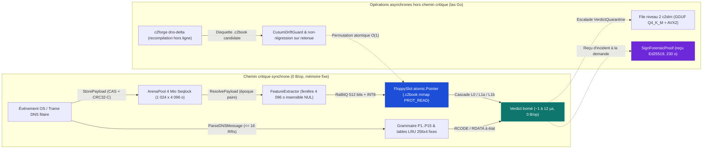
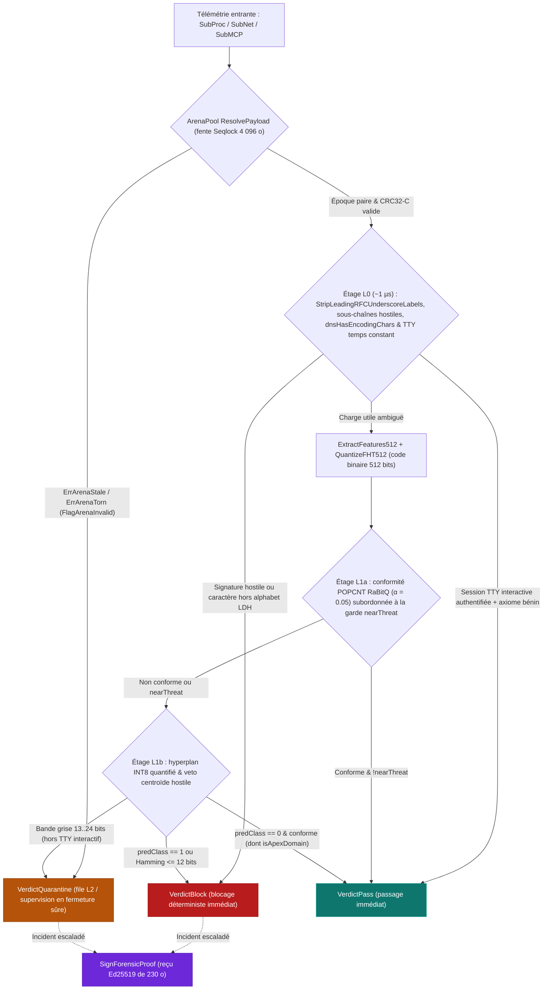

# Pourquoi la micro-optimisation est un choix fondamental de sécurité : inspection télémétrique à basse latence et décisions de remédiation avec c2blue55

*Déterminisme architectural, chemins critiques sans allocation, résilience sous charge soutenue et frontières de détection falsifiables dans la télémétrie hôte et DNS*

     

**Navigation :** [English Edition](why_micro_optimization_is_a_security_choice.md) · [Édition Word (.docx)](why_micro_optimization_is_a_security_choice.fr.docx) · [Présentation du dépôt](../README.fr.md) · [Géométrie & formules des centroïdes](centroid_geometry_and_formulas.fr.md) · [Banc comparatif 7 piles DNS](dns_detection_solutions_benchmark.fr.md) · [Monographie d'architecture Wittgenstein](c2blue55_wittgenstein_article.fr.md)

| Paramètre d'ingénierie | Spécification vérifiée |
| :--- | :--- |
| **Version & Date** | `v8.2` — `2026-11-01` (Édition post-audit & banc de charge soutenue) |
| **Cible d'exécution** | `Linux x86_64`, `Go 1.27` en mode scalaire portable + noyaux vectoriels AVX2 `GOAMD64=v3` / `GOEXPERIMENT=simd` transpilés mécaniquement depuis le C99 par `sgoiter` dans `c2pkg`, `0 % CGo`, `0 % GPU` |
| **Invariant mémoire & état** | `0 B/op` (`0 allocs/op`) sur le chemin critique synchrone ; anneau circulaire sans verrou `ArenaPool` (`1 024` × `4 096` o = `4 Mio`, `seqlock`) ; images binaires de modèles `.c2book` projetées en lecture seule (`mmap` `PROT_READ`) ; tables `256x4` LRU fixes |
| **Frontière d'action** | Verdicts déterministes `VerdictBlock`, `VerdictQuarantine`, `VerdictPass`, `DecisionEscalateSLM` + reçu `ForensicProof` Ed25519 de `230` octets ; terminaison OS, refus `fanotify` ou mise en trou noir DNS hors bibliothèque |
| **Vérification contradictoire** | `TestMonographTruthfulnessAndDocxParity`, `TestWittgenstein_Evaluation_RealData`, banc UDP réel 60 s (`44 997 paq/s`, `0` perte, `7,39 Mio` MaxRSS) & capture multiprotocole 7 piles de `325,11 Mo` (`3 011 298` paquets) |

---

## Sommaire

- [1. L'illusion de la performance comme exigence secondaire](#1-lillusion-de-la-performance-comme-exigence-secondaire)
  - [1.1 Trois modes de défaillance opérationnelle face à un trafic hostile](#11-trois-modes-de-défaillance-opérationnelle-face-à-un-trafic-hostile)
  - [1.2 Fonction de sécurité et frontière d'application de la remédiation](#12-fonction-de-sécurité-et-frontière-dapplication-de-la-remédiation)
- [2. La micro-architecture et l'exécutif langage comme surface d'attaque](#2-la-micro-architecture-et-lexécutif-langage-comme-surface-dattaque)
  - [2.1 L'effet d'observateur sur les hôtes de production partagés](#21-leffet-dobservateur-sur-les-hôtes-de-production-partagés)
  - [2.2 Réalités d'un exécutif à mémoire gérée en Go 1.27](#22-réalités-dun-exécutif-à-mémoire-gérée-en-go-127)
  - [2.3 Déni d'inspection asymétrique et travail borné dans le pire cas](#23-déni-dinspection-asymétrique-et-travail-borné-dans-le-pire-cas)
- [3. Séparer le chemin critique sans allocation des sous-systèmes hors chemin](#3-séparer-le-chemin-critique-sans-allocation-des-sous-systèmes-hors-chemin)
  - [3.1 Chemin critique synchrone (`0 B/op`) contre allocations hors chemin](#31-chemin-critique-synchrone-0-bop-contre-allocations-hors-chemin)
  - [3.2 Passage de charges utiles sans verrou : l'anneau atomique Seqlock de 4 Mio (`ArenaPool`)](#32-passage-de-charges-utiles-sans-verrou--lanneau-atomique-seqlock-de-4-mio-arenapool)
  - [3.3 Quarantaine fermée sur contention et trames filaires malformées](#33-quarantaine-fermée-sur-contention-et-trames-filaires-malformées)
  - [3.4 Bases de connaissances immuables projetées en mémoire (`.c2book`) et scellement cryptographique](#34-bases-de-connaissances-immuables-projetées-en-mémoire-c2book-et-scellement-cryptographique)
- [4. Un coût proportionnel à l'ambiguïté : la cascade L0 -> L1a -> L1b](#4-un-coût-proportionnel-à-lambiguïté--la-cascade-l0---l1a---l1b)
  - [4.1 Étage L0 : signatures exactes, réflexes structurels et normalisation des préfixes RFC](#41-étage-l0--signatures-exactes-réflexes-structurels-et-normalisation-des-préfixes-rfc)
  - [4.2 Étage L1a : projection 4 096 octets insensible aux NUL et recherche binaire conforme RaBitQ](#42-étage-l1a--projection-4-096-octets-insensible-aux-nul-et-recherche-binaire-conforme-rabitq)
  - [4.3 Étage L1b : têtes linéaires quantifiées INT8, protection des domaines d'apex et latence mesurée](#43-étage-l1b--têtes-linéaires-quantifiées-int8-protection-des-domaines-dapex-et-latence-mesurée)
- [5. Recertification hors ligne des références et gardes anti-empoisonnement](#5-recertification-hors-ligne-des-références-et-gardes-anti-empoisonnement)
  - [5.1 Inférence en ligne en lecture seule contre forgerie différentielle hors ligne](#51-inférence-en-ligne-en-lecture-seule-contre-forgerie-différentielle-hors-ligne)
  - [5.2 Trois portes fermées anti-empoisonnement](#52-trois-portes-fermées-anti-empoisonnement)
- [6. Reçus forensiques autonomes et rejeu déterministe bit à bit des verdicts](#6-reçus-forensiques-autonomes-et-rejeu-déterministe-bit-à-bit-des-verdicts)
  - [6.1 Reçu binaire autonome de 230 octets (`ForensicProof`)](#61-reçu-binaire-autonome-de-230-octets-forensicproof)
  - [6.2 Discipline de signature Ed25519 hors bande](#62-discipline-de-signature-ed25519-hors-bande)
  - [6.3 Rejeu déterministe du verdict (`ReplayForensicProof`)](#63-rejeu-déterministe-du-verdict-replayforensicproof)
- [7. Évaluation empirique sur fenêtre de 4 096 octets, précautions méthodologiques et compromis](#7-évaluation-empirique-sur-fenêtre-de-4-096-octets-précautions-méthodologiques-et-compromis)
  - [7.1 Précautions méthodologiques : tailles d'échantillons, historique de calibration et distinction Block / Quarantine](#71-précautions-méthodologiques--tailles-déchantillons-historique-de-calibration-et-distinction-block--quarantine)
  - [7.2 Tableau récapitulatif d'évaluation (fenêtre de `4 096` octets)](#72-tableau-récapitulatif-dévaluation-fenêtre-de-4-096-octets)
  - [7.3 Compromis structurels derrière les mesures](#73-compromis-structurels-derrière-les-mesures)
- [8. Grammaire filaire à état, transit chiffré sans clé, quotients hôtes et tenue sous charge de 60 s (v8.2)](#8-grammaire-filaire-à-état-transit-chiffré-sans-clé-quotients-hôtes-et-tenue-sous-charge-de-60-s-v82)
  - [8.1 Grammaire à état des réponses DNS en clair (`P14` et `P15`)](#81-grammaire-à-état-des-réponses-dns-en-clair-p14-et-p15)
  - [8.2 Classification sans clé du transit chiffré et agrégation multivoie par hôte (`FinalizeWithHosts`)](#82-classification-sans-clé-du-transit-chiffré-et-agrégation-multivoie-par-hôte-finalizewithhosts)
  - [8.3 Quotients cinétiques par processus sous Linux (`part_resolveur_permille`)](#83-quotients-cinétiques-par-processus-sous-linux-part_resolveur_permille)
  - [8.4 Résilience sous charge soutenue de 60 s et frontières d'échec explicites](#84-résilience-sous-charge-soutenue-de-60-s-et-frontières-déchec-explicites)
- [9. Conclusion : ingénierie système prévisible et périmètre empirique honnête](#9-conclusion--ingénierie-système-prévisible-et-périmètre-empirique-honnête)

---

## 1. L'illusion de la performance comme exigence secondaire

En ingénierie logicielle généraliste, la micro-optimisation — supprimer les allocations sur le tas (*heap*) à chaque requête, borner strictement les boucles d'analyse syntaxique et faire tenir les tables de recherche dans les caches du processeur — est habituellement traitée comme un raffinement économique différé jusqu'à la montée en charge. Lorsqu'un service dorsal web consomme une milliseconde supplémentaire par requête ou alloue quelques kilo-octets d'objets éphémères, l'ajout de cœurs CPU ou de mémoire vive suffit généralement à absorber le surcoût.

En sécurité défensive temps réel — inspecter chaque exécution de processus, décoder le trafic DNS filaire, classifier sans clé TLS des flux chiffrés DNS-over-QUIC (`DoQ`) ou DNS-over-HTTPS (`DoH`), et superviser les appels d'outils d'agents IA — cette hypothèse échoue physiquement. Contrairement à un service applicatif qui traite le trafic de ses propres usagers, un capteur de sécurité se trouve en coupure ou en écoute directe face à un **trafic non fiable et potentiellement hostile**, dont le débit, la géométrie de paquets et la cardinalité de noms de domaine sont choisis par un adversaire ou amplifiés par des rafales légitimes du réseau.

### 1.1 Trois modes de défaillance opérationnelle face à un trafic hostile

Dans un capteur de sécurité, la performance constitue une **propriété structurelle de correction**. Dès lors qu'une chaîne d'inspection ne garantit ni un budget temporel borné à l'échelle de la microseconde (typiquement de `1` à `25` microsecondes par événement sur un seul cœur), ni une empreinte mémoire bornée, trois défaillances opérationnelles apparaissent sous charge soutenue :

- **Perte silencieuse de visibilité (saturation des files) :** les tampons de sockets du noyau, les anneaux de capture réseau ou les files de communication inter-processus (`IPC`) se remplissent plus vite que les ouvriers d'analyse ne les vident, provoquant soit l'abandon muet de paquets (*fail-open*), soit le blocage des applications supervisées (*fail-closed*).
- **Gigue d'observation auto-infligée :** les pauses de ramasse-miettes, la contention sur les verrous ou les rafales d'écritures disque et `IPC` déforment les écarts inter-arrivées des paquets, faussant les détecteurs temporels de balisage (*beaconing*).
- **Épuisement asymétrique des ressources (déni d'inspection) :** une simple rafale réseau de `22 Mo` ou de `325 Mo` déclenche des giga-octets d'écritures intermédiaires en base de données ou en courtier de messages et plusieurs giga-octets d'empreinte mémoire, mettant hors service la sonde de supervision sur un matériel modeste.

### 1.2 Fonction de sécurité et frontière d'application de la remédiation

La micro-optimisation ne rend jamais pertinente une règle statistique mal calibrée — et la section 8 expose intégralement chaque faux positif hors-distribution et chaque angle mort mesurés sur `c2blue55` lui-même. Sa fonction de sécurité est plus précise et néanmoins indispensable : **éliminer l'imprévisibilité d'exécution des ressources** afin que l'acte même d'inspecter le trafic ne puisse jamais être retourné contre le défenseur.

> [!NOTE]
> **Frontière opérationnelle d'application :** `CascadeEngine` et `Pipeline` sont des bibliothèques de décision déterministes produisant des verdicts structurés (`VerdictBlock`, `VerdictQuarantine`, `VerdictPass`, `DecisionEscalateSLM`) et des reçus optionnels `ForensicProof` Ed25519 de `230` octets. L'application active au niveau du système d'exploitation — terminaison d'un processus, refus d'un appel `execve` via `fanotify` sous Linux dans `cmd/c2agent`, ou mise en trou noir d'une réponse DNS dans un résolveur — s'exécute dans le démon hôte ou la couche d'intégration à l'extérieur des paquets de bibliothèque.

---

## 2. La micro-architecture et l'exécutif langage comme surface d'attaque

Comprendre pourquoi les choix d'ingénierie bas niveau gouvernent la survie d'une sonde en production exige d'examiner ce qui se produit physiquement dans le processeur et le système d'exploitation lorsqu'un moteur d'inspection traite des dizaines de milliers d'événements par seconde.

### 2.1 L'effet d'observateur sur les hôtes de production partagés

Les agents de point de terminaison (*endpoint*) et les sondes réseau légères partagent les cœurs CPU, les tampons de traduction d'adresses et les bus mémoire avec les charges applicatives de production. Une sonde qui alloue des objets dynamiques à chaque paquet, parcourt des arbres syntaxiques riches en pointeurs ou sérialise des chaînes JSON entre processus dégrade à la fois sa propre fidélité de détection et les performances de l'hôte protégé :

- **Éviction des caches processeur :** le balayage d'objets dispersés sur le tas évince les ensembles de travail chauds des applications hors des caches de données de niveau 1 et de niveau 2 (`L1D` / `L2`).
- **Pression sur la traduction de mémoire virtuelle :** des accès fréquents répartis sur de nombreuses pages mémoire multiplient les défauts du tampon de traduction d'adresses (*Translation Lookaside Buffer*, `TLB`) pour l'ensemble des fils d'exécution colocalisés.
- **Amplification des changements de contexte noyau et des entrées-sorties :** faire transiter chaque flux analysé par des sockets inter-processus, un courtier de messages (tel que Redis pub/sub) ou des insertions SQLite/JSON ligne par ligne consomme davantage de temps noyau (`sys`) et de bande passante d'écriture NVMe que l'analyse protocolaire elle-même.

Maintenir l'état du chemin critique dans des régions mémoire contiguës et prédimensionnées garantit que la consommation CPU et mémoire demeure proportionnelle au débit filaire, sans divergence non linéaire.

### 2.2 Réalités d'un exécutif à mémoire gérée en Go 1.27

`c2blue55` est intégralement écrit en Go 1.27 pur, sans liaison `CGo`. Le ramasse-miettes (*garbage collector*, `GC`) concurrent à marquage tricolore de Go maintient les pauses globales (*stop-the-world*) nettement sous la milliseconde ; le danger concret d'une sonde Go à haut débit n'est donc pas un gel de plusieurs secondes, mais **l'effondrement du débit induit par le rythme d'allocation** :

1. **Bridage des goroutines par `mark assist` :** lorsque les goroutines applicatives allouent sur le tas plus vite que le marquage de fond ne recycle la mémoire, l'exécutif Go réquisitionne les goroutines de traitement de paquets elles-mêmes pour interrompre l'inspection au milieu d'un événement et balayer le tas.
2. **Coût de traversée des graphes de pointeurs :** de grandes tables associatives contenant des pointeurs obligent le ramasse-miettes à parcourir des millions d'arêtes d'objets à chaque cycle de collecte.
3. **Croissance adversariale des tranches dynamiques :** des trames malformées ou saturées d'enregistrements qui provoquent des réallocations `append` ou des conversions dynamiques `string` démultiplient la rotation mémoire exactement au moment d'une attaque.

> [!IMPORTANT]
> **Théorème opérationnel de l'asymétrie du coût d'inspection :** dès lors que l'inspection par paquet alloue sur le tas ou parcourt un état non borné, un adversaire peut amplifier à plein débit filaire le temps CPU, le bridage `mark assist` du ramasse-miettes et la charge `IPC` du défenseur. Soumises à des rafales soutenues, les sondes lourdes saturent leurs anneaux de capture et abandonnent silencieusement des paquets (*fail-open*), transformant le surcoût d'exécution en vecteur direct d'évasion. Imposer **`0 B/op` (`0 allocs/op`)** sur les primitives synchrones élimine le bridage `mark assist` tout en préservant la sûreté mémoire et le contrôle des bornes de Go.

### 2.3 Déni d'inspection asymétrique et travail borné dans le pire cas

Les analyseurs protocolaires subissent une asymétrie de coût classique : un attaquant peut émettre à plein débit filaire des en-têtes DNS compacts malformés, des sections de cent enregistrements ou des sous-domaines aléatoires, tandis qu'un analyseur naïf instancie un objet par enregistrement ou exécute des expressions régulières à retour sur trace (*backtracking*). Plafonner les fenêtres d'inspection (`4 096` octets), le nombre d'enregistrements DNS par section (`<= 16`) et les tables d'état (caches associatifs par ensembles de taille fixe `256x4` à remplacement du moins récemment utilisé, `LRU`) garantit un travail maximal strictement borné par paquet dans le pire cas.

---

## 3. Séparer le chemin critique sans allocation des sous-systèmes hors chemin

Une revue d'architecture n'est opposable que lorsqu'elle trace une frontière exacte entre les primitives synchrones sans allocation et les composants hors chemin critique qui utilisent délibérément le tas standard.

### 3.1 Chemin critique synchrone (`0 B/op`) contre allocations hors chemin

Chaque primitive d'inspection synchrone en ligne de `c2blue55` s'exécute en **`0 B/op` (`0 allocs/op`)**, invariant opposé par des tests automatisés de non-régression `testing.AllocsPerRun` tant sur des entrées valides que sur des trames malformées :

- **Cascade réflexe et vectorielle :** `CascadeEngine.EvaluateEvent` et `ExtractFeatures512` (classification vectorielle des lignes de commande, des noms DNS `QNAME` et des arguments d'outils d'agents IA).
- **Décodage DNS filaire et grammaire à état des réponses :** `ParseDNSMessage`, `Pipeline.ProcessDNS`, `SOANegativeTracker.Observe` et `RenouvellementRDataTracker.ObserveResponse`.
- **Comptabilité filaire sans clé du transit chiffré :** `EncryptedFlowAggregator.Observe` (cinétique des flux `DoQ`, `DoH2`, `DoH3` et `H3`).

À l'inverse, trois sous-systèmes allouent volontairement sur le tas Go **en dehors** de l'évaluation synchrone par paquet :

1. **Escalade asynchrone de niveau 2 vers le petit modèle de langage (`c2slm`) :** lorsque des événements ambigus placés en `Quarantine` sont escaladés dans `cmd/c2agent` vers le moteur d'inférence Go pur embarqué (`Qwen2.5-0.5B-Instruct` quantifié en format GGUF `Q4_K_M`), les tampons de jetons et les arènes d'activations allouent hors chemin critique. La compilation avec `GOEXPERIMENT=simd` active les noyaux vectoriels AVX2 de `c2pkg` (transpilés mécaniquement depuis le C99 par `sgoiter` et prouvés identiques bit à bit contre `gcc -O2`), accélérant ces produits matrice-vecteur d'un facteur `4x` à `5x` par rapport au Go scalaire portable.
2. **Défauts à froid d'attribution socket-vers-processus sous Linux (`internal/cinetique`) :** la résolution d'un quadruplet socket `(srcIP, srcPort, dstIP, dstPort, proto)` vers l'identifiant de processus (`PID`) propriétaire via l'interface noyau `NETLINK_SOCK_DIAG` (`inet_diag`) alloue lors d'une interrogation à froid, tandis que les paquets en régime établi touchent un cache associatif fixe de `1 024` entrées (`256x4` LRU, durée de vie `2 s`) en `0 B/op`.
3. **Forgerie hors ligne des modèles, bancs PCAP par lots et génération de rapports CLI (`cmd/c2forge`, `RecordSession`) :** l'ingestion des corpus d'apprentissage, la validation croisée en tenant une famille entière à l'écart (*Leave-One-Family-Out*, `LOFO`) et l'écriture des rapports JSON utilisent des allocations ordinaires.

### 3.2 Passage de charges utiles sans verrou : l'anneau atomique Seqlock de 4 Mio (`ArenaPool`)

Transmettre des charges utiles de longueur variable (lignes de commande ou trames réseau jusqu'à `4 096` octets, `engine.PageSize = 4096`) entre les goroutines de captation et les évaluateurs synchrones impose ordinairement soit d'allouer une tranche `[]byte` par événement, soit de verrouiller un mutex partagé. À la place, `ArenaPool` préalloue au démarrage un unique tableau contigu de `4 Mio` (`4 194 304` octets) découpé en `1 024` fentes de `4 096` octets, protégées chacune par un **verrou séquentiel (*sequence lock*, `seqlock`)** — une primitive de synchronisation où l'écrivain fait passer un compteur atomique à une valeur impaire avant d'écrire, puis à la valeur paire suivante une fois l'écriture achevée :

1. **Réservation de fente :** l'écrivain obtient l'indice suivant de l'anneau par incrémentation atomique sans verrou (`index & 1023`).
2. **Ouverture d'époque impaire :** l'écrivain bascule le compteur d'époque 64 bits de la fente vers une valeur impaire par comparaison et échange atomique (*Compare-And-Swap*, `CAS`), signalant une écriture en cours.
3. **Copie atomique alignée sur 64 bits et contrôle d'intégrité :** jusqu'à `4 096` octets sont copiés par mots atomiques de 64 bits accompagnés d'une somme de contrôle matérielle CRC32-C de Castagnoli.
4. **Publication en époque paire :** `StorePayload` incrémente le compteur d'époque vers le nombre pair suivant, rendant la charge visible.

Les lecteurs (`ResolvePayload`) copient la fente sans prendre aucun verrou et vérifient que le compteur d'époque lu avant et après la copie est identique et pair.

### 3.3 Quarantaine fermée sur contention et trames filaires malformées

Lorsqu'une rafale d'entrée dépasse momentanément la cadence de consommation et qu'un écrivain rapide parcourt l'ensemble des `1 024` fentes avant qu'un lecteur n'ait achevé sa copie, un anneau circulaire naïf inspecte des octets déchirés ou abandonne l'événement en silence (*fail-open*). À l'inverse, `ResolvePayload` renvoie une erreur typée (`ErrArenaStale` ou `ErrArenaTorn`), et `CascadeEngine` arme immédiatement le drapeau `FlagArenaInvalid` puis oriente l'événement vers **`VerdictQuarantine`**.

Ce même principe de fermeture par défaut (*fail-closed*) régit le décodage DNS filaire (`RAT-02a`). Les attaquants bourrent fréquemment leurs messages DNS de `17+` enregistrements factices ou de champs surdimensionnés, dans l'espoir que l'analyseur abandonne le décodage et classe le paquet comme bénin par défaut. Dès que `ParseDNSMessage` rejette un datagramme — par exemple `ErrPacketTooShort`, `ErrRDataTooLong` (`RDLENGTH > 1 536` octets) ou `ErrTooManyRRs` (`> 16` enregistrements dans une même section) — `Pipeline.ProcessDNS` comme `RecordSession` incrémentent les compteurs d'erreurs de décodage et renvoient `DecisionEscalateSLM` avec le motif `REASON_DNS_PARSE_ERROR` en **`0 B/op`**.

### 3.4 Bases de connaissances immuables projetées en mémoire (`.c2book`) et scellement cryptographique

Au lieu de désérialiser au démarrage des modèles JSON ou des archives Python `pickle`, `c2blue55` compile ses signatures lexicales, ses prototypes conformes et ses hyperplans quantifiés `INT8` dans des fichiers binaires plats appelés **disquettes `.c2book`** (en-tête `C2FLOP1`). À l'exécution, `LoadFloppyMmap` projette directement le fichier dans des pages virtuelles en lecture seule (`syscall.Mmap`, `PROT_READ`, `MAP_SHARED`) et permute les modèles actifs en temps constant $O(1)$ au moyen d'un pointeur atomique (`FloppySlot` encapsulant `atomic.Pointer[FloppyDisk]`) :

- **Résistance cryptographique à l'altération :** chaque image `.c2book` débute par un en-tête `FloppyHeader` de `64` octets (`0..32` : signature magique `C2FLOP1\0`, version de format, identifiant de famille, dimension, compteurs et rayon `BlockRadius` ; `32..64` : sceau `Seal` de 32 octets). Lorsqu'elle porte le drapeau de scellement (`FloppyFlagSealed`), `LoadFloppyMmap` vérifie à la fois une somme CRC32-C de Castagnoli et une étiquette cryptographique **HMAC-SHA256** (`32..64`) calculée sur le préfixe de métadonnées de 32 octets (`0..32`) et la totalité du corps. Le moindre octet modifié sur disque (par exemple une réduction malveillante de `BlockRadius`) échoue immédiatement avec `ErrFloppySeal`. Fournir une clé nulle ou vide pour une disquette scellée — ou fournir une clé HMAC face à une disquette non scellée — échoue immédiatement avec `ErrFloppyUnsealed`.
- **Câblage effectif dans le dépôt :** `LoadFloppyMmap` est exercé par `cmd/c2forge` (`lab-eval`, `dns-delta`) et par les bancs de performance (`wittgenstein_bench_test.go`), tandis que les démons autonomes (`cmd/c2agent` et `cmd/c2blue-mcp-guard`) instancient directement en mémoire les structures modulaires `Codebook`, `GrayZoneDecider` et `ServerOracle`.
- **Clés publiques de démonstration reproductible contre mode strict de production :** afin qu'un auditeur externe puisse rejouer les bancs dès le clonage du dépôt, `WittgensteinFloppyKey` émet un avertissement explicite et se replie sur des clés publiques de démonstration lorsque les variables d'environnement `C2BLUE_HMAC_KEY_*` sont absentes. L'activation de `C2BLUE_REQUIRE_SECURE_KEYS=1` (ou `C2BLUE_PRODUCTION=1`) désactive ce repli (`nil`) et contraint `decodeFloppy` à rejeter toute image `.c2book` non scellée (`ErrFloppyUnsealed`), fermant toute attaque par effacement du bit de scellement dans l'en-tête.

---

## 4. Un coût proportionnel à l'ambiguïté : la cascade L0 -> L1a -> L1b

Exécuter un réseau de neurones ou un produit scalaire flottant dense sur chaque commande `ls` ou chaque résolution `www.example.com` gaspille inutilement les cycles processeur. `c2blue55` structure la classification synchrone comme un filtre à trois étages opérant sur l'intégralité de la **fenêtre de `4 096` octets insensible aux octets nuls (`NUL`)**, ne dépensant qu'environ `1` microseconde sur les cas francs et de `7` à `12` microsecondes sur les cas ambigus.

### 4.1 Étage L0 : signatures exactes, réflexes structurels et normalisation des préfixes RFC

L'étage L0 tranche les motifs sans ambiguïté et les axiomes de provenance du système d'exploitation en environ `1` microseconde (`0 B/op`) :

- **Balayage de sous-chaînes insensible à la casse** (`containsSubsliceFold`) contre les signatures hostiles compilées de lignes de commande et de domaines.
- **Réflexes structurels sur les commandes et le DNS :** `netcatWithExec` intercepte les invocations `nc`/`ncat` liant un interpréteur shell (`-e`, `-c`) quel que soit l'ordre des drapeaux, tandis que `dnsHasEncodingChars` bloque immédiatement les symboles Base64 hors alphabet standard `LDH` (`+`, `/`, `=`) glissés dans les noms de requêtes DNS.
- **Dépouillement sans allocation des préfixes de service RFC (`StripLeadingRFCUnderscoreLabels`) :** en entreprise, Active Directory (`_ldap._tcp.dc._msdcs`), la téléphonie SIP (`_sip._tls`), TLS DANE ou DMARC préfixent légitimement leurs requêtes DNS par des étiquettes de service commençant par un tiret bas (`_`). Les détecteurs naïfs d'entropie et de ratio de consonnes interprètent à tort ces préfixes comme un encodage de tunnel, générant `50/50` faux positifs sur du trafic `SRV` bénin. `StripLeadingRFCUnderscoreLabels` (`internal/engine/dns_agent.go`) retire en `0 B/op` **jusqu'à deux étiquettes initiales de service RFC autorisées** avant l'extraction des traits du sous-domaine, ramenant les faux positifs `SRV` bénins de **`50/50 -> 0/50`** sur `benign-rrtypes-clear.pcap` tout en bloquant les tunnels dissimulés derrière un préfixe de service (`349/366` bloqués sur `vaydns-srv-clear.pcap`, y compris `_sip._tls.<charge>`).
- **Axiomes de provenance OS en temps constant** (`EvaluateOntology`) vérifiant les sessions interactives authentifiées sans fuite par branchement conditionnel.

### 4.2 Étage L1a : projection 4 096 octets insensible aux NUL et recherche binaire conforme RaBitQ

Les charges utiles non tranchées par l'étage L0 entrent dans `ExtractFeatures512`, qui calcule les n-grammes de caractères, les distributions de longueurs et les résumés d'entropie d'octets sur la totalité des `4 096` octets sans jamais s'arrêter aux octets `0x00` (`NUL`) intercalés — mettant en échec le contournement par bourrage d'octets nuls et remplaçant le plafond initial de 96 octets des premiers prototypes.

Pour comparer ces 512 descripteurs en quelques nanosecondes sans aucune allocation, `QuantizeFHT512` applique une **transformée de Hadamard rapide (*Fast Hadamard Transform*, `FHT`)** suivie d'une **quantification binaire `RaBitQ` à 1 bit**, comprimant le vecteur de 512 flottants en une **signature binaire de 512 bits** (huit mots `uint64`). La distance au trafic bénin calibré (au seuil de signification conforme $\alpha = 0.05$) se réduit alors à une instruction matérielle `POPCNT` (comptage des bits à 1 sur le `XOR` des registres 64 bits). Point décisif, l'étage L1a applique une **garde de subordination** : dès que l'échantillon tombe simultanément dans le rayon de Hamming `BlockRadius` d'un centroïde hostile quelconque (`nearThreat`), il est interdit à L1a d'accorder un laissez-passer bénin et l'événement est obligatoirement transmis à l'étage L1b.

### 4.3 Étage L1b : têtes linéaires quantifiées INT8, protection des domaines d'apex et latence mesurée

L'étage L1b combine un classifieur linéaire quantifié sur entiers signés de 8 bits (`INT8`) avec des rayons de veto autour des centroïdes hostiles (`R_block <= 12` bits) et place les échantillons frontaliers (distance de Hamming `13..24` bits sans provenance interactive authentifiée par terminal `TTY`) en `VerdictQuarantine`. Pour les domaines enregistrables nus de second niveau dépourvus de sous-domaine (`isApexDomain`, par exemple `sickbeard.com`), le veto par seul rayon centroïde est relâché uniquement lorsque la tête `INT8` atteste positivement la conformité à la classe bénigne (`predClass == 0 && conforms`).

Latences mesurées sur processeur **Intel Core i9-14900K** (Linux 6.14, Go 1.27, fenêtre de `4 096` octets, `BenchmarkWittgenstein_*`) :

| Opération mesurée (`wittgenstein_bench_test.go`) | Latence (`GOEXPERIMENT=simd`) | Latence (Go 1.27 scalaire portable) | Plafond non épinglé / référence | Allocations sur le tas |
| :--- | :---: | :---: | :---: | :---: |
| **Filtre réflexe de sous-chaînes L0** | **0,97 µs/op** (~1,03 M ops/s) | 0,93 µs/op (~1,08 M ops/s) | 1,12 µs/op (~895 k ops/s) | **0 B/op (0 allocs)** |
| **Cascade complète (commande bénigne -> L1a)** | **6,68 µs/op** (~150 k ops/s) | 7,21 µs/op (~139 k ops/s) | 8,63 µs/op (~116 k ops/s) | **0 B/op (0 allocs)** |
| **Cascade complète (requête DNS -> L1a)** | **9,61 µs/op** (~104 k ops/s) | 10,29 µs/op (~97 k ops/s) | 11,68 µs/op (~86 k ops/s) | **0 B/op (0 allocs)** |
| **Cascade complète (charge Arena étendue -> L1b)** | **11,94 µs/op** (~84 k ops/s) | 12,24 µs/op (~82 k ops/s) | 16,32 µs/op (~61 k ops/s) | **0 B/op (0 allocs)** |

Sur les étages 512 bits invoquant `FHT512 + RaBitQ`, l'activation de `GOEXPERIMENT=simd` réduit la latence moyenne de `6,6 %` à `7,4 %` (`7,21 -> 6,68 µs` et `10,29 -> 9,61 µs`, `+2,5 %` sur le chemin étendu `L1b` `12,24 -> 11,94 µs`, et `-4,3 %` sur `L0` seul `0,93 -> 0,97 µs` où aucun noyau vectoriel `FHT512` n'intervient) par rapport au Go 1.27 scalaire portable (qui émet déjà l'instruction matérielle `POPCNT` sous `GOAMD64=v3`), tout en procurant un gain d'un facteur `4x` à `5x` sur les produits matriciels GGUF hors chemin de `c2slm`. Sur des processeurs serveurs à fréquence d'horloge plus basse, les temps moyens s'établissent typiquement entre `1,5x` et `2x` ces valeurs (`~15` à `20 µs`), nettement à l'intérieur d'un budget synchrone de `25 µs`.

---

## 5. Recertification hors ligne des références et gardes anti-empoisonnement

Les détecteurs qui réajustent continuellement leurs centroïdes en ligne sur le trafic de production s'exposent à un empoisonnement progressif mené par l'attaquant (dérive dite « de la grenouille ébouillantée ») ou à une corruption numérique sur entrée dégénérée.

### 5.1 Inférence en ligne en lecture seule contre forgerie différentielle hors ligne

`c2blue55` impose une séparation architecturale stricte entre l'évaluation télémétrique en ligne et le réapprentissage des références afin qu'aucun trafic hostile ne puisse déplacer les frontières de décision actives en vol.

> [!NOTE]
> **Frontière de recertification hors ligne :** le moteur d'inspection en ligne monte les disquettes `.c2book` en mémoire virtuelle en lecture seule (`PROT_READ`) et ne modifie jamais aucun centroïde sur le chemin synchrone. `CusumDriftGuard` (`internal/engine/drift_guard.go`) et `ValidateAgainstHoldoutSet` s'exécutent exclusivement hors ligne dans `cmd/c2forge` lors de la forgerie des modèles et de la recompilation différentielle `dns-delta` avant une permutation atomique de pointeur.

### 5.2 Trois portes fermées anti-empoisonnement

Toute mise à jour candidate d'une disquette `.c2book` doit franchir trois portes de vérification fermées (*fail-closed*) avant émission :

1. **Rejet immédiat des valeurs `NaN` / `±Inf` (`ErrDriftGuardNaN`) :** `CusumDriftGuard` inspecte chaque coordonnée d'un centroïde candidat avant tout calcul de distance et avorte immédiatement en présence d'un flottant non fini, sans altérer l'état actif.
2. **Bornes de déplacement par pas et somme cumulée CUSUM :** toute mise à jour finie doit simultanément respecter le déplacement euclidien maximal par pas ($d = \|\mu_t - \mu_{t-1}\|_2 \le \text{MaxRadius}$), le budget cumulé de dérive (`MaxDriftBudget`) et la statistique de somme cumulée de Page $S_t^+ = \max(0, S_{t-1}^+ + (d - \text{slack}))$.
3. **Non-régression obligatoire sur jeu de retenue (`ErrHoldoutUnvalidated`) :** `ValidateAgainstHoldoutSet` refuse toute tranche témoin nulle ou vide (`ErrHoldoutUnvalidated`) et rejette toute disquette candidate dont les centroïdes hostiles entreraient en collision avec le trafic bénin tenu à l'écart au-delà de `maxAllowedRegression` ; de même, `BuildBaselineFromSilo` avorte avec `ErrOracleCorrupt` dès que les tranches du silo échouent à l'authentification.

---

## 6. Reçus forensiques autonomes et rejeu déterministe bit à bit des verdicts

Lorsqu'un analyste d'investigation examine une alerte plusieurs heures après les faits, les tampons circulaires ont déjà tourné et les processus éphémères ont disparu. Plutôt que d'alourdir le chemin critique par un chaînage de hachages verrouillé à chaque paquet (anti-patron de « blockchain en ligne »), `c2blue55` fournit une primitive de reçu cryptographique hors bande.

### 6.1 Reçu binaire autonome de 230 octets (`ForensicProof`)

Invoqué à la demande sur un événement escaladé (`SignForensicProof`), le moteur émet un reçu binaire compact de `230` octets regroupant :

- **Horodatage et origine :** l'horodatage à la nanoseconde, l'identifiant du sous-système et le code d'action.
- **En-tête canonique :** l'en-tête d'événement `Probe_event_t` de `128` octets.
- **Empreinte de charge :** le condensat cryptographique `SHA-256` des octets exacts de la charge inspectée.
- **Provenance du modèle :** l'identifiant `FloppyCRC32` de la disquette `.c2book` active à l'instant exact de la décision.
- **Verdict de la cascade :** le quadruplet de décision (action de remédiation, étage décisif, distance de Hamming, score de confiance).

### 6.2 Discipline de signature Ed25519 hors bande

`SignForensicProof` exige une clé privée Ed25519 valide (rejetant toute clé `nil` ou malformée) et s'exécute strictement hors bande afin que la cryptographie asymétrique ne ralentisse jamais le filtrage synchrone à la microseconde (`SignForensicProof` est livré comme API de bibliothèque vérifiée plutôt que dans une boucle systématique par paquet au sein de `cmd/c2agent`).

### 6.3 Rejeu déterministe du verdict (`ReplayForensicProof`)

Parce que `ExtractFeatures512`, `QuantizeFHT512` et les étages `L0` / `L1a` / `L1b` ne dépendent que des octets de la charge utile, des drapeaux de provenance OS et de l'image immuable `.c2book`, `ReplayForensicProof` réévalue la charge archivée bien après la rotation d'`ArenaPool` et vérifie l'égalité bit à bit de l'action, de l'étage, de la distance de Hamming et du niveau de confiance.

---

## 7. Évaluation empirique sur fenêtre de 4 096 octets, précautions méthodologiques et compromis

Une ébauche antérieure pré-audit de cette monographie citait des taux de blocage franc de `100,00 %` issus d'un ancien prototype limité aux 96 premiers octets qui confondait `Quarantine` et `Block`. Le rétablissement du balayage intégral sur `4 096` octets insensible aux octets nuls (`AUD-02`) et la reforgerie complète des disquettes `.c2book` ont établi les chiffres exacts vérifiés automatiquement par `TestWittgenstein_Evaluation_RealData`.

### 7.1 Précautions méthodologiques : tailles d'échantillons, historique de calibration et distinction Block / Quarantine

- **Partitions de retenue finies et analyse préalable des erreurs :** des partitions de `N = 41` *reverse shells* et `N = 42` commandes d'administration impliquent des intervalles de confiance de Wilson à 95 % larges (`0/42` couvre `[0,00 %, 8,38 %]`). En outre, les raffinements structurels (`isApexDomain`, `OntoVerdictAllow` sous terminal `TTY` et `netcatWithExec`) ont été conçus après examen des modes d'échec observés sur ces jeux ; ces mesures reflètent donc une **performance de développement calibrée**, tandis que la capacité de transfert hors-distribution fait l'objet d'épreuves indépendantes à la section 8.
- **Distinction stricte entre `Block` sans état et `Quarantine` :** sur la fenêtre de `4 096` octets, `0/41` *reverse shells* hostiles ne passent au travers (`100,00 %` interceptés), répartis en **`33/41` (`80,49 %`) blocages immédiats `VerdictBlock`** et **`8/41` (`19,51 %`) mises en quarantaine `VerdictQuarantine`** (orientées vers l'arbitrage L2 `c2slm` ou la supervision).

### 7.2 Tableau récapitulatif d'évaluation (fenêtre de `4 096` octets)

Vérifié par la commande `GOEXPERIMENT=simd go test -v -run TestWittgenstein_Evaluation_RealData .` :

| Partition d'évaluation | Taille (N) | Taux de blocage franc [IC 95 %] | Taux de quarantaine [IC 95 %] | Taux de passage [IC 95 %] | Répartition par étage (L0 / L1a / L1b) |
| :--- | :---: | :---: | :---: | :---: | :--- |
| **Charges de *reverse shells* (retenue)** | 41 | **80,49 %** (33/41) [65,99 %, 89,77 %] | **19,51 %** (8/41) [10,23 %, 34,01 %] | **0,00 %** (0/41) [0,00 %, 8,57 %] | Block 20/0/13 ; Quar 0/0/8 (100 % interceptés) |
| **Mutations paramétriques de shells** | 111 | **80,18 %** (89/111) [71,81 %, 86,53 %] | **19,82 %** (22/111) [13,47 %, 28,19 %] | **0,00 %** (0/111) [0,00 %, 3,35 %] | Block 48/0/41 ; Quar 0/0/22 (100 % interceptés) |
| **Requêtes de tunnels DNS C2 (`validate.csv`)** | 4 000 | **99,35 %** (3 974/4 000) [99,05 %, 99,56 %] | **0,65 %** (26/4 000) [0,44 %, 0,95 %] | **0,00 %** (0/4 000) [0,00 %, 0,10 %] | Block 2 957/0/1 017 ; Quar 0/0/26 (`tuns.org`) |
| **Base de domaines bénins (`validate.csv`)** | 1 000 | **0,00 %** (0/1 000) [0,00 %, 0,38 %] | **0,00 %** (0/1 000) [0,00 %, 0,38 %] | **100,00 %** (1 000/1 000) [99,62 %, 100,00 %] | Pass 0 / 856 L1a / 144 L1b |
| **Commandes d'admin (brutes sans terminal)** | 42 | **0,00 %** (0/42) [0,00 %, 8,38 %] | **69,05 %** (29/42) [53,97 %, 80,93 %] | **30,95 %** (13/42) [19,07 %, 46,03 %] | Quar 0/0/29 ; Pass 0/13/0 |
| **Commandes d'admin (terminal TTY interactif)** | 42 | **0,00 %** (0/42) [0,00 %, 8,38 %] | **0,00 %** (0/42) [0,00 %, 8,38 %] | **100,00 %** (42/42) [91,62 %, 100,00 %] | Pass 15 L0 / 24 L1a / 3 L1b |
| **Jeu d'entraînement admin bénin (sans provenance)** | 103 | **0,97 %** (1/103) [0,17 %, 5,30 %] | **66,99 %** (69/103) [57,44 %, 75,32 %] | **32,04 %** (33/103) [23,81 %, 41,56 %] | 1 FP franc (`Get-Counter`), 69 Quar, 33 Pass |

**Taux de la classe majoritaire et aire sous la courbe ROC (`ROC AUC`) sur partitions appariées :** chaque ligne du tableau ci-dessus présente une tranche mono-classe isolée (`ROC AUC = N/A` prise isolément). Évaluées en classification binaire appariée :

- **Validation DNS appariée (`validate.csv`, `N = 5 000`) :** `4 000` requêtes DNS C2 hostiles contre `1 000` domaines bénins (**taux de la classe majoritaire `0,8000`**). Le critère strict `VerdictBlock` produit `TP = 3 974/4 000`, `FP = 0/1 000`, `TN = 1 000/1 000`, `FN = 26/4 000` (les `26` étant mis en quarantaine ; soit `TP = 4 000/4 000`, `FN = 0` en interception `Block + Quarantine`) avec **`ROC AUC = 1,0000`**.
- **Commandes de processus appariées (`N = 83`) :** `41` *reverse shells* hostiles contre `42` commandes d'administration bénignes (**taux de la classe majoritaire `42/83 = 0,5060`**). Le critère strict `VerdictBlock` produit `TP = 33/41`, `FP = 0/42`, `TN = 42/42` (`13` `Pass` + `29` `Quarantine` sans terminal ; `42/42` `Pass` sous terminal `TTY` authentifié), `FN = 8/41` (les `8` étant mis en quarantaine), soit **`ROC AUC = 0,9919`** sous `TTY` (`0,9013` en mode brut sans terminal).

### 7.3 Compromis structurels derrière les mesures

- **Tunnels DNS contre domaines DGA à étiquette unique :** sur `4 000` requêtes de tunnel, l'étage L0 en bloque `2 957` (`2 000` sur `hidemyself.org` + `957` sur `example.org` via `dnsHasEncodingChars`), tandis que l'étage L1b en bloque `1 017` et en met `26/4 000` en quarantaine (`0,65 %`, `tuns.org`). Les `1 000` domaines bénins passent intégralement (`856` en L1a, `144` en L1b). Parce qu'`isApexDomain` désactive le veto centroïde pur sur les domaines enregistrables de second niveau sans sous-domaine, la détection des algorithmes de génération de domaines (`DGA`) nus repose exclusivement sur les têtes `INT8` dédiées aux `DGA`.
- **Friction de quarantaine sur l'administration sans terminal (`69,05 %`) :** en l'absence de métadonnées de session OS, les pipelines complexes `kubectl`, `docker` ou shell recouvrent dans l'espace des n-grammes les commandes de reconnaissance *Living-Off-The-Land* (`LOLBAS`), plaçant en quarantaine `29/42` (`69,05 %`) commandes d'évaluation et `69/103` (`66,99 %`) commandes d'entraînement (plus `1/103` = `0,97 %` faux blocage sur `Get-Counter`). Les tâches automatisées `cron` et `systemd` nécessitent par conséquent soit l'arbitrage L2 par `c2slm`, soit des politiques explicites par unité de service.
- **Fenêtre d'exemption des sessions interactives `TTY` :** lorsque `DeriveCascadeContext` atteste une session interactive authentifiée (`HasTTY && LoginSession && EUID == UID` et absence de drapeaux `memfd`, `deleted`, `W+X` ou `/tmp`), `OntoVerdictAllow` lève la bande de quarantaine `13..24` (`42/42` = `100,00 %` de passage pour l'administrateur). Comme `deriveCascadeOntoKey` projette les chemins `SubProc` non temporaires (`/home/...`, `/opt/`) sur `TgtBinSystem`, un attaquant opérant depuis une session SSH interactive volée échappe à la bande de quarantaine `13..24`, sauf s'il est intercepté par L0, par le rayon dur `R_block <= 12` ou par l'hyperplan `predClass == 1`.

---

## 8. Grammaire filaire à état, transit chiffré sans clé, quotients hôtes et tenue sous charge de 60 s (v8.2)

L'inspection isolée des seuls noms de requêtes DNS laisse passer trois classes d'évasion modernes : les tunnels qui concentrent l'essentiel de leur charge utile dans moins de cent **réponses du serveur** (`VayDNS`, `NoizDNS`, `Soar`), les tunnels encapsulés dans des sessions chiffrées `DoQ` (`UDP/853`) ou `DoH3` (`UDP/443`) (`Slipstream`, `dnstt`), et les rafales diluées sur de multiples domaines. La version `v8.2` traite ces trois classes en `0 B/op` et confronte l'ensemble à un banc de charge soutenue de 60 secondes aux côtés de six piles open-source de référence.

### 8.1 Grammaire à état des réponses DNS en clair (`P14` et `P15`)

- **Charges dissimulées dans de fausses réponses négatives `NXDOMAIN` (`REASON_P14_NXDOMAIN_ANSWER_PAYLOAD`) :** lorsqu'un serveur DNS répond `NXDOMAIN` (`RCODE=3`, signifiant que le nom demandé n'existe pas), sa section `Answer` est normalement vide — ou ne contient tout au plus que les enregistrements d'alias `CNAME` (`5`), `DNAME` (`39`) et leurs signatures DNSSEC `RRSIG` (`46`) menant à la cible inexistante (RFC 1035 / RFC 2308 / RFC 4035 / RFC 6672). Le tunnel `Soar` détourne cette grammaire en positionnant `RCODE=3` tout en logeant des données C2 dans des enregistrements `TXT` de la section `Answer`, contournant à la fois Zeek (`0` entrée `weird.log`) et les suiveurs qui n'inspectent que la section `Authority`/`SOA`. `c2blue55` reconstitue le code `RCODE` étendu complet sur 12 bits (`Header RCODE | (EDNS0 ExtRCODE << 4)` — de sorte que le code EDNS0 `BADMODE=19`, dont les 4 bits de poids faible `19 & 0x0f == 3` entreraient sinon en collision avec `NXDOMAIN=3`, ainsi que `BADVERS=16`, dont `16 & 0x0f == 0` entrerait en collision avec `NOERROR=0`, sont tous deux décodés sans ambiguïté) et signale tout vrai `ExtRCODE == 3` portant un enregistrement `Answer` non vide hors `{CNAME, DNAME, RRSIG}`, interceptant **`40/40` (`100 %`, `ROC AUC = 1,0000`)** réponses `Soar` dès la première trame descendante avec **`0/200`** faux positif sur les chaînes d'alias signées et les paquets à codes EDNS0 étendus.
- **Suivi commutatif du renouvellement des jeux de réponses (`REASON_P15_RDATA_RENEWAL`) :** les tunnels sur enregistrements `SRV`, `TXT`, `MX`, `NS` ou `CAA` (`VayDNS`) renvoient une charge chiffrée `RDATA` inédite à presque chaque réponse `NOERROR` sous un même domaine, alors que les serveurs légitimes de messagerie, de téléphonie SIP ou d'autorités de certification renvoient un ensemble stable d'enregistrements (souvent permutés circulairement en *round-robin*). `RenouvellementRDataTracker.ObserveResponse` (`internal/engine/renouvellement_rdata.go`) maintient une table associative fixe `256x4` LRU en `0 B/op` dotée d'un anneau de 16 fentes sur une fenêtre glissante de `600 s` (`10` minutes) par triplet `(clientPrefix, apex, qtype)`. Pour chaque réponse, il décompresse les noms RFC 1035, ignore les signatures `RRSIG`, hache chaque enregistrement `Answer` unique par `FNV-1a` + `SplitMix64`, puis les combine par **addition modulaire commutative sur `uint64` (`+`)** afin que toute permutation circulaire *round-robin* produise rigoureusement la même empreinte. Dès que `>= 8` réponses accumulent `>= 750` millièmes (`75,0 %`) d'empreintes distinctes avec une longueur moyenne `RDLength >= 128` octets, la règle `P15` déclenche — interceptant **`99/99`** flux de tunnel `VayDNS` `CAA` (`vaydns-caa-unbound-clear.pcap`) et déclenchant dès la 8e réponse sur `vaydns-mx-clear.pcap`, avec **`0/200`** faux positif bénin.

### 8.2 Classification sans clé du transit chiffré et agrégation multivoie par hôte (`FinalizeWithHosts`)

Sans clés privées TLS, une sonde réseau ne peut pas déchiffrer le contenu applicatif des flux `DoQ` ou `DoH2`/`DoH3`. La physique protocolaire n'en sépare pas moins quatre régimes cinétiques — `R0a` (résolutions DNS récursives courtes), `R0b` (téléchargements web asymétriques massifs), `R1a` (tunnels C2 bidirectionnels soutenus) et `R1b` (balises périodiques) — au moyen d'un vecteur `KineticVector` à 9 dimensions articulé autour de la persistance volumétrique bidirectionnelle $\log_2(1 + \min(V_\uparrow, V_\downarrow)/4096)$.

Lorsque `Slipstream` répartit un transfert de `32 Kio` sur $K=2$ résolveurs `DoQ` indépendants (`slipstream-2doq-multipath-transit.pcap`), la persistance de chaque flux pris isolément descend de `4,32` (`R1a`) à `4,08` et `3,51` (`R0a`, sous le seuil de `4,30`). Pour neutraliser cette dilution multivoie en $1/K$ sans fausser les métriques par flux, `FinalizeWithHosts` (`encrypted_wire_hote.go`, activé par `c2forge encrypted-eval -hote -doh-ports`) regroupe par hôte client normalisé (`NormalizeHostClientKey` : préfixe IPv4 `/32` ou IPv6 `/64` résistant à la rotation d'adresses temporaires RFC 8981) les conversations vers plusieurs résolveurs actives dans une fenêtre de `10 s` et réévalue les volumes agrégés $\sum_r V_{\uparrow,r}$ et $\sum_r V_{\downarrow,r}$ (`pers = 4,77 -> R1a`, synchronie `833` millièmes), tout en préservant le basculement légitime entre résolveur primaire et secondaire (`0/11` faux positif bénin).

### 8.3 Quotients cinétiques par processus sous Linux (`part_resolveur_permille`)

Lorsqu'un attaquant dissimule un tunnel `DoH3` de `32 Kio` (`21 683` o = `21,7 ko` utiles QUIC montants) à l'intérieur de **la même connexion QUIC exactement** que `3 291 563` o (`3,29 Mo` / `3,14 Mio` QUIC descendants ; `3,35 Mo` / `3,20 Mio` filaires totaux) de téléchargements HTTP/3 légitimes (`doh3-shared-conn-vaydns-transit` sur `:9444`), la forte asymétrie descendante du téléchargement web (`AsymetrieDescendanteLog2 = 6,45`, `PersistanceBidirectionnelle = 5,25`) classe la connexion filaire globale en `R0b`. Sur la paire à origine partagée `:9444` (`N = 2` : `1` capture hostile + `1` capture bénigne `doh3-shared-web-only.pcap`, taux de classe majoritaire `0,5000`), le classifieur filaire sans clé de `c2blue55` obtient **`TP = 0/1, FP = 0/1, TN = 1/1, FN = 1/1` (`ROC AUC = 0,5000` ; `ROC AUC = 0,4545` sur `N = 12` face aux `11` témoins bénins `L1 + L1-bis`, `Maj. = 0,9167`)**.

Sur les postes et serveurs Linux, `internal/cinetique` lève cet angle mort pour les processus C2 autonomes sans module noyau ni compteurs matériels en étendant `QuotientsEpisode` à **12 quotients comportementaux en virgule fixe** (`0 B/op` en régime établi) :

- **Confinement aux résolveurs (`part_resolveur_permille`, indice 10) :** appuyé sur un cache de sockets de `1 024` entrées (`256x4` LRU) placé devant `NETLINK_INET_DIAG`, `internal/cinetique` mesure la fraction (en millièmes, c'est-à-dire en parts pour mille) des octets réseau d'un processus échangés avec des résolveurs DNS/DoQ/DoH dès que le volume réseau cumulé atteint **`16 384` octets (`16 Kio`)**. Un navigateur web résout des noms puis ouvre des connexions vers des serveurs de contenus (`ConnexionsHorsResolveur > 0`) ; un binaire C2 autonome ne dialogue *qu'avec* des résolveurs. L'indicateur `ConfinementResolveur` s'active lorsque `part_resolveur_permille >= 500` millièmes (`>= 50 %`), `ConnexionsHorsResolveur == 0` **et** `!EcouteDNSClairLocale` (ce qui exempte les résolveurs-relais locaux tels que `unbound`, `dnsmasq` et `systemd-resolved` qui écoutent localement sur `:53`). Limite résiduelle explicite : lorsqu'un tunnel s'exécute *à l'intérieur même* d'un navigateur web actif (extension malveillante ou onglet injecté présentant `ConnexionsHorsResolveur > 0`), `ConfinementResolveur` demeure `false`.
- **Absorption réseau descriptive (`absorption_reseau_permille`, indice 11) :** suit le rapport $1000 \times (\Delta\text{BlockBytesWritten} + \Delta\text{RSS}_+) / \Delta\text{IngressBytes}$ au-delà de `1 Mio` entrant, masqué comme strictement descriptif (`MasqueQuotientsDescriptifs`) afin qu'aucun utilitaire légitime de téléchargement de fichiers ne déclenche de score d'anomalie.

### 8.4 Résilience sous charge soutenue de 60 s et frontières d'échec explicites

Afin de vérifier que la micro-optimisation en `0 B/op` se traduit effectivement par une tenue opérationnelle réelle — et de mettre à nu les modes d'échec masqués par les courtes captures de laboratoire mono-zone — `c2blue55` `v8.2` (`GOEXPERIMENT=simd`, Intel Core i9-14900K) a été éprouvé à la fois sur un **socket UDP actif de 60 secondes** (`2 000 paq/s` en régime Normal ; `44 997 paq/s` / `2,70 M` paquets en régime Extrême) et séquentiellement face à six piles open-source sur des captures multiprotocoles **Normal de 66,7 s (`147 020` paquets, `22,15 Mo`)** et **Extrême de 67,5 s (`3 011 298` paquets, `325,11 Mo`)** mêlant trafic DNS Internet réel `argencon`, flux bénins `DoQ`/`DoH2`/`DoH3`/`H3` et tunnels C2 réels :

- **Socket UDP réel de 60 s (`44 997 paq/s`) :** `c2blue55` a traité `2 700 014 / 2 700 014` paquets (`0` perte) en `10,24 s` de temps CPU total (`17,07 %` d'un cœur ; **`3,42 µs/msg`** d'évaluation en boucle, **`3,79 µs/msg`** de CPU processus total appels système inclus), **`7,39 Mio` de mémoire résidente maximale (`MaxRSS`)** et **`0,0 Mio` d'écriture disque**.
- **Rejeu hors ligne Extrême de `325,11 Mo` (`3 011 298` paquets) :** `c2blue55` a terminé en **`13,86 s` (`217 298 paq/s`, `332,7 Mio` RSS, `0,12 Mio` écrits sur disque)** — devant `Suricata 8.0.8` préchauffé (`15,33 s`, `487,0 Mio` RSS, `1 338,2 Mio` de journal EVE JSON logique), `Zeek 9.0.1` (`15,08 s`, `94,2 Mio` RSS, `253,8 Mio` de journaux), `TShark 4.4.19` (`15,55 s`, `666,7 Mio` RSS) et `RITA v5.1.2 + ClickHouse` (`27,78 s`, `5 134,9 Mio` RSS, `716,7 Mio` écrits sur disque), tandis que l'architecture Python multiprocessus de `Stratosphere Slips v1.1.24` a atteint le plafond d'arrêt de `240,1 s` tant en Normal qu'en Extrême (`635–855 s` CPU cumulé, `1 317–5 505 Mio` RSS anonyme/socket, `1 071–1 976 Mio` d'écritures disque causées par l'amplification IPC Redis/SQLite par paquet).

| Capacité ou scénario hors-échantillon / charge 60 s | Périmètre du corpus / capture | Résultat mesuré (`TP, FP, TN, FN`, `maj` & `AUC`) | Limite dure / angle mort résiduel |
| :--- | :---: | :---: | :--- |
| **`REASON_P14_NXDOMAIN_ANSWER_PAYLOAD` (`Soar`)** | 40 trames `Soar` + 200 bénignes RFC 2308/4035 | **40/40 TP**, **0/200 FP** (`TN=200, FN=0, maj=0,8333, AUC=1,0000`) | Ne couvre que la contrebande `Answer` sous `RCODE=3` ; un tunnel `NOERROR` relève de P15 ou L1b |
| **`REASON_P15_RDATA_RENEWAL` + `StripLeadingRFCUnderscoreLabels`** | `SRV` (`416` : 366 tunnel + 50 bénins) & `CAA` (`99` tunnel ; total `515`) | `SRV` : **349/366 TP**, **0/50 FP** (`TN=50, FN=17, maj=0,8798, AUC=0,9842`) ; `CAA` : **99/99 TP** (`maj combiné=0,9029, CAA AUC=1,0000`) | P15 requiert `>= 8` réponses (`<= 600 s`, moy. `>= 128` o) ; une rafale `< 8` réponses échappe à P15 |
| **`FinalizeWithHosts` transit chiffré (charge Extrême 60 s)** | 23 flux C2 chiffrés + 36 bénins `DoQ`/`DoH`/`H3` | **13/23 TP**, **0/36 FP** (`TN=36, FN=10, maj=0,6102`, **ROC AUC = 1,0000**) | Les rafales courtes de 32 Kio sous le seuil prudent de persistance `4,30` subissent des FN sans agent hôte |
| **DNS clair multi-domaines en flux (`BenchObserver` P4)** | `normal-60s` (`267` flux) & `extreme-60s` (`276` flux) | **24/27 & 33/36 TP**, **215..216/240 FP** (`TN=25..24, FN=3, maj=0,8989/0,8696, AUC=0,8947/0,9208`) | `REASON_P4_MULTIPARENT_SHARDING` cumule `>= 4` apex parents à étiquettes `10..32` car. sans oubli temporel ni porte d'entropie |
| **DNS externe non calibré (`netrack/learn`, Apache-2.0)** | `6 119` `iodine` + `8 654` requêtes bénignes externes (`maj=0,5858`) | `Block` strict : `TP=6 053/6 119`, **27,6 % FP** (`2 385/8 654`, `TN=6 269` dont `255` Q, `FN=66` dont `19` Q, `AUC=0,9922`) | Un déploiement sans calibration sur zones tierces produit **27,6 %** (`2 385/8 654` Block ; `30,5 %` avec `255` Q) de FP sans `dns-delta` |
| **Couverture sur connexion QUIC partagée (`doh3-shared-conn-vaydns-transit`)** | `32 Kio` `VayDNS` (`21,7 ko` montants) + `3,29 Mo` (`3,14 Mio`) couverture HTTP/3 (`:9444`) | Masqué en **`R0b`** (`Asymetrie = 6,45`, **TP=0/1, FP=0/1, TN=1/1, FN=1/1**, `maj=0,5000, AUC=0,5000` ; `AUC=0,4545` sur `N=12`) | Les métriques filaires sans clé ne peuvent pas démultiplexer une connexion HTTP/3 unique (`part_resolveur_permille` isole un binaire autonome, pas un navigateur) |

> [!WARNING]
> **Frontières d'échec mesurées hors-distribution et sous charge soutenue :** déployer sur des zones DNS tierces (`netrack/learn`) des centroïdes `.c2book` sans recalibration locale `c2forge dns-delta` engendre **27,6 %** (`2 385/8 654` en `Block` strict ; `30,5 %` avec les `255` `Quarantine`) de faux positifs bénins. Sur les captures en flux multi-domaines `argencon`, le compteur non amorti `REASON_P4_MULTIPARENT_SHARDING` déclenche **`215..216/240`** faux positifs clients. Sur le transit chiffré sans clé TLS, le co-multiplexage d'un tunnel de `32 Kio` dans un téléchargement HTTP/3 de `3,29 Mo` (`doh3-shared-conn-vaydns-transit`) produit **`0/1` rappel filaire** (`ROC AUC = 0,5000`).

Trois enseignements concrets d'ingénierie découlent de ces frontières falsifiables :

1. **Tout compteur multi-domaines à état exige une porte d'entropie et une décroissance temporelle :** sur des captures unitaires de laboratoire limitées à une seule zone DNS, `REASON_P4_MULTIPARENT_SHARDING` (`internal/engine/dns_forensic_ttd.go:561-577`) produisait `0` faux positif. Soumise pendant 60 secondes à du trafic Internet réel `argencon` où chaque poste bénin résout des dizaines de domaines distincts, l'accumulation sans décroissance temporelle ni filtre d'entropie de Shannon d'au moins `4` apex parents portant des étiquettes alphanumériques ordinaires de `10..32` caractères a déclenché `215/240` (Normal) et `216/240` (Extrême) faux positifs clients — démontrant pourquoi un banc de charge multi-domaines soutenu est irremplaçable à côté des PCAP unitaires.
2. **La calibration locale de zone (`c2forge dns-delta`) est un prérequis impératif avant tout blocage DNS en clair :** appliquer sans adaptation locale des centroïdes `.c2book` calibrés sur un tournoi à des zones d'entreprise étrangères (`netrack/learn`) engendre **27,6 %** (`2 385/8 654`) de faux positifs bénins malgré une aire `ROC AUC` de `0,9922` sur `iodine`.
3. **La cinétique filaire et l'attribution par processus hôte sont complémentaires et non substituables :** l'agrégation filaire sans clé (`FinalizeWithHosts`) maintient **`0/36` faux positif et `ROC AUC = 1,0000`** sous charge extrême et défait l'éclatement multivoie de `Slipstream`, mais aucun classifieur de flux sans clé ne peut isoler un tunnel co-multiplexé à l'intérieur d'un téléchargement HTTP/3 massif (`doh3-shared-conn-vaydns-transit`) — ce qui requiert l'attribution des sockets par processus sous Linux (`part_resolveur_permille`) pour les binaires C2 autonomes, tandis qu'une extension malveillante logée dans un navigateur actif demeure hors périmètre sans coupure TLS.

> [!TIP]
> **Liste de contrôle recommandée avant mise en production :** exécuter `c2forge dns-delta` sur les journaux DNS récursifs locaux avant d'activer le blocage DNS en clair ; imposer `C2BLUE_REQUIRE_SECURE_KEYS=1` avec des secrets dédiés `C2BLUE_HMAC_KEY_*` afin de rejeter toute image `.c2book` non scellée ; compiler avec `GOEXPERIMENT=simd` (`GOAMD64=v3`) ; et associer l'agrégation filaire `FinalizeWithHosts` (`-hote -doh-ports`) à l'attribution hôte Linux `part_resolveur_permille` ainsi qu'à l'arbitrage L2 `c2slm` pour les tâches `cron` / `systemd` sans terminal `TTY`.

---

## 9. Conclusion : ingénierie système prévisible et périmètre empirique honnête

Dans `c2blue55`, la micro-optimisation résout la moitié « survie opérationnelle » de la supervision de sécurité en temps réel : maintenir le balayage intégral sur `4 096` octets, l'interrogation des bases binaires `.c2book`, la grammaire à état des réponses DNS et l'agrégation sans clé des flux `DoQ`/`DoH` à zéro allocation dynamique (`0 B/op`), dans une enveloppe mesurée en microbenchmark d'environ `1` à `16` microsecondes par événement (`0,97` à `16,32 µs/op`), et stable à **`7,39 Mio` de RSS (`44 997 paq/s` en UDP actif)** comme à **`217 298 paq/s` en rejeu hors ligne**, sans amplification `IPC` ni écritures disque.

Associer cette discipline système à une transparence expérimentale complète — en distinguant `VerdictBlock` (`80,49 %` sur les shells de retenue) de `VerdictQuarantine` (`19,51 %` sur les shells ; `69,05 %` sur les commandes d'administration sans terminal), en opposant une fermeture stricte sur les trames malformées (`REASON_DNS_PARSE_ERROR`) et en publiant les décomptes exacts d'échec hors-distribution (**27,6 %** de faux positifs `netrack` sans calibration locale, `215/240` faux positifs `P4` multi-parents sous flux multi-domaines non amorti, et `0/1` par masquage filaire sur `doh3-shared-conn-vaydns-transit`) — fournit aux ingénieurs de sécurité des garanties vérifiables et des prérequis de déploiement explicites plutôt que des promesses opaques.

---

**Navigation :** [Haut de page](#pourquoi-la-micro-optimisation-est-un-choix-fondamental-de-sécurité--inspection-télémétrique-à-basse-latence-et-décisions-de-remédiation-avec-c2blue55) · [English Edition](why_micro_optimization_is_a_security_choice.md) · [Édition Word (.docx)](why_micro_optimization_is_a_security_choice.fr.docx) · [Présentation du dépôt](../README.fr.md) · [Banc comparatif 7 piles DNS](dns_detection_solutions_benchmark.fr.md) · [Monographie d'architecture Wittgenstein](c2blue55_wittgenstein_article.fr.md)
