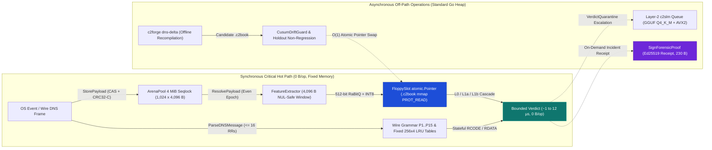
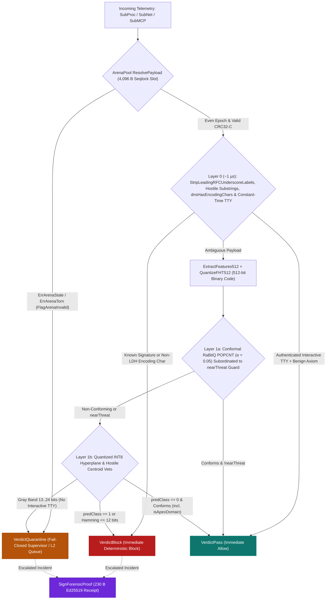

# Why Micro-Optimization is a Fundamental Security Choice: Low-Latency Telemetry Inspection and Remediation Decisions with c2blue55

*Architectural Determinism, Zero-Allocation Hot Paths, Sustained-Load Resilience, and Falsifiable Detection Boundaries in Host and DNS Telemetry*

     

**Navigation:** [Version française](why_micro_optimization_is_a_security_choice.fr.md) · [Word Edition (.docx)](why_micro_optimization_is_a_security_choice.docx) · [Repository Overview](../README.md) · [Centroid Geometry & Formulas](centroid_geometry_and_formulas.md) · [7-Stack DNS Benchmark](dns_detection_solutions_benchmark.md) · [Wittgenstein Architecture Monograph](c2blue55_wittgenstein_article.md)

| Engineering Parameter | Verified Specification |
| :--- | :--- |
| **Version & Date** | `v8.2` — `2026-11-01` (Post-Audit & Sustained-Load Edition) |
| **Execution Target** | `Linux x86_64`, `Go 1.27` portable scalar build + `GOAMD64=v3` / `GOEXPERIMENT=simd` AVX2 vector kernels transpiled mechanically from C99 via `sgoiter` in `c2pkg`, `0% CGo`, `0% GPU` |
| **Memory & State Invariant** | `0 B/op` (`0 allocs/op`) on synchronous hot paths; pre-allocated `ArenaPool` lock-free seqlock ring (`1,024` × `4,096` B = `4 MiB`); read-only `mmap` (`PROT_READ`) `.c2book` binary model images; fixed `256x4` LRU state tables |
| **Action Boundary** | Deterministic `VerdictBlock`, `VerdictQuarantine`, `VerdictPass`, `DecisionEscalateSLM` + `230`-byte Ed25519 `ForensicProof` receipt; OS process termination, `fanotify` denial, or DNS sinkholing executes outside library packages |
| **Adversarial Verification** | `TestMonographTruthfulnessAndDocxParity`, `TestWittgenstein_Evaluation_RealData`, 60 s live UDP bench (`44,997 pkt/s`, `0` drops, `7.39 MiB` MaxRSS) & 7-stack `325.11 MB` (`3,011,298` pkts) capture |

---

## Table of Contents

- [1. The Fallacy of Performance as a Secondary Feature](#1-the-fallacy-of-performance-as-a-secondary-feature)
  - [1.1 Three Operational Failure Modes Under Hostile Traffic](#11-three-operational-failure-modes-under-hostile-traffic)
  - [1.2 Security Purpose and Remediation Enforcement Boundary](#12-security-purpose-and-remediation-enforcement-boundary)
- [2. Micro-Architecture and Runtime Overhead as an Attack Surface](#2-micro-architecture-and-runtime-overhead-as-an-attack-surface)
  - [2.1 The Observer Effect on Shared Production Hosts](#21-the-observer-effect-on-shared-production-hosts)
  - [2.2 Managed Runtime Realities in Go 1.27](#22-managed-runtime-realities-in-go-127)
  - [2.3 Asymmetric Denial-of-Inspection and Bounded Worst-Case Work](#23-asymmetric-denial-of-inspection-and-bounded-worst-case-work)
- [3. Separating the Zero-Allocation Hot Path from Off-Path Subsystems](#3-separating-the-zero-allocation-hot-path-from-off-path-subsystems)
  - [3.1 Synchronous Hot Path (`0 B/op`) vs. Off-Path Allocations](#31-synchronous-hot-path-0-bop-vs-off-path-allocations)
  - [3.2 Lock-Free Payload Passing: The 4 MiB Atomic Seqlock Ring (`ArenaPool`)](#32-lock-free-payload-passing-the-4-mib-atomic-seqlock-ring-arenapool)
  - [3.3 Fail-Closed Quarantine on Contention and Malformed Wire Frames](#33-fail-closed-quarantine-on-contention-and-malformed-wire-frames)
  - [3.4 Immutable Memory-Mapped Knowledge Bases (`.c2book`) and Cryptographic Sealing](#34-immutable-memory-mapped-knowledge-bases-c2book-and-cryptographic-sealing)
- [4. Cost Proportional to Ambiguity: The L0 -> L1a -> L1b Cascade](#4-cost-proportional-to-ambiguity-the-l0---l1a---l1b-cascade)
  - [4.1 Layer 0: Exact Signatures, Structural Reflexes, and RFC Service-Prefix Normalization](#41-layer-0-exact-signatures-structural-reflexes-and-rfc-service-prefix-normalization)
  - [4.2 Layer 1a: NUL-Safe 4,096-Byte Projection and Conformal RaBitQ Binary Search](#42-layer-1a-nul-safe-4096-byte-projection-and-conformal-rabitq-binary-search)
  - [4.3 Layer 1b: Quantized INT8 Linear Heads, Apex Protection, and Measured Latency](#43-layer-1b-quantized-int8-linear-heads-apex-protection-and-measured-latency)
- [5. Offline Baseline Recertification and Anti-Poisoning Guards](#5-offline-baseline-recertification-and-anti-poisoning-guards)
  - [5.1 Read-Only Online Inference vs. Offline Differential Forging](#51-read-only-online-inference-vs-offline-differential-forging)
  - [5.2 Three Fail-Closed Anti-Poisoning Gates](#52-three-fail-closed-anti-poisoning-gates)
- [6. Stand-Alone Forensic Receipts and Bit-Exact Verdict Replay](#6-stand-alone-forensic-receipts-and-bit-exact-verdict-replay)
  - [6.1 Self-Contained 230-Byte Receipt (`ForensicProof`)](#61-self-contained-230-byte-receipt-forensicproof)
  - [6.2 Out-of-Band Ed25519 Signature Discipline](#62-out-of-band-ed25519-signature-discipline)
  - [6.3 Deterministic Verdict Replay (`ReplayForensicProof`)](#63-deterministic-verdict-replay-replayforensicproof)
- [7. Empirical Evaluation on the 4,096-Byte Engine, Caveats, and Trade-Offs](#7-empirical-evaluation-on-the-4096-byte-engine-caveats-and-trade-offs)
  - [7.1 Methodological Caveats: Sample Sizes, Calibration History, and Block vs. Quarantine](#71-methodological-caveats-sample-sizes-calibration-history-and-block-vs-quarantine)
  - [7.2 Benchmark Summary Table (`4,096`-Byte Window)](#72-benchmark-summary-table-4096-byte-window)
  - [7.3 Structural Trade-Offs Behind the Numbers](#73-structural-trade-offs-behind-the-numbers)
- [8. Stateful Wire Grammar, Keyless Encrypted-Transit, Host Ratios, and 60-Second Load Validation (v8.2)](#8-stateful-wire-grammar-keyless-encrypted-transit-host-ratios-and-60-second-load-validation-v82)
  - [8.1 Stateful Clear-DNS Response Grammar (`P14` and `P15`)](#81-stateful-clear-dns-response-grammar-p14-and-p15)
  - [8.2 Keyless Encrypted-Transit Classification and Multipath Host Aggregation (`FinalizeWithHosts`)](#82-keyless-encrypted-transit-classification-and-multipath-host-aggregation-finalizewithhosts)
  - [8.3 Linux Host Process Kinetic Ratios (`part_resolveur_permille`)](#83-linux-host-process-kinetic-ratios-part_resolveur_permille)
  - [8.4 Sustained 60-Second Load Resilience and Honest Failure Boundaries](#84-sustained-60-second-load-resilience-and-honest-failure-boundaries)
- [9. Conclusion: Predictable Systems Engineering and Honest Empirical Scoping](#9-conclusion-predictable-systems-engineering-and-honest-empirical-scoping)

---

## 1. The Fallacy of Performance as a Secondary Feature

In general-purpose software engineering, micro-optimization—eliminating per-request heap allocations, bounding parser loops, and fitting lookup tables inside CPU caches—is routinely treated as an economic refinement deferred until traffic grows. When a web backend spends an extra millisecond per request or allocates a few kilobytes of short-lived objects, adding CPU cores or memory normally absorbs the cost.

In real-time defensive security—inspecting process executions, decoding wire DNS traffic, classifying encrypted DNS-over-QUIC (`DoQ`) or DNS-over-HTTPS (`DoH`) flows without TLS keys, and supervising AI agent tool calls—that assumption fails physically. Unlike a web service processing requests from its own users, a security sensor sits inline with **untrusted, potentially hostile traffic** whose packet rate, frame geometry, and domain cardinality are chosen by an adversary or amplified by legitimate network bursts.

### 1.1 Three Operational Failure Modes Under Hostile Traffic

Performance in a security sensor is a **structural correctness property**. Whenever an inspection pipeline fails to guarantee a bounded microsecond budget (typically `1` to `25` microseconds per event on a single core) and bounded memory growth, three operational failures appear under sustained load:

- **Silent visibility loss (queue saturation):** Kernel socket buffers, packet capture rings, or internal inter-process communication (`IPC`) queues fill up faster than worker threads drain them, forcing either silent packet drops (`fail-open`) or stalls across protected applications (`fail-closed`).
- **Self-inflicted observation jitter:** Garbage collection pauses, lock contention, or disk and `IPC` serialization bursts distort packet inter-arrival timestamps, corrupting timing-based beacon detectors.
- **Asymmetric resource exhaustion (Denial-of-Inspection):** A single `22 MB` or `325 MB` burst of traffic triggers gigabytes of intermediate database or message-broker writes and multi-gigabyte memory footprints, knocking out the monitoring stack on modest hardware.

### 1.2 Security Purpose and Remediation Enforcement Boundary

Micro-optimization never makes a poorly calibrated statistical rule accurate—and Section 8 documents every out-of-distribution false positive and blind spot measured on `c2blue55` itself. Its specific security purpose is narrower and indispensable: **removing runtime resource unpredictability** so that the act of inspecting traffic cannot be turned against the defender.

> [!NOTE]
> **Operational Remediation Boundary:** `CascadeEngine` and `Pipeline` are deterministic decision libraries emitting structured verdicts (`VerdictBlock`, `VerdictQuarantine`, `VerdictPass`, `DecisionEscalateSLM`) and optional `230`-byte Ed25519 `ForensicProof` receipts. Active operating-system enforcement—terminating a process, denying an `execve` system call via Linux `fanotify` in `cmd/c2agent`, or sinkholing a DNS reply inside a resolver—is executed by the surrounding daemon or integration layer outside the library packages.

---

## 2. Micro-Architecture and Runtime Overhead as an Attack Surface

Understanding why low-level engineering choices govern sensor survivability requires examining what happens physically on a modern CPU and operating system when an inspection engine processes tens of thousands of events per second.

### 2.1 The Observer Effect on Shared Production Hosts

Endpoint agents and lightweight network sensors share CPU cores, address-translation buffers, and memory buses with production workloads. A sensor that allocates dynamic objects per packet, chases pointer-heavy syntax trees, or serializes JSON strings between worker processes degrades both its own detection fidelity and the host it protects:

- **CPU Cache Eviction:** Scanning scattered heap objects evicts hot application working sets from Level 1 and Level 2 CPU data caches (`L1D` / `L2`).
- **Virtual-Memory Translation Pressure:** Frequent page-spanning accesses multiply Translation Lookaside Buffer (`TLB`) misses across co-located application threads.
- **Kernel Context-Switch and I/O Amplification:** Passing every parsed flow through inter-process sockets, message brokers (such as Redis pub/sub), or row-by-row SQLite/JSON writes burns more kernel `sys` CPU time and NVMe write bandwidth than the protocol analysis itself.

Keeping hot-path state inside contiguous, pre-sized memory regions ensures that CPU and memory usage stay proportional to wire throughput rather than diverging non-linearly.

### 2.2 Managed Runtime Realities in Go 1.27

`c2blue55` is written in pure Go 1.27 without CGo bindings. Go's concurrent tri-color mark-sweep garbage collector keeps stop-the-world pauses well under a millisecond, so the practical hazard in a high-rate Go sensor is not a multi-second freeze, but **allocation-driven throughput collapse**:

1. **Mutator `mark assist` throttling:** When goroutines allocate heap memory faster than background marking reclaims it, the Go runtime drafts packet-processing goroutines themselves to pause inspection mid-event and scan the heap.
2. **Pointer-scanning overhead:** Large maps containing pointers force the garbage collector to traverse millions of object edges during every collection cycle.
3. **Adversarial slice growth:** Malformed or maximally packed frames that trigger dynamic `append` reallocations or `string` conversions multiply heap churn precisely during an attack.

> [!IMPORTANT]
> **Operational Theorem of Inspection Cost Asymmetry:** When per-packet inspection allocates on the heap or traverses unbounded state, an adversary can amplify the defender's CPU, `mark assist` GC throttling, and IPC load at line rate. Heavyweight sensors subjected to sustained bursts saturate their capture rings and silently drop packets (`fail-open`), turning runtime overhead directly into an evasion primitive. Enforcing **`0 B/op` (`0 allocs/op`)** on synchronous primitives removes `mark assist` stalls while preserving Go's memory safety and bounds checking.

### 2.3 Asymmetric Denial-of-Inspection and Bounded Worst-Case Work

Protocol parsers face a classic cost asymmetry: an attacker can emit compact malformed DNS headers, 100-record sections, or randomized subdomains at line rate, whereas a naive parser allocates per-record objects or runs backtracking regular expressions. Capping inspection windows (`4,096` bytes), DNS resource-record counts per section (`<= 16`), and state tables (fixed `256x4` set-associative caches with Least-Recently-Used `LRU` replacement) guarantees deterministic worst-case work per packet.

---

## 3. Separating the Zero-Allocation Hot Path from Off-Path Subsystems

An engineering review is only credible when it draws an exact boundary between synchronous zero-allocation primitives and off-path components that intentionally use standard heap memory.

### 3.1 Synchronous Hot Path (`0 B/op`) vs. Off-Path Allocations

Every synchronous inline inspection primitive in `c2blue55` runs in **`0 B/op` (`0 allocs/op`)**, enforced by automated `testing.AllocsPerRun` regression tests across both valid and malformed inputs:

- **Vector & Reflex Cascade:** `CascadeEngine.EvaluateEvent` and `ExtractFeatures512` (command line, DNS `QNAME`, and AI agent payload classification).
- **Wire DNS & Stateful Response Grammar:** `ParseDNSMessage`, `Pipeline.ProcessDNS`, `SOANegativeTracker.Observe`, and `RenouvellementRDataTracker.ObserveResponse`.
- **Keyless Encrypted-Transit Accounting:** `EncryptedFlowAggregator.Observe` (`DoQ`, `DoH2`, `DoH3`, and `H3` packet kinematics).

Conversely, three subsystems intentionally allocate on the Go heap **outside** synchronous per-packet evaluation:

1. **Asynchronous Layer-2 Small Language Model Escalation (`c2slm`):** When ambiguous events placed in `Quarantine` are escalated in `cmd/c2agent` to the embedded pure-Go inference engine (`Qwen2.5-0.5B-Instruct` quantized in GGUF `Q4_K_M`), token buffers and activation arenas allocate off-path. Compiling with `GOEXPERIMENT=simd` activates `c2pkg` AVX2 vector kernels (mechanically transpiled from C99 via `sgoiter` and verified bit-for-bit against `gcc -O2`), accelerating those matrix-vector products by `4x` to `5x` over portable scalar Go.
2. **Cold Linux Socket-to-Process Attribution Misses (`internal/cinetique`):** Mapping a network socket `(srcIP, srcPort, dstIP, dstPort, proto)` to its owning Linux process ID via kernel `NETLINK_SOCK_DIAG` (`inet_diag`) allocates during a cold netlink dump, whereas steady-state packets hit a fixed `1,024`-entry (`256x4` set-associative LRU, `2 s` TTL) cache in `0 B/op`.
3. **Offline Model Forging, Batch PCAP Harnesses, and CLI Reporting (`cmd/c2forge`, `RecordSession`):** Training corpus ingestion, Leave-One-Family-Out (`LOFO`) cross-validation, and JSON report writers allocate normally.

### 3.2 Lock-Free Payload Passing: The 4 MiB Atomic Seqlock Ring (`ArenaPool`)

Passing variable-length event payloads (command lines or network frames up to `4,096` bytes, `engine.PageSize = 4096`) between ingestion goroutines and synchronous evaluators normally requires either allocating a `[]byte` slice per event or contending on a shared mutex. Instead, `ArenaPool` pre-allocates a single `4 MiB` (`4,194,304`-byte) contiguous array divided into `1,024` slots of `4,096` bytes protected by a per-slot **sequence lock (`seqlock`)**—a reader-writer synchronization primitive where writers advance an atomic counter to an odd number before writing and to the next even number when finished:

1. **Slot Claim:** A writer reserves the next slot index via lock-free atomic increment (`index & 1023`).
2. **Odd-Epoch Write Lock:** The writer transitions the slot's 64-bit epoch counter to an odd value using Compare-And-Swap (`CAS`), signaling an active write.
3. **Word-Aligned Atomic Copy and Integrity Check:** Up to `4,096` bytes are written in 64-bit atomic words alongside a hardware-accelerated Castagnoli CRC32-C checksum.
4. **Even-Epoch Publish:** `StorePayload` increments the epoch counter to the next even number, publishing the payload.

Readers (`ResolvePayload`) copy the slot without taking any lock and verify that the epoch counter observed before and after reading is identical and even.

### 3.3 Fail-Closed Quarantine on Contention and Malformed Wire Frames

When packet arrival momentarily outpaces consumption and a fast writer wraps all `1,024` slots before a reader finishes copying, a naive ring buffer either reads torn bytes or drops the event silently (`fail-open`). Instead, `ResolvePayload` returns a typed error (`ErrArenaStale` or `ErrArenaTorn`), and `CascadeEngine` immediately sets `FlagArenaInvalid` and routes the event to **`VerdictQuarantine`**.

The exact same fail-closed principle governs wire DNS parsing (`RAT-02a`). Attackers frequently pad DNS messages with `17+` dummy resource records or oversized fields hoping a parser will bail out and default to "benign." Whenever `ParseDNSMessage` rejects a datagram—such as `ErrPacketTooShort`, `ErrRDataTooLong` (`RDLENGTH > 1,536` bytes), or `ErrTooManyRRs` (`> 16` resource records in a section)—both `Pipeline.ProcessDNS` and `RecordSession` increment parse-error counters and return `DecisionEscalateSLM` with `REASON_DNS_PARSE_ERROR` in **`0 B/op`**.

### 3.4 Immutable Memory-Mapped Knowledge Bases (`.c2book`) and Cryptographic Sealing

Instead of deserializing JSON or Python `pickle` models at startup, `c2blue55` compiles its keyword signatures, conformal prototypes, and quantized `INT8` hyperplanes into flat binary files called **`.c2book` floppies** (`C2FLOP1` header). At runtime, `LoadFloppyMmap` maps the file directly into read-only virtual pages (`syscall.Mmap`, `PROT_READ`, `MAP_SHARED`) and swaps active models in $O(1)$ time via an atomic pointer (`FloppySlot` wrapping `atomic.Pointer[FloppyDisk]`):

- **Cryptographic Tamper Resistance:** Each `.c2book` image starts with a `64`-byte `FloppyHeader` (`0..32`: `C2FLOP1\0` magic, format version, family ID, dimension, counts, and `BlockRadius`; `32..64`: 32-byte `Seal`). When sealed (`FloppyFlagSealed`), `LoadFloppyMmap` verifies both a Castagnoli CRC32-C checksum and an **HMAC-SHA256** cryptographic tag (`32..64`) computed over the 32-byte metadata prefix (`0..32`) and full body. Any altered byte (for instance, shrinking `BlockRadius` on disk) fails with `ErrFloppySeal`. Passing a `nil`/empty key for a sealed disk—or passing an HMAC key for an unsealed disk—fails immediately with `ErrFloppyUnsealed`.
- **Actual Repository Wiring:** `LoadFloppyMmap` is exercised by `cmd/c2forge` (`lab-eval`, `dns-delta`) and the benchmark suites (`wittgenstein_bench_test.go`), whereas the standalone daemons (`cmd/c2agent` and `cmd/c2blue-mcp-guard`) instantiate modular `Codebook`, `GrayZoneDecider`, and `ServerOracle` structures directly in memory.
- **Reproducible Demo Keys vs. Strict Production Mode:** So external auditors can run benchmarks immediately after cloning, `WittgensteinFloppyKey` logs an explicit warning and falls back to public demonstration keys when `C2BLUE_HMAC_KEY_*` environment variables are unset. Setting `C2BLUE_REQUIRE_SECURE_KEYS=1` (or `C2BLUE_PRODUCTION=1`) disables fallback (`nil`) and forces `decodeFloppy` to reject any unsealed `.c2book` image (`ErrFloppyUnsealed`), closing header-bit stripping attacks.

---

## 4. Cost Proportional to Ambiguity: The L0 -> L1a -> L1b Cascade

Running neural or dense floating-point inference on every `ls` command or `www.example.com` lookup wastes CPU cycles. `c2blue55` organizes inline classification as a three-stage filter over the full **`4,096`-byte NUL-safe payload window**, spending `~1` microsecond on clear-cut cases and `~7` to `12` microseconds on ambiguous ones.

### 4.1 Layer 0: Exact Signatures, Structural Reflexes, and RFC Service-Prefix Normalization

Layer 0 settles unambiguous patterns and operating-system provenance checks in `~1` microsecond (`0 B/op`):

- **Case-insensitive substring scan** (`containsSubsliceFold`) against compiled hostile command and domain signatures.
- **Structural command and DNS reflexes:** `netcatWithExec` catches flag-reordered `nc`/`ncat` shell bindings (`-e`, `-c`), while `dnsHasEncodingChars` blocks non-LDH Base64 symbols (`+`, `/`, `=`) embedded in DNS query names.
- **Zero-allocation RFC service-prefix stripping (`StripLeadingRFCUnderscoreLabels`):** Enterprise protocols such as Active Directory (`_ldap._tcp.dc._msdcs`), SIP (`_sip._tls`), TLS DANE, and DMARC legitimately prepend underscore service labels to DNS queries. Naive entropy and consonant-ratio detectors misread those underscore prefixes as tunnel encoding, causing `50/50` false positives on benign `SRV` traffic. `StripLeadingRFCUnderscoreLabels` (`internal/engine/dns_agent.go`) strips **up to two leading allowed RFC underscore labels** in `0 B/op` before subdomain feature extraction, eliminating **`50/50 -> 0/50`** benign `SRV` false positives on `benign-rrtypes-clear.pcap` while still blocking covert tunnels hidden behind service prefixes (`349/366` blocked on `vaydns-srv-clear.pcap`, including `_sip._tls.<payload>`).
- **Constant-time OS provenance axioms** (`EvaluateOntology`) verifying authenticated interactive terminal sessions without branching leaks.

### 4.2 Layer 1a: NUL-Safe 4,096-Byte Projection and Conformal RaBitQ Binary Search

Payloads not settled by Layer 0 enter `ExtractFeatures512`, which computes character n-grams, length distributions, and byte-entropy summaries across all `4,096` bytes without stopping at embedded `0x00` (`NUL`) bytes—defeating null-padding evasion and replacing an early 96-byte prototype cap.

To compare those 512 features in nanoseconds without heap allocations, `QuantizeFHT512` applies a **Fast Hadamard Transform (`FHT`)** followed by **1-bit RaBitQ quantization**, compressing the 512-float vector into a **512-bit binary signature** (eight `uint64` words). Distance to calibrated benign traffic (at conformal significance level $\alpha = 0.05$) reduces to hardware `POPCNT` instructions (population count of `XOR`ed 64-bit registers). Crucially, Layer 1a enforces a **subordination guard**: whenever the sample also falls within the calibrated Hamming `BlockRadius` of any hostile centroid (`nearThreat`), Layer 1a is forbidden from issuing a benign pass and must escalate to Layer 1b.

### 4.3 Layer 1b: Quantized INT8 Linear Heads, Apex Protection, and Measured Latency

Layer 1b combines a quantized 8-bit integer (`INT8`) linear classifier with hostile centroid veto radii (`R_block <= 12` bits) and places borderline samples (Hamming distance `13..24` bits without authenticated interactive `TTY` provenance) into `VerdictQuarantine`. For bare second-level registrable domains (`isApexDomain`, e.g., `sickbeard.com` with no subdomain), pure centroid veto blocking is relaxed only when the `INT8` head positively certifies benign conformity (`predClass == 0 && conforms`).

Measured on an **Intel Core i9-14900K** (Linux 6.14, Go 1.27, `4,096`-byte window, `BenchmarkWittgenstein_*`):

| Benchmark Operation (`wittgenstein_bench_test.go`) | Latency (`GOEXPERIMENT=simd`) | Latency (Portable Scalar Go 1.27) | Unpinned / Reference Ceiling | Heap Allocations |
| :--- | :---: | :---: | :---: | :---: |
| **L0 Reflex Substring Filter** | **0.97 µs/op** (~1.03M ops/s) | 0.93 µs/op (~1.08M ops/s) | 1.12 µs/op (~895k ops/s) | **0 B/op (0 allocs)** |
| **Complete Cascade (Benign Command -> L1a)** | **6.68 µs/op** (~150k ops/s) | 7.21 µs/op (~139k ops/s) | 8.63 µs/op (~116k ops/s) | **0 B/op (0 allocs)** |
| **Complete Cascade (DNS Query -> L1a)** | **9.61 µs/op** (~104k ops/s) | 10.29 µs/op (~97k ops/s) | 11.68 µs/op (~86k ops/s) | **0 B/op (0 allocs)** |
| **Complete Cascade (Extended Arena Payload -> L1b)** | **11.94 µs/op** (~84k ops/s) | 12.24 µs/op (~82k ops/s) | 16.32 µs/op (~61k ops/s) | **0 B/op (0 allocs)** |

On the 512-bit cascade stages invoking `FHT512 + RaBitQ`, `GOEXPERIMENT=simd` trims mean latency by `6.6%` to `7.4%` (`7.21 -> 6.68 µs` and `10.29 -> 9.61 µs`, `+2.5%` on the extended `L1b` payload path `12.24 -> 11.94 µs`, and `-4.3%` on `L0`-only `0.93 -> 0.97 µs` where no `FHT512` vector kernel runs) over portable scalar Go 1.27 (which already emits hardware `POPCNT` under `GOAMD64=v3`), while delivering a `4x` to `5x` speedup on off-path `c2slm` GGUF matrix products. Lower-clocked server CPUs typically measure `1.5x` to `2x` higher (`~15` to `20 µs` mean), well inside a `25 µs` synchronous budget.

---

## 5. Offline Baseline Recertification and Anti-Poisoning Guards

Detectors that continuously adapt their centroids online in production can be slowly poisoned by an attacker ("boiling-frog" drift) or corrupted by degenerate numerical inputs.

### 5.1 Read-Only Online Inference vs. Offline Differential Forging

`c2blue55` enforces a strict architectural separation between online telemetry evaluation and baseline adaptation so adversarial traffic can never steer active decision boundaries in flight.

> [!NOTE]
> **Offline Recertification Boundary:** The online inspection engine mounts `.c2book` floppies in read-only virtual memory (`PROT_READ`) and never mutates centroids on the synchronous path. `CusumDriftGuard` (`internal/engine/drift_guard.go`) and `ValidateAgainstHoldoutSet` execute strictly offline inside `cmd/c2forge` during model forging and `dns-delta` differential recompilation before an atomic pointer swap.

### 5.2 Three Fail-Closed Anti-Poisoning Gates

Every candidate `.c2book` update must clear three fail-closed verification gates before emission:

1. **`NaN` / `±Inf` Rejection (`ErrDriftGuardNaN`):** `CusumDriftGuard` inspects every coordinate of a candidate centroid prior to distance math and aborts immediately on non-finite floats without touching active state.
2. **Per-Step and Cumulative CUSUM Bounds:** Finite updates must simultaneously satisfy single-step Euclidean movement ($d = \|\mu_t - \mu_{t-1}\|_2 \le \text{MaxRadius}$), cumulative drift budget (`MaxDriftBudget`), and Page's cumulative sum statistic $S_t^+ = \max(0, S_{t-1}^+ + (d - \text{slack}))$.
3. **Mandatory Holdout Non-Regression (`ErrHoldoutUnvalidated`):** `ValidateAgainstHoldoutSet` refuses `nil` or empty holdout slices (`ErrHoldoutUnvalidated`) and rejects any candidate floppy whose hostile centroids collide with held-out benign traffic beyond `maxAllowedRegression`; `BuildBaselineFromSilo` likewise aborts with `ErrOracleCorrupt` whenever silo slices fail authentication.

---

## 6. Stand-Alone Forensic Receipts and Bit-Exact Verdict Replay

When an incident responder investigates an alert hours after occurrence, ring buffers have wrapped and ephemeral processes have exited. Rather than adding slow per-packet hash-chain locking ("inline blockchain" anti-patterns), `c2blue55` provides an out-of-band cryptographic receipt primitive.

### 6.1 Self-Contained 230-Byte Receipt (`ForensicProof`)

When invoked on demand for an escalated event (`SignForensicProof`), the engine emits a compact `230`-byte binary receipt containing:

- **Event Timing & Origin:** Nanosecond timestamp, subsystem identifier, and action code.
- **Canonical Header:** The `128`-byte `Probe_event_t` event header.
- **Payload Digest:** The `SHA-256` cryptographic hash of the exact inspected payload bytes.
- **Model Provenance:** The active `.c2book` `FloppyCRC32` identifier at the instant of evaluation.
- **Cascade Verdict:** The 4-field decision tuple (remediation action, decisive stage, Hamming distance, confidence score).

### 6.2 Out-of-Band Ed25519 Signature Discipline

`SignForensicProof` requires a valid Ed25519 private key (rejecting `nil` or malformed keys) and runs strictly out-of-band so public-key cryptography never slows down inline microsecond filtering (`SignForensicProof` is shipped as a verified library API rather than a per-packet loop inside `cmd/c2agent`).

### 6.3 Deterministic Verdict Replay (`ReplayForensicProof`)

Because `ExtractFeatures512`, `QuantizeFHT512`, and `L0` / `L1a` / `L1b` depend exclusively on payload bytes, OS provenance flags, and the immutable `.c2book` image, `ReplayForensicProof` re-evaluates the archived payload long after `ArenaPool` wraparound and verifies bit-for-bit equality across action, stage, Hamming distance, and confidence.

---

## 7. Empirical Evaluation on the 4,096-Byte Engine, Caveats, and Trade-Offs

An early pre-audit draft of this monograph cited `100.00%` hard-block rates derived from an obsolete 96-byte prefix prototype that conflated `Quarantine` with `Block`. Restoring full `4,096`-byte NUL-safe scanning (`AUD-02`) and re-forging all `.c2book` floppies established the exact figures verified automatically by `TestWittgenstein_Evaluation_RealData`.

### 7.1 Methodological Caveats: Sample Sizes, Calibration History, and Block vs. Quarantine

- **Finite Holdout Partitions and Prior Error Analysis:** Partitions of `N=41` reverse shells and `N=42` admin commands carry wide 95% Wilson confidence intervals (`0/42` spans `[0.00%, 8.38%]`). Furthermore, structural refinements (`isApexDomain`, `OntoVerdictAllow` under `TTY`, and `netcatWithExec`) were designed after inspecting failure modes on these sets; they measure **calibrated development performance**, whereas out-of-distribution transfer is tested independently in Section 8.
- **Distinguishing Stateless `Block` from `Quarantine`:** Over `4,096` bytes, `0/41` hostile reverse shells pass (`100.00%` intercepted), split into **`33/41` (`80.49%`) immediate `VerdictBlock`** and **`8/41` (`19.51%`) `VerdictQuarantine`** (routed for L2 `c2slm` or supervisor arbitration).

### 7.2 Benchmark Summary Table (`4,096`-Byte Window)

Verified via `GOEXPERIMENT=simd go test -v -run TestWittgenstein_Evaluation_RealData .`:

| Evaluation Partition | Sample Count (N) | Hard Block Rate [95% CI] | Quarantine Rate [95% CI] | Pass Rate [95% CI] | Stage Breakdown (L0 / L1a / L1b) |
| :--- | :---: | :---: | :---: | :---: | :--- |
| **Reverse Shell Payloads (Holdout)** | 41 | **80.49%** (33/41) [65.99%, 89.77%] | **19.51%** (8/41) [10.23%, 34.01%] | **0.00%** (0/41) [0.00%, 8.57%] | Block 20/0/13; Quar 0/0/8 (100% intercepted) |
| **Parametric Shell Mutations** | 111 | **80.18%** (89/111) [71.81%, 86.53%] | **19.82%** (22/111) [13.47%, 28.19%] | **0.00%** (0/111) [0.00%, 3.35%] | Block 48/0/41; Quar 0/0/22 (100% intercepted) |
| **DNS C2 Tunneling Queries (`validate.csv`)** | 4,000 | **99.35%** (3,974/4,000) [99.05%, 99.56%] | **0.65%** (26/4,000) [0.44%, 0.95%] | **0.00%** (0/4,000) [0.00%, 0.10%] | Block 2,957/0/1,017; Quar 0/0/26 (`tuns.org`) |
| **Benign Domain Baseline (`validate.csv`)** | 1,000 | **0.00%** (0/1,000) [0.00%, 0.38%] | **0.00%** (0/1,000) [0.00%, 0.38%] | **100.00%** (1,000/1,000) [99.62%, 100.00%] | Pass 0 / 856 L1a / 144 L1b |
| **Admin Commands (Raw Headless)** | 42 | **0.00%** (0/42) [0.00%, 8.38%] | **69.05%** (29/42) [53.97%, 80.93%] | **30.95%** (13/42) [19.07%, 46.03%] | Quar 0/0/29; Pass 0/13/0 |
| **Admin Commands (Interactive TTY)** | 42 | **0.00%** (0/42) [0.00%, 8.38%] | **0.00%** (0/42) [0.00%, 8.38%] | **100.00%** (42/42) [91.62%, 100.00%] | Pass 15 L0 / 24 L1a / 3 L1b |
| **Benign Admin Training Set (No Provenance)** | 103 | **0.97%** (1/103) [0.17%, 5.30%] | **66.99%** (69/103) [57.44%, 75.32%] | **32.04%** (33/103) [23.81%, 41.56%] | 1 Hard FP (`Get-Counter`), 69 Quar, 33 Pass |

**Majority-Class Baselines and `ROC AUC` Across Paired Partitions:** Individual rows above report single-class holdout or baseline slices (`ROC AUC = N/A` per isolated single-class row). Evaluated as paired binary classification sets:

- **Paired DNS Validation (`validate.csv`, `N = 5,000`):** `4,000` hostile DNS C2 queries vs. `1,000` benign domains (**majority-class rate `0.8000`**). Strict `VerdictBlock` yields `TP = 3,974/4,000`, `FP = 0/1,000`, `TN = 1,000/1,000`, `FN = 26/4,000` (all `26` quarantined; `TP = 4,000/4,000`, `FN = 0` under `Block + Quarantine` interception) with **`ROC AUC = 1.0000`**.
- **Paired Process Commands (`N = 83`):** `41` hostile reverse shells vs. `42` benign admin commands (**majority-class rate `42/83 = 0.5060`**). Strict `VerdictBlock` yields `TP = 33/41`, `FP = 0/42`, `TN = 42/42` (`13` `Pass` + `29` `Quarantine` headless; `42/42` `Pass` under authenticated `TTY`), `FN = 8/41` (all `8` quarantined), achieving **`ROC AUC = 0.9919`** under `TTY` (`0.9013` raw headless).

### 7.3 Structural Trade-Offs Behind the Numbers

- **DNS Tunneling vs. Single-Label DGA:** Out of `4,000` tunnel queries, Layer 0 blocks `2,957` (`2,000` via `hidemyself.org` + `957` `example.org` via `dnsHasEncodingChars`), while Layer 1b blocks `1,017` and quarantines `26/4,000` (`0.65%`, `tuns.org`). All `1,000` benign domains pass (`856` at L1a, `144` at L1b). Because `isApexDomain` suppresses pure centroid vetoes on bare second-level domains, Domain Generation Algorithms (`DGA`) without subdomains rely entirely on dedicated `INT8` DGA heads.
- **Headless Admin Quarantine Friction (`69.05%`):** Without OS session metadata, complex `kubectl`, `docker`, and shell pipelines overlap in n-gram space with Living-Off-The-Land (`LOLBAS`) recon commands, quarantining `29/42` (`69.05%`) evaluation commands and `69/103` (`66.99%`) training commands (plus `1/103` = `0.97%` hard block on `Get-Counter`). Unattended `cron` and `systemd` workloads therefore require L2 `c2slm` arbitration or explicit service-unit policies.
- **Interactive TTY Exemption Window:** When `DeriveCascadeContext` attests an interactive login terminal (`HasTTY && LoginSession && EUID == UID` and no `memfd`, `deleted`, `W+X`, or `/tmp` flags), `OntoVerdictAllow` suppresses the `13..24` quarantine band (`42/42` = `100.00%` admin pass). Because `deriveCascadeOntoKey` maps non-temporary `SubProc` paths (`/home/...`, `/opt/`) to `TgtBinSystem`, an attacker operating inside a stolen interactive SSH session evades the `13..24` quarantine band unless caught by L0, `R_block <= 12`, or `predClass == 1`.

---

## 8. Stateful Wire Grammar, Keyless Encrypted-Transit, Host Ratios, and 60-Second Load Validation (v8.2)

Inspecting individual DNS query names in isolation misses three modern evasion classes: tunnels that pack large payloads into fewer than 100 **server responses** (`VayDNS`, `NoizDNS`, `Soar`), tunnels wrapped inside encrypted `DoQ` (`UDP/853`) or `DoH3` (`UDP/443`) sessions (`Slipstream`, `dnstt`), and multi-domain traffic bursts. Version `v8.2` addresses these in `0 B/op` and subjects the resulting stack to a 60-second sustained-load benchmark alongside six reference open-source stacks.

### 8.1 Stateful Clear-DNS Response Grammar (`P14` and `P15`)

- **Smuggled Payloads Inside Negative `NXDOMAIN` Replies (`REASON_P14_NXDOMAIN_ANSWER_PAYLOAD`):** In standard DNS resolution, when a server returns `NXDOMAIN` (`RCODE=3`, "this domain does not exist"), its `Answer` section is empty—or, at most, contains `CNAME` (`5`), `DNAME` (`39`), or DNSSEC `RRSIG` (`46`) alias records leading to the non-existent target (RFC 1035 / RFC 2308 / RFC 4035 / RFC 6672). The `Soar` tunnel abuses this grammar by setting `RCODE=3` while stuffing C2 data into `TXT` records inside `Answer`, slipping past both Zeek (`0` `weird.log` entries) and authority-only `SOA` trackers. `c2blue55` reconstructs the full 12-bit extended RCODE (`Header RCODE | (EDNS0 ExtRCODE << 4)`—so EDNS0 `BADMODE=19`, whose lower 4 bits `19 & 0x0f == 3` would otherwise collide with `NXDOMAIN=3`, and `BADVERS=16`, whose lower 4 bits `16 & 0x0f == 0` would collide with `NOERROR=0`, are both decoded unambiguously) and flags true `ExtRCODE == 3` carrying any non-`{CNAME, DNAME, RRSIG}` non-empty `Answer` record, catching **`40/40` (`100%`, `ROC AUC = 1.0000`)** `Soar` replies on the first downlink frame with **`0/200`** false positives on signed alias chains and EDNS0 extended-RCODE packets.
- **Order-Independent RRset Renewal Tracking (`REASON_P15_RDATA_RENEWAL`):** Tunnels over `SRV`, `TXT`, `MX`, `NS`, or `CAA` records (`VayDNS`) return a brand-new encrypted `RDATA` payload on nearly every `NOERROR` response under the same domain, whereas legitimate mail, SIP, or certificate authorities return a stable set of records (often shuffled in round-robin order). `RenouvellementRDataTracker.ObserveResponse` (`internal/engine/renouvellement_rdata.go`) maintains a fixed `256x4` set-associative LRU table (`0 B/op`) with a 16-slot ring over a `600 s` (`10`-minute) window per `(clientPrefix, apex, qtype)`. For each response, it decompresses RFC 1035 names, ignores `RRSIG` signatures, hashes each unique Answer record via `FNV-1a` + `SplitMix64`, and combines them via **commutative modular `uint64` addition (`+`)** so round-robin record permutation yields the exact same digest. Once `>= 8` replies arrive with `>= 750` permille (`75.0%`) distinct RRset digests and mean `RDLength >= 128` bytes, `P15` fires—catching **`99/99`** `VayDNS` `CAA` tunnel flows (`vaydns-caa-unbound-clear.pcap`) and firing on the 8th reply of `vaydns-mx-clear.pcap` with **`0/200`** benign false positives.

### 8.2 Keyless Encrypted-Transit Classification and Multipath Host Aggregation (`FinalizeWithHosts`)

Without TLS private keys, network sensors cannot read encrypted `DoQ` or `DoH2`/`DoH3` payloads. However, protocol physics still separates four traffic regimes—`R0a` (short recursive DNS lookups), `R0b` (asymmetric bulk web downloads), `R1a` (sustained bidirectional C2 tunnels), and `R1b` (periodic beacons)—via a 9-dimensional `KineticVector` centered on bidirectional volume persistence $\log_2(1 + \min(V_\uparrow, V_\downarrow)/4096)$.

When `Slipstream` splits a `32 KiB` transfer across $K=2$ independent `DoQ` resolvers (`slipstream-2doq-multipath-transit.pcap`), each individual flow's persistence drops from `4.32` (`R1a`) to `4.08` and `3.51` (`R0a`, below the `4.30` threshold). To defeat `1/K` multipath dilution without corrupting single-flow metrics, `FinalizeWithHosts` (`encrypted_wire_hote.go`, enabled via `c2forge encrypted-eval -hote -doh-ports`) groups concurrent resolver conversations active within `10 s` by normalized client host (`NormalizeHostClientKey`: IPv4 `/32` or IPv6 `/64` prefix to resist RFC 8981 temporary address rotation) and re-evaluates aggregate $\sum_r V_{\uparrow,r}$ and $\sum_r V_{\downarrow,r}$ (`pers = 4.77 -> R1a`, synchrony `833` permille), while guarding primary+secondary resolver failover (`0/11` benign false positives).

### 8.3 Linux Host Process Kinetic Ratios (`part_resolveur_permille`)

When an attacker hides a `32 KiB` `DoH3` tunnel (`21,683` B = `21.7 kB` net QUIC uplink) inside the **exact same QUIC connection** as `3,291,563` B (`3.29 MB` / `3.14 MiB` QUIC downlink; `3.35 MB` / `3.20 MiB` total wire bytes) of legitimate HTTP/3 downloads (`doh3-shared-conn-vaydns-transit` on `:9444`), bulk download asymmetry (`AsymetrieDescendanteLog2 = 6.45`, `PersistanceBidirectionnelle = 5.25`) classifies the wire flow as `R0b`. On the `:9444` shared-origin pair (`N = 2`: `1` hostile + `1` benign `doh3-shared-web-only.pcap`, majority-class rate `0.5000`), `c2blue55`'s keyless flow classifier scores **`TP = 0/1, FP = 0/1, TN = 1/1, FN = 1/1` (`ROC AUC = 0.5000`; `ROC AUC = 0.4545` across `N = 12` against the `11` `L1 + L1-bis` benign controls, `Maj. = 0.9167`)**.

On Linux endpoints, `internal/cinetique` addresses standalone C2 processes without kernel modules or hardware performance counters by extending `QuotientsEpisode` to **12 fixed-point process ratios** (`0 B/op` steady state):

- **Resolver Confinement (`part_resolveur_permille`, index 10):** Using a `1,024`-entry (`256x4` LRU) socket cache ahead of `NETLINK_INET_DIAG`, `internal/cinetique` measures the fraction (in permille, i.e., parts per thousand) of a process's network bytes exchanged with DNS/DoQ/DoH resolvers once total network volume reaches **`16,384` bytes (`16 KiB`)**. A web browser resolves names and then opens connections to content servers (`ConnexionsHorsResolveur > 0`); a standalone C2 binary speaks *only* to resolvers. `ConfinementResolveur` triggers when `part_resolveur_permille >= 500` permille (`>= 50%`), `ConnexionsHorsResolveur == 0`, **and** `!EcouteDNSClairLocale` (exempting local forwarders like `unbound`, `dnsmasq`, and `systemd-resolved` that listen on local `:53`). Note the residual boundary: if a covert tunnel runs *inside* an active web browser process (malicious extension or injected tab with `ConnexionsHorsResolveur > 0`), `ConfinementResolveur` remains `false`.
- **Descriptive Network Absorption (`absorption_reseau_permille`, index 11):** Tracks $1000 \times (\Delta\text{BlockBytesWritten} + \Delta\text{RSS}_+) / \Delta\text{IngressBytes}$ above `1 MiB` ingress, masked as purely descriptive (`MasqueQuotientsDescriptifs`) so legitimate file downloaders never trigger anomaly z-scores.

### 8.4 Sustained 60-Second Load Resilience and Honest Failure Boundaries

To verify that `0 B/op` micro-optimization translates into real operational stability—and to expose failure modes hidden by short single-zone lab PCAPs—`c2blue55` `v8.2` (`GOEXPERIMENT=simd`, Intel Core i9-14900K) was benchmarked both on a **60-second live UDP socket** (`2,000 pkt/s` Normal; `44,997 pkt/s` / `2.70M` packets Extreme) and sequentially against six open-source stacks on **66.7 s Normal (`147,020` pkts, `22.15 MB`)** and **67.5 s Extreme (`3,011,298` pkts, `325.11 MB`)** multi-protocol captures mixing real `argencon` Internet DNS traffic, benign `DoQ`/`DoH2`/`DoH3`/`H3`, and live C2 tunnels:

- **Live 60 s UDP Socket (`44,997 pkt/s`):** `c2blue55` processed `2,700,014 / 2,700,014` packets (`0` drops) in `10.24 s` total CPU (`17.07%` of one core; **`3.42 µs/msg`** wall-loop evaluation time, **`3.79 µs/msg`** total process CPU including kernel socket syscalls), **`7.39 MiB` MaxRSS**, and **`0.0 MiB` disk writes**.
- **Offline `325.11 MB` Extreme Replay (`3,011,298` pkts):** `c2blue55` finished in **`13.86 s` (`217,298 pkt/s`, `332.7 MiB` RSS, `0.12 MiB` disk writes)**—ahead of warm `Suricata 8.0.8` (`15.33 s`, `487.0 MiB` RSS, `1,338.2 MiB` logical EVE JSON), `Zeek 9.0.1` (`15.08 s`, `94.2 MiB` RSS, `253.8 MiB` logs), `TShark 4.4.19` (`15.55 s`, `666.7 MiB` RSS), and `RITA v5.1.2 + ClickHouse` (`27.78 s`, `5,134.9 MiB` RSS, `716.7 MiB` disk writes), whereas Python multi-process `Stratosphere Slips v1.1.24` timed out at `240.1 s` on both Normal and Extreme (`635–855 s` CPU, `1,317–5,505 MiB` anonymous/socket RSS, `1,071–1,976 MiB` disk writes due to per-packet Redis/SQLite IPC amplification).

| Capability or OOS / Sustained-Load Scenario | Corpus / Capture Scope | Measured Outcome (`TP, FP, TN, FN`, `maj` & `AUC`) | Hard Limitation / Residual Blind Spot |
| :--- | :---: | :---: | :--- |
| **`REASON_P14_NXDOMAIN_ANSWER_PAYLOAD` (`Soar`)** | 40 `Soar` frames + 200 RFC 2308/4035 benign | **40/40 TP**, **0/200 FP** (`TN=200, FN=0, maj=0.8333, AUC=1.0000`) | Catches `RCODE=3` Answer smuggling only; `NOERROR` tunnels require P15 or L1b |
| **`REASON_P15_RDATA_RENEWAL` + `StripLeadingRFCUnderscoreLabels`** | `SRV` (`416`: 366 tunnel + 50 benign) & `CAA` (`99` tunnel; combined `515`) | `SRV`: **349/366 TP**, **0/50 FP** (`TN=50, FN=17, maj=0.8798, AUC=0.9842`); `CAA`: **99/99 TP** (`combined maj=0.9029, CAA AUC=1.0000`) | Needs `>= 8` replies (`<= 600 s`, mean `>= 128` B) for P15; `< 8`-reply bursts evade P15 |
| **`FinalizeWithHosts` Encrypted Transit (60 s Extreme Load)** | 23 encrypted C2 flows + 36 benign `DoQ`/`DoH`/`H3` | **13/23 TP**, **0/36 FP** (`TN=36, FN=10, maj=0.6102`, **ROC AUC = 1.0000**) | Short 32 KiB bursts under conservative `4.30` persistence threshold suffer FN without host agent |
| **Multi-Domain Streaming Clear-DNS (`BenchObserver` P4)** | `normal-60s` (`267` flows) & `extreme-60s` (`276` flows) | **24/27 & 33/36 TP**, **215..216/240 FP** (`TN=25..24, FN=3, maj=0.8989/0.8696, AUC=0.8947/0.9208`) | `REASON_P4_MULTIPARENT_SHARDING` counts `>= 4` parent apexes with `10..32`-char labels without decay/entropy gate |
| **External Uncalibrated DNS (`netrack/learn`, Apache-2.0)** | `6,119` `iodine` + `8,654` external benign queries (`maj=0.5858`) | Strict `Block`: `TP=6,053/6,119`, **27.6% FP** (`2,385/8,654`, `TN=6,269` incl. `255` Q, `FN=66` incl. `19` Q, `AUC=0.9922`) | Uncalibrated deployment on foreign zones produces **27.6%** (`2,385/8,654` Block; `30.5%` incl. `255` Q) benign FPs without `dns-delta` |
| **Shared-QUIC Cover Traffic (`doh3-shared-conn-vaydns-transit`)** | `32 KiB` `VayDNS` (`21.7 kB` uplink) + `3.29 MB` (`3.14 MiB`) HTTP/3 cover (`:9444`) | Masked as **`R0b`** (`Asymetrie = 6.45`, **TP=0/1, FP=0/1, TN=1/1, FN=1/1**, `maj=0.5000, AUC=0.5000`; `AUC=0.4545` on `N=12`) | `c2blue55`'s unkeyed flow metrics cannot demultiplex streams inside one bulk HTTP/3 connection (`part_resolveur_permille` catches standalone binaries, not in-browser tunnels) |

> [!WARNING]
> **Measured Out-of-Distribution and Sustained-Load Failure Boundaries:** Deploying tournament-calibrated `.c2book` centroids onto foreign DNS zones (`netrack/learn`) without local `c2forge dns-delta` adaptation produces **27.6%** (`2,385/8,654` strict `Block`; `30.5%` including `255` `Quarantine`) benign false positives. On multi-domain `argencon` streaming captures, the un-decayed `REASON_P4_MULTIPARENT_SHARDING` counter triggers **`215..216/240`** benign client false positives. On encrypted wire transit without TLS keys, co-multiplexing a `32 KiB` tunnel inside a `3.29 MB` HTTP/3 download (`doh3-shared-conn-vaydns-transit`) yields **`0/1` wire recall** (`ROC AUC = 0.5000`).

Three concrete engineering lessons emerge from these falsifiable boundaries:

1. **Stateful Multi-Domain Counters Need Entropy Gates and Time Decay:** In single-zone lab tests, `REASON_P4_MULTIPARENT_SHARDING` (`internal/engine/dns_forensic_ttd.go:561-577`) produced `0` false positives. Under 60-second realistic `argencon` multi-domain traffic where each benign client resolves dozens of distinct Internet domains, accumulating `>= 4` parent apexes carrying ordinary `10..32`-character alphanumeric labels without time decay or Shannon-entropy gating triggered `215/240` (Normal) and `216/240` (Extreme) benign client false positives—proving why sustained multi-domain load benches are mandatory alongside unit PCAPs.
2. **Local Zone Calibration (`c2forge dns-delta`) is Required Before Clear-DNS Blocking:** Applying tournament-calibrated `.c2book` centroids uncalibrated to foreign enterprise zones (`netrack/learn`) yields **27.6%** (`2,385/8,654`) benign false positives despite `0.9922` `ROC AUC` on `iodine`.
3. **Wire Kinetics and Host Attribution Are Complementary, Not Substitutes:** Keyless wire aggregation (`FinalizeWithHosts`) achieves **`0/36` FP and `ROC AUC = 1.0000`** under extreme load and defeats `Slipstream` multipath splitting, yet `c2blue55`'s unkeyed flow classifier cannot separate a tunnel multiplexed inside a bulk HTTP/3 connection (`doh3-shared-conn-vaydns-transit`)—requiring Linux endpoint socket attribution (`part_resolveur_permille`) for standalone C2 binaries, while an extension running inside an active browser remains out of scope without TLS inspection.

> [!TIP]
> **Recommended Production Deployment Checklist:** Run `c2forge dns-delta` against local recursive DNS logs prior to enabling clear-DNS blocking; enforce `C2BLUE_REQUIRE_SECURE_KEYS=1` with dedicated `C2BLUE_HMAC_KEY_*` secrets so unsealed `.c2book` images are rejected; build with `GOEXPERIMENT=simd` (`GOAMD64=v3`); and pair `FinalizeWithHosts` (`-hote -doh-ports`) wire aggregation with Linux `part_resolveur_permille` socket attribution and L2 `c2slm` arbitration for headless `cron` / `systemd` workloads.

---

## 9. Conclusion: Predictable Systems Engineering and Honest Empirical Scoping

Micro-optimization in `c2blue55` solves the survivability half of real-time security supervision: keeping `4,096`-byte payload scanning, `.c2book` binary lookups, stateful DNS response grammar checks, and keyless `DoQ`/`DoH` flow aggregation allocation-free (`0 B/op`), bounded within `~1` to `16` microseconds mean microbenchmark latency per event (`0.97` to `16.32 µs/op`), and stable at **`7.39 MiB` RSS (`44,997 pkt/s` live UDP)** and **`217,298 pkt/s` offline replay** without IPC or disk write amplification.

Pairing that systems discipline with transparent reporting—distinguishing `VerdictBlock` (`80.49%` on held-out shells) from `VerdictQuarantine` (`19.51%` on shells; `69.05%` on headless admin commands), enforcing fail-closed wire parsing (`REASON_DNS_PARSE_ERROR`), and publishing exact out-of-distribution failure counts (**27.6%** uncalibrated `netrack` FPs, `215/240` uncalibrated multi-parent `P4` FPs under multi-domain streaming load, and `0/1` wire masking on `doh3-shared-conn-vaydns-transit`)—gives security engineers verifiable guarantees and clear deployment prerequisites rather than black-box claims.

---

**Navigation:** [Back to Top](#why-micro-optimization-is-a-fundamental-security-choice-low-latency-telemetry-inspection-and-remediation-decisions-with-c2blue55) · [Version française](why_micro_optimization_is_a_security_choice.fr.md) · [Word Edition (.docx)](why_micro_optimization_is_a_security_choice.docx) · [Repository Overview](../README.md) · [7-Stack DNS Benchmark](dns_detection_solutions_benchmark.md) · [Wittgenstein Architecture Monograph](c2blue55_wittgenstein_article.md)
